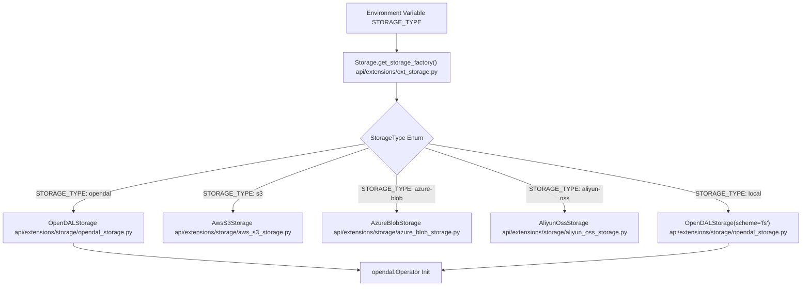
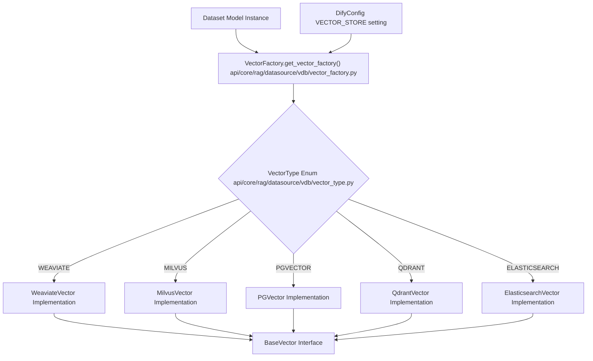

<!-- source: DeepWiki mcp.deepwiki.com · repo langgenius/dify · page 3.3 Storage Backends and Vector Database Configuration · fetched 2026-10-26 -->

# Storage Backends and Vector Database Configuration

Relevant source files

The following files were used as context for generating this wiki page:

- [api/.env.example](api/.env.example)
- [api/configs/feature/__init__.py](api/configs/feature/__init__.py)
- [api/configs/middleware/__init__.py](api/configs/middleware/__init__.py)
- [api/configs/middleware/vdb/milvus_config.py](api/configs/middleware/vdb/milvus_config.py)
- [api/configs/middleware/vdb/weaviate_config.py](api/configs/middleware/vdb/weaviate_config.py)
- [api/configs/packaging/__init__.py](api/configs/packaging/__init__.py)
- [api/core/mcp/auth/auth_flow.py](api/core/mcp/auth/auth_flow.py)
- [api/core/mcp/auth_client.py](api/core/mcp/auth_client.py)
- [api/core/mcp/entities.py](api/core/mcp/entities.py)
- [api/core/mcp/error.py](api/core/mcp/error.py)
- [api/core/mcp/types.py](api/core/mcp/types.py)
- [api/core/rag/datasource/vdb/field.py](api/core/rag/datasource/vdb/field.py)
- [api/core/rag/datasource/vdb/vector_factory.py](api/core/rag/datasource/vdb/vector_factory.py)
- [api/core/rag/datasource/vdb/vector_type.py](api/core/rag/datasource/vdb/vector_type.py)
- [api/core/tools/custom_tool/tool.py](api/core/tools/custom_tool/tool.py)
- [api/core/tools/mcp_tool/tool.py](api/core/tools/mcp_tool/tool.py)
- [api/extensions/ext_app_metrics.py](api/extensions/ext_app_metrics.py)
- [api/extensions/ext_celery.py](api/extensions/ext_celery.py)
- [api/extensions/ext_database.py](api/extensions/ext_database.py)
- [api/extensions/ext_import_modules.py](api/extensions/ext_import_modules.py)
- [api/extensions/ext_sentry.py](api/extensions/ext_sentry.py)
- [api/migrations/README](api/migrations/README)
- [api/providers/vdb/vdb-baidu/src/dify_vdb_baidu/baidu_vector.py](api/providers/vdb/vdb-baidu/src/dify_vdb_baidu/baidu_vector.py)
- [api/providers/vdb/vdb-clickzetta/tests/integration_tests/test_docker_integration.py](api/providers/vdb/vdb-clickzetta/tests/integration_tests/test_docker_integration.py)
- [api/providers/vdb/vdb-lindorm/src/dify_vdb_lindorm/lindorm_vector.py](api/providers/vdb/vdb-lindorm/src/dify_vdb_lindorm/lindorm_vector.py)
- [api/providers/vdb/vdb-milvus/src/dify_vdb_milvus/milvus_vector.py](api/providers/vdb/vdb-milvus/src/dify_vdb_milvus/milvus_vector.py)
- [api/providers/vdb/vdb-milvus/tests/unit_tests/test_milvus.py](api/providers/vdb/vdb-milvus/tests/unit_tests/test_milvus.py)
- [api/providers/vdb/vdb-weaviate/tests/unit_tests/test_weaviate_integration_header.py](api/providers/vdb/vdb-weaviate/tests/unit_tests/test_weaviate_integration_header.py)
- [api/pyproject.toml](api/pyproject.toml)
- [api/schedule/queue_monitor_task.py](api/schedule/queue_monitor_task.py)
- [api/services/knowledge/dataset_read_service.py](api/services/knowledge/dataset_read_service.py)
- [api/tests/integration_tests/.env.example](api/tests/integration_tests/.env.example)
- [api/tests/unit_tests/configs/test_dify_config.py](api/tests/unit_tests/configs/test_dify_config.py)
- [api/tests/unit_tests/core/agent/test_plugin_entities.py](api/tests/unit_tests/core/agent/test_plugin_entities.py)
- [api/tests/unit_tests/core/mcp/auth/test_auth_flow.py](api/tests/unit_tests/core/mcp/auth/test_auth_flow.py)
- [api/tests/unit_tests/core/mcp/client/test_sse.py](api/tests/unit_tests/core/mcp/client/test_sse.py)
- [api/tests/unit_tests/core/mcp/fixtures.py](api/tests/unit_tests/core/mcp/fixtures.py)
- [api/tests/unit_tests/core/mcp/session/test_base_session.py](api/tests/unit_tests/core/mcp/session/test_base_session.py)
- [api/tests/unit_tests/core/mcp/session/test_client_session.py](api/tests/unit_tests/core/mcp/session/test_client_session.py)
- [api/tests/unit_tests/core/mcp/test_auth_client_inheritance.py](api/tests/unit_tests/core/mcp/test_auth_client_inheritance.py)
- [api/tests/unit_tests/core/mcp/test_entities.py](api/tests/unit_tests/core/mcp/test_entities.py)
- [api/tests/unit_tests/core/mcp/test_mcp_client.py](api/tests/unit_tests/core/mcp/test_mcp_client.py)
- [api/tests/unit_tests/core/mcp/test_types.py](api/tests/unit_tests/core/mcp/test_types.py)
- [api/tests/unit_tests/core/rag/datasource/vdb/test_vector_factory.py](api/tests/unit_tests/core/rag/datasource/vdb/test_vector_factory.py)
- [api/tests/unit_tests/extensions/test_celery_ssl.py](api/tests/unit_tests/extensions/test_celery_ssl.py)
- [api/tests/unit_tests/libs/test_email_i18n.py](api/tests/unit_tests/libs/test_email_i18n.py)
- [api/tests/unit_tests/tools/test_api_tool.py](api/tests/unit_tests/tools/test_api_tool.py)
- [api/tests/unit_tests/tools/test_mcp_tool.py](api/tests/unit_tests/tools/test_mcp_tool.py)
- [api/uv.lock](api/uv.lock)
- [docker/.env.example](docker/.env.example)
- [docker/docker-compose-template.yaml](docker/docker-compose-template.yaml)
- [docker/docker-compose.middleware.yaml](docker/docker-compose.middleware.yaml)
- [docker/docker-compose.yaml](docker/docker-compose.yaml)
- [docker/envs/core-services/shared.env.example](docker/envs/core-services/shared.env.example)
- [docker/envs/infrastructure/ssrf-proxy.env.example](docker/envs/infrastructure/ssrf-proxy.env.example)
- [docker/envs/middleware.env.example](docker/envs/middleware.env.example)
- [web/package.json](web/package.json)

## Purpose and Scope

This document details Dify's storage backend configuration for handling user-uploaded files and assets, alongside the vector database configuration layer supporting knowledge base embeddings. It outlines the OpenDAL storage abstraction, cloud provider integration (S3, OSS, Azure, etc.), the 23+ supported vector database implementations, and the factory and configuration patterns used to initialize these subsystems at runtime.

---

## 1. Storage Backend Architecture

### Overview

Dify uses a pluggable storage backend system for storing user-uploaded files, documents, and generated artifacts. The system supports multiple cloud providers and local storage through a unified interface, anchored by Apache OpenDAL as the primary storage abstraction layer.

Sources: [api/configs/middleware/__init__.py:54-84](), [api/.env.example:126-130]()

### Storage Configuration and Types

The storage subsystem supports multiple providers configured via `STORAGE_TYPE` in environment variables or `.env` settings [api/.env.example:128-130](). The valid storage types and their configuration parameters are defined in `StorageConfig` [api/configs/middleware/__init__.py:71-86]():

| STORAGE_TYPE Value | Provider Description | Configuration Class / Mapping |
|-------------------|----------------------|-------------------------------|
| `opendal` | Apache OpenDAL Universal Layer | `OpenDALStorageConfig` [api/configs/middleware/__init__.py:19]() |
| `s3` | Amazon S3 & Compatible Storage | `S3StorageConfig` [api/configs/middleware/__init__.py:12]() |
| `aliyun-oss` | Alibaba Cloud OSS | `AliyunOSSStorageConfig` [api/configs/middleware/__init__.py:11]() |
| `azure-blob` | Azure Blob Storage | `AzureBlobStorageConfig` [api/configs/middleware/__init__.py:13]() |
| `baidu-obs` | Baidu OBS | `BaiduOBSStorageConfig` [api/configs/middleware/__init__.py:14]() |
| `clickzetta-volume` | ClickZetta Volume Storage | `ClickZettaVolumeStorageConfig` [api/configs/middleware/__init__.py:15]() |
| `google-storage` | Google Cloud Storage | `GoogleCloudStorageConfig` [api/configs/middleware/__init__.py:16]() |
| `huawei-obs` | Huawei Cloud OBS | `HuaweiCloudOBSStorageConfig` [api/configs/middleware/__init__.py:17]() |
| `oci-storage` | Oracle Cloud Infrastructure | `OCIStorageConfig` [api/configs/middleware/__init__.py:18]() |
| `tencent-cos` | Tencent Cloud COS | `TencentCloudCOSStorageConfig` [api/configs/middleware/__init__.py:21]() |
| `volcengine-tos` | Volcengine TOS | `VolcengineTOSStorageConfig` [api/configs/middleware/__init__.py:22]() |
| `supabase` | Supabase Storage | `SupabaseStorageConfig` [api/configs/middleware/__init__.py:20]() |
| `local` | Deprecated local filesystem | `StorageConfig.STORAGE_LOCAL_PATH` [api/configs/middleware/__init__.py:80-84]() |

Sources: [api/configs/middleware/__init__.py:11-86](), [api/.env.example:126-173]()

---

## 2. Vector Database Integration Architecture

### Vector Factory and Initialization Flow

Dify integrates with over 23 vector database implementations. Each implementation is declared as a package in the uv workspace and managed via `VectorFactory` [api/pyproject.toml:58-94]().

Sources: [api/pyproject.toml:58-94](), [api/configs/middleware/__init__.py:103-120]()

### Supported Vector Databases

The vector database layer utilizes workspace modules configured under `api/pyproject.toml` [api/pyproject.toml:58-60](). The supported vector stores, along with their Pydantic configuration mappings from `api/configs/middleware/__init__.py`, include:

| Vector Store Identifier | Configuration Class | Module Reference |
|-------------------------|---------------------|------------------|
| `weaviate` | `WeaviateConfig` [api/configs/middleware/__init__.py:52]() | `dify-vdb-weaviate` |
| `qdrant` | `QdrantConfig` [api/configs/middleware/__init__.py:43]() | `dify-vdb-qdrant` |
| `milvus` | `MilvusConfig` [api/configs/middleware/__init__.py:35]() | `dify-vdb-milvus` |
| `pgvector` | `PGVectorConfig` [api/configs/middleware/__init__.py:41]() | `dify-vdb-pgvector` |
| `pgvecto-rs` | `PGVectoRSConfig` [api/configs/middleware/__init__.py:42]() | `dify-vdb-pgvectors` |
| `chroma` | `ChromaConfig` [api/configs/middleware/__init__.py:26]() | `dify-vdb-chroma` |
| `elasticsearch` | `ElasticsearchConfig` [api/configs/middleware/__init__.py:29]() | `dify-vdb-elasticsearch` |
| `opensearch` | `OpenSearchConfig` [api/configs/middleware/__init__.py:39]() | `dify-vdb-opensearch` |
| `tidb` | `TiDBVectorConfig` [api/configs/middleware/__init__.py:48]() | `dify-vdb-tidb-vector` |
| `clickzetta` | `ClickzettaConfig` [api/configs/middleware/__init__.py:27]() | `dify-vdb-clickzetta` |

Sources: [api/pyproject.toml:58-94](), [api/configs/middleware/__init__.py:23-52]()

---

## 3. Configuration and Environment Mapping

All storage and vector store parameters are parsed via Pydantic settings models and populated from environment variables or Docker `.env` files [docker/.env.example:158-182]().

Key configuration options such as `VECTOR_STORE`, `VECTOR_INDEX_NAME_PREFIX`, and storage credentials are validated at startup to ensure service connectivity and correct fallback behavior [api/configs/middleware/__init__.py:103-120]().

Sources: [api/configs/middleware/__init__.py:71-120](), [docker/.env.example:158-182]()

---

