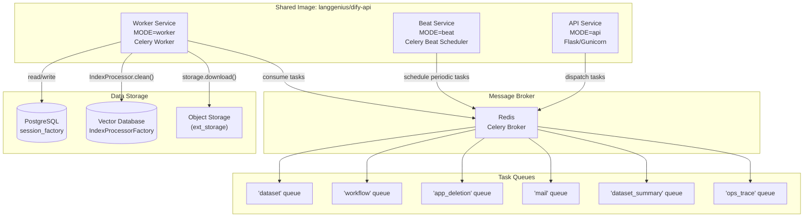
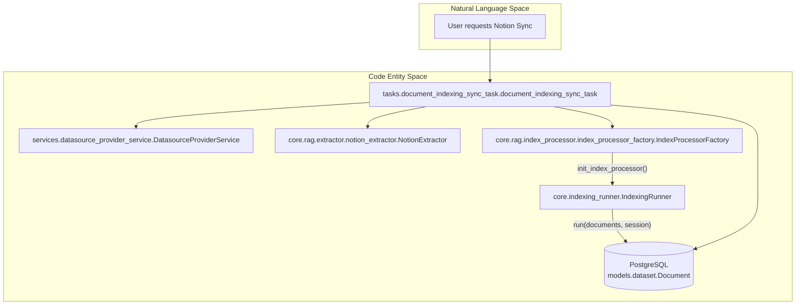
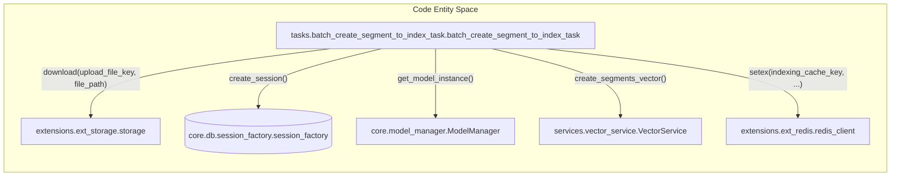
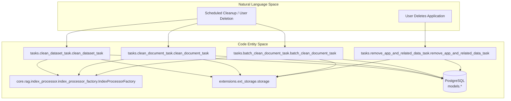

<!-- source: DeepWiki mcp.deepwiki.com · repo langgenius/dify · page 3.4 Background Task Processing with Celery · fetched 2026-10-26 -->

# Background Task Processing with Celery

<details>
<summary>Relevant source files</summary>

The following files were used as context for generating this wiki page:

- [api/.env.example](api/.env.example)
- [api/configs/feature/__init__.py](api/configs/feature/__init__.py)
- [api/configs/middleware/__init__.py](api/configs/middleware/__init__.py)
- [api/configs/middleware/vdb/weaviate_config.py](api/configs/middleware/vdb/weaviate_config.py)
- [api/configs/packaging/__init__.py](api/configs/packaging/__init__.py)
- [api/core/rag/datasource/vdb/vector_factory.py](api/core/rag/datasource/vdb/vector_factory.py)
- [api/core/rag/datasource/vdb/vector_type.py](api/core/rag/datasource/vdb/vector_type.py)
- [api/events/event_handlers/clean_when_dataset_deleted.py](api/events/event_handlers/clean_when_dataset_deleted.py)
- [api/events/event_handlers/clean_when_document_deleted.py](api/events/event_handlers/clean_when_document_deleted.py)
- [api/extensions/ext_app_metrics.py](api/extensions/ext_app_metrics.py)
- [api/extensions/ext_celery.py](api/extensions/ext_celery.py)
- [api/extensions/ext_database.py](api/extensions/ext_database.py)
- [api/extensions/ext_import_modules.py](api/extensions/ext_import_modules.py)
- [api/extensions/ext_sentry.py](api/extensions/ext_sentry.py)
- [api/migrations/README](api/migrations/README)
- [api/providers/vdb/vdb-weaviate/tests/unit_tests/test_weaviate_integration_header.py](api/providers/vdb/vdb-weaviate/tests/unit_tests/test_weaviate_integration_header.py)
- [api/pyproject.toml](api/pyproject.toml)
- [api/schedule/queue_monitor_task.py](api/schedule/queue_monitor_task.py)
- [api/tasks/add_document_to_index_task.py](api/tasks/add_document_to_index_task.py)
- [api/tasks/batch_clean_document_task.py](api/tasks/batch_clean_document_task.py)
- [api/tasks/clean_dataset_task.py](api/tasks/clean_dataset_task.py)
- [api/tasks/clean_document_task.py](api/tasks/clean_document_task.py)
- [api/tasks/create_segment_to_index_task.py](api/tasks/create_segment_to_index_task.py)
- [api/tasks/deal_dataset_vector_index_task.py](api/tasks/deal_dataset_vector_index_task.py)
- [api/tasks/delete_segment_from_index_task.py](api/tasks/delete_segment_from_index_task.py)
- [api/tasks/disable_segment_from_index_task.py](api/tasks/disable_segment_from_index_task.py)
- [api/tasks/disable_segments_from_index_task.py](api/tasks/disable_segments_from_index_task.py)
- [api/tasks/document_indexing_sync_task.py](api/tasks/document_indexing_sync_task.py)
- [api/tasks/enable_segment_to_index_task.py](api/tasks/enable_segment_to_index_task.py)
- [api/tasks/enable_segments_to_index_task.py](api/tasks/enable_segments_to_index_task.py)
- [api/tasks/generate_summary_index_task.py](api/tasks/generate_summary_index_task.py)
- [api/tasks/regenerate_summary_index_task.py](api/tasks/regenerate_summary_index_task.py)
- [api/tasks/remove_document_from_index_task.py](api/tasks/remove_document_from_index_task.py)
- [api/tests/integration_tests/.env.example](api/tests/integration_tests/.env.example)
- [api/tests/unit_tests/configs/test_dify_config.py](api/tests/unit_tests/configs/test_dify_config.py)
- [api/tests/unit_tests/core/rag/datasource/vdb/test_vector_factory.py](api/tests/unit_tests/core/rag/datasource/vdb/test_vector_factory.py)
- [api/tests/unit_tests/extensions/test_celery_ssl.py](api/tests/unit_tests/extensions/test_celery_ssl.py)
- [api/tests/unit_tests/services/retention/workflow_run/test_archive_bundle_index.py](api/tests/unit_tests/services/retention/workflow_run/test_archive_bundle_index.py)
- [api/tests/unit_tests/tasks/test_batch_clean_document_task.py](api/tests/unit_tests/tasks/test_batch_clean_document_task.py)
- [api/tests/unit_tests/tasks/test_clean_dataset_task.py](api/tests/unit_tests/tasks/test_clean_dataset_task.py)
- [api/tests/unit_tests/tasks/test_clean_document_task.py](api/tests/unit_tests/tasks/test_clean_document_task.py)
- [api/tests/unit_tests/tasks/test_community_telemetry_task.py](api/tests/unit_tests/tasks/test_community_telemetry_task.py)
- [api/tests/unit_tests/tasks/test_document_indexing_sync_task.py](api/tests/unit_tests/tasks/test_document_indexing_sync_task.py)
- [api/tests/unit_tests/tasks/test_enable_segment_index_tasks.py](api/tests/unit_tests/tasks/test_enable_segment_index_tasks.py)
- [api/tests/unit_tests/tasks/test_retry_document_indexing_task.py](api/tests/unit_tests/tasks/test_retry_document_indexing_task.py)
- [api/tests/unit_tests/tasks/test_segment_index_cleanup_tasks.py](api/tests/unit_tests/tasks/test_segment_index_cleanup_tasks.py)
- [api/tests/unit_tests/tasks/test_summary_queue_isolation.py](api/tests/unit_tests/tasks/test_summary_queue_isolation.py)
- [api/uv.lock](api/uv.lock)
- [docker/.env.example](docker/.env.example)
- [docker/docker-compose-template.yaml](docker/docker-compose-template.yaml)
- [docker/docker-compose.middleware.yaml](docker/docker-compose.middleware.yaml)
- [docker/docker-compose.yaml](docker/docker-compose.yaml)
- [docker/envs/core-services/shared.env.example](docker/envs/core-services/shared.env.example)
- [docker/envs/infrastructure/ssrf-proxy.env.example](docker/envs/infrastructure/ssrf-proxy.env.example)
- [docker/envs/middleware.env.example](docker/envs/middleware.env.example)
- [web/package.json](web/package.json)

</details>


## Purpose and Scope

This document describes the background task processing infrastructure in Dify, which uses Celery for asynchronous task execution. The system handles long-running operations such as dataset indexing, workflow execution, data cleanup, and resource deletion outside the request-response cycle of the API service.

For information about workflow execution engines, see [5.1](). For document indexing pipeline details, see [4.2]().

---

## Architecture Overview

### Service Topology

Dify's background processing infrastructure consists of three main components that share the same container image (`langgenius/dify-api`) but operate in different modes. The system utilizes Redis as the central message broker to manage task distribution across worker nodes.



Sources: [api/extensions/ext_celery.py:118-135](), [api/tasks/add_document_to_index_task.py:23-23]()

### Mode-Based Service Differentiation

The container entrypoint script differentiates the service role based on the `MODE` environment variable.

| Mode | Service | Purpose | Process Command |
|------|---------|---------|-----------------|
| `api` | API Server | Handle HTTP requests | `gunicorn app:socketio_app` or `python -m app` |
| `worker` | Celery Worker | Execute background tasks | `celery -A celery_entrypoint.celery worker` |
| `beat` | Celery Beat | Schedule periodic tasks | `celery -A app.celery beat` |

Sources: [api/extensions/ext_celery.py:118-166]()

---

## Queue Topology

### Queue Structure and Isolation

Celery workers consume from specialized queues. Task definitions use decorators or routing keys to route tasks to specific hardware or logical isolation groups.

| Queue | Task Types | Key Implementation Files |
|-------|-----------|--------------------------|
| `dataset` | Document processing, indexing, syncing, cleanup | [api/tasks/document_indexing_sync_task.py](), [api/tasks/add_document_to_index_task.py](), [api/tasks/clean_dataset_task.py](), [api/tasks/clean_document_task.py](), [api/tasks/batch_clean_document_task.py]() |
| `dataset_summary` | Generating summaries for document chunks | [api/tasks/generate_summary_index_task.py](), [api/tasks/regenerate_summary_index_task.py]() |
| `workflow` | Workflow execution (Community Edition) | [api/tasks/async_workflow_tasks.py]() |
| `app_deletion` | Deleting applications and related data | [api/tasks/remove_app_and_related_data_task.py]() |

Sources: [api/extensions/ext_celery.py:172-184](), [api/tasks/document_indexing_sync_task.py:21-22](), [api/tasks/clean_dataset_task.py:34-34]()

---

## Worker Configuration

### Worker Process Management

The Celery application is initialized in `api/extensions/ext_celery.py`. It uses a custom `FlaskTask` class to ensure every background task runs within a Flask application context, providing access to database sessions via `app.app_context()` and request logging context initialization.

```python
class FlaskTask(Task):
    def __call__(self, *args: object, **kwargs: object) -> object:
        from core.logging.context import init_request_context

        with app.app_context():
            # Initialize logging context for this task (similar to before_request in Flask)
            init_request_context()
            return self.run(*args, **kwargs)
```

Sources: [api/extensions/ext_celery.py:118-127]()

---

## Broker and Backend Configuration

### Redis Integration

Dify uses Redis as the primary message broker and result backend. The system supports advanced Redis configurations including SSL/TLS and Sentinels.

#### SSL/TLS Support
If `dify_config.BROKER_USE_SSL` is enabled, `get_celery_ssl_options()` maps certificate requirement strings (e.g., `CERT_REQUIRED`) to Python `ssl` constants and applies them to both the broker and the Redis result backend.

Sources: [api/extensions/ext_celery.py:58-86](), [api/extensions/ext_celery.py:154-161]()

#### Sentinel and Namespace Support
When `CELERY_USE_SENTINEL` is true, transport options include `master_name` and `sentinel_kwargs`. Namespace isolation is achieved via `global_keyprefix` using the normalized `REDIS_KEY_PREFIX`.

Sources: [api/extensions/ext_celery.py:89-107](), [api/extensions/ext_celery.py:110-116]()

---

## Task Scheduling with Beat

Celery Beat manages periodic maintenance tasks. The schedule is defined dynamically during initialization based on environment feature flags and configurations in `dify_config`.

### Periodic Task Schedule

| Task Name | Frequency | Purpose |
|-----------|-----------|---------|
| `clean_embedding_cache_task` | Configured interval | Removes old embedding results from cache |
| `clean_unused_datasets_task` | Configured interval | Cleanup of datasets and vector indexes |
| `queue_monitor_task` | Every 5 minutes | Monitors and manages tenant-isolated task queues |
| `community_telemetry.send_heartbeat` | Configured in `beat_schedule` | Sends anonymous usage data for community edition |

Sources: [api/extensions/ext_celery.py:45-55](), [api/schedule/queue_monitor_task.py:13-13]()

---

## Core Background Task Patterns

### 1. Document Indexing and Sync
The indexing pipeline handles asynchronous preparation of documents. Tasks like `document_indexing_sync_task` specifically handle Notion synchronization by comparing `last_edited_time`.



Sources: [api/tasks/document_indexing_sync_task.py:21-115](), [api/tasks/document_indexing_sync_task.py:143-147]()

### 2. Segment Batch Processing
For bulk operations, Dify uses background tasks that process records in batches, leveraging storage download utilities and vector services for embedding insertion.



Sources: [api/tasks/add_document_to_index_task.py:33-45](), [api/tasks/add_document_to_index_task.py:104-106]()

### 3. Resource Cleanup and Deletion
Cleanup tasks implement complex logic to identify datasets and documents for removal, triggering `IndexProcessor.clean()` for vector data and `storage.delete()` for associated files. The application removal task handles comprehensive deletion of all data associated with an application.



Sources: [api/tasks/clean_dataset_task.py:34-34](), [api/tasks/clean_document_task.py:19-19](), [api/tasks/batch_clean_document_task.py:25-25](), [api/tasks/remove_app_and_related_data_task.py:59-59]()

---

## Implementation Details

### Database Session Management
Tasks utilize session factories to ensure clean transaction boundaries in background threads. Many tasks use a multi-phase approach: a short transaction to update status, followed by long-running logic (such as LLM calls or file downloads), and a final transaction to commit results.

Sources: [api/extensions/ext_celery.py:118-127](), [api/tasks/document_indexing_sync_task.py:34-34]()

### Tenant Isolation in Queues
For heavy operations, Dify manages task distribution to prevent a single tenant from monopolizing worker resources, supervised by monitoring tasks such as `queue_monitor_task`.

Sources: [api/schedule/queue_monitor_task.py:13-13]()

---

