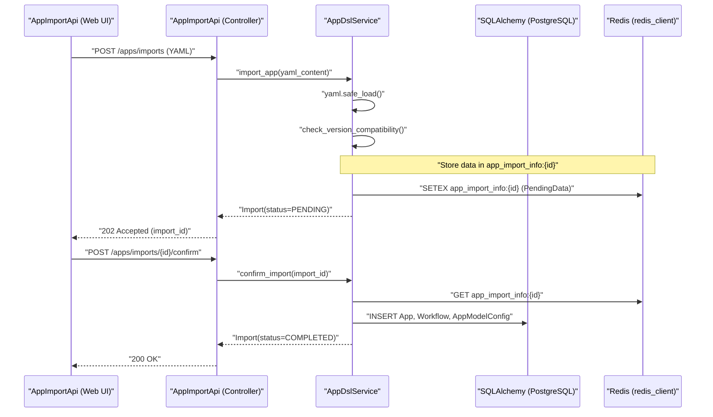
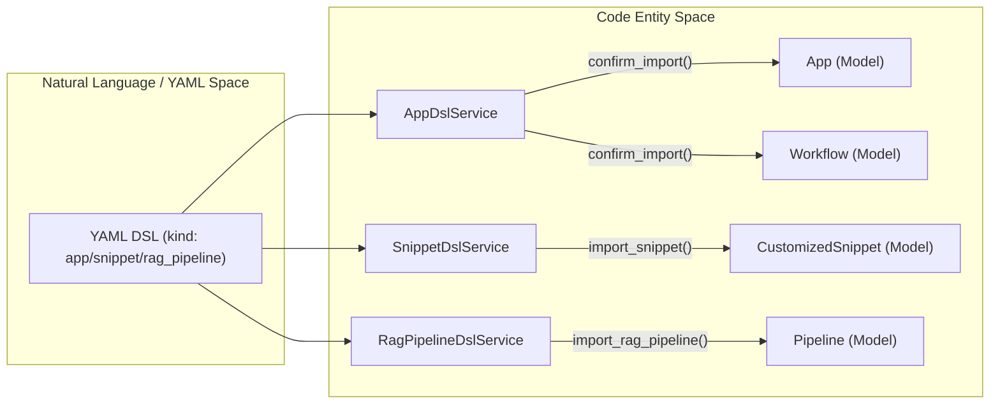

<!-- source: DeepWiki mcp.deepwiki.com · repo langgenius/dify · page 3.5 Cross-Environment Migration and Import/Export Tooling · fetched 2026-10-26 -->

# Cross-Environment Migration and Import/Export Tooling

Relevant source files

The following files were used as context for generating this wiki page:

- [api/controllers/console/app/app_import.py](api/controllers/console/app/app_import.py)
- [api/controllers/console/datasets/rag_pipeline/rag_pipeline_datasets.py](api/controllers/console/datasets/rag_pipeline/rag_pipeline_datasets.py)
- [api/controllers/console/datasets/rag_pipeline/rag_pipeline_import.py](api/controllers/console/datasets/rag_pipeline/rag_pipeline_import.py)
- [api/core/helper/creators.py](api/core/helper/creators.py)
- [api/services/app/console_gateway.py](api/services/app/console_gateway.py)
- [api/services/app/console_service.py](api/services/app/console_service.py)
- [api/services/app/creators_platform_gateway.py](api/services/app/creators_platform_gateway.py)
- [api/services/app_dsl_service.py](api/services/app_dsl_service.py)
- [api/services/enterprise/rbac_service.py](api/services/enterprise/rbac_service.py)
- [api/services/entities/dsl_entities.py](api/services/entities/dsl_entities.py)
- [api/services/knowledge/dataset_service.py](api/services/knowledge/dataset_service.py)
- [api/services/rag_pipeline/rag_pipeline_dsl_service.py](api/services/rag_pipeline/rag_pipeline_dsl_service.py)
- [api/services/snippet_dsl_service.py](api/services/snippet_dsl_service.py)
- [api/tests/test_containers_integration_tests/services/test_app_dsl_service.py](api/tests/test_containers_integration_tests/services/test_app_dsl_service.py)
- [api/tests/unit_tests/controllers/console/app/test_app_import_api.py](api/tests/unit_tests/controllers/console/app/test_app_import_api.py)
- [api/tests/unit_tests/controllers/console/workspace/test_rbac.py](api/tests/unit_tests/controllers/console/workspace/test_rbac.py)
- [api/tests/unit_tests/core/helper/test_creators.py](api/tests/unit_tests/core/helper/test_creators.py)
- [api/tests/unit_tests/services/app/test_console_gateway.py](api/tests/unit_tests/services/app/test_console_gateway.py)
- [api/tests/unit_tests/services/app/test_console_service.py](api/tests/unit_tests/services/app/test_console_service.py)
- [api/tests/unit_tests/services/app/test_creators_platform_gateway.py](api/tests/unit_tests/services/app/test_creators_platform_gateway.py)
- [api/tests/unit_tests/services/enterprise/test_rbac_service.py](api/tests/unit_tests/services/enterprise/test_rbac_service.py)
- [api/tests/unit_tests/services/rag_pipeline/test_rag_pipeline_dsl_service.py](api/tests/unit_tests/services/rag_pipeline/test_rag_pipeline_dsl_service.py)
- [api/tests/unit_tests/services/test_app_dsl_service.py](api/tests/unit_tests/services/test_app_dsl_service.py)
- [api/tests/unit_tests/services/test_snippet_dsl_service.py](api/tests/unit_tests/services/test_snippet_dsl_service.py)

This page explains in technical detail how Dify handles application and workflow DSL (Domain Specific Language) export and import across different environments, focusing on migration wizards, dependency packaging for tools and plugins, and the RAG pipeline transformation logic.

## 1. App and Workflow DSL Export/Import Overview

Dify applications are serialized into a YAML-based DSL that includes the application metadata, model configurations, and the underlying workflow graph.

### Core Service: `AppDslService`
The `AppDslService` is the central authority defined in `api/services/app_dsl_service.py` [api/services/app_dsl_service.py:151-174]() for transforming between database entities and the DSL format.

- **Import Modes**: Supports `yaml-content` (direct string) and `yaml-url` (fetching from remote sources like GitHub) [api/services/app_dsl_service.py:161-174]().
- **Validation**:
    - **Size**: Enforces a `DSL_MAX_SIZE` limit via `dsl_content_size` [api/services/app_dsl_service.py:62-62]().
    - **Version Compatibility**: Uses `check_version_compatibility` to ensure the imported DSL version aligns with `CURRENT_APP_DSL_VERSION` [api/services/app_dsl_service.py:20-20](), [api/services/dsl_version.py:1-20]().
    - **Structure**: Validates the YAML mapping and ensures required top-level structures exist [api/services/app_dsl_service.py:118-131]().

### App Import Flow
The import process utilizes Redis to store `PendingData` for multi-step confirmation [api/services/app_dsl_service.py:92-95](), [api/services/app_dsl_service.py:134-144]().

1. **Initiation**: The `AppImportApi` controller (`api/controllers/console/app/app_import.py`) receives requests [api/controllers/console/app/app_import.py:44-112]() and delegates to `AppDslService.import_app()` [api/services/app_dsl_service.py:158-174]().
2. **Dependency Check**: Before persistence, the system analyzes required plugins and tools using `DependenciesAnalysisService` [api/services/app_dsl_service.py:86-86]().
3. **Persistence**: The service creates the `App` model and associated `Workflow` or `AppModelConfig` records, and initializes RBAC creator access via `try_sync_creator_access_policy_member_bindings` [api/services/app_dsl_service.py:98-115](), [api/services/enterprise/rbac_service.py:90-105]().

Sources: [api/services/app_dsl_service.py:1-174](), [api/controllers/console/app/app_import.py:44-112](), [api/services/enterprise/rbac_service.py:90-105]()

---

## 2. RAG Pipeline Transformation and Migration

Dify allows for migrating standard Datasets into advanced RAG Pipelines, which use a graph-based workflow for ingestion and retrieval.

### RAG Pipeline DSL Service
The `RagPipelineDslService` (`api/services/rag_pipeline/rag_pipeline_dsl_service.py`) provides specialized import/export logic for RAG pipelines scoped to the `rag_pipeline` kind [api/services/rag_pipeline/rag_pipeline_dsl_service.py:87-97]().

- **Import Logic**: Implements `import_rag_pipeline()` which handles `YAML_URL` and `YAML_CONTENT` modes [api/services/rag_pipeline/rag_pipeline_dsl_service.py:98-111]().
- **Version Control**: Defines `CURRENT_DSL_VERSION` as `"0.1.0"` for pipelines [api/services/rag_pipeline/rag_pipeline_dsl_service.py:61-61]().
- **Dataset Integration**: Allows binding imported pipelines to existing or newly created `Dataset` models [api/controllers/console/datasets/rag_pipeline/rag_pipeline_import.py:96-124]().

Sources: [api/services/rag_pipeline/rag_pipeline_dsl_service.py:87-111](), [api/controllers/console/datasets/rag_pipeline/rag_pipeline_import.py:96-124]()

---

## 3. Dependency Packaging and Tool Migration

When moving apps across environments, the system must ensure that the target environment has the necessary tools and plugins.

### Dependency Analysis
The `DependenciesAnalysisService` scans the workflow graph for nodes that rely on external providers.
- **Model Dependencies**: `AppDslService._extract_dependencies_from_workflow` extracts provider requirements from LLM nodes, including those using `LLMEnvironmentVariable` [api/tests/unit_tests/services/test_app_dsl_service.py:118-153]().
- **Tool and Trigger Dependencies**: Detects `ToolNodeData`, trigger plugin nodes, and datasource nodes [api/tests/unit_tests/services/test_app_dsl_service.py:95-116]().

Sources: [api/services/app_dsl_service.py:86-86](), [api/tests/unit_tests/services/test_app_dsl_service.py:95-153]()

---

## 4. Snippet DSL Persistence

Dify supports importing and exporting code snippets as DSL to facilitate reuse across different workflows and environments via `SnippetDslService` [api/services/snippet_dsl_service.py:1-190]().

- **Kind Validation**: Strictly enforces `kind: snippet` in the YAML metadata [api/services/snippet_dsl_service.py:1-190]().
- **Confirmation Flow**: Uses Redis-backed structures to allow users to review snippet dependencies before final creation [api/services/snippet_dsl_service.py:1-190]().

Sources: [api/services/snippet_dsl_service.py:1-190]()

---

## 5. Import/Export Data Flow

The following diagram illustrates the interaction between controllers and services during a DSL import.

Sources: [api/controllers/console/app/app_import.py:44-129](), [api/services/app_dsl_service.py:92-95]()

---

## 6. System Architecture: Conversion Entity Mapping

The architecture bridges the gap between YAML DSL content and internal SQLAlchemy models.

Sources: [api/services/app_dsl_service.py:151-174](), [api/services/snippet_dsl_service.py:1-190](), [api/services/rag_pipeline/rag_pipeline_dsl_service.py:87-97]()

---

## 7. Summary of Key Components

| Class | Responsibility | File Reference |
| :--- | :--- | :--- |
| `AppDslService` | Logic for app YAML serialization/deserialization and version checking. | [api/services/app_dsl_service.py:151-174]() |
| `RagPipelineDslService` | Specialized logic for RAG pipeline DSL import/export. | [api/services/rag_pipeline/rag_pipeline_dsl_service.py:87-97]() |
| `SnippetDslService` | Logic for code snippet YAML import and validation. | [api/services/snippet_dsl_service.py:1-190]() |
| `DependenciesAnalysisService` | Analyzes DSL content to identify required model and tool providers. | [api/services/plugin/dependencies_analysis.py:1-50]() |

Sources: [api/services/app_dsl_service.py:151-174](), [api/services/rag_pipeline/rag_pipeline_dsl_service.py:87-97](), [api/services/snippet_dsl_service.py:1-190]()

---

