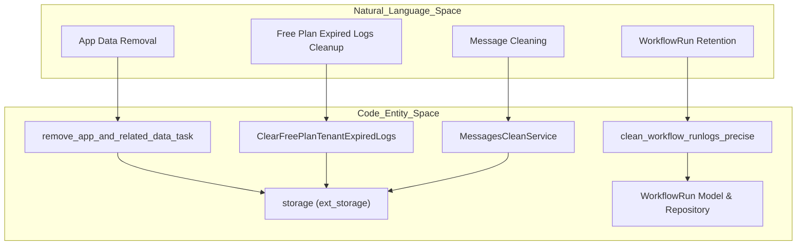
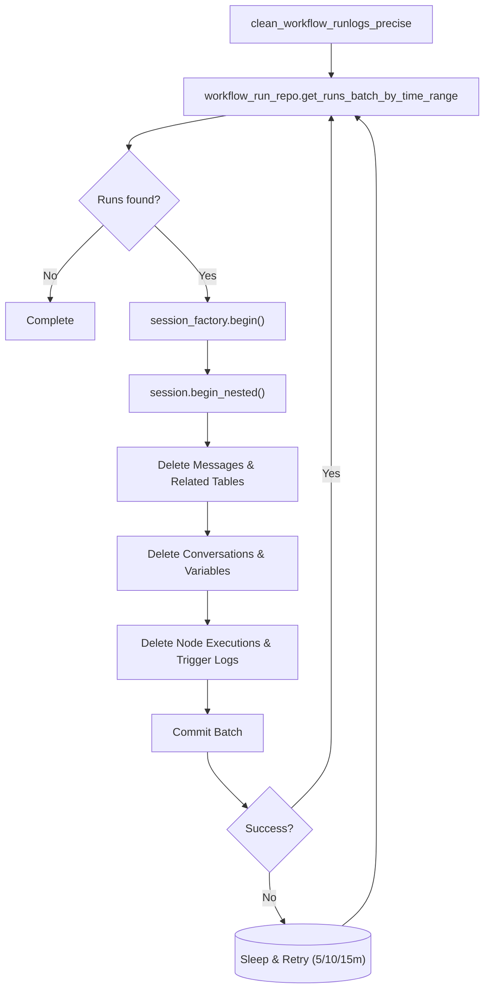

<!-- source: DeepWiki mcp.deepwiki.com · repo langgenius/dify · page 3.6 Data Retention, Cleanup and Log Archival · fetched 2026-10-26 -->

# Data Retention, Cleanup and Log Archival

<details>
<summary>Relevant source files</summary>

The following files were used as context for generating this wiki page:

- [api/controllers/console/datasets/hit_testing_base.py](api/controllers/console/datasets/hit_testing_base.py)
- [api/controllers/service_api/dataset/hit_testing.py](api/controllers/service_api/dataset/hit_testing.py)
- [api/libs/passport.py](api/libs/passport.py)
- [api/repositories/api_workflow_run_repository.py](api/repositories/api_workflow_run_repository.py)
- [api/repositories/sqlalchemy_api_workflow_run_repository.py](api/repositories/sqlalchemy_api_workflow_run_repository.py)
- [api/schedule/clean_workflow_runlogs_precise.py](api/schedule/clean_workflow_runlogs_precise.py)
- [api/services/clear_free_plan_tenant_expired_logs.py](api/services/clear_free_plan_tenant_expired_logs.py)
- [api/services/retention/conversation/messages_clean_service.py](api/services/retention/conversation/messages_clean_service.py)
- [api/services/retention/workflow_run/clear_free_plan_expired_workflow_run_logs.py](api/services/retention/workflow_run/clear_free_plan_expired_workflow_run_logs.py)
- [api/services/retention/workflow_run/delete_archived_workflow_run.py](api/services/retention/workflow_run/delete_archived_workflow_run.py)
- [api/tests/test_containers_integration_tests/repositories/test_sqlalchemy_api_workflow_run_repository.py](api/tests/test_containers_integration_tests/repositories/test_sqlalchemy_api_workflow_run_repository.py)
- [api/tests/test_containers_integration_tests/repositories/test_sqlalchemy_workflow_run_cleanup_repository.py](api/tests/test_containers_integration_tests/repositories/test_sqlalchemy_workflow_run_cleanup_repository.py)
- [api/tests/unit_tests/commands/test_clean_expired_messages.py](api/tests/unit_tests/commands/test_clean_expired_messages.py)
- [api/tests/unit_tests/controllers/console/datasets/test_hit_testing.py](api/tests/unit_tests/controllers/console/datasets/test_hit_testing.py)
- [api/tests/unit_tests/controllers/console/datasets/test_hit_testing_base.py](api/tests/unit_tests/controllers/console/datasets/test_hit_testing_base.py)
- [api/tests/unit_tests/controllers/service_api/dataset/test_hit_testing.py](api/tests/unit_tests/controllers/service_api/dataset/test_hit_testing.py)
- [api/tests/unit_tests/enums/test_quota_type.py](api/tests/unit_tests/enums/test_quota_type.py)
- [api/tests/unit_tests/libs/test_passport.py](api/tests/unit_tests/libs/test_passport.py)
- [api/tests/unit_tests/repositories/test_sqlalchemy_api_workflow_run_repository.py](api/tests/unit_tests/repositories/test_sqlalchemy_api_workflow_run_repository.py)
- [api/tests/unit_tests/schedule/test_clean_workflow_runlogs_precise.py](api/tests/unit_tests/schedule/test_clean_workflow_runlogs_precise.py)
- [api/tests/unit_tests/services/retention/workflow_run/test_clear_free_plan_expired_workflow_run_logs.py](api/tests/unit_tests/services/retention/workflow_run/test_clear_free_plan_expired_workflow_run_logs.py)
- [api/tests/unit_tests/services/test_clear_free_plan_expired_workflow_run_logs.py](api/tests/unit_tests/services/test_clear_free_plan_expired_workflow_run_logs.py)
- [api/tests/unit_tests/services/test_clear_free_plan_tenant_expired_logs.py](api/tests/unit_tests/services/test_clear_free_plan_tenant_expired_logs.py)
- [api/tests/unit_tests/services/test_messages_clean_service.py](api/tests/unit_tests/services/test_messages_clean_service.py)
- [api/tests/unit_tests/utils/encryption/test_system_encryption.py](api/tests/unit_tests/utils/encryption/test_system_encryption.py)

</details>


This page documents the comprehensive data retention, cleanup, and log archival mechanisms implemented in Dify. It covers the services responsible for managing the lifecycle and retention of conversation and workflow run data, cleanup of expired logs especially for free-plan tenants, precise workflow runlog cleanup via Celery schedules, message cleaning policies, and archival/restore workflows. Emphasis is placed on technical implementation, data flows, key service classes and functions, and their orchestration in the background task system.

Sources: `api/services/clear_free_plan_tenant_expired_logs.py:1-176`, `api/schedule/clean_workflow_runlogs_precise.py:1-170`, `api/repositories/api_workflow_run_repository.py:69-83`

---

## Overview and Purpose

Dify maintains retention and cleanup workflows to manage storage costs, enforce data lifecycle policies, and enable regulatory and privacy compliance. These tasks include:
- Periodic deletion of stale conversations and workflow runs beyond retention periods using cursor-based pagination and time-range filters.
- Cleanup of expired logs specifically for free-plan (sandbox) tenants with backup serialization to object storage.
- Deep cleaning of messages and their closely related records using customizable policies (`MessagesCleanPolicy`).
- Precise workflow run log cleanup via Celery scheduled tasks (`clean_workflow_runlogs_precise`) with complete message cascades and retry mechanisms.
- Archival and restore paths for workflow run logs in cloud deployments when configured.
- App removal handling including related data and offloaded artifacts.

The retention and cleanup services work efficiently with batch operations, database transactions, and Celery tasks for asynchronous execution.

Sources: `api/services/clear_free_plan_tenant_expired_logs.py:37-126`, `api/schedule/clean_workflow_runlogs_precise.py:43-105`, `api/services/retention/conversation/messages_clean_service.py:168-185`

---

## Main Components and Data Flow

The cleanup and retention features are driven by key modules and services:
1. **App Data Removal Task**: `remove_app_and_related_data_task` removes an entire app's related data from the database and storage.
2. **Precise Workflow Run Cleanup**: `clean_workflow_runlogs_precise` (`api/schedule/clean_workflow_runlogs_precise.py:43-105`) handles time-range-based workflow run log pruning with nested transactions and batch retries.
3. **Free-Plan Expired Logs Cleanup Service**: `ClearFreePlanTenantExpiredLogs` (`api/services/clear_free_plan_tenant_expired_logs.py:37-484`) targets sandbox tenants, backing up expired messages/conversations to object storage before deletion.
4. **Message Cleaning Service**: `MessagesCleanService` (`api/services/retention/conversation/messages_clean_service.py:168-575`) executes retention policies on messages and related message tables.


Sources: `api/tasks/remove_app_and_related_data_task.py:1-103`, `api/schedule/clean_workflow_runlogs_precise.py:43-105`, `api/services/clear_free_plan_tenant_expired_logs.py:37-176`, `api/services/retention/conversation/messages_clean_service.py:168-185`

---

## 1. Precise Workflow Run Log Cleanup

### 1.1 Task: `clean_workflow_runlogs_precise`

- Defined as a Celery task queue-bound to `"retention"` (`api/schedule/clean_workflow_runlogs_precise.py:43-44`).
- Calculates the cutoff date using `dify_config.WORKFLOW_LOG_RETENTION_DAYS` (`api/schedule/clean_workflow_runlogs_precise.py:50-51`).
- Utilizes `APIWorkflowRunRepository` via `DifyAPIRepositoryFactory.create_api_workflow_run_repository(...)` (`api/schedule/clean_workflow_runlogs_precise.py:52-53`).
- Iteratively fetches batches of expired runs using cursor-based timestamps (`api/schedule/clean_workflow_runlogs_precise.py:62-69`).
- Executes deletions within a nested transaction (`session.begin_nested()`) handling cascades for `Message`, `ConversationVariable`, `Conversation`, node executions, and workflow trigger logs (`api/schedule/clean_workflow_runlogs_precise.py:107-165`).
- Implements an incremental retry mechanism (5, 10, 15 minutes delay) up to `MAX_RETRIES = 3` upon failure (`api/schedule/clean_workflow_runlogs_precise.py:32,86-93`).

Sources: `api/schedule/clean_workflow_runlogs_precise.py:32-105`

### 1.2 Repository Support: `DifyAPISQLAlchemyWorkflowRunRepository`

- Implements `APIWorkflowRunRepository` protocol (`api/repositories/sqlalchemy_api_workflow_run_repository.py:180-193`).
- Provides optimized batch queries such as `get_runs_batch_by_time_range` and lightweight cleanup references (`WorkflowRunCleanupRef`) to avoid unnecessary model hydration (`api/repositories/api_workflow_run_repository.py:69-83`).

Sources: `api/repositories/sqlalchemy_api_workflow_run_repository.py:1-193`, `api/repositories/api_workflow_run_repository.py:69-83`


Sources: `api/schedule/clean_workflow_runlogs_precise.py:43-165`

---

## 2. Free-Plan Expired Logs Cleanup Service

### Service: `ClearFreePlanTenantExpiredLogs`

- Scans tenants on free/sandbox plans for expired messages and conversations (`api/services/clear_free_plan_tenant_expired_logs.py:37-176`).
- Serializes records to JSON and backs them up to object storage (`storage.save`) under `free_plan_tenant_expired_logs/{tenant_id}/...` (`api/services/clear_free_plan_tenant_expired_logs.py:101-108,145-154`).
- Cleans up message-related tables (`MessageFeedback`, `MessageFile`, `MessageAnnotation`, `MessageChain`, `MessageAgentThought`, `AppAnnotationHitHistory`, `SavedMessage`) in batches (`api/services/clear_free_plan_tenant_expired_logs.py:68-125`).

Sources: `api/services/clear_free_plan_tenant_expired_logs.py:37-176`

---

## 3. Message Cleaning Service

### Service: `MessagesCleanService`

- Implements message retention enforcement (`MessagesCleanService`) driven by `MessagesCleanPolicy` (`api/services/retention/conversation/messages_clean_service.py:168-185`).
- Supports time window filters (`start_from`, `end_before`) and dry-run execution modes.
- Records low-cardinality OpenTelemetry metrics via `MessagesCleanupMetrics` (counters and histograms tracking scanned, filtered, and deleted messages) (`api/services/retention/conversation/messages_clean_service.py:40-160`).

Sources: `api/services/retention/conversation/messages_clean_service.py:40-185`

---

## 4. Summary of Files and Key Classes/Functions

| File Path | Key Components | Description |
|---|---|---|
| `api/schedule/clean_workflow_runlogs_precise.py` | `clean_workflow_runlogs_precise` | Celery task for precise workflow run log cleanup with batch retries and cascades. |
| `api/repositories/sqlalchemy_api_workflow_run_repository.py` | `DifyAPISQLAlchemyWorkflowRunRepository` | SQLAlchemy 2.0 repository implementing service-layer workflow run operations. |
| `api/services/clear_free_plan_tenant_expired_logs.py` | `ClearFreePlanTenantExpiredLogs` | Service for backing up and cleaning free-plan tenant expired logs. |
| `api/services/retention/conversation/messages_clean_service.py` | `MessagesCleanService`, `MessagesCleanupMetrics` | Message cleanup policy engine with telemetry instrumentation. |

Sources: `api/schedule/clean_workflow_runlogs_precise.py:1-170`, `api/repositories/sqlalchemy_api_workflow_run_repository.py:1-193`, `api/services/clear_free_plan_tenant_expired_logs.py:1-176`, `api/services/retention/conversation/messages_clean_service.py:1-185`

---

## 5. Mermaid Diagrams Connecting Natural Language Concepts to Code Entities

### Diagram 1: Workflow Run Cleanup Architecture Mapping

```mermaid
flowchart LR
    "Scheduled Workflow Run Cleanup" -->|Triggered by| "clean_workflow_runlogs_precise (api/schedule/clean_workflow_runlogs_precise.py)"
    "Workflow Run Repository Query" -->|Handled by| "DifyAPISQLAlchemyWorkflowRunRepository (api/repositories/sqlalchemy_api_workflow_run_repository.py)"
    "Lightweight Run Filtering" -->|Uses DTO| "WorkflowRunCleanupRef (api/repositories/api_workflow_run_repository.py)"
    "Trigger Log Deletion" -->|Uses Repo| "SQLAlchemyWorkflowTriggerLogRepository (api/repositories/sqlalchemy_workflow_trigger_log_repository.py)"
```
Sources: `api/schedule/clean_workflow_runlogs_precise.py:43-165`, `api/repositories/sqlalchemy_api_workflow_run_repository.py:180-193`, `api/repositories/api_workflow_run_repository.py:69-83`

---

