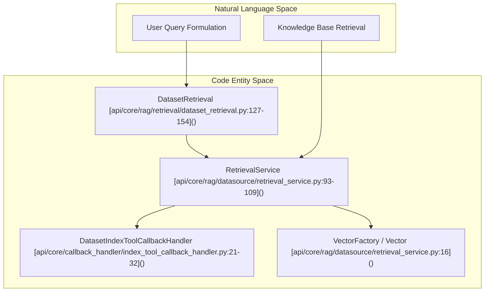
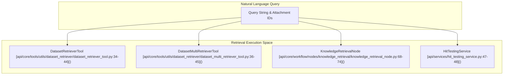

<!-- source: DeepWiki mcp.deepwiki.com · repo langgenius/dify · page 4 Knowledge Base and RAG System · fetched 2026-10-26 -->

# Knowledge Base and RAG System

Relevant source files

The following files were used as context for generating this wiki page:

- [api/core/app/apps/agent_chat/app_runner.py](api/core/app/apps/agent_chat/app_runner.py)
- [api/core/app/apps/base_app_runner.py](api/core/app/apps/base_app_runner.py)
- [api/core/app/apps/chat/app_runner.py](api/core/app/apps/chat/app_runner.py)
- [api/core/app/apps/completion/app_runner.py](api/core/app/apps/completion/app_runner.py)
- [api/core/callback_handler/index_tool_callback_handler.py](api/core/callback_handler/index_tool_callback_handler.py)
- [api/core/plugin/backwards_invocation/app.py](api/core/plugin/backwards_invocation/app.py)
- [api/core/rag/datasource/retrieval_service.py](api/core/rag/datasource/retrieval_service.py)
- [api/core/rag/retrieval/dataset_retrieval.py](api/core/rag/retrieval/dataset_retrieval.py)
- [api/core/tools/utils/dataset_retriever/dataset_multi_retriever_tool.py](api/core/tools/utils/dataset_retriever/dataset_multi_retriever_tool.py)
- [api/core/tools/utils/dataset_retriever/dataset_retriever_tool.py](api/core/tools/utils/dataset_retriever/dataset_retriever_tool.py)
- [api/core/workflow/nodes/knowledge_retrieval/knowledge_retrieval_node.py](api/core/workflow/nodes/knowledge_retrieval/knowledge_retrieval_node.py)
- [api/services/hit_testing_service.py](api/services/hit_testing_service.py)
- [api/tests/unit_tests/core/app/apps/chat/test_base_app_runner_multimodal.py](api/tests/unit_tests/core/app/apps/chat/test_base_app_runner_multimodal.py)
- [api/tests/unit_tests/core/callback_handler/test_index_tool_callback_handler.py](api/tests/unit_tests/core/callback_handler/test_index_tool_callback_handler.py)
- [api/tests/unit_tests/core/plugin/test_backwards_invocation_app.py](api/tests/unit_tests/core/plugin/test_backwards_invocation_app.py)
- [api/tests/unit_tests/core/rag/datasource/test_datasource_retrieval.py](api/tests/unit_tests/core/rag/datasource/test_datasource_retrieval.py)
- [api/tests/unit_tests/core/rag/retrieval/test_dataset_retrieval.py](api/tests/unit_tests/core/rag/retrieval/test_dataset_retrieval.py)
- [api/tests/unit_tests/core/rag/retrieval/test_dataset_retrieval_methods.py](api/tests/unit_tests/core/rag/retrieval/test_dataset_retrieval_methods.py)
- [api/tests/unit_tests/core/tools/utils/test_misc_utils_extra.py](api/tests/unit_tests/core/tools/utils/test_misc_utils_extra.py)
- [api/tests/unit_tests/extensions/otel/test_retrieval_tracing.py](api/tests/unit_tests/extensions/otel/test_retrieval_tracing.py)

This document describes the Knowledge Base and Retrieval-Augmented Generation (RAG) system in Dify, designed to enable semantic search and retrieval over large collections of documents. The system covers the complete lifecycle from document ingestion, processing, indexing, vectorization, storage, and semantic retrieval integrated with generative workflows. It is a core technology enabling AI knowledge augmentation in applications powered by Dify.

For detailed subsystem information, related child pages cover dataset and document management, indexing pipelines, retrieval strategies, vector database integration, external knowledge bases, summary index generation, RAG pipeline workflows, and the new KnowledgeFS frontend UI.

---

## System Overview and Component Interactions

The Knowledge Base and RAG system manages knowledge content organized hierarchically as `Dataset` models containing `Document` records, each decomposed into `DocumentSegment` entries and optionally `ChildChunk` entities [api/core/rag/datasource/retrieval_service.py:29-35](). Documents can be ingested from multiple sources and segmented for indexing.

*Figure: Bridging Natural Language Retrieval to Code Entities (`DatasetRetrieval`, `RetrievalService`, `DatasetIndexToolCallbackHandler`).*

**Sources:**  
- Dataset and Segment models [api/core/rag/datasource/retrieval_service.py:29-35]()  
- DatasetRetrieval class [api/core/rag/retrieval/dataset_retrieval.py:127-154]()  
- RetrievalService class [api/core/rag/datasource/retrieval_service.py:93-109]()  

---

## Dataset Service and Document Management

Datasets and documents provide the administrative boundary for Dify knowledge bases. The backend handles dataset creation, CRUD operations on documents, file uploads, permissions, and metadata configurations.

For details, see [Dataset Service and Document Management](#4.1).

**Sources:** [api/services/dataset_service.py:1-178]()

---

## Document Indexing Pipeline

Raw documents undergo an Extract-Transform-Load (ETL) process managed by the indexing pipeline. Content is extracted from sources (files, Notion, web), transformed using specialized index processors into paragraph, hierarchical parent-child, or QA chunks, and loaded into vector or keyword storage.

For details, see [Document Indexing Pipeline](#4.2).

**Sources:** [api/core/indexing_runner.py:50-128]()

---

## Retrieval Strategies and Metadata Filtering

The retrieval layer supports semantic vector search, keyword search, hybrid fusion, reranking models, and manual or automated metadata-based filtering. 

*Figure: Code Entity Space for Retrieval Tools and Nodes (`DatasetRetrieverTool`, `DatasetMultiRetrieverTool`, `KnowledgeRetrievalNode`, `HitTestingService`).*

For details, see [Retrieval Strategies and Metadata Filtering](#4.3).

**Sources:** [api/core/rag/datasource/retrieval_service.py:93-109](), [api/core/tools/utils/dataset_retriever/dataset_retriever_tool.py:34-44](), [api/core/workflow/nodes/knowledge_retrieval/knowledge_retrieval_node.py:68-74]()

---

## Vector Database Integration Architecture

Dify provides an abstraction layer over 23+ vector databases via `VectorFactory` and concrete `BaseVector` implementations under `api/providers/vdb`, enabling configuration-driven vector storage selection.

For details, see [Vector Database Integration Architecture](#4.4).

**Sources:** [api/core/rag/datasource/vdb/vector_factory.py:29-159]()

---

## External Knowledge Base Integration

External datasets connect to third-party knowledge providers through HTTP APIs rather than internal storage. The `ExternalDatasetService` manages authentication, payload mapping, and external retrieval calls.

For details, see [External Knowledge Base Integration](#4.5).

**Sources:** [api/services/external_knowledge_service.py:1-163](), [api/core/rag/datasource/retrieval_service.py:176-194]()

---

## Summary Index Generation

Datasets can optionally generate condensed summary embeddings for document segments to accelerate context retrieval. Summary tasks run asynchronously using dedicated Celery background queues.

For details, see [Summary Index Generation](#4.6).

**Sources:** [api/services/summary_index_service.py:1-10]()

---

## RAG Pipeline Workflow

The RAG pipeline is exposed as a standalone workflow type. It uses a workflow DSL service and transform pipelines to execute multi-step retrieval operations as background tasks.

For details, see [RAG Pipeline Workflow](#4.7).

**Sources:** [api/services/rag_pipeline/rag_pipeline.py:10-100]()

---

## KnowledgeFS Frontend (New RAG UI)

The frontend under `web/features/new-rag` delivers a KnowledgeFS-backed user interface for knowledge lists, dataset creation wizards, document management, chunk inspection, and real-time processing task tracking.

For details, see [KnowledgeFS Frontend (New RAG UI)](#4.8).

**Sources:** `web/features/new-rag` module structure.

---

## Summary

The Dify Knowledge Base and RAG system provides a modular, high-performance architecture for document processing, multi-strategy retrieval, and generative workflow integration. 

For deep technical details, refer to the child pages:
- [Dataset Service and Document Management](#4.1)
- [Document Indexing Pipeline](#4.2)
- [Retrieval Strategies and Metadata Filtering](#4.3)
- [Vector Database Integration Architecture](#4.4)
- [External Knowledge Base Integration](#4.5)
- [Summary Index Generation](#4.6)
- [RAG Pipeline Workflow](#4.7)
- [KnowledgeFS Frontend (New RAG UI)](#4.8)

**Sources:**  
- api/services/dataset_service.py (lines 1-178)  
- api/core/rag/datasource/retrieval_service.py (lines 93-109)  
- api/core/rag/retrieval/dataset_retrieval.py (lines 127-154)  
- api/core/tools/utils/dataset_retriever/dataset_retriever_tool.py (lines 34-44)  
- api/core/workflow/nodes/knowledge_retrieval/knowledge_retrieval_node.py (lines 68-74)

---

