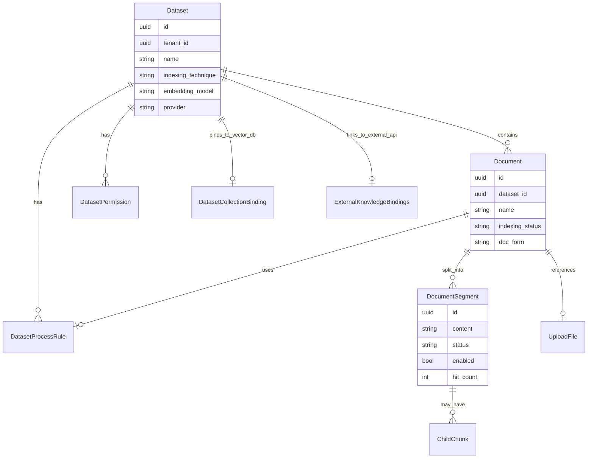
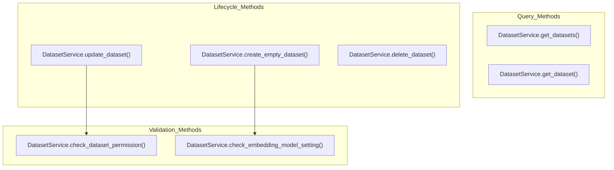
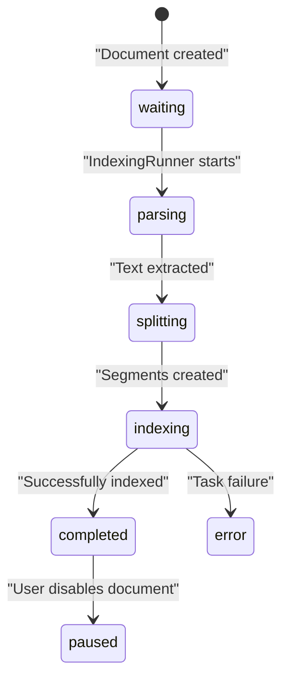
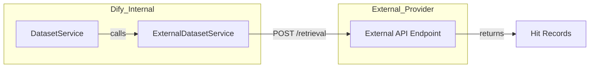

<!-- source: DeepWiki mcp.deepwiki.com · repo langgenius/dify · page 4.1 Dataset Service and Document Management · fetched 2026-10-26 -->

# Dataset Service and Document Management

Relevant source files

The following files were used as context for generating this wiki page:

- [api/controllers/console/datasets/data_source.py](api/controllers/console/datasets/data_source.py)
- [api/controllers/console/datasets/datasets.py](api/controllers/console/datasets/datasets.py)
- [api/controllers/console/datasets/datasets_document.py](api/controllers/console/datasets/datasets_document.py)
- [api/controllers/console/datasets/datasets_segments.py](api/controllers/console/datasets/datasets_segments.py)
- [api/controllers/console/datasets/external.py](api/controllers/console/datasets/external.py)
- [api/controllers/console/datasets/metadata.py](api/controllers/console/datasets/metadata.py)
- [api/controllers/console/tag/tags.py](api/controllers/console/tag/tags.py)
- [api/controllers/service_api/dataset/dataset.py](api/controllers/service_api/dataset/dataset.py)
- [api/controllers/service_api/dataset/document.py](api/controllers/service_api/dataset/document.py)
- [api/controllers/service_api/dataset/metadata.py](api/controllers/service_api/dataset/metadata.py)
- [api/controllers/service_api/dataset/segment.py](api/controllers/service_api/dataset/segment.py)
- [api/services/tag_service.py](api/services/tag_service.py)
- [api/tests/test_containers_integration_tests/controllers/service_api/__init__.py](api/tests/test_containers_integration_tests/controllers/service_api/__init__.py)
- [api/tests/test_containers_integration_tests/controllers/service_api/dataset/__init__.py](api/tests/test_containers_integration_tests/controllers/service_api/dataset/__init__.py)
- [api/tests/test_containers_integration_tests/controllers/service_api/dataset/test_dataset.py](api/tests/test_containers_integration_tests/controllers/service_api/dataset/test_dataset.py)
- [api/tests/test_containers_integration_tests/services/test_dataset_service_document.py](api/tests/test_containers_integration_tests/services/test_dataset_service_document.py)
- [api/tests/test_containers_integration_tests/services/test_hit_testing_service.py](api/tests/test_containers_integration_tests/services/test_hit_testing_service.py)
- [api/tests/test_containers_integration_tests/services/test_tag_service.py](api/tests/test_containers_integration_tests/services/test_tag_service.py)
- [api/tests/unit_tests/controllers/console/datasets/rag_pipeline/test_rag_pipeline_import.py](api/tests/unit_tests/controllers/console/datasets/rag_pipeline/test_rag_pipeline_import.py)
- [api/tests/unit_tests/controllers/console/datasets/test_datasets.py](api/tests/unit_tests/controllers/console/datasets/test_datasets.py)
- [api/tests/unit_tests/controllers/console/datasets/test_datasets_document.py](api/tests/unit_tests/controllers/console/datasets/test_datasets_document.py)
- [api/tests/unit_tests/controllers/console/datasets/test_datasets_segments.py](api/tests/unit_tests/controllers/console/datasets/test_datasets_segments.py)
- [api/tests/unit_tests/controllers/console/datasets/test_external.py](api/tests/unit_tests/controllers/console/datasets/test_external.py)
- [api/tests/unit_tests/controllers/console/datasets/test_metadata.py](api/tests/unit_tests/controllers/console/datasets/test_metadata.py)
- [api/tests/unit_tests/controllers/console/tag/test_tags.py](api/tests/unit_tests/controllers/console/tag/test_tags.py)
- [api/tests/unit_tests/controllers/service_api/dataset/test_dataset_apis.py](api/tests/unit_tests/controllers/service_api/dataset/test_dataset_apis.py)
- [api/tests/unit_tests/controllers/service_api/dataset/test_dataset_payloads.py](api/tests/unit_tests/controllers/service_api/dataset/test_dataset_payloads.py)
- [api/tests/unit_tests/controllers/service_api/dataset/test_dataset_segment.py](api/tests/unit_tests/controllers/service_api/dataset/test_dataset_segment.py)
- [api/tests/unit_tests/controllers/service_api/dataset/test_dataset_tag_apis.py](api/tests/unit_tests/controllers/service_api/dataset/test_dataset_tag_apis.py)
- [api/tests/unit_tests/controllers/service_api/dataset/test_document.py](api/tests/unit_tests/controllers/service_api/dataset/test_document.py)
- [api/tests/unit_tests/controllers/service_api/dataset/test_metadata.py](api/tests/unit_tests/controllers/service_api/dataset/test_metadata.py)
- [api/tests/unit_tests/services/dataset_service_test_helpers.py](api/tests/unit_tests/services/dataset_service_test_helpers.py)
- [api/tests/unit_tests/services/hit_service.py](api/tests/unit_tests/services/hit_service.py)
- [api/tests/unit_tests/services/test_dataset_service_dataset.py](api/tests/unit_tests/services/test_dataset_service_dataset.py)
- [api/tests/unit_tests/services/test_dataset_service_document.py](api/tests/unit_tests/services/test_dataset_service_document.py)
- [api/tests/unit_tests/services/test_dataset_service_segment.py](api/tests/unit_tests/services/test_dataset_service_segment.py)
- [api/tests/unit_tests/services/test_hit_testing_service.py](api/tests/unit_tests/services/test_hit_testing_service.py)

This page covers the knowledge base management architecture in Dify, centered on the `DatasetService`, `DocumentService`, `SegmentService`, and supporting controllers. Dify implements a **dual API architecture** where the same underlying service layer is exposed through two distinct API interfaces:

1. **Console API** (`/console/api/datasets/*`): Internal administrative interface for workspace members to manage datasets through the Dify web UI (`[api/controllers/console/datasets/datasets.py:1]()`, `[api/controllers/console/datasets/datasets_document.py:1]()`).
2. **Service API** (`/v1/datasets/*`): External developer API for programmatic dataset management via API keys (`[api/controllers/service_api/dataset/dataset.py:1]()`, `[api/controllers/service_api/dataset/document.py:1]()`).

For information about the document indexing pipeline, see section 4.2. For retrieval strategies, see section 4.3.

Sources:
- `[api/controllers/console/datasets/datasets.py:1-67]()`
- `[api/controllers/service_api/dataset/dataset.py:1-40]()`

## Dataset Entity Model

The `Dataset` model represents a knowledge base and contains configuration for indexing, retrieval, and permissions.

Diagram: Dataset Entity Relationships

Sources:
- `[api/controllers/service_api/dataset/dataset.py:46-49]()`
- `[models/dataset.py:39-54]()`

## DatasetService Core Operations

The `DatasetService` class provides the primary interface for dataset management operations, including creation, updates, and permission validation, exposed via payloads like `DatasetCreatePayload` (`[api/controllers/console/datasets/datasets.py:102-123]()`) and `DatasetUpdatePayload` (`[api/controllers/console/datasets/datasets.py:124-139]()`).

### DatasetService Method Catalog

Diagram: DatasetService Public Methods & Code Entities

**Key Operations Table:**

| Method / Route | Purpose | Code Entity / Controller |
| :--- | :--- | :--- |
| `get_datasets()` | Lists datasets for a tenant, applying permission filters. | `DatasetListApi` (`[api/controllers/console/datasets/datasets.py:1]()`) |
| `create_empty_dataset()` | Creates a `Dataset` entry and handles external bindings if applicable. | `DatasetListApi.post` (`[api/controllers/console/datasets/datasets.py:102-123]()`) |
| `update_dataset()` | Updates metadata and triggers re-indexing if model or technique changes. | `DatasetApi.patch` (`[api/controllers/console/datasets/datasets.py:124-139]()`) |
| `delete_dataset()` | Deletes dataset records and triggers deletion events. | `DatasetApi.delete` (`[api/controllers/console/datasets/datasets.py:1]()`) |

Sources:
- `[api/controllers/console/datasets/datasets.py:102-139]()`
- `[api/controllers/service_api/dataset/dataset.py:128-176]()`

### Indexing Technique Transitions

When a dataset's `indexing_technique` is modified (e.g., from `economy` to `high_quality`), `DatasetService` manages the transition by triggering background tasks:
- **Economy to High Quality:** Dispatches tasks to generate embeddings for existing segments using embedding model configs (`[api/controllers/console/datasets/datasets.py:102-139]`).
- **Embedding Model Change:** Re-embeds the entire dataset collection when `embedding_model` or `embedding_model_provider` fields change (`[api/controllers/console/datasets/datasets.py:124-139]()`).

Sources:
- `[api/controllers/console/datasets/datasets.py:124-139]()`

## Document Management Lifecycle

Documents represent individual source files processed into knowledge bases, handled via `DocumentService` and controllers like `DatasetDocumentApi` (`[api/controllers/console/datasets/datasets_document.py:1]()`) and `DocumentTextCreatePayload` (`[api/controllers/service_api/dataset/document.py:104-150]()`).

### Document States and Status Flow

Diagram: Document Indexing State Transition

**Implementation Details:**
- **Creation & Text Upload:** `DocumentTextCreatePayload` defines fields such as `name`, `text`, `process_rule`, `doc_form` (`text_model`, `hierarchical_model`, `qa_model`), and `indexing_technique` (`[api/controllers/service_api/dataset/document.py:104-150]()`).
- **Error Handling:** Translation functions like `_raise_document_error` and `_raise_document_indexing_error` map domain exceptions (such as `DocumentNotFoundError`, `DocumentIndexingStateError`, or provider quota limits) to HTTP status codes (`[api/controllers/console/datasets/datasets_document.py:85-107]()`).

Sources:
- `[api/controllers/console/datasets/datasets_document.py:85-126]()`
- `[api/controllers/service_api/dataset/document.py:104-150]()`

## External Knowledge Integration

Dify supports connecting to external knowledge bases via `ExternalDatasetService` and external API templates (`[api/controllers/console/datasets/external.py:1]()`).

Diagram: External Knowledge Data Flow

- **API Templates:** Managed via `ExternalApiTemplateListApi` and `ExternalKnowledgeApiPayload`, storing credentials and settings (`[api/controllers/console/datasets/external.py:57-60]()`).
- **Hit Testing:** `ExternalHitTestingPayload` allows validating queries against external knowledge endpoints (`[api/controllers/console/datasets/external.py:62-66]()`).

Sources:
- `[api/controllers/console/datasets/external.py:45-67]()`

## Segment and Child Chunk Management

Segments are granular retrieval units managed by `SegmentService` and exposed through `SegmentApi` (`[api/controllers/service_api/dataset/segment.py:150-153]()`).

### Segment Operations & Payloads
- **Creation:** `SegmentCreatePayload` and `SegmentCreateItemPayload` handle batch chunk creation with fields like `content`, `answer`, and `keywords` (`[api/controllers/service_api/dataset/segment.py:54-70]()`).
- **Querying & Filtering:** `SegmentListQuery` supports filtering by indexing `status` and search `keyword` (`[api/controllers/service_api/dataset/segment.py:72-80]()`).
- **Child Chunks (Hierarchical Model):** Parent segments can hold child chunks configured via `ChildChunkCreatePayload` and `ChildChunkUpdatePayload` (`[api/controllers/console/datasets/datasets_segments.py:8-89]()`).

Sources:
- `[api/controllers/service_api/dataset/segment.py:54-90]()`
- `[api/controllers/console/datasets/datasets_segments.py:76-94]()`

## Metadata and Tagging

### Metadata Service
Custom metadata fields are managed via `DatasetMetadataCreateServiceApi` (`[api/controllers/service_api/dataset/metadata.py:55-56]()`) using `MetadataArgs` and `MetadataUpdatePayload` (`[api/controllers/service_api/dataset/metadata.py:8-11]()`). They enable structured annotations and filtering per document (`[api/controllers/service_api/dataset/metadata.py:57-86]()`).

### Tagging Service
The `TagService` provides unified tagging across apps, snippets, and datasets (`[api/services/tag_service.py:43-114]()`).
- **Bindings:** `TagBindingPayload` and `TagBindingRemovePayload` bind or unbind tags (`[api/controllers/console/tag/tags.py:43-52]()`).
- **Filtering:** `TagService.get_target_ids_by_tag_ids` supports matching specific or all requested tags (`[api/services/tag_service.py:66-114]()`).

Sources:
- `[api/controllers/service_api/dataset/metadata.py:55-103]()`
- `[api/services/tag_service.py:43-114]()`
- `[api/controllers/console/tag/tags.py:43-52]()`

## Permission and Access Control

Dataset access is governed by RBAC checks and permission enums (`DatasetPermissionEnum`):
- **`ONLY_ME`**: Restricted to the creator or tenant owners/admins (`[api/controllers/service_api/dataset/dataset.py:135-142]()`).
- **`ALL_TEAM_MEMBERS`**: Grants workspace-wide access (`[api/controllers/service_api/dataset/dataset.py:135-142]()`).
- **`PARTIAL_MEMBERS`**: Grants access to specified team member IDs via `partial_member_list` (`[api/controllers/console/datasets/datasets.py:124-139]()`).
- **Roles**: Enforced through `_DATASET_EDIT_ROLES` consisting of `OWNER`, `ADMIN`, `EDITOR`, and `DATASET_OPERATOR` (`[api/controllers/console/datasets/datasets.py:63-65]()`).

Sources:
- `[api/controllers/console/datasets/datasets.py:63-65]()`
- `[api/controllers/service_api/dataset/dataset.py:135-142]()`

---

