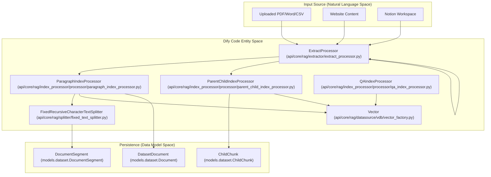
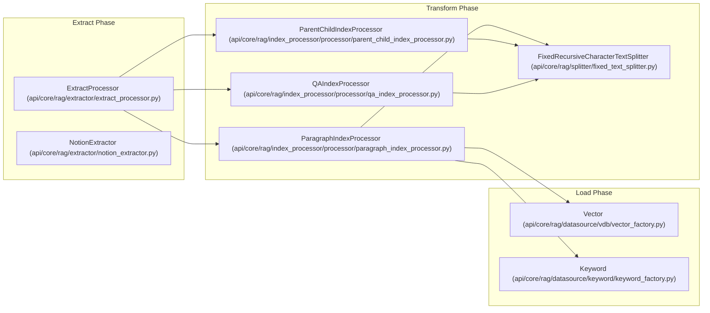

<!-- source: DeepWiki mcp.deepwiki.com · repo langgenius/dify · page 4.2 Document Indexing Pipeline · fetched 2026-10-26 -->

# Document Indexing Pipeline

Relevant source files

The following files were used as context for generating this wiki page:

- [api/configs/middleware/vdb/iris_config.py](api/configs/middleware/vdb/iris_config.py)
- [api/core/app/app_config/common/sensitive_word_avoidance/manager.py](api/core/app/app_config/common/sensitive_word_avoidance/manager.py)
- [api/core/app/layers/conversation_variable_persist_layer.py](api/core/app/layers/conversation_variable_persist_layer.py)
- [api/core/app/layers/suspend_layer.py](api/core/app/layers/suspend_layer.py)
- [api/core/app/layers/timeslice_layer.py](api/core/app/layers/timeslice_layer.py)
- [api/core/app/layers/trigger_post_layer.py](api/core/app/layers/trigger_post_layer.py)
- [api/core/app/workflow/layers/persistence.py](api/core/app/workflow/layers/persistence.py)
- [api/core/extension/api_based_extension_requestor.py](api/core/extension/api_based_extension_requestor.py)
- [api/core/extension/extensible.py](api/core/extension/extensible.py)
- [api/core/extension/extension.py](api/core/extension/extension.py)
- [api/core/external_data_tool/base.py](api/core/external_data_tool/base.py)
- [api/core/external_data_tool/factory.py](api/core/external_data_tool/factory.py)
- [api/core/llm_generator/output_parser/structured_output.py](api/core/llm_generator/output_parser/structured_output.py)
- [api/core/plugin/entities/plugin_daemon.py](api/core/plugin/entities/plugin_daemon.py)
- [api/core/plugin/impl/agent.py](api/core/plugin/impl/agent.py)
- [api/core/plugin/impl/oauth.py](api/core/plugin/impl/oauth.py)
- [api/core/plugin/impl/plugin.py](api/core/plugin/impl/plugin.py)
- [api/core/plugin/impl/tool.py](api/core/plugin/impl/tool.py)
- [api/core/plugin/utils/chunk_merger.py](api/core/plugin/utils/chunk_merger.py)
- [api/core/rag/docstore/dataset_docstore.py](api/core/rag/docstore/dataset_docstore.py)
- [api/core/rag/embedding/cached_embedding.py](api/core/rag/embedding/cached_embedding.py)
- [api/core/rag/embedding/embedding_base.py](api/core/rag/embedding/embedding_base.py)
- [api/core/rag/embedding/token_counter.py](api/core/rag/embedding/token_counter.py)
- [api/core/rag/extractor/extract_processor.py](api/core/rag/extractor/extract_processor.py)
- [api/core/rag/extractor/notion_extractor.py](api/core/rag/extractor/notion_extractor.py)
- [api/core/rag/extractor/pdf_extractor.py](api/core/rag/extractor/pdf_extractor.py)
- [api/core/rag/index_processor/index_processor.py](api/core/rag/index_processor/index_processor.py)
- [api/core/rag/index_processor/index_processor_base.py](api/core/rag/index_processor/index_processor_base.py)
- [api/core/rag/index_processor/processor/paragraph_index_processor.py](api/core/rag/index_processor/processor/paragraph_index_processor.py)
- [api/core/rag/index_processor/processor/parent_child_index_processor.py](api/core/rag/index_processor/processor/parent_child_index_processor.py)
- [api/core/rag/index_processor/processor/qa_index_processor.py](api/core/rag/index_processor/processor/qa_index_processor.py)
- [api/core/rag/rerank/rerank_model.py](api/core/rag/rerank/rerank_model.py)
- [api/core/rag/rerank/weight_rerank.py](api/core/rag/rerank/weight_rerank.py)
- [api/core/rag/retrieval/output_parser/react_output.py](api/core/rag/retrieval/output_parser/react_output.py)
- [api/core/rag/splitter/fixed_text_splitter.py](api/core/rag/splitter/fixed_text_splitter.py)
- [api/core/rag/splitter/text_splitter.py](api/core/rag/splitter/text_splitter.py)
- [api/core/rag/summary_index/summary_index.py](api/core/rag/summary_index/summary_index.py)
- [api/core/telemetry/gateway.py](api/core/telemetry/gateway.py)
- [api/core/workflow/nodes/knowledge_index/knowledge_index_node.py](api/core/workflow/nodes/knowledge_index/knowledge_index_node.py)
- [api/extensions/otel/__init__.py](api/extensions/otel/__init__.py)
- [api/extensions/otel/context.py](api/extensions/otel/context.py)
- [api/migrations/versions/2025_07_22_0019-375fe79ead14_oauth_refresh_token.py](api/migrations/versions/2025_07_22_0019-375fe79ead14_oauth_refresh_token.py)
- [api/providers/vdb/vdb-weaviate/src/dify_vdb_weaviate/weaviate_vector.py](api/providers/vdb/vdb-weaviate/src/dify_vdb_weaviate/weaviate_vector.py)
- [api/providers/vdb/vdb-weaviate/tests/unit_tests/test_doc_id_cleanup_41714.py](api/providers/vdb/vdb-weaviate/tests/unit_tests/test_doc_id_cleanup_41714.py)
- [api/providers/vdb/vdb-weaviate/tests/unit_tests/test_weaviate_vector.py](api/providers/vdb/vdb-weaviate/tests/unit_tests/test_weaviate_vector.py)
- [api/repositories/knowledge/retrieval_source_repository.py](api/repositories/knowledge/retrieval_source_repository.py)
- [api/services/conversation_variable_updater.py](api/services/conversation_variable_updater.py)
- [api/services/plugin/oauth_service.py](api/services/plugin/oauth_service.py)
- [api/services/workflow/inspector_events.py](api/services/workflow/inspector_events.py)
- [api/tests/unit_tests/controllers/common/test_fields.py](api/tests/unit_tests/controllers/common/test_fields.py)
- [api/tests/unit_tests/core/app/app_config/__init__.py](api/tests/unit_tests/core/app/app_config/__init__.py)
- [api/tests/unit_tests/core/app/app_config/common/test_sensitive_word_avoidance_manager.py](api/tests/unit_tests/core/app/app_config/common/test_sensitive_word_avoidance_manager.py)
- [api/tests/unit_tests/core/app/app_config/easy_ui_based_app/test_agent_manager.py](api/tests/unit_tests/core/app/app_config/easy_ui_based_app/test_agent_manager.py)
- [api/tests/unit_tests/core/app/app_config/easy_ui_based_app/test_model_config_converter.py](api/tests/unit_tests/core/app/app_config/easy_ui_based_app/test_model_config_converter.py)
- [api/tests/unit_tests/core/app/app_config/easy_ui_based_app/test_model_config_manager.py](api/tests/unit_tests/core/app/app_config/easy_ui_based_app/test_model_config_manager.py)
- [api/tests/unit_tests/core/app/layers/test_timeslice_layer.py](api/tests/unit_tests/core/app/layers/test_timeslice_layer.py)
- [api/tests/unit_tests/core/app/layers/test_trigger_post_layer.py](api/tests/unit_tests/core/app/layers/test_trigger_post_layer.py)
- [api/tests/unit_tests/core/app/workflow/layers/test_persistence_inspector_publish.py](api/tests/unit_tests/core/app/workflow/layers/test_persistence_inspector_publish.py)
- [api/tests/unit_tests/core/extension/test_api_based_extension_requestor.py](api/tests/unit_tests/core/extension/test_api_based_extension_requestor.py)
- [api/tests/unit_tests/core/extension/test_extensible.py](api/tests/unit_tests/core/extension/test_extensible.py)
- [api/tests/unit_tests/core/extension/test_extension.py](api/tests/unit_tests/core/extension/test_extension.py)
- [api/tests/unit_tests/core/external_data_tool/api/test_api.py](api/tests/unit_tests/core/external_data_tool/api/test_api.py)
- [api/tests/unit_tests/core/external_data_tool/test_base.py](api/tests/unit_tests/core/external_data_tool/test_base.py)
- [api/tests/unit_tests/core/external_data_tool/test_external_data_fetch.py](api/tests/unit_tests/core/external_data_tool/test_external_data_fetch.py)
- [api/tests/unit_tests/core/external_data_tool/test_factory.py](api/tests/unit_tests/core/external_data_tool/test_factory.py)
- [api/tests/unit_tests/core/helper/code_executor/test_template_transformer.py](api/tests/unit_tests/core/helper/code_executor/test_template_transformer.py)
- [api/tests/unit_tests/core/llm_generator/output_parser/test_rule_config_generator.py](api/tests/unit_tests/core/llm_generator/output_parser/test_rule_config_generator.py)
- [api/tests/unit_tests/core/llm_generator/output_parser/test_structured_output.py](api/tests/unit_tests/core/llm_generator/output_parser/test_structured_output.py)
- [api/tests/unit_tests/core/moderation/test_content_moderation.py](api/tests/unit_tests/core/moderation/test_content_moderation.py)
- [api/tests/unit_tests/core/plugin/__init__.py](api/tests/unit_tests/core/plugin/__init__.py)
- [api/tests/unit_tests/core/plugin/utils/__init__.py](api/tests/unit_tests/core/plugin/utils/__init__.py)
- [api/tests/unit_tests/core/plugin/utils/test_chunk_merger.py](api/tests/unit_tests/core/plugin/utils/test_chunk_merger.py)
- [api/tests/unit_tests/core/rag/datasource/keyword/jieba/test_stopwords.py](api/tests/unit_tests/core/rag/datasource/keyword/jieba/test_stopwords.py)
- [api/tests/unit_tests/core/rag/datasource/keyword/test_keyword_base.py](api/tests/unit_tests/core/rag/datasource/keyword/test_keyword_base.py)
- [api/tests/unit_tests/core/rag/datasource/keyword/test_keyword_factory.py](api/tests/unit_tests/core/rag/datasource/keyword/test_keyword_factory.py)
- [api/tests/unit_tests/core/rag/datasource/vdb/test_field.py](api/tests/unit_tests/core/rag/datasource/vdb/test_field.py)
- [api/tests/unit_tests/core/rag/datasource/vdb/test_vector_base.py](api/tests/unit_tests/core/rag/datasource/vdb/test_vector_base.py)
- [api/tests/unit_tests/core/rag/docstore/test_dataset_docstore.py](api/tests/unit_tests/core/rag/docstore/test_dataset_docstore.py)
- [api/tests/unit_tests/core/rag/embedding/__init__.py](api/tests/unit_tests/core/rag/embedding/__init__.py)
- [api/tests/unit_tests/core/rag/embedding/test_cached_embedding.py](api/tests/unit_tests/core/rag/embedding/test_cached_embedding.py)
- [api/tests/unit_tests/core/rag/embedding/test_embedding_base.py](api/tests/unit_tests/core/rag/embedding/test_embedding_base.py)
- [api/tests/unit_tests/core/rag/embedding/test_embedding_service.py](api/tests/unit_tests/core/rag/embedding/test_embedding_service.py)
- [api/tests/unit_tests/core/rag/embedding/test_token_counter.py](api/tests/unit_tests/core/rag/embedding/test_token_counter.py)
- [api/tests/unit_tests/core/rag/extractor/test_extract_processor.py](api/tests/unit_tests/core/rag/extractor/test_extract_processor.py)
- [api/tests/unit_tests/core/rag/extractor/test_extractor_base.py](api/tests/unit_tests/core/rag/extractor/test_extractor_base.py)
- [api/tests/unit_tests/core/rag/extractor/test_jina_reader_extractor.py](api/tests/unit_tests/core/rag/extractor/test_jina_reader_extractor.py)
- [api/tests/unit_tests/core/rag/extractor/test_notion_extractor.py](api/tests/unit_tests/core/rag/extractor/test_notion_extractor.py)
- [api/tests/unit_tests/core/rag/extractor/test_notion_page_rich_text.py](api/tests/unit_tests/core/rag/extractor/test_notion_page_rich_text.py)
- [api/tests/unit_tests/core/rag/extractor/test_pdf_extractor.py](api/tests/unit_tests/core/rag/extractor/test_pdf_extractor.py)
- [api/tests/unit_tests/core/rag/extractor/test_text_extractor.py](api/tests/unit_tests/core/rag/extractor/test_text_extractor.py)
- [api/tests/unit_tests/core/rag/indexing/processor/conftest.py](api/tests/unit_tests/core/rag/indexing/processor/conftest.py)
- [api/tests/unit_tests/core/rag/indexing/processor/test_paragraph_index_processor.py](api/tests/unit_tests/core/rag/indexing/processor/test_paragraph_index_processor.py)
- [api/tests/unit_tests/core/rag/indexing/processor/test_parent_child_index_processor.py](api/tests/unit_tests/core/rag/indexing/processor/test_parent_child_index_processor.py)
- [api/tests/unit_tests/core/rag/indexing/processor/test_qa_index_processor.py](api/tests/unit_tests/core/rag/indexing/processor/test_qa_index_processor.py)
- [api/tests/unit_tests/core/rag/indexing/test_index_processor.py](api/tests/unit_tests/core/rag/indexing/test_index_processor.py)
- [api/tests/unit_tests/core/rag/indexing/test_index_processor_base.py](api/tests/unit_tests/core/rag/indexing/test_index_processor_base.py)
- [api/tests/unit_tests/core/rag/rerank/__init__.py](api/tests/unit_tests/core/rag/rerank/__init__.py)
- [api/tests/unit_tests/core/rag/rerank/test_reranker.py](api/tests/unit_tests/core/rag/rerank/test_reranker.py)
- [api/tests/unit_tests/core/rag/retrieval/test_dataset_retrieval_attachment_entry.py](api/tests/unit_tests/core/rag/retrieval/test_dataset_retrieval_attachment_entry.py)
- [api/tests/unit_tests/core/rag/retrieval/test_multi_dataset_function_call_router.py](api/tests/unit_tests/core/rag/retrieval/test_multi_dataset_function_call_router.py)
- [api/tests/unit_tests/core/rag/retrieval/test_multi_dataset_react_route.py](api/tests/unit_tests/core/rag/retrieval/test_multi_dataset_react_route.py)
- [api/tests/unit_tests/core/rag/retrieval/test_retrieval_source_query.py](api/tests/unit_tests/core/rag/retrieval/test_retrieval_source_query.py)
- [api/tests/unit_tests/core/rag/splitter/__init__.py](api/tests/unit_tests/core/rag/splitter/__init__.py)
- [api/tests/unit_tests/core/rag/splitter/test_text_splitter.py](api/tests/unit_tests/core/rag/splitter/test_text_splitter.py)
- [api/tests/unit_tests/enterprise/telemetry/test_enterprise_trace.py](api/tests/unit_tests/enterprise/telemetry/test_enterprise_trace.py)
- [api/tests/unit_tests/utils/http_parser/test_oauth_convert_request_to_raw_data.py](api/tests/unit_tests/utils/http_parser/test_oauth_convert_request_to_raw_data.py)

## Purpose and Scope

This page details the **Document Indexing Pipeline** implemented in the Dify backend, focusing on the ETL (Extract-Transform-Load) process executed by the `IndexingRunner` class. The pipeline handles extraction of textual content from various data sources (Notion, uploaded files, websites), transforms the content by cleaning and segmentation (including Paragraph, ParentChild, and QA formats), and loads indexed segments into vector and keyword indexes to provide fast retrieval.

This pipeline is a critical component of the Knowledge Base and Retrieval-Augmented Generation system within Dify.

**Sources:**  
[api/core/rag/extractor/extract_processor.py:44-122](),  
[api/core/rag/index_processor/processor/paragraph_index_processor.py:64-135](),  
[api/core/rag/index_processor/processor/parent_child_index_processor.py:44-142](),  
[api/core/rag/index_processor/processor/qa_index_processor.py:43-124]()

---

## Pipeline Overview

The document indexing pipeline is organized as a sequential ETL process. The runner orchestrates the flow from raw data to searchable segments.

| Phase     | Description                                         | Key Operations                                               |
|-----------|-----------------------------------------------------|--------------------------------------------------------------|
| **Extract**   | Parse and load raw data content from sources        | Content extraction via `ExtractProcessor` and specialized Extractors [api/core/rag/extractor/extract_processor.py:120-127]() |
| **Transform** | Clean and segment content into structured documents | Text cleaning via `CleanProcessor`, segmentation via `TextSplitter` implementations [api/core/rag/index_processor/processor/paragraph_index_processor.py:101-105]() |
| **Load**      | Store processed segments into indexes                | Persisting `DocumentSegment` and `ChildChunk` records, embedding generation via `Vector` factory [api/core/rag/index_processor/processor/paragraph_index_processor.py:146-156]() |

The process supports indexing from common data sources including Notion pages, file uploads, and the web. It integrates multiple extractor implementations to handle formats like PDFs, Microsoft Office docs, markdown, and HTML.

**Sources:**  
[api/core/rag/extractor/extract_processor.py:120-127](), [api/core/rag/index_processor/processor/paragraph_index_processor.py:101-156]()

---

## Core Components and Data Flow

### IndexingRunner Class and Index Processor Factory

The indexing lifecycle manages document extraction, transformation, token counting, and vector/keyword index loading. For each document in a dataset, the system delegates to an index processor subclass implementing `BaseIndexProcessor`.

1. **Extract**: Calls `index_processor.extract()` using specific extract settings [api/core/rag/index_processor/processor/paragraph_index_processor.py:66-74]() [api/core/rag/index_processor/processor/parent_child_index_processor.py:46-55]() [api/core/rag/index_processor/processor/qa_index_processor.py:45-53]().
2. **Transform**: Cleans text and runs chunk splitting (e.g., `FixedRecursiveCharacterTextSplitter`) [api/core/rag/index_processor/processor/paragraph_index_processor.py:78-134]() [api/core/rag/index_processor/processor/parent_child_index_processor.py:58-142]() [api/core/rag/index_processor/processor/qa_index_processor.py:56-124]().
3. **Load**: Persists segments to the database, creates vector embeddings via `Vector`, and builds inverted keyword indexes via `Keyword` [api/core/rag/index_processor/processor/paragraph_index_processor.py:137-166]().

### Natural Language Space to Code Entity Space: Pipeline Mapping

This diagram associates high-level concepts with specific code entities and data models.

**Sources:**  
[api/core/rag/extractor/extract_processor.py:45-122](),  
[api/core/rag/index_processor/processor/paragraph_index_processor.py:64-156](),  
[api/core/rag/index_processor/processor/parent_child_index_processor.py:44-142](),  
[api/core/rag/index_processor/processor/qa_index_processor.py:43-124](),  
[api/core/rag/splitter/fixed_text_splitter.py:34-57]()

---

## ETL Pipeline Phases in Detail

### 1. Extract Phase

The `ExtractProcessor` chooses an appropriate extractor based on the `DatasourceType` and file extension:

- **WordExtractor & Unstructured Word**: Parses `.docx` files.
- **PdfExtractor**: Handles PDF text extraction and image parsing [api/core/rag/extractor/pdf_extractor.py:30-32]().
- **NotionExtractor**: Fetches content via the Notion API, querying databases and blocks recursively [api/core/rag/extractor/notion_extractor.py:38-169]().
- **Web Extractors**: Uses `FirecrawlWebExtractor`, `JinaReaderWebExtractor`, or `WaterCrawlWebExtractor` for web scraping [api/core/rag/extractor/extract_processor.py:17-32]().

**Sources:**  
[api/core/rag/extractor/extract_processor.py:45-142](), [api/core/rag/extractor/notion_extractor.py:38-169](), [api/core/rag/extractor/pdf_extractor.py:30-32]()

### 2. Transform Phase

The transformation phase cleans text and breaks it into segments using index processors.

- **Paragraph Index Processor (`ParagraphIndexProcessor`)**: Standard linear splitting via `FixedRecursiveCharacterTextSplitter` [api/core/rag/index_processor/processor/paragraph_index_processor.py:64-135]().
- **Parent-Child Index Processor (`ParentChildIndexProcessor`)**: Creates larger parent sections and splits them further into smaller child chunks for fine-grained vector embedding lookup [api/core/rag/index_processor/processor/parent_child_index_processor.py:44-142]().
- **QA Index Processor (`QAIndexProcessor`)**: Invokes an LLM generator to transform text blocks into Question-Answer pairs [api/core/rag/index_processor/processor/qa_index_processor.py:43-124]().

**Sources:**  
[api/core/rag/index_processor/processor/paragraph_index_processor.py:64-135](), [api/core/rag/index_processor/processor/parent_child_index_processor.py:44-142](), [api/core/rag/index_processor/processor/qa_index_processor.py:43-124]()

### 3. Load Phase

This phase persists data and populates search indexes.

- **Vector Indexing**: `Vector(dataset, session=session).create(documents)` generates embeddings and inserts them into the vector store [api/core/rag/index_processor/processor/paragraph_index_processor.py:146-152]().
- **Keyword Indexing**: `Keyword(dataset)` builds the keyword-based inverted index for hybrid retrieval [api/core/rag/index_processor/processor/paragraph_index_processor.py:153-156]().

### System Component Association Diagram

This diagram maps the logical ETL stages to internal Dify services and models.

**Sources:**  
[api/core/rag/extractor/extract_processor.py:45-122](), [api/core/rag/index_processor/processor/paragraph_index_processor.py:64-166](), [api/core/rag/splitter/fixed_text_splitter.py:34-57]()

---

## Summary of Key Classes

| Class | Responsibility | File |
| :--- | :--- | :--- |
| `ExtractProcessor` | Dispatcher for file/web/notion extractors | `api/core/rag/extractor/extract_processor.py` |
| `NotionExtractor` | Notion API workspace/database/page content loader | `api/core/rag/extractor/notion_extractor.py` |
| `BaseIndexProcessor` | Abstract interface for index processors | `api/core/rag/index_processor/index_processor_base.py` |
| `ParagraphIndexProcessor` | Paragraph strategy ETL implementation | `api/core/rag/index_processor/processor/paragraph_index_processor.py` |
| `ParentChildIndexProcessor` | Parent-Child hierarchical strategy ETL implementation | `api/core/rag/index_processor/processor/parent_child_index_processor.py` |
| `QAIndexProcessor` | Question-Answer extraction and splitting strategy | `api/core/rag/index_processor/processor/qa_index_processor.py` |
| `FixedRecursiveCharacterTextSplitter` | Logic for splitting text into chunks recursively | `api/core/rag/splitter/fixed_text_splitter.py` |

**Sources:**  
[api/core/rag/extractor/extract_processor.py:45](), [api/core/rag/extractor/notion_extractor.py:38](), [api/core/rag/index_processor/index_processor_base.py:46](), [api/core/rag/index_processor/processor/paragraph_index_processor.py:64](), [api/core/rag/index_processor/processor/parent_child_index_processor.py:44](), [api/core/rag/index_processor/processor/qa_index_processor.py:43](), [api/core/rag/splitter/fixed_text_splitter.py:34]()

---

