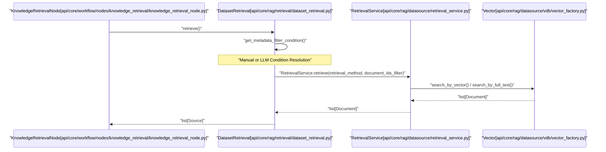

<!-- source: DeepWiki mcp.deepwiki.com · repo langgenius/dify · page 4.3 Retrieval Strategies and Metadata Filtering · fetched 2026-10-26 -->

# Retrieval Strategies and Metadata Filtering

<details>
<summary>Relevant source files</summary>

The following files were used as context for generating this wiki page:

- [api/core/app/apps/agent_chat/app_runner.py](api/core/app/apps/agent_chat/app_runner.py)
- [api/core/app/apps/base_app_runner.py](api/core/app/apps/base_app_runner.py)
- [api/core/app/apps/chat/app_runner.py](api/core/app/apps/chat/app_runner.py)
- [api/core/app/apps/completion/app_runner.py](api/core/app/apps/completion/app_runner.py)
- [api/core/callback_handler/index_tool_callback_handler.py](api/core/callback_handler/index_tool_callback_handler.py)
- [api/core/plugin/backwards_invocation/app.py](api/core/plugin/backwards_invocation/app.py)
- [api/core/rag/datasource/retrieval_service.py](api/core/rag/datasource/retrieval_service.py)
- [api/core/rag/retrieval/dataset_retrieval.py](api/core/rag/retrieval/dataset_retrieval.py)
- [api/core/tools/utils/dataset_retriever/dataset_multi_retriever_tool.py](api/core/tools/utils/dataset_retriever/dataset_multi_retriever_tool.py)
- [api/core/tools/utils/dataset_retriever/dataset_retriever_tool.py](api/core/tools/utils/dataset_retriever/dataset_retriever_tool.py)
- [api/core/workflow/nodes/knowledge_retrieval/knowledge_retrieval_node.py](api/core/workflow/nodes/knowledge_retrieval/knowledge_retrieval_node.py)
- [api/services/hit_testing_service.py](api/services/hit_testing_service.py)
- [api/tests/unit_tests/core/app/apps/chat/test_base_app_runner_multimodal.py](api/tests/unit_tests/core/app/apps/chat/test_base_app_runner_multimodal.py)
- [api/tests/unit_tests/core/callback_handler/test_index_tool_callback_handler.py](api/tests/unit_tests/core/callback_handler/test_index_tool_callback_handler.py)
- [api/tests/unit_tests/core/plugin/test_backwards_invocation_app.py](api/tests/unit_tests/core/plugin/test_backwards_invocation_app.py)
- [api/tests/unit_tests/core/rag/datasource/test_datasource_retrieval.py](api/tests/unit_tests/core/rag/datasource/test_datasource_retrieval.py)
- [api/tests/unit_tests/core/rag/retrieval/test_dataset_retrieval.py](api/tests/unit_tests/core/rag/retrieval/test_dataset_retrieval.py)
- [api/tests/unit_tests/core/rag/retrieval/test_dataset_retrieval_methods.py](api/tests/unit_tests/core/rag/retrieval/test_dataset_retrieval_methods.py)
- [api/tests/unit_tests/core/tools/utils/test_misc_utils_extra.py](api/tests/unit_tests/core/tools/utils/test_misc_utils_extra.py)
- [api/tests/unit_tests/extensions/otel/test_retrieval_tracing.py](api/tests/unit_tests/extensions/otel/test_retrieval_tracing.py)

</details>


## Purpose and Scope

This page details the technical implementation of retrieval strategies and metadata filtering within Dify's RAG (Retrieval-Augmented Generation) system. It covers single vs. multiple dataset retrieval, search method execution (semantic, full-text, hybrid, keyword), reranking pipelines, and the mechanisms for manual and LLM-based metadata filtering.

The core retrieval logic is encapsulated in the `DatasetRetrieval` class [api/core/rag/retrieval/dataset_retrieval.py:125](), while the execution of specific search methods against data sources is handled by the `RetrievalService` [api/core/rag/datasource/retrieval_service.py:93]().

Sources: [api/core/rag/retrieval/dataset_retrieval.py:125-150](), [api/core/rag/datasource/retrieval_service.py:93-110]()

---

## Retrieval Strategy Architecture

Dify supports two primary strategies for querying knowledge bases, configured via `DatasetRetrieveConfigEntity` [api/core/app/app_config/entities.py:20]().

### 1. Single Dataset Retrieval (N-to-1 Routing)
In this mode, an LLM acts as a router to select the most relevant dataset from a list of available options before executing the search.

```mermaid
graph TD
    "UserQuery" --> "DatasetRetrieval.single_retrieve"
    "DatasetRetrieval.single_retrieve" --> "RouterSelection"
    
    subgraph "RouterLogic"
        "RouterSelection" --> "FunctionCallMultiDatasetRouter[api/core/rag/retrieval/router/multi_dataset_function_call_router.py]"
        "RouterSelection" --> "ReactMultiDatasetRouter[api/core/rag/retrieval/router/multi_dataset_react_route.py]"
    end
    
    "FunctionCallMultiDatasetRouter" --> "SelectedDatasetID"
    "ReactMultiDatasetRouter" --> "SelectedDatasetID"
    
    "SelectedDatasetID" --> "RetrievalService.retrieve[api/core/rag/datasource/retrieval_service.py::retrieve]"
    "RetrievalService.retrieve[api/core/rag/datasource/retrieval_service.py::retrieve]" --> "FinalDocuments"
```
**Diagram: Single Dataset Routing Flow**

*   **Routing Mechanism**: The system converts available datasets into tool representations using their descriptions [api/core/rag/retrieval/dataset_retrieval.py:607-616]().
*   **Model Selection**: If the model supports `ModelFeature.TOOL_CALL`, it invokes `FunctionCallMultiDatasetRouter` [api/core/rag/retrieval/dataset_retrieval.py:633](). Otherwise, it falls back to a ReAct prompt strategy via `ReactMultiDatasetRouter` [api/core/rag/retrieval/dataset_retrieval.py:648]().

### 2. Multiple Dataset Retrieval (N-to-N Parallel)
This strategy executes searches across all selected datasets in parallel and aggregates the results.

*   **Parallel Execution**: Utilizes a `ThreadPoolExecutor` bounded by `dify_config.RETRIEVAL_SERVICE_EXECUTORS` [api/core/rag/datasource/retrieval_service.py:120]().
*   **Aggregation**: Results from all worker threads are gathered into a shared `all_documents` list, deduplicated, and optionally reranked [api/core/rag/datasource/retrieval_service.py:116-173]().

Sources: [api/core/rag/retrieval/dataset_retrieval.py:125-150](), [api/core/rag/datasource/retrieval_service.py:116-173](), [api/core/app/app_config/entities.py:18-23]()

---

## Search Methods and Execution

Dify implements retrieval via the `RetrievalMethod` enum [api/core/rag/retrieval/retrieval_methods.py:16]().

| Method | Code Entity / Handler | Implementation Detail |
| :--- | :--- | :--- |
| `SEMANTIC_SEARCH` | `Vector.search_by_vector()` | Vector similarity search using embedded vectors stored in the VDB backend. |
| `FULL_TEXT_SEARCH` | `Vector.search_by_full_text()` | Keyword matching using database-native full-text indices. |
| `HYBRID_SEARCH` | `RetrievalService._retrieve()` | Executes semantic and full-text searches concurrently, merging results [api/core/rag/datasource/retrieval_service.py:120-160](). |
| `KEYWORD_SEARCH` | `JiebaKeywordTableHandler` | BM25-based keyword search primarily used for Economy-tier indexes [api/core/rag/datasource/keyword/jieba/jieba_keyword_table_handler.py:45](). |

### Hybrid Search and Reranking Flow

```mermaid
graph TB
    subgraph "RetrievalService[api/core/rag/datasource/retrieval_service.py]"
        "Query" --> "SearchLogic[_retrieve]"
        "SearchLogic[_retrieve]" --> "Vector.search_by_vector"
        "SearchLogic[_retrieve]" --> "Vector.search_by_full_text"
    end

    subgraph "PostProcessing[api/core/rag/data_post_processor/]"
        "Vector.search_by_vector" --> "DataPostProcessor.invoke[api/core/rag/data_post_processor/data_post_processor.py]"
        "Vector.search_by_full_text" --> "DataPostProcessor.invoke[api/core/rag/data_post_processor/data_post_processor.py]"
        "DataPostProcessor.invoke[api/core/rag/data_post_processor/data_post_processor.py]" --> "RerankCheck{RerankEnabled?}"
        "RerankCheck" -- "Yes" --> "RerankModelRunner[api/core/rag/rerank/rerank_model.py]"
        "RerankCheck" -- "No" --> "WeightedScoreFusion"
    end

    "RerankModelRunner[api/core/rag/rerank/rerank_model.py]" --> "FinalSortedDocs"
    "WeightedScoreFusion" --> "FinalSortedDocs"
```
**Diagram: Hybrid Search to Code Entity Mapping**

*   **Reranking**: When reranking is enabled, `DataPostProcessor` processes the retrieved document set [api/core/rag/datasource/retrieval_service.py:14-15](). The `RerankModelRunner` executes cross-encoder scoring using the selected model instance [api/core/tools/utils/dataset_retriever/dataset_multi_retriever_tool.py:73-81]().
*   **Parent-Child Retrieval**: For datasets structured with `IndexStructureType.PARENT_CHILD_INDEX`, the vector store retrieves fine-grained child chunks, but the system maps them back to their parent segments before returning context to the application [api/core/callback_handler/index_tool_callback_handler.py:71-83]().

Sources: [api/core/rag/datasource/retrieval_service.py:93-173](), [api/core/rag/data_post_processor/data_post_processor.py:44](), [api/core/tools/utils/dataset_retriever/dataset_multi_retriever_tool.py:73-81](), [api/core/callback_handler/index_tool_callback_handler.py:71-83]()

---

## Metadata Filtering

Metadata filtering narrows the search space by enforcing attribute-based constraints (e.g., tags, categories, document IDs) before vector or full-text queries run.

### Filtering Modes
Dify supports three modes for metadata filtering:
1.  **Disabled**: No constraints applied.
2.  **Manual**: Evaluates explicit `MetadataFilteringCondition` instances supplied in configuration [api/core/app/app_config/entities.py:21]().
3.  **Automatic (LLM-based)**: Uses an LLM to extract filtering conditions and parameters from the user's natural language query [api/core/rag/retrieval/dataset_retrieval.py:133]().

### Workflow Node Integration
During workflow execution, the `KnowledgeRetrievalNode` resolves query variables and optional metadata filter configurations [api/core/workflow/nodes/knowledge_retrieval/knowledge_retrieval_node.py:101-143]().

```python
# KnowledgeRetrievalNode execution snippet
results, usage = self._fetch_dataset_retriever(
    session=session, node_data=self._node_data, variables=variables
)
```
[api/core/workflow/nodes/knowledge_retrieval/knowledge_retrieval_node.py:140-142]()

Sources: [api/core/rag/retrieval/dataset_retrieval.py:125-157](), [api/core/workflow/nodes/knowledge_retrieval/knowledge_retrieval_node.py:101-143](), [api/core/app/app_config/entities.py:18-23]()

---

## Hit Testing Service

The `HitTestingService` enables developers and administrators to test dataset retrieval rules and metadata filters interactively via the Dify Console [api/services/hit_testing_service.py:47]().

*   **Execution**: Resolves retrieval configurations and invokes `RetrievalService.retrieve()` with optional `document_ids_filter` [api/services/hit_testing_service.py:123-164]().
*   **Audit Logging**: Records query payloads via `DatasetQuery` entities to track search analytics [api/services/hit_testing_service.py:168-171]().

Sources: [api/services/hit_testing_service.py:47-171](), [api/core/rag/datasource/retrieval_service.py:93-173]()

---

## Technical Data Flow: Query to Result


**Diagram: Retrieval Execution Sequence**

Sources: [api/core/rag/retrieval/dataset_retrieval.py:125-170](), [api/core/rag/datasource/retrieval_service.py:93-173](), [api/core/workflow/nodes/knowledge_retrieval/knowledge_retrieval_node.py:101-143]()

---

