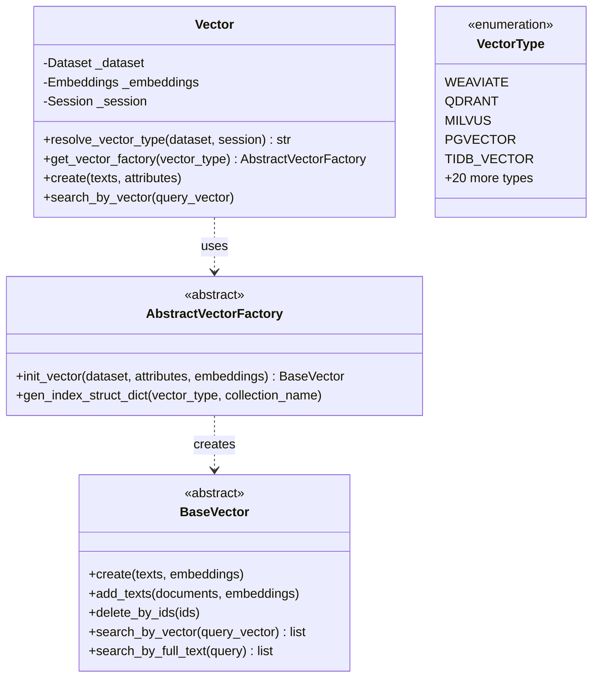
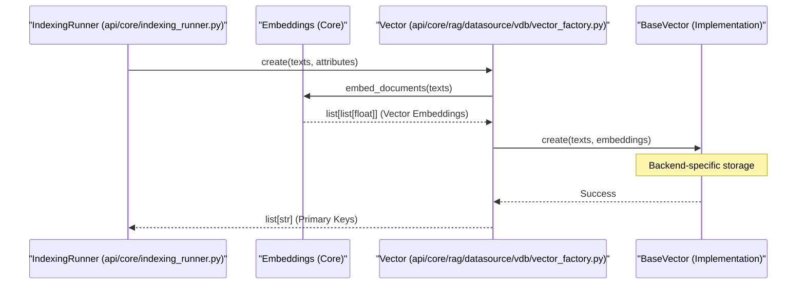
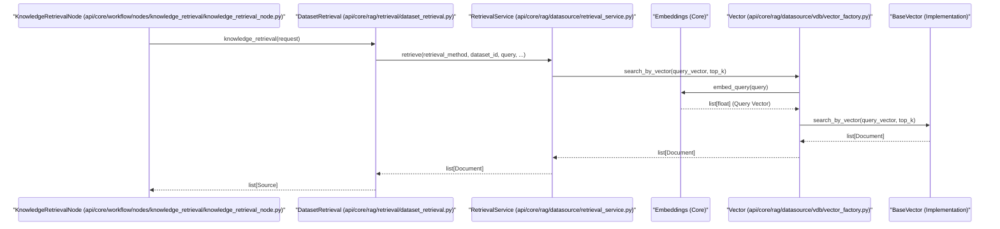

<!-- source: DeepWiki mcp.deepwiki.com · repo langgenius/dify · page 4.4 Vector Database Integration Architecture · fetched 2026-10-26 -->

# Vector Database Integration Architecture

<details>
<summary>Relevant source files</summary>

The following files were used as context for generating this wiki page:

- [api/.env.example](api/.env.example)
- [api/configs/feature/__init__.py](api/configs/feature/__init__.py)
- [api/configs/middleware/__init__.py](api/configs/middleware/__init__.py)
- [api/configs/middleware/vdb/weaviate_config.py](api/configs/middleware/vdb/weaviate_config.py)
- [api/configs/packaging/__init__.py](api/configs/packaging/__init__.py)
- [api/controllers/console/workspace/skills.py](api/controllers/console/workspace/skills.py)
- [api/core/helper/ssrf_proxy.py](api/core/helper/ssrf_proxy.py)
- [api/core/rag/datasource/vdb/vector_factory.py](api/core/rag/datasource/vdb/vector_factory.py)
- [api/core/rag/datasource/vdb/vector_type.py](api/core/rag/datasource/vdb/vector_type.py)
- [api/core/rag/extractor/word_extractor.py](api/core/rag/extractor/word_extractor.py)
- [api/extensions/ext_app_metrics.py](api/extensions/ext_app_metrics.py)
- [api/extensions/ext_celery.py](api/extensions/ext_celery.py)
- [api/extensions/ext_database.py](api/extensions/ext_database.py)
- [api/extensions/ext_import_modules.py](api/extensions/ext_import_modules.py)
- [api/extensions/ext_sentry.py](api/extensions/ext_sentry.py)
- [api/migrations/README](api/migrations/README)
- [api/providers/vdb/vdb-alibabacloud-mysql/tests/unit_tests/test_alibabacloud_mysql_factory.py](api/providers/vdb/vdb-alibabacloud-mysql/tests/unit_tests/test_alibabacloud_mysql_factory.py)
- [api/providers/vdb/vdb-analyticdb/tests/unit_tests/test_analyticdb_vector.py](api/providers/vdb/vdb-analyticdb/tests/unit_tests/test_analyticdb_vector.py)
- [api/providers/vdb/vdb-baidu/tests/unit_tests/test_baidu_vector.py](api/providers/vdb/vdb-baidu/tests/unit_tests/test_baidu_vector.py)
- [api/providers/vdb/vdb-chroma/tests/unit_tests/test_chroma_vector.py](api/providers/vdb/vdb-chroma/tests/unit_tests/test_chroma_vector.py)
- [api/providers/vdb/vdb-clickzetta/tests/unit_tests/test_clickzetta_vector.py](api/providers/vdb/vdb-clickzetta/tests/unit_tests/test_clickzetta_vector.py)
- [api/providers/vdb/vdb-couchbase/tests/unit_tests/test_couchbase_vector.py](api/providers/vdb/vdb-couchbase/tests/unit_tests/test_couchbase_vector.py)
- [api/providers/vdb/vdb-elasticsearch/src/dify_vdb_elasticsearch/elasticsearch_vector.py](api/providers/vdb/vdb-elasticsearch/src/dify_vdb_elasticsearch/elasticsearch_vector.py)
- [api/providers/vdb/vdb-elasticsearch/tests/unit_tests/test_elasticsearch_ja_vector.py](api/providers/vdb/vdb-elasticsearch/tests/unit_tests/test_elasticsearch_ja_vector.py)
- [api/providers/vdb/vdb-elasticsearch/tests/unit_tests/test_elasticsearch_vector.py](api/providers/vdb/vdb-elasticsearch/tests/unit_tests/test_elasticsearch_vector.py)
- [api/providers/vdb/vdb-hologres/tests/unit_tests/test_hologres_vector.py](api/providers/vdb/vdb-hologres/tests/unit_tests/test_hologres_vector.py)
- [api/providers/vdb/vdb-huawei-cloud/src/dify_vdb_huawei_cloud/huawei_cloud_vector.py](api/providers/vdb/vdb-huawei-cloud/src/dify_vdb_huawei_cloud/huawei_cloud_vector.py)
- [api/providers/vdb/vdb-huawei-cloud/tests/unit_tests/test_huawei_cloud_vector.py](api/providers/vdb/vdb-huawei-cloud/tests/unit_tests/test_huawei_cloud_vector.py)
- [api/providers/vdb/vdb-iris/tests/unit_tests/test_iris_vector.py](api/providers/vdb/vdb-iris/tests/unit_tests/test_iris_vector.py)
- [api/providers/vdb/vdb-lindorm/tests/unit_tests/test_lindorm_vector.py](api/providers/vdb/vdb-lindorm/tests/unit_tests/test_lindorm_vector.py)
- [api/providers/vdb/vdb-opengauss/tests/unit_tests/test_opengauss.py](api/providers/vdb/vdb-opengauss/tests/unit_tests/test_opengauss.py)
- [api/providers/vdb/vdb-opensearch/src/dify_vdb_opensearch/opensearch_vector.py](api/providers/vdb/vdb-opensearch/src/dify_vdb_opensearch/opensearch_vector.py)
- [api/providers/vdb/vdb-pgvecto-rs/tests/unit_tests/test_pgvecto_rs.py](api/providers/vdb/vdb-pgvecto-rs/tests/unit_tests/test_pgvecto_rs.py)
- [api/providers/vdb/vdb-pgvector/src/dify_vdb_pgvector/pgvector.py](api/providers/vdb/vdb-pgvector/src/dify_vdb_pgvector/pgvector.py)
- [api/providers/vdb/vdb-tablestore/src/dify_vdb_tablestore/tablestore_vector.py](api/providers/vdb/vdb-tablestore/src/dify_vdb_tablestore/tablestore_vector.py)
- [api/providers/vdb/vdb-vastbase/pyproject.toml](api/providers/vdb/vdb-vastbase/pyproject.toml)
- [api/providers/vdb/vdb-vastbase/src/dify_vdb_vastbase/vastbase_vector.py](api/providers/vdb/vdb-vastbase/src/dify_vdb_vastbase/vastbase_vector.py)
- [api/providers/vdb/vdb-vastbase/tests/unit_tests/test_vastbase_vector.py](api/providers/vdb/vdb-vastbase/tests/unit_tests/test_vastbase_vector.py)
- [api/providers/vdb/vdb-weaviate/tests/unit_tests/test_weaviate_integration_header.py](api/providers/vdb/vdb-weaviate/tests/unit_tests/test_weaviate_integration_header.py)
- [api/pyproject.toml](api/pyproject.toml)
- [api/schedule/queue_monitor_task.py](api/schedule/queue_monitor_task.py)
- [api/tests/integration_tests/.env.example](api/tests/integration_tests/.env.example)
- [api/tests/unit_tests/configs/test_dify_config.py](api/tests/unit_tests/configs/test_dify_config.py)
- [api/tests/unit_tests/controllers/console/workspace/test_skills.py](api/tests/unit_tests/controllers/console/workspace/test_skills.py)
- [api/tests/unit_tests/core/helper/test_ssrf_proxy.py](api/tests/unit_tests/core/helper/test_ssrf_proxy.py)
- [api/tests/unit_tests/core/rag/datasource/vdb/test_vector_factory.py](api/tests/unit_tests/core/rag/datasource/vdb/test_vector_factory.py)
- [api/tests/unit_tests/core/rag/extractor/test_word_extractor.py](api/tests/unit_tests/core/rag/extractor/test_word_extractor.py)
- [api/tests/unit_tests/core/rag/extractor/unstructured/test_unstructured_extractors.py](api/tests/unit_tests/core/rag/extractor/unstructured/test_unstructured_extractors.py)
- [api/tests/unit_tests/extensions/test_celery_ssl.py](api/tests/unit_tests/extensions/test_celery_ssl.py)
- [api/uv.lock](api/uv.lock)
- [docker/.env.example](docker/.env.example)
- [docker/docker-compose-template.yaml](docker/docker-compose-template.yaml)
- [docker/docker-compose.middleware.yaml](docker/docker-compose.middleware.yaml)
- [docker/docker-compose.yaml](docker/docker-compose.yaml)
- [docker/envs/core-services/shared.env.example](docker/envs/core-services/shared.env.example)
- [docker/envs/infrastructure/ssrf-proxy.env.example](docker/envs/infrastructure/ssrf-proxy.env.example)
- [docker/envs/middleware.env.example](docker/envs/middleware.env.example)
- [web/package.json](web/package.json)

</details>


## Purpose and Scope

This document describes the vector database integration architecture in Dify, including the `VectorFactory` abstraction that enables support for 23+ different vector database implementations, the configuration-driven selection mechanism, and how vector databases integrate with the document indexing and retrieval pipelines.

For information about how documents are indexed into vector databases, see [Document Indexing Pipeline](4.2). For information about how vector search is used during retrieval, see [Retrieval Strategies and Metadata Filtering](4.3). For deployment-level storage and VDB configuration, see [Storage Backends and Vector Database Configuration](3.3).

## Architecture Overview

The vector database integration architecture uses a factory pattern to abstract away the specifics of individual vector database implementations, allowing the system to switch between different vector databases through configuration alone.

### System Context Diagram

```mermaid
graph TB
    subgraph "Application Layer"
        IndexingRunner["IndexingRunner<br/>(api/core/indexing_runner.py)"]
        DatasetRetrieval["DatasetRetrieval<br/>(api/core/rag/retrieval/dataset_retrieval.py)"]
        RetrievalService["RetrievalService<br/>(api/core/rag/datasource/retrieval_service.py)"]
        KnowledgeRetrievalNode["KnowledgeRetrievalNode<br/>(api/core/workflow/nodes/knowledge_retrieval/knowledge_retrieval_node.py)"]
    end
    
    subgraph "Vector Abstraction Layer"
        Vector["Vector<br/>(api/core/rag/datasource/vdb/vector_factory.py)"]
        VectorFactory["AbstractVectorFactory<br/>(api/core/rag/datasource/vdb/vector_factory.py)"]
        BaseVector["BaseVector<br/>(Abstract Base)"]
    end
    
    subgraph "Configuration Layer"
        DifyConfig["dify_config<br/>(VECTOR_STORE)"]
        VDBConfigs["VDB-specific Configs<br/>(WeaviateConfig, MilvusConfig, etc.)"]
    end
    
    subgraph "Vector Database Implementations"
        Weaviate["WeaviateVector"]
        Milvus["MilvusVector"]
        PGVector["PGVector"]
        Qdrant["QdrantVector"]
        TidbVector["TiDBVector"]
        Others["... 20+ more"]
    end
    
    subgraph "External Services"
        WeaviateDB[("Weaviate<br/>Service")]
        MilvusDB[("Milvus<br/>Service")]
        PostgresDB[("PostgreSQL<br/>w/ pgvector")]
        QdrantDB[("Qdrant<br/>Service")]
    end
    
    IndexingRunner --> Vector
    DatasetRetrieval --> RetrievalService
    RetrievalService --> Vector
    KnowledgeRetrievalNode --> DatasetRetrieval
    
    Vector --> VectorFactory
    VectorFactory --> DifyConfig
    VectorFactory --> VDBConfigs
    
    BaseVector <|-- Weaviate
    BaseVector <|-- Milvus
    BaseVector <|-- PGVector
    BaseVector <|-- Qdrant
    BaseVector <|-- TidbVector
    
    Weaviate --> WeaviateDB
    Milvus --> MilvusDB
    PGVector --> PostgresDB
    Qdrant --> QdrantDB
```

**Sources:**
[api/core/rag/datasource/vdb/vector_factory.py:29-101](), [api/core/rag/datasource/vdb/vector_type.py:4-30](), [api/core/rag/retrieval/dataset_retrieval.py:103-111](), [api/core/rag/datasource/retrieval_service.py:93-109](), [api/core/workflow/nodes/knowledge_retrieval/knowledge_retrieval_node.py:91-92]()

## Vector Factory Pattern

The `Vector` class serves as the entry point for creating vector database instances. It determines which implementation to instantiate based on the `VECTOR_STORE` environment variable or the specific dataset configuration stored in the database.

### Factory Class Structure



**Sources:**
[api/core/rag/datasource/vdb/vector_factory.py:29-41](), [api/core/rag/datasource/vdb/vector_factory.py:101-130](), [api/core/rag/datasource/vdb/vector_factory.py:151-159](), [api/core/rag/datasource/vdb/vector_type.py:4-30]()

### Lazy Embedding Initialization
Dify implements a `_LazyEmbeddings` proxy to defer the materialization of embedding models. This ensures that cleanup operations (like `delete_by_ids`) do not trigger expensive or fragile calls to model providers or billing APIs if embeddings are not strictly required for the operation.

**Sources:**
[api/core/rag/datasource/vdb/vector_factory.py:43-58](), [api/core/rag/datasource/vdb/vector_factory.py:64-74]()

## Configuration System

Vector database selection is driven by the `dify_config.VECTOR_STORE` setting and metadata stored in the `Dataset` model.

### Selection Logic
The `Vector.resolve_vector_type` function determines the backend using the following priority:
1. If `dataset.index_struct_dict` contains a `type`, use it. [api/core/rag/datasource/vdb/vector_factory.py:135-136]()
2. If `VECTOR_STORE_WHITELIST_ENABLE` is true and the tenant is whitelisted, use `TIDB_ON_QDRANT`. [api/core/rag/datasource/vdb/vector_factory.py:138-144]()
3. Fall back to the global `dify_config.VECTOR_STORE`. [api/core/rag/datasource/vdb/vector_factory.py:133-133]()

**Sources:**
[api/core/rag/datasource/vdb/vector_factory.py:131-150]()

## Supported Vector Database Implementations

Dify supports over 23 vector database implementations. These are defined in `VectorType` and mapped to specific factory classes via a registry. The `api/uv.lock` and `api/pyproject.toml` files list the `dify-vdb-*` packages, indicating the breadth of supported vector databases. The `docker/docker-compose.yaml` and `docker/docker-compose-template.yaml` files also show how environment variables for various vector stores are loaded from `envs/vectorstores/*.env` files.

| VectorType | Code Identifier | Description |
|---|---|---|
| `WEAVIATE` | `weaviate` | High-performance vector search engine |
| `MILVUS` | `milvus` | Cloud-native vector database |
| `PGVECTOR` | `pgvector` | PostgreSQL extension for vector similarity |
| `QDRANT` | `qdrant` | Vector database with extended filtering |
| `TIDB_VECTOR` | `tidb_vector` | TiDB vector search capabilities |
| `ELASTICSEARCH` | `elasticsearch` | Distributed search and analytics engine |
| `ALIBABACLOUD_MYSQL` | `alibabacloud_mysql` | Alibaba Cloud MySQL with vector capabilities |
| `ANALYTICDB` | `analyticdb` | Alibaba Cloud AnalyticDB |
| `BAIDU` | `baidu` | Baidu Vector DB |
| `CHROMA` | `chroma` | Embeddings database |
| `CLICKZETTA` | `clickzetta` | ClickZetta vector store |
| `COUCHBASE` | `couchbase` | Couchbase vector store |
| `HOLOGRES` | `hologres` | Alibaba Cloud Hologres |
| `HUAWEI_CLOUD` | `huawei_cloud` | Huawei Cloud vector store |
| `IRIS` | `iris` | InterSystems IRIS vector store |
| `LINDORM` | `lindorm` | Alibaba Cloud Lindorm |
| `MATRIXONE` | `matrixone` | MatrixOne vector store |
| `MYSCALE` | `myscale` | MyScale vector store |
| `OCEANBASE` | `oceanbase` | OceanBase vector store |
| `OPENGAUSS` | `opengauss` | OpenGauss vector store |
| `OPENSEARCH` | `opensearch` | OpenSearch vector store |
| `ORACLE` | `oracle` | Oracle vector store |
| `PGVECTO_RS` | `pgvecto_rs` | pgvecto.rs vector store |
| `RELYT` | `relyt` | Relyt vector store |
| `TABLESTORE` | `tablestore` | Alibaba Cloud Table Store |
| `TENCENT` | `tencent` | Tencent Vector DB |
| `TIDB_ON_QDRANT` | `tidb_on_qdrant` | TiDB on Qdrant |
| `UPSTASH` | `upstash` | Upstash vector store |
| `VASTBASE_VECTOR` | `vastbase_vector` | Vastbase vector store |
| `VIKINGDB` | `vikingdb` | VikingDB vector store |

**Sources:**
[api/core/rag/datasource/vdb/vector_type.py:4-30](), [api/core/rag/datasource/vdb/vector_factory.py:152-153](), [api/uv.lock:22-51](), [api/pyproject.toml:70-99](), [docker/docker-compose.yaml:22-52](), [docker/docker-compose.yaml:88-118](), [docker/docker-compose.yaml:154-187](), [docker/docker-compose-template.yaml:16-49](), [docker/docker-compose-template.yaml:82-115](), [docker/docker-compose-template.yaml:148-180]()

## Vector Database Lifecycle

### Data Flow: Indexing documents into Vector Space

This diagram bridges the Natural Language processing to the code-level vector storage during the indexing phase handled by `IndexingRunner`.



**Sources:**
[api/core/rag/datasource/vdb/vector_factory.py:101-130](), [api/core/rag/datasource/vdb/vector_factory.py:168-175]()

### Data Flow: Querying from Natural Language to Vector Search

This flow shows how a natural language query is transformed and searched within the retrieval logic via `DatasetRetrieval` and `RetrievalService`.



**Sources:**
[api/core/rag/retrieval/dataset_retrieval.py:121-123](), [api/core/rag/datasource/retrieval_service.py:93-109](), [api/core/rag/datasource/vdb/vector_factory.py:101-130](), [api/core/workflow/nodes/knowledge_retrieval/knowledge_retrieval_node.py:139-141]()

## Key Functions and Classes

### Vector Class (`api/core/rag/datasource/vdb/vector_factory.py`)
- `__init__`: Initializes the vector backend. It sets up default attributes such as `doc_id`, `dataset_id`, and `is_summary` which are critical for routing summary hits through parent chunks. [api/core/rag/datasource/vdb/vector_factory.py:102-129]()
- `create`: High-level method to embed texts and store them in the VDB. [api/core/rag/datasource/vdb/vector_factory.py:168-175]()
- `search_by_vector`: Performs similarity search using a provided vector. [api/core/rag/datasource/vdb/vector_factory.py:184-188]()
- `delete_by_ids`: Removes entries from the vector store by their IDs. [api/core/rag/datasource/vdb/vector_factory.py:202-203]()

### RetrievalService (`api/core/rag/datasource/retrieval_service.py`)
- `retrieve`: Orchestrates multi-threaded retrieval. It uses a `ThreadPoolExecutor` to handle concurrent searches when multiple attachment IDs or queries are provided. [api/core/rag/datasource/retrieval_service.py:97-120]()

### DatasetRetrieval (`api/core/rag/retrieval/dataset_retrieval.py`)
- `knowledge_retrieval`: The primary entry point for RAG retrieval, handling rate limits, dataset availability checks, and metadata filtering. [api/core/rag/retrieval/dataset_retrieval.py:121-158]()

**Sources:**
[api/core/rag/datasource/vdb/vector_factory.py:102-203](), [api/core/rag/datasource/retrieval_service.py:93-120](), [api/core/rag/retrieval/dataset_retrieval.py:121-158]()

---

