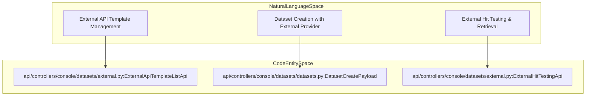
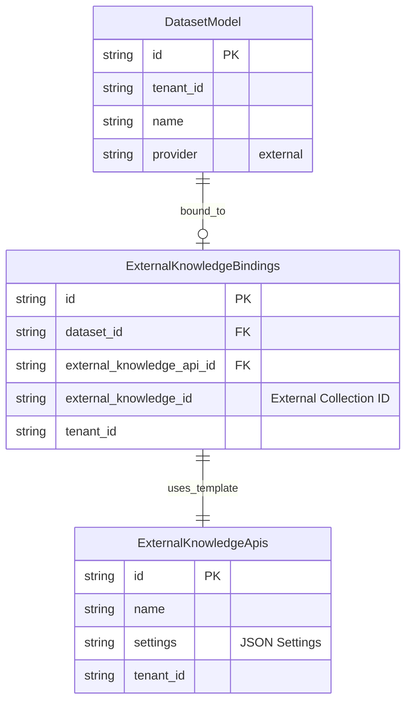
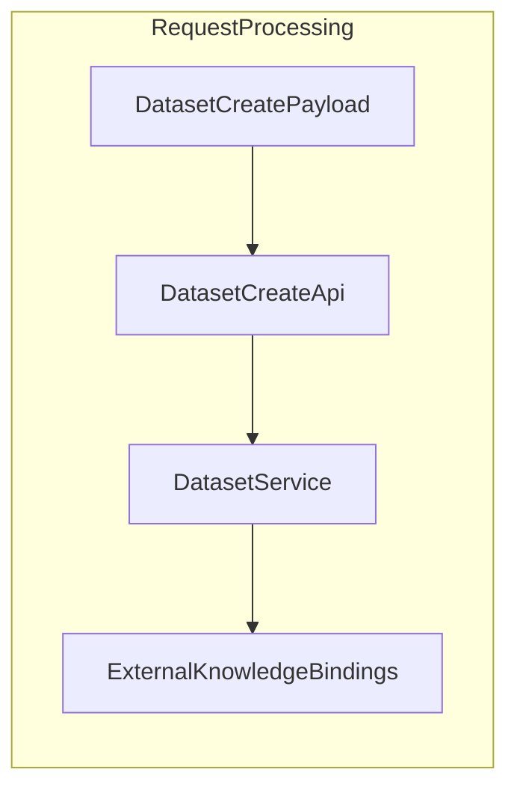

<!-- source: DeepWiki mcp.deepwiki.com · repo langgenius/dify · page 4.5 External Knowledge Base Integration · fetched 2026-10-26 -->

# External Knowledge Base Integration

Relevant source files

The following files were used as context for generating this wiki page:

- [api/controllers/console/datasets/data_source.py](api/controllers/console/datasets/data_source.py)
- [api/controllers/console/datasets/datasets.py](api/controllers/console/datasets/datasets.py)
- [api/controllers/console/datasets/datasets_document.py](api/controllers/console/datasets/datasets_document.py)
- [api/controllers/console/datasets/datasets_segments.py](api/controllers/console/datasets/datasets_segments.py)
- [api/controllers/console/datasets/external.py](api/controllers/console/datasets/external.py)
- [api/controllers/console/datasets/metadata.py](api/controllers/console/datasets/metadata.py)
- [api/controllers/console/tag/tags.py](api/controllers/console/tag/tags.py)
- [api/controllers/service_api/dataset/dataset.py](api/controllers/service_api/dataset/dataset.py)
- [api/controllers/service_api/dataset/document.py](api/controllers/service_api/dataset/document.py)
- [api/controllers/service_api/dataset/metadata.py](api/controllers/service_api/dataset/metadata.py)
- [api/controllers/service_api/dataset/segment.py](api/controllers/service_api/dataset/segment.py)
- [api/services/tag_service.py](api/services/tag_service.py)
- [api/tests/test_containers_integration_tests/controllers/service_api/__init__.py](api/tests/test_containers_integration_tests/controllers/service_api/__init__.py)
- [api/tests/test_containers_integration_tests/controllers/service_api/dataset/__init__.py](api/tests/test_containers_integration_tests/controllers/service_api/dataset/__init__.py)
- [api/tests/test_containers_integration_tests/controllers/service_api/dataset/test_dataset.py](api/tests/test_containers_integration_tests/controllers/service_api/dataset/test_dataset.py)
- [api/tests/test_containers_integration_tests/services/test_tag_service.py](api/tests/test_containers_integration_tests/services/test_tag_service.py)
- [api/tests/unit_tests/controllers/console/datasets/test_datasets.py](api/tests/unit_tests/controllers/console/datasets/test_datasets.py)
- [api/tests/unit_tests/controllers/console/datasets/test_datasets_document.py](api/tests/unit_tests/controllers/console/datasets/test_datasets_document.py)
- [api/tests/unit_tests/controllers/console/datasets/test_datasets_segments.py](api/tests/unit_tests/controllers/console/datasets/test_datasets_segments.py)
- [api/tests/unit_tests/controllers/console/datasets/test_external.py](api/tests/unit_tests/controllers/console/datasets/test_external.py)
- [api/tests/unit_tests/controllers/console/datasets/test_metadata.py](api/tests/unit_tests/controllers/console/datasets/test_metadata.py)
- [api/tests/unit_tests/controllers/console/tag/test_tags.py](api/tests/unit_tests/controllers/console/tag/test_tags.py)
- [api/tests/unit_tests/controllers/service_api/dataset/test_dataset_apis.py](api/tests/unit_tests/controllers/service_api/dataset/test_dataset_apis.py)
- [api/tests/unit_tests/controllers/service_api/dataset/test_dataset_payloads.py](api/tests/unit_tests/controllers/service_api/dataset/test_dataset_payloads.py)
- [api/tests/unit_tests/controllers/service_api/dataset/test_dataset_segment.py](api/tests/unit_tests/controllers/service_api/dataset/test_dataset_segment.py)
- [api/tests/unit_tests/controllers/service_api/dataset/test_dataset_tag_apis.py](api/tests/unit_tests/controllers/service_api/dataset/test_dataset_tag_apis.py)
- [api/tests/unit_tests/controllers/service_api/dataset/test_document.py](api/tests/unit_tests/controllers/service_api/dataset/test_document.py)
- [api/tests/unit_tests/controllers/service_api/dataset/test_metadata.py](api/tests/unit_tests/controllers/service_api/dataset/test_metadata.py)
- [oxlint-suppressions.json](oxlint-suppressions.json)
- [web/app/components/app/configuration/debug/__tests__/index.spec.tsx](web/app/components/app/configuration/debug/__tests__/index.spec.tsx)
- [web/app/components/app/configuration/debug/debug-with-multiple-model/__tests__/chat-item.spec.tsx](web/app/components/app/configuration/debug/debug-with-multiple-model/__tests__/chat-item.spec.tsx)
- [web/app/components/app/configuration/debug/debug-with-multiple-model/__tests__/text-generation-item.spec.tsx](web/app/components/app/configuration/debug/debug-with-multiple-model/__tests__/text-generation-item.spec.tsx)
- [web/app/components/app/configuration/debug/debug-with-multiple-model/text-generation-item.tsx](web/app/components/app/configuration/debug/debug-with-multiple-model/text-generation-item.tsx)
- [web/app/components/app/configuration/debug/index.tsx](web/app/components/app/configuration/debug/index.tsx)
- [web/app/components/app/log/__tests__/list.spec.tsx](web/app/components/app/log/__tests__/list.spec.tsx)
- [web/app/components/app/log/list.tsx](web/app/components/app/log/list.tsx)
- [web/app/components/base/agent-log-modal/__tests__/detail.spec.tsx](web/app/components/base/agent-log-modal/__tests__/detail.spec.tsx)
- [web/app/components/base/agent-log-modal/__tests__/index.spec.tsx](web/app/components/base/agent-log-modal/__tests__/index.spec.tsx)
- [web/app/components/base/agent-log-modal/detail.tsx](web/app/components/base/agent-log-modal/detail.tsx)
- [web/app/components/base/agent-log-modal/index.stories.tsx](web/app/components/base/agent-log-modal/index.stories.tsx)
- [web/app/components/base/agent-log-modal/index.tsx](web/app/components/base/agent-log-modal/index.tsx)
- [web/app/components/base/chat/chat/answer/__tests__/feedback-focus.browser.spec.tsx](web/app/components/base/chat/chat/answer/__tests__/feedback-focus.browser.spec.tsx)
- [web/app/components/base/chat/chat/answer/__tests__/operation.spec.tsx](web/app/components/base/chat/chat/answer/__tests__/operation.spec.tsx)
- [web/app/components/base/chat/chat/answer/operation.tsx](web/app/components/base/chat/chat/answer/operation.tsx)
- [web/app/components/base/message-log-modal/__tests__/index.spec.tsx](web/app/components/base/message-log-modal/__tests__/index.spec.tsx)
- [web/app/components/base/message-log-modal/index.stories.tsx](web/app/components/base/message-log-modal/index.stories.tsx)
- [web/app/components/base/message-log-modal/index.tsx](web/app/components/base/message-log-modal/index.tsx)
- [web/app/components/datasets/external-knowledge-base/create/ExternalApiSelect.tsx](web/app/components/datasets/external-knowledge-base/create/ExternalApiSelect.tsx)
- [web/app/components/datasets/external-knowledge-base/create/ExternalApiSelection.tsx](web/app/components/datasets/external-knowledge-base/create/ExternalApiSelection.tsx)
- [web/app/components/datasets/external-knowledge-base/create/__tests__/ExternalApiSelect.spec.tsx](web/app/components/datasets/external-knowledge-base/create/__tests__/ExternalApiSelect.spec.tsx)
- [web/app/components/datasets/external-knowledge-base/create/__tests__/ExternalApiSelection.spec.tsx](web/app/components/datasets/external-knowledge-base/create/__tests__/ExternalApiSelection.spec.tsx)
- [web/app/components/workflow-app/components/workflow-header/chat-variable-trigger.tsx](web/app/components/workflow-app/components/workflow-header/chat-variable-trigger.tsx)
- [web/app/components/workflow-app/components/workflow-panel.tsx](web/app/components/workflow-app/components/workflow-panel.tsx)
- [web/app/components/workflow-app/hooks/use-is-chat-mode.ts](web/app/components/workflow-app/hooks/use-is-chat-mode.ts)
- [web/app/components/workflow/note-node/note-editor/plugins/link-editor-plugin/__tests__/focus.browser.spec.tsx](web/app/components/workflow/note-node/note-editor/plugins/link-editor-plugin/__tests__/focus.browser.spec.tsx)

## Purpose and Scope

This page documents Dify's external knowledge base integration system (`api/controllers/console/datasets/external.py`), which enables datasets to retrieve information from external HTTP API-based knowledge sources rather than internally stored documents. While internal datasets (`provider="vendor"`) use Dify's local indexing and vector database pipelines (`api/controllers/console/datasets/datasets.py`), external datasets (`provider="external"`) delegate storage, chunking, and vector indexing to third-party APIs.

External knowledge integration allows systems to:
- Connect Dify to custom enterprise knowledge APIs or third-party retrieval engines (e.g., AWS Bedrock Knowledge Bases).
- Avoid local data duplication by querying external collections directly via unified REST contracts.
- Maintain strict data residency while leveraging Dify's RAG orchestration and prompt execution engine.

Sources: [api/controllers/console/datasets/datasets.py:102-121](), [api/controllers/console/datasets/external.py:57-60]()

## Architecture Overview

The external knowledge architecture decouples API authentication/endpoint configurations from individual datasets through a template binding pattern. 

### Component & Code Entity Mapping

The following diagram bridges natural language concepts with concrete code symbols across controllers and data handlers:

Sources: [api/controllers/console/datasets/datasets.py:102-110](), [api/controllers/console/datasets/external.py:141-142]()

## Data Models and Domain Entities

External knowledge integration relies on two primary data structures: template configurations and dataset bindings.

### Entity Relationship Mapping

Sources: [api/controllers/console/datasets/external.py:57-88]()

## External Dataset Lifecycle

### Creation Flow

When creating an external dataset (`DatasetCreatePayload`), the client passes `provider="external"`, along with `external_knowledge_api_id` and `external_knowledge_id` [api/controllers/console/datasets/datasets.py:102-110]().

Sources: [api/controllers/console/datasets/datasets.py:102-110]()

### Retrieval and Hit Testing

External hit testing allows administrators to test external knowledge queries before binding them to live workflow applications (`ExternalHitTestingPayload`) [api/controllers/console/datasets/external.py:62-67]().

| Operation Class / Function | Route Decorator | Role |
| :--- | :--- | :--- |
| `ExternalApiTemplateListApi` | `@console_ns.route("/datasets/external-knowledge-api")` | Lists or creates external API connection templates [api/controllers/console/datasets/external.py:141-142]() |
| `DatasetCreatePayload` | N/A (Pydantic Model) | Validates external provider and binding identifiers [api/controllers/console/datasets/datasets.py:102-110]() |
| `ExternalHitTestingPayload` | N/A (Pydantic Model) | Validates query string and optional metadata filtering conditions [api/controllers/console/datasets/external.py:62-67]() |

Sources: [api/controllers/console/datasets/datasets.py:102-110](), [api/controllers/console/datasets/external.py:62-67](), [api/controllers/console/datasets/external.py:141-142]()

## Comparison: External vs Internal Datasets

| Feature | Internal Dataset (`vendor`) | External Dataset (`external`) |
| :--- | :--- | :--- |
| **Data Storage & Indexing** | Local Vector DB (Milvus, Qdrant, PGVector) managed via ETL | Third-party System via HTTP API |
| **Data Synchronization** | Document upload, chunking, and embedding worker pipelines | None (managed entirely externally) |
| **Payload Validation** | `IndexingEstimatePayload` [api/controllers/console/datasets/datasets.py:146-153]() | `ExternalKnowledgeApiPayload` [api/controllers/console/datasets/external.py:57-59]() |
| **Testing Interface** | Internal Chunk inspection / Segment CRUD | `ExternalHitTestingPayload` [api/controllers/console/datasets/external.py:62-67]() |

Sources: [api/controllers/console/datasets/datasets.py:146-153](), [api/controllers/console/datasets/external.py:57-67]()

## Security, RBAC, and Access Control

1. **Role-Based Access Control**: Administrative modification or creation of external API templates requires privileged workspace roles (`_DATASET_EDIT_ROLES` or `_EXTERNAL_CONNECT_ROLES`) [api/controllers/console/datasets/external.py:39-42]() via `console_account_admission` decorators [api/controllers/console/datasets/external.py:169-169]().
2. **Tenant Isolation**: All operations enforce workspace-level scoping through `RequestContext` and repository filters to prevent cross-tenant exposure of external API credentials.
3. **SSRF and Proxy Safeguards**: External knowledge endpoints are validated and executed through secure internal proxy layers to protect against server-side request forgery.

Sources: [api/controllers/console/datasets/external.py:39-42](), [api/controllers/console/datasets/external.py:169-169]()

---

