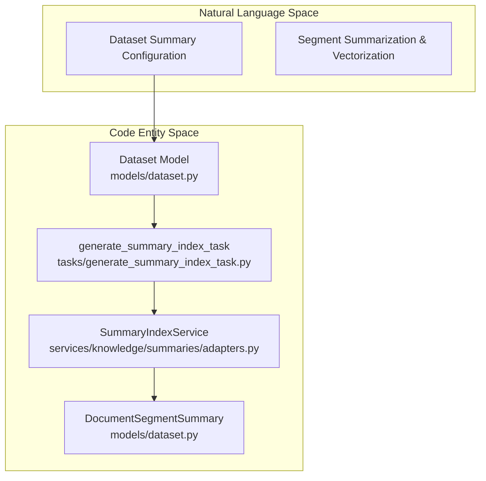
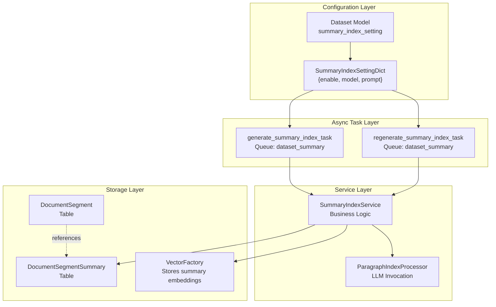
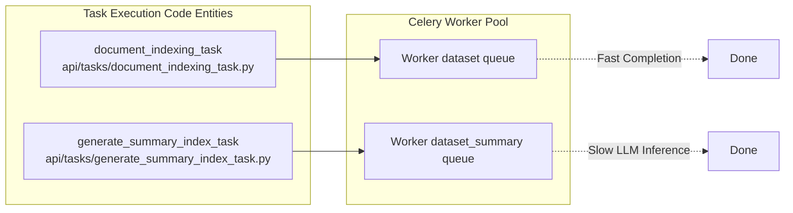
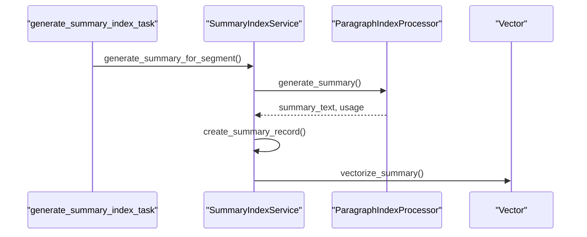

<!-- source: DeepWiki mcp.deepwiki.com · repo langgenius/dify · page 4.6 Summary Index Generation · fetched 2026-10-26 -->

# Summary Index Generation

Relevant source files

The following files were used as context for generating this wiki page:

- [api/core/workflow/nodes/knowledge_retrieval/exc.py](api/core/workflow/nodes/knowledge_retrieval/exc.py)
- [api/providers/vdb/vdb-tencent/src/dify_vdb_tencent/tencent_vector.py](api/providers/vdb/vdb-tencent/src/dify_vdb_tencent/tencent_vector.py)
- [api/providers/vdb/vdb-tencent/tests/unit_tests/test_tencent_vector.py](api/providers/vdb/vdb-tencent/tests/unit_tests/test_tencent_vector.py)
- [api/providers/vdb/vdb-vikingdb/src/dify_vdb_vikingdb/vikingdb_vector.py](api/providers/vdb/vdb-vikingdb/src/dify_vdb_vikingdb/vikingdb_vector.py)
- [api/tasks/batch_create_segment_to_index_task.py](api/tasks/batch_create_segment_to_index_task.py)
- [api/tasks/delete_account_task.py](api/tasks/delete_account_task.py)
- [api/tasks/document_indexing_task.py](api/tasks/document_indexing_task.py)
- [api/tasks/duplicate_document_indexing_task.py](api/tasks/duplicate_document_indexing_task.py)
- [api/tasks/retry_document_indexing_task.py](api/tasks/retry_document_indexing_task.py)
- [api/tasks/sync_website_document_indexing_task.py](api/tasks/sync_website_document_indexing_task.py)
- [api/tests/integration_tests/controllers/console/app/test_chat_message_permissions.py](api/tests/integration_tests/controllers/console/app/test_chat_message_permissions.py)
- [api/tests/integration_tests/controllers/console/app/test_model_config_permissions.py](api/tests/integration_tests/controllers/console/app/test_model_config_permissions.py)
- [api/tests/integration_tests/workflow/nodes/knowledge_retrieval/__init__.py](api/tests/integration_tests/workflow/nodes/knowledge_retrieval/__init__.py)
- [api/tests/test_containers_integration_tests/core/rag/retrieval/test_dataset_retrieval_integration.py](api/tests/test_containers_integration_tests/core/rag/retrieval/test_dataset_retrieval_integration.py)
- [api/tests/test_containers_integration_tests/services/document_service_status.py](api/tests/test_containers_integration_tests/services/document_service_status.py)
- [api/tests/test_containers_integration_tests/services/test_dataset_service_delete_dataset.py](api/tests/test_containers_integration_tests/services/test_dataset_service_delete_dataset.py)
- [api/tests/test_containers_integration_tests/services/test_dataset_service_retrieval.py](api/tests/test_containers_integration_tests/services/test_dataset_service_retrieval.py)
- [api/tests/test_containers_integration_tests/services/test_document_service_rename_document.py](api/tests/test_containers_integration_tests/services/test_document_service_rename_document.py)
- [api/tests/test_containers_integration_tests/services/test_workflow_service.py](api/tests/test_containers_integration_tests/services/test_workflow_service.py)
- [api/tests/test_containers_integration_tests/tasks/__init__.py](api/tests/test_containers_integration_tests/tasks/__init__.py)
- [api/tests/test_containers_integration_tests/tasks/test_add_document_to_index_task.py](api/tests/test_containers_integration_tests/tasks/test_add_document_to_index_task.py)
- [api/tests/test_containers_integration_tests/tasks/test_batch_clean_document_task.py](api/tests/test_containers_integration_tests/tasks/test_batch_clean_document_task.py)
- [api/tests/test_containers_integration_tests/tasks/test_batch_create_segment_to_index_task.py](api/tests/test_containers_integration_tests/tasks/test_batch_create_segment_to_index_task.py)
- [api/tests/test_containers_integration_tests/tasks/test_clean_dataset_task.py](api/tests/test_containers_integration_tests/tasks/test_clean_dataset_task.py)
- [api/tests/test_containers_integration_tests/tasks/test_create_segment_to_index_task.py](api/tests/test_containers_integration_tests/tasks/test_create_segment_to_index_task.py)
- [api/tests/test_containers_integration_tests/tasks/test_dataset_indexing_task.py](api/tests/test_containers_integration_tests/tasks/test_dataset_indexing_task.py)
- [api/tests/test_containers_integration_tests/tasks/test_deal_dataset_vector_index_task.py](api/tests/test_containers_integration_tests/tasks/test_deal_dataset_vector_index_task.py)
- [api/tests/test_containers_integration_tests/tasks/test_delete_segment_from_index_task.py](api/tests/test_containers_integration_tests/tasks/test_delete_segment_from_index_task.py)
- [api/tests/test_containers_integration_tests/tasks/test_disable_segments_from_index_task.py](api/tests/test_containers_integration_tests/tasks/test_disable_segments_from_index_task.py)
- [api/tests/test_containers_integration_tests/tasks/test_document_indexing_sync_task.py](api/tests/test_containers_integration_tests/tasks/test_document_indexing_sync_task.py)
- [api/tests/test_containers_integration_tests/tasks/test_document_indexing_task.py](api/tests/test_containers_integration_tests/tasks/test_document_indexing_task.py)
- [api/tests/test_containers_integration_tests/tasks/test_document_indexing_update_task.py](api/tests/test_containers_integration_tests/tasks/test_document_indexing_update_task.py)
- [api/tests/test_containers_integration_tests/tasks/test_duplicate_document_indexing_task.py](api/tests/test_containers_integration_tests/tasks/test_duplicate_document_indexing_task.py)
- [api/tests/test_containers_integration_tests/tasks/test_enable_segments_to_index_task.py](api/tests/test_containers_integration_tests/tasks/test_enable_segments_to_index_task.py)
- [api/tests/test_containers_integration_tests/tasks/test_mail_account_deletion_task.py](api/tests/test_containers_integration_tests/tasks/test_mail_account_deletion_task.py)
- [api/tests/test_containers_integration_tests/tasks/test_mail_email_code_login_task.py](api/tests/test_containers_integration_tests/tasks/test_mail_email_code_login_task.py)
- [api/tests/test_containers_integration_tests/tasks/test_mail_invite_member_task.py](api/tests/test_containers_integration_tests/tasks/test_mail_invite_member_task.py)
- [api/tests/test_containers_integration_tests/tasks/test_mail_register_task.py](api/tests/test_containers_integration_tests/tasks/test_mail_register_task.py)
- [api/tests/unit_tests/core/repositories/test_workflow_node_execution_conflict_handling.py](api/tests/unit_tests/core/repositories/test_workflow_node_execution_conflict_handling.py)
- [api/tests/unit_tests/core/workflow/nodes/knowledge_retrieval/__init__.py](api/tests/unit_tests/core/workflow/nodes/knowledge_retrieval/__init__.py)
- [api/tests/unit_tests/services/test_summary_index_service.py](api/tests/unit_tests/services/test_summary_index_service.py)
- [api/tests/unit_tests/tasks/test_dataset_indexing_task.py](api/tests/unit_tests/tasks/test_dataset_indexing_task.py)

## Purpose and Scope
Summary Index Generation is a specialized feature designed to automatically produce concise LLM-based summaries for document segments (chunks) within datasets. This capability enables summary-based retrieval as a complement to regular vector or keyword retrieval, improving efficiency and user experience by providing digestible overviews of segmented content.

To ensure that the computationally expensive LLM inference for summaries does not block standard document indexing workflows, this system isolates summary generation into a dedicated Celery queue (`dataset_summary`). This separation supports scalability and responsiveness in large-scale document management.

Sources: `[api/tasks/generate_summary_index_task.py:31-33]`, `[api/tests/unit_tests/services/test_summary_index_service.py:1-18]`, `[api/tasks/document_indexing_task.py:23-23]`

---

## Architecture Overview
The system maps domain concepts into specific backend entities, services, and asynchronous worker queues:

Sources: `[models/dataset.py:1-30]`, `[api/tasks/generate_summary_index_task.py:31-33]`, `[api/tests/unit_tests/services/test_summary_index_service.py:14-18]`

Sources: `[api/tasks/generate_summary_index_task.py:31-33]`, `[api/tests/unit_tests/services/test_summary_index_service.py:14-18]`

---

## Task Queue Isolation
Summary generation and regeneration are routed exclusively to the dedicated `dataset_summary` queue. This queue isolation strategy is critical because:
- Each segment’s summary requires an LLM call, which takes several seconds.
- Regenerating summaries for an entire dataset can take hours.
- Running summary tasks on the same queue as faster indexing tasks would block standard document processing.

Sources: `[api/tasks/document_indexing_task.py:34-35]`, `[api/tasks/generate_summary_index_task.py:31-33]`

---

## Implementation and Logic Flow
Summary index generation is implemented primarily through the `SummaryIndexService` class, which handles generating LLM summaries, persisting results, and vectorizing summaries for retrieval.

| Component | Description | Location |
|---|---|---|
| `SummaryIndexService` | Main entrypoint for summary generation logic | `[api/tests/unit_tests/services/test_summary_index_service.py:18-18]` |
| `generate_summary_index_task` | Celery background task routing summary work | `[api/tasks/generate_summary_index_task.py:31-33]` |
| `DocumentSegmentSummary` | SQLAlchemy model holding summary content and states | `[api/tests/unit_tests/services/test_summary_index_service.py:16-16]` |

Sources: `[api/tasks/generate_summary_index_task.py:31-51]`, `[api/tests/unit_tests/services/test_summary_index_service.py:14-18]`

---

## Summary Generation, Cleanup, and Error Handling
- **Generation Flow**: The asynchronous task `generate_summary_index_task` is triggered after document segments are processed. Summaries are stored in `DocumentSegmentSummary` and vectorized via `Vector`.
- **Cleanup Tasks**: Handled by `clean_document_task` and `clean_dataset_task` where summaries and vector bindings are purged.
- **Error Handling**: Tracks `status` (`GENERATING`, `SUCCESS`, `FAILED`) in `DocumentSegmentSummary` with atomic SQLAlchemy session handling.

Sources: `[api/tasks/generate_summary_index_task.py:31-108]`, `[api/tests/unit_tests/services/test_summary_index_service.py:130-146]`, `[api/tests/test_containers_integration_tests/tasks/test_clean_dataset_task.py:45-45]`

---

