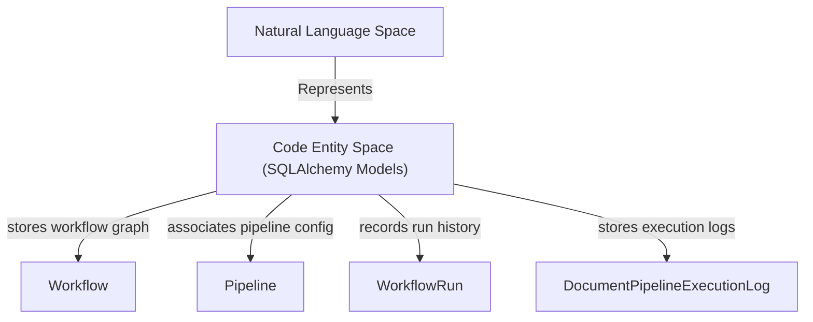
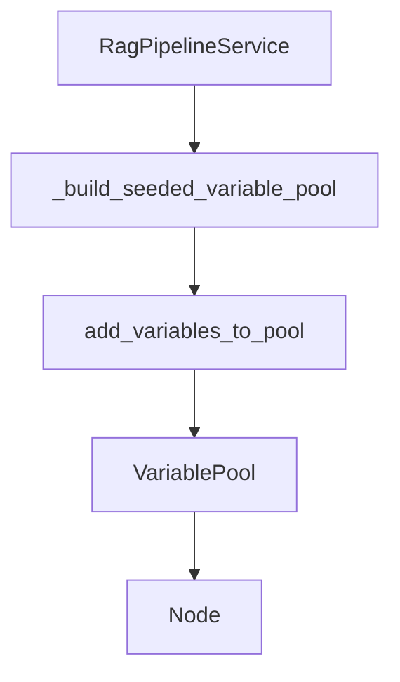
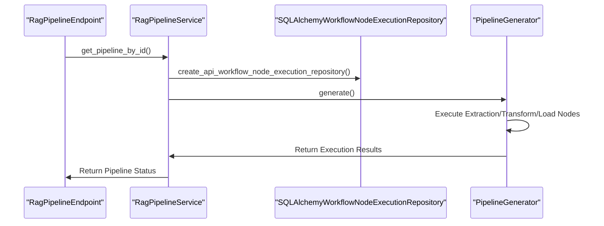

<!-- source: DeepWiki mcp.deepwiki.com · repo langgenius/dify · page 4.7 RAG Pipeline Workflow · fetched 2026-10-26 -->

# RAG Pipeline Workflow

Relevant source files

The following files were used as context for generating this wiki page:

- [api/core/plugin/impl/model.py](api/core/plugin/impl/model.py)
- [api/core/plugin/impl/model_runtime.py](api/core/plugin/impl/model_runtime.py)
- [api/core/plugin/plugin_service.py](api/core/plugin/plugin_service.py)
- [api/core/repositories/__init__.py](api/core/repositories/__init__.py)
- [api/core/repositories/celery_workflow_execution_repository.py](api/core/repositories/celery_workflow_execution_repository.py)
- [api/core/repositories/celery_workflow_node_execution_repository.py](api/core/repositories/celery_workflow_node_execution_repository.py)
- [api/core/repositories/factory.py](api/core/repositories/factory.py)
- [api/core/repositories/human_input_repository.py](api/core/repositories/human_input_repository.py)
- [api/core/repositories/sqlalchemy_workflow_execution_repository.py](api/core/repositories/sqlalchemy_workflow_execution_repository.py)
- [api/core/repositories/sqlalchemy_workflow_node_execution_repository.py](api/core/repositories/sqlalchemy_workflow_node_execution_repository.py)
- [api/core/workflow/node_factory.py](api/core/workflow/node_factory.py)
- [api/core/workflow/node_runtime.py](api/core/workflow/node_runtime.py)
- [api/libs/module_loading.py](api/libs/module_loading.py)
- [api/repositories/factory.py](api/repositories/factory.py)
- [api/services/human_input_delivery_test_service.py](api/services/human_input_delivery_test_service.py)
- [api/services/plugin/dependencies_analysis.py](api/services/plugin/dependencies_analysis.py)
- [api/services/plugin/plugin_migration.py](api/services/plugin/plugin_migration.py)
- [api/services/rag_pipeline/rag_pipeline.py](api/services/rag_pipeline/rag_pipeline.py)
- [api/services/rag_pipeline/rag_pipeline_transform_service.py](api/services/rag_pipeline/rag_pipeline_transform_service.py)
- [api/tests/test_containers_integration_tests/services/rag_pipeline/__init__.py](api/tests/test_containers_integration_tests/services/rag_pipeline/__init__.py)
- [api/tests/test_containers_integration_tests/services/rag_pipeline/test_rag_pipeline_service_db.py](api/tests/test_containers_integration_tests/services/rag_pipeline/test_rag_pipeline_service_db.py)
- [api/tests/unit_tests/core/plugin/test_model_runtime_adapter.py](api/tests/unit_tests/core/plugin/test_model_runtime_adapter.py)
- [api/tests/unit_tests/core/repositories/test_celery_workflow_execution_repository.py](api/tests/unit_tests/core/repositories/test_celery_workflow_execution_repository.py)
- [api/tests/unit_tests/core/repositories/test_celery_workflow_node_execution_repository.py](api/tests/unit_tests/core/repositories/test_celery_workflow_node_execution_repository.py)
- [api/tests/unit_tests/core/repositories/test_factory.py](api/tests/unit_tests/core/repositories/test_factory.py)
- [api/tests/unit_tests/core/repositories/test_sqlalchemy_workflow_node_execution_repository.py](api/tests/unit_tests/core/repositories/test_sqlalchemy_workflow_node_execution_repository.py)
- [api/tests/unit_tests/core/repositories/test_workflow_node_execution_truncation.py](api/tests/unit_tests/core/repositories/test_workflow_node_execution_truncation.py)
- [api/tests/unit_tests/core/workflow/entities/test_private_workflow_pause.py](api/tests/unit_tests/core/workflow/entities/test_private_workflow_pause.py)
- [api/tests/unit_tests/core/workflow/nodes/tool/test_tool_node_runtime.py](api/tests/unit_tests/core/workflow/nodes/tool/test_tool_node_runtime.py)
- [api/tests/unit_tests/core/workflow/test_node_factory.py](api/tests/unit_tests/core/workflow/test_node_factory.py)
- [api/tests/unit_tests/core/workflow/test_node_runtime.py](api/tests/unit_tests/core/workflow/test_node_runtime.py)
- [api/tests/unit_tests/models/test_workflow.py](api/tests/unit_tests/models/test_workflow.py)
- [api/tests/unit_tests/services/plugin/__init__.py](api/tests/unit_tests/services/plugin/__init__.py)
- [api/tests/unit_tests/services/plugin/conftest.py](api/tests/unit_tests/services/plugin/conftest.py)
- [api/tests/unit_tests/services/plugin/test_dependencies_analysis.py](api/tests/unit_tests/services/plugin/test_dependencies_analysis.py)
- [api/tests/unit_tests/services/plugin/test_endpoint_service.py](api/tests/unit_tests/services/plugin/test_endpoint_service.py)
- [api/tests/unit_tests/services/plugin/test_oauth_service.py](api/tests/unit_tests/services/plugin/test_oauth_service.py)
- [api/tests/unit_tests/services/plugin/test_plugin_migration.py](api/tests/unit_tests/services/plugin/test_plugin_migration.py)
- [api/tests/unit_tests/services/plugin/test_plugin_service.py](api/tests/unit_tests/services/plugin/test_plugin_service.py)
- [api/tests/unit_tests/services/plugin/test_plugin_service_installation.py](api/tests/unit_tests/services/plugin/test_plugin_service_installation.py)
- [api/tests/unit_tests/services/rag_pipeline/test_rag_pipeline_service.py](api/tests/unit_tests/services/rag_pipeline/test_rag_pipeline_service.py)
- [api/tests/unit_tests/services/rag_pipeline/test_rag_pipeline_transform_service.py](api/tests/unit_tests/services/rag_pipeline/test_rag_pipeline_transform_service.py)
- [api/tests/unit_tests/services/test_human_input_delivery_test_service.py](api/tests/unit_tests/services/test_human_input_delivery_test_service.py)

The RAG (Retrieval-Augmented Generation) Pipeline in Dify is a specialized workflow type designed to enable flexible and powerful ETL (Extract, Transform, Load) and knowledge retrieval pipelines decoupled from typical chat or completion apps. It is modeled as a standalone pipeline entity associated with a `Dataset` and managed via a graph-based DSL. Execution is asynchronous using Celery, and detailed state management is supported through draft variables and workflow run histories.

---

## 1. RAG Pipeline as a Standalone Workflow

### Overview

- The RAG Pipeline is a distinct workflow type tied directly to a `Dataset`. It uses the `DatasetRuntimeMode.RAG_PIPELINE` mode to indicate this specialized role [api/services/rag_pipeline/rag_pipeline_transform_service.py:39-44]().
- It stores its configuration and execution logic primarily in:
  - The `Pipeline` model representing the RAG pipeline entity [api/models/dataset.py:65-65]().
  - The associated `Workflow` which defines the directed graph of nodes for execution [api/models/workflow.py:71-76]().
  - Draft variables for workflow input/output state during development phases.
- Runs are triggered by specific RAG-related events such as data ingestion or debugging. The trigger source is recorded via workflow run triggers and metadata [models/workflow.py:74-74]().
- Permissions and access to manage/edit the RAG pipelines are enforced via RBAC on the Dataset resource using repository and service patterns [api/services/rag_pipeline/rag_pipeline.py:123-126]().

### Data Model Mapping

| Concept in RAG Pipeline Workflow | Corresponding Code Entity (Model) |
| :--- | :--- |
| RAG Pipeline entity | `models.dataset.Pipeline` [api/models/dataset.py:65-65]() |
| Execution graph | `models.workflow.Workflow` [api/models/workflow.py:71-76]() |
| Execution history (runs) | `models.workflow.WorkflowRun` [api/models/workflow.py:75-75]() |
| Pipeline execution logs | `models.dataset.DocumentPipelineExecutionLog` [api/models/dataset.py:64-64]() |

### Diagram: RAG Pipeline Entities in Codebase

Sources: [api/models/dataset.py:61-68](), [api/models/workflow.py:71-76](), [api/services/rag_pipeline/rag_pipeline.py:123-126]().

---

## 2. Pipeline DSL and Transform Service

### Transforming Legacy Datasets to RAG Pipelines

- The `RagPipelineTransformService` converts existing datasets into RAG pipelines by generating a YAML DSL representing the indexing and retrieval graph [api/services/rag_pipeline/rag_pipeline_transform_service.py:31-38]().
- The transformation process inspects:
  - Dataset `doc_form` - such as `PARAGRAPH_INDEX` or `PARENT_CHILD_INDEX` [api/services/rag_pipeline/rag_pipeline_transform_service.py:60-61]().
  - Data source type, e.g., uploaded files (`DataSourceType.UPLOAD_FILE`), Notion imports (`DataSourceType.NOTION_IMPORT`), website crawl [api/services/rag_pipeline/rag_pipeline_transform_service.py:54-54](), [api/services/rag_pipeline/rag_pipeline_transform_service.py:123-136]().
- Based on these attributes, corresponding DSL templates are selected from predefined YAML files [api/services/rag_pipeline/rag_pipeline_transform_service.py:120-146]().
- Nodes of the graph are patched with dataset-specific configuration, including:
  - Handling file extensions for local files [api/services/rag_pipeline/rag_pipeline_transform_service.py:75-80]().
  - Injecting knowledge index configuration data for retrieval nodes [api/services/rag_pipeline/rag_pipeline_transform_service.py:81-85]().
- The resulting pipeline is saved as a `Pipeline` record, and the dataset’s runtime mode is switched to `RAG_PIPELINE`, linking the new pipeline [api/services/rag_pipeline/rag_pipeline_transform_service.py:91-108]().

### Pipeline DSL Import/Export and Dependency Checking

- The `RagPipelineDslService` manages the import and export of pipeline DSL YAML configurations [api/services/rag_pipeline/rag_pipeline.py:90-90]().
- Import supports parsing YAML, creating/updating pipeline and workflow entities atomically.
- Dependency checks validate required plugins and model providers before pipeline execution.

Sources: [api/services/rag_pipeline/rag_pipeline_transform_service.py:31-146](), [api/services/rag_pipeline/rag_pipeline.py:90-90]().

---

## 3. Pipeline Service and Variable Loading

### Variable Management in RAG Pipelines

- The execution of RAG pipelines relies on variable pools seeded via helper functions like `_build_seeded_variable_pool` [api/services/rag_pipeline/rag_pipeline.py:103-106]().
- `RagPipelineService` initializes repositories using `DifyAPIRepositoryFactory` to manage persistence and retrieval across workflow executions [api/services/rag_pipeline/rag_pipeline.py:117-121]().
- Variable initialization incorporates system variables and tenant-scoped runtime contexts to feed the execution engine [api/services/rag_pipeline/rag_pipeline.py:37-44]().

### Variable Resolution Dataflow Diagram

Sources: [api/services/rag_pipeline/rag_pipeline.py:37-44](), [api/services/rag_pipeline/rag_pipeline.py:103-121]().

---

## 4. Pipeline Execution via Celery Tasks

### Asynchronous Execution Architecture

- Execution of RAG pipelines is done asynchronously via Celery to allow large-scale ETL operations without blocking frontend or API processing.
- `PipelineGenerator` converts the DSL graph into an executable workflow instance [api/services/rag_pipeline/rag_pipeline.py:16-16]().
- The `RagPipelineService` class orchestrates pipeline template retrieval, draft workflow management, and execution hooks [api/services/rag_pipeline/rag_pipeline.py:109-153]().
- Node-level execution traces are managed via `SQLAlchemyWorkflowNodeExecutionRepository` created through `DifyAPIRepositoryFactory` [api/services/rag_pipeline/rag_pipeline.py:117-119]().

### Execution Flow Sequence Diagram

### Additional Execution Details

- Methods exist to list, retrieve, and show details of pipeline templates to support frontend DSL builder UI [api/services/rag_pipeline/rag_pipeline.py:129-153]().
- The `RagPipelineService` utilizes API repository factories to persist node-level execution traces and workflow runs [api/services/rag_pipeline/rag_pipeline.py:33-33](), [api/services/rag_pipeline/rag_pipeline.py:117-121]().

Sources: [api/services/rag_pipeline/rag_pipeline.py:16-121](), [api/core/app/apps/pipeline/pipeline_generator.py:1-16]().

---

