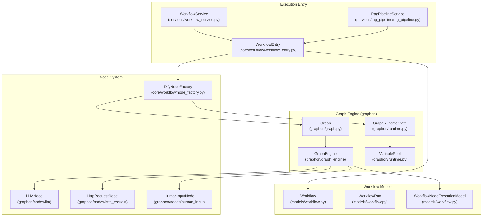
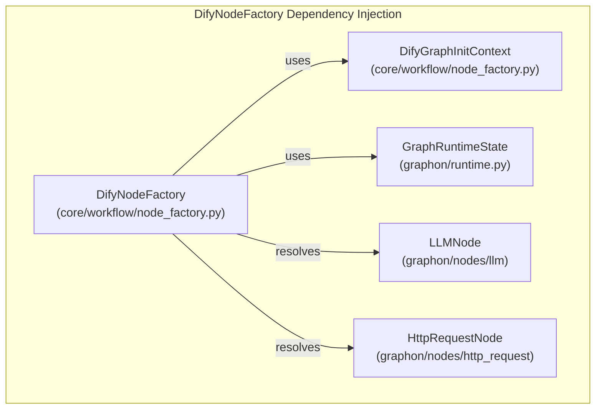

<!-- source: DeepWiki mcp.deepwiki.com · repo langgenius/dify · page 5 Workflow Engine and Node Execution · fetched 2026-10-26 -->

# Workflow Engine and Node Execution

Relevant source files

The following files were used as context for generating this wiki page:

- [api/core/app/apps/base_app_queue_manager.py](api/core/app/apps/base_app_queue_manager.py)
- [api/core/app/apps/message_based_app_queue_manager.py](api/core/app/apps/message_based_app_queue_manager.py)
- [api/core/app/apps/pipeline/pipeline_queue_manager.py](api/core/app/apps/pipeline/pipeline_queue_manager.py)
- [api/core/app/apps/workflow/app_queue_manager.py](api/core/app/apps/workflow/app_queue_manager.py)
- [api/core/workflow/nodes/human_input/boundary.py](api/core/workflow/nodes/human_input/boundary.py)
- [api/core/workflow/nodes/human_input/callback.py](api/core/workflow/nodes/human_input/callback.py)
- [api/core/workflow/nodes/human_input/constants.py](api/core/workflow/nodes/human_input/constants.py)
- [api/core/workflow/workflow_entry.py](api/core/workflow/workflow_entry.py)
- [api/services/retention/workflow_run/restore_archived_workflow_run.py](api/services/retention/workflow_run/restore_archived_workflow_run.py)
- [api/tests/unit_tests/core/app/apps/test_base_app_queue_manager.py](api/tests/unit_tests/core/app/apps/test_base_app_queue_manager.py)
- [api/tests/unit_tests/core/app/apps/test_legacy_stop_graphengine_lifecycle.py](api/tests/unit_tests/core/app/apps/test_legacy_stop_graphengine_lifecycle.py)
- [api/tests/unit_tests/core/app/apps/test_message_based_app_queue_manager.py](api/tests/unit_tests/core/app/apps/test_message_based_app_queue_manager.py)
- [api/tests/unit_tests/core/app/apps/workflow/test_app_queue_manager.py](api/tests/unit_tests/core/app/apps/workflow/test_app_queue_manager.py)
- [api/tests/unit_tests/core/rag/datasource/keyword/jieba/test_jieba.py](api/tests/unit_tests/core/rag/datasource/keyword/jieba/test_jieba.py)
- [api/tests/unit_tests/core/workflow/nodes/human_input/test_human_input_form_filled_event.py](api/tests/unit_tests/core/workflow/nodes/human_input/test_human_input_form_filled_event.py)
- [api/tests/unit_tests/core/workflow/test_human_input_callback.py](api/tests/unit_tests/core/workflow/test_human_input_callback.py)
- [api/tests/unit_tests/core/workflow/test_workflow_entry.py](api/tests/unit_tests/core/workflow/test_workflow_entry.py)
- [api/tests/unit_tests/core/workflow/test_workflow_entry_helpers.py](api/tests/unit_tests/core/workflow/test_workflow_entry_helpers.py)
- [api/tests/unit_tests/services/retention/workflow_run/test_restore_archived_workflow_run.py](api/tests/unit_tests/services/retention/workflow_run/test_restore_archived_workflow_run.py)
- [api/tests/unit_tests/services/workflow/test_node_output_inspector_service.py](api/tests/unit_tests/services/workflow/test_node_output_inspector_service.py)

## Purpose and Scope

This document describes the workflow execution engine in Dify, which orchestrates graph-based application logic through a node-based execution model. The engine processes workflows defined as directed acyclic graphs (DAGs) where nodes represent operations (LLM calls, HTTP requests, code execution, human input, etc.) and edges define data flow.

This page covers:
- Workflow definition and lifecycle management
- Node types and their execution semantics
- Variable management and data passing between nodes
- Execution tracking, queue management, and state persistence
- Node factory patterns and dependency injection

For details on the underlying execution logic, see [Workflow Definition and Execution Model](#5.1).

---

## Architecture Overview

### Workflow Execution Architecture

**Sources:** [api/core/workflow/workflow_entry.py:102-173](), [api/core/workflow/node_factory.py:14-37]()

The workflow engine uses a layered architecture:

1. **Entry Layer** - `WorkflowEntry` initializes the `GraphEngine` with specific configurations such as `min_workers` and `max_workers`, and manages execution layers like `ExecutionLimitsLayer` and `DebugLoggingLayer` [api/core/workflow/workflow_entry.py:102-173]().
2. **Model Layer** - `Workflow` stores graph definitions, `WorkflowRun` tracks executions, and `WorkflowNodeExecutionModel` records node-level results [api/models/workflow.py:86]().
3. **Graph Engine** - Orchestration logic resides in the `graphon` package, managing node scheduling and state via `GraphEngine` and `GraphRuntimeState` [api/core/workflow/workflow_entry.py:36-49]().
4. **Node Layer** - Specific node implementations execute business logic, resolved via `resolve_workflow_node_class` [api/core/workflow/node_factory.py:19-24]().

---

## Workflow Definition and Lifecycle

### Workflow Model Structure

The `Workflow` model stores the complete graph definition as JSON serialization of nodes and edges. Versioning uses constants like `VERSION_DRAFT` for drafts edited in the UI and published versions for runtime use. Workflows can have multiple types such as standard workflows or specialized RAG-pipelines tagged by `WorkflowType` [api/models/workflow.py:86]().

### Graph Configuration Structure

Graph configuration includes arrays of node and edge definitions. During execution, the `DifyGraphInitContext` holds this graph config and user context [api/core/workflow/node_factory.py:20-21](). Nodes are registered and resolved by type through a mapping that performs necessary dynamic imports.

### Workflow Lifecycle States

Workflows maintain draft and published lifecycle states. `WorkflowService` manages transitions and version checks, ensuring that executions target the correct hash and version. Node execution status is tracked using `WorkflowNodeExecutionStatus` which covers states like `RUNNING`, `SUCCEEDED`, `FAILED`, and `PAUSED` [api/tests/unit_tests/services/workflow/test_node_output_inspector_service.py:20-21]().

---

## Node Types and Execution

### Node Factory Pattern

Node instantiation is centralized in the `DifyNodeFactory`. It resolves the appropriate class for a node type and version (defaulting to latest) and handles instantiation with dependency injection [api/core/workflow/node_factory.py:19-24]().

**Sources:** [api/core/workflow/node_factory.py:19-24](), [api/core/workflow/workflow_entry.py:14-49]()

### Core Node Types

| Node Type | Implementation Class | Description | Key Dependencies |
|---|---|---|---|
| LLM Node | `LLMNode` | Performs language model inference | `ModelConfig` |
| HTTP Request Node | `HttpRequestNode` | Executes external REST API calls | Template variable interpolation |
| Knowledge Retrieval Node | `KnowledgeIndexNode` | Integrates RAG pipelines | Dataset retrieval engine |
| Human Input Node | `HumanInputNode` | Supports human-in-the-loop interactions | `DifyHITLCallback` [api/tests/unit_tests/core/workflow/nodes/human_input/test_human_input_form_filled_event.py:43-45]() |
| Agent Node | `AgentNode` | Invokes advanced agent runners in workflows | Strategy resolver pattern |

For detailed node lifecycle and implementation, see the child pages linked below.

---

## Variable Management and Data Flow

### VariablePool Architecture

The `VariablePool` is the per-execution in-memory store of variables. It is initialized with system variables (via `build_system_variables`), user inputs, and environment variables [api/core/workflow/workflow_entry.py:26-31](). Variables are represented as `Variable` objects with typed entities.

### Queue Management and Streaming

App execution events are bridged to SSE responses via queue managers like `AppQueueManager`, `WorkflowAppQueueManager`, and `MessageBasedAppQueueManager` [api/core/app/apps/base_app_queue_manager.py:50-66](), [api/core/app/apps/workflow/app_queue_manager.py:19-24](), [api/core/app/apps/message_based_app_queue_manager.py:19-23](). These managers handle task lifecycles, stop flags via Redis, and queue event dispatching [api/core/app/apps/base_app_queue_manager.py:134-143]().

---

## Summary of Subsystems and Child Pages

- [Workflow Definition and Execution Model](#5.1) — Workflow and WorkflowRun models, GraphEngine architecture, VariablePool, execution lifecycle, and node execution repositories
- [Node Factory and Dependency Injection](#5.2) — DifyNodeFactory pattern, node instantiation, and dependency injection for different node types
- [LLM Node Implementation](#5.3) — LLM node architecture, prompt construction, memory integration, and model invocation
- [HTTP Request, Code and Document Extractor Nodes](#5.4) — HttpRequestNode with template variables, CodeNode with sandbox integration, document extractor node, and security considerations
- [Knowledge Retrieval Node](#5.5) — Integration of RAG retrieval within workflows, knowledge retrieval node configuration
- [Human Input Node and Pause-Resume Mechanism](#5.6) — HumanInputNode implementation, form delivery, state persistence, and workflow resumption
- [Agent Node in Workflows](#5.7) — AgentNode implementation within the workflow graph engine, strategy resolver pattern, agent-workflow binding, and how inline vs roster agents are invoked from workflow nodes
- [Workflow Testing and Mock System](#5.8) — MockNodeFactory, mock configurations, and table-driven testing for workflows
- [Streaming Task Pipelines and Queue Managers](#5.9) — How generate task pipelines convert queue events into SSE responses for advanced-chat, workflow and easy-UI apps; AppQueueManager, task entities, and message cycle management

**Sources:** [api/core/workflow/workflow_entry.py:102-173](), [api/core/app/apps/base_app_queue_manager.py:50-66](), [api/core/app/apps/workflow/app_queue_manager.py:19-24]()

---

