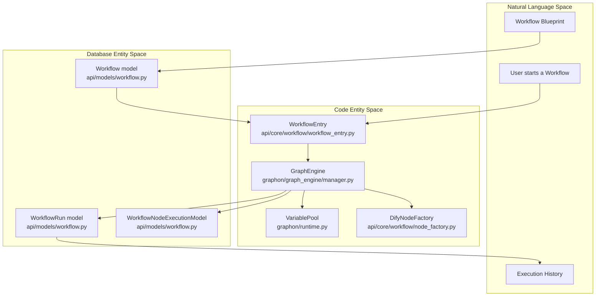
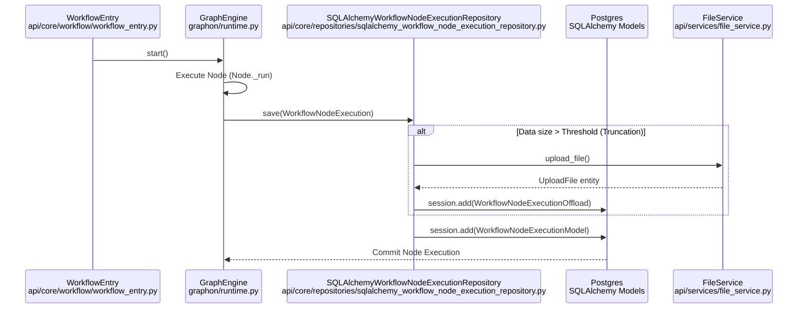

<!-- source: DeepWiki mcp.deepwiki.com · repo langgenius/dify · page 5.1 Workflow Definition and Execution Model · fetched 2026-10-26 -->

# Workflow Definition and Execution Model

Relevant source files

The following files were used as context for generating this wiki page:

- [api/core/app/apps/base_app_queue_manager.py](api/core/app/apps/base_app_queue_manager.py)
- [api/core/app/apps/message_based_app_queue_manager.py](api/core/app/apps/message_based_app_queue_manager.py)
- [api/core/app/apps/pipeline/pipeline_queue_manager.py](api/core/app/apps/pipeline/pipeline_queue_manager.py)
- [api/core/app/apps/workflow/app_queue_manager.py](api/core/app/apps/workflow/app_queue_manager.py)
- [api/core/repositories/__init__.py](api/core/repositories/__init__.py)
- [api/core/repositories/celery_workflow_execution_repository.py](api/core/repositories/celery_workflow_execution_repository.py)
- [api/core/repositories/celery_workflow_node_execution_repository.py](api/core/repositories/celery_workflow_node_execution_repository.py)
- [api/core/repositories/factory.py](api/core/repositories/factory.py)
- [api/core/repositories/human_input_repository.py](api/core/repositories/human_input_repository.py)
- [api/core/repositories/sqlalchemy_workflow_execution_repository.py](api/core/repositories/sqlalchemy_workflow_execution_repository.py)
- [api/core/repositories/sqlalchemy_workflow_node_execution_repository.py](api/core/repositories/sqlalchemy_workflow_node_execution_repository.py)
- [api/core/workflow/nodes/human_input/boundary.py](api/core/workflow/nodes/human_input/boundary.py)
- [api/core/workflow/nodes/human_input/callback.py](api/core/workflow/nodes/human_input/callback.py)
- [api/core/workflow/nodes/human_input/constants.py](api/core/workflow/nodes/human_input/constants.py)
- [api/core/workflow/workflow_entry.py](api/core/workflow/workflow_entry.py)
- [api/libs/module_loading.py](api/libs/module_loading.py)
- [api/repositories/factory.py](api/repositories/factory.py)
- [api/services/rag_pipeline/rag_pipeline.py](api/services/rag_pipeline/rag_pipeline.py)
- [api/services/retention/workflow_run/restore_archived_workflow_run.py](api/services/retention/workflow_run/restore_archived_workflow_run.py)
- [api/tests/test_containers_integration_tests/services/rag_pipeline/__init__.py](api/tests/test_containers_integration_tests/services/rag_pipeline/__init__.py)
- [api/tests/test_containers_integration_tests/services/rag_pipeline/test_rag_pipeline_service_db.py](api/tests/test_containers_integration_tests/services/rag_pipeline/test_rag_pipeline_service_db.py)
- [api/tests/unit_tests/core/app/apps/test_base_app_queue_manager.py](api/tests/unit_tests/core/app/apps/test_base_app_queue_manager.py)
- [api/tests/unit_tests/core/app/apps/test_legacy_stop_graphengine_lifecycle.py](api/tests/unit_tests/core/app/apps/test_legacy_stop_graphengine_lifecycle.py)
- [api/tests/unit_tests/core/app/apps/test_message_based_app_queue_manager.py](api/tests/unit_tests/core/app/apps/test_message_based_app_queue_manager.py)
- [api/tests/unit_tests/core/app/apps/workflow/test_app_queue_manager.py](api/tests/unit_tests/core/app/apps/workflow/test_app_queue_manager.py)
- [api/tests/unit_tests/core/rag/datasource/keyword/jieba/test_jieba.py](api/tests/unit_tests/core/rag/datasource/keyword/jieba/test_jieba.py)
- [api/tests/unit_tests/core/repositories/test_celery_workflow_execution_repository.py](api/tests/unit_tests/core/repositories/test_celery_workflow_execution_repository.py)
- [api/tests/unit_tests/core/repositories/test_celery_workflow_node_execution_repository.py](api/tests/unit_tests/core/repositories/test_celery_workflow_node_execution_repository.py)
- [api/tests/unit_tests/core/repositories/test_factory.py](api/tests/unit_tests/core/repositories/test_factory.py)
- [api/tests/unit_tests/core/repositories/test_sqlalchemy_workflow_node_execution_repository.py](api/tests/unit_tests/core/repositories/test_sqlalchemy_workflow_node_execution_repository.py)
- [api/tests/unit_tests/core/repositories/test_workflow_node_execution_truncation.py](api/tests/unit_tests/core/repositories/test_workflow_node_execution_truncation.py)
- [api/tests/unit_tests/core/workflow/entities/test_private_workflow_pause.py](api/tests/unit_tests/core/workflow/entities/test_private_workflow_pause.py)
- [api/tests/unit_tests/core/workflow/nodes/human_input/test_human_input_form_filled_event.py](api/tests/unit_tests/core/workflow/nodes/human_input/test_human_input_form_filled_event.py)
- [api/tests/unit_tests/core/workflow/test_human_input_callback.py](api/tests/unit_tests/core/workflow/test_human_input_callback.py)
- [api/tests/unit_tests/core/workflow/test_workflow_entry.py](api/tests/unit_tests/core/workflow/test_workflow_entry.py)
- [api/tests/unit_tests/core/workflow/test_workflow_entry_helpers.py](api/tests/unit_tests/core/workflow/test_workflow_entry_helpers.py)
- [api/tests/unit_tests/models/test_workflow.py](api/tests/unit_tests/models/test_workflow.py)
- [api/tests/unit_tests/services/rag_pipeline/test_rag_pipeline_service.py](api/tests/unit_tests/services/rag_pipeline/test_rag_pipeline_service.py)
- [api/tests/unit_tests/services/retention/workflow_run/test_restore_archived_workflow_run.py](api/tests/unit_tests/services/retention/workflow_run/test_restore_archived_workflow_run.py)
- [api/tests/unit_tests/services/workflow/test_node_output_inspector_service.py](api/tests/unit_tests/services/workflow/test_node_output_inspector_service.py)

## Purpose and Scope

This document describes the workflow definition and execution model in Dify, covering the static graph blueprint, runtime orchestration by the engine (`GraphEngine`), variable handling (`VariablePool`), and the lifecycle of an execution run including persistence and resumption via specialized repositories.

The architecture distinctly separates the following concerns:
1. **Static Definition Layer**: The `Workflow` SQLAlchemy model represents the blueprint and graph JSON of nodes and edges defining user workflows [api/models/workflow.py:177-222]().
2. **Execution Engine Layer**: The runtime `GraphEngine` executes graph logic and manages node dependencies, invoking node logic via `DifyNodeFactory` and `WorkflowEntry` [api/core/workflow/workflow_entry.py:102-163]().
3. **Runtime State Management**: `VariablePool` tracks variable scopes and data flowing through nodes during execution [api/core/workflow/workflow_entry.py:48]().
4. **Execution Persistence Layer**: `WorkflowRun` and `WorkflowNodeExecutionModel` track and store per-execution metadata, node inputs/outputs, status, and logs [api/models/workflow.py:581-891]().
5. **Async Execution and Resumption**: Background processing and queuing infrastructure supporting state persistence and pause-resume mechanics [api/core/app/apps/base_app_queue_manager.py:50-123]().

Sources: [api/models/workflow.py:177-222](), [api/core/workflow/workflow_entry.py:102-163](), [api/core/workflow/workflow_entry.py:48](), [api/models/workflow.py:581-891](), [api/core/app/apps/base_app_queue_manager.py:50-123]()

---

## Workflow Model: Static Definition

The `Workflow` SQLAlchemy model embodies the design-time representation of a workflow instance:

| Field | Type | Description |
| :--- | :--- | :--- |
| `id` | UUID | Primary workflow identifier [api/models/workflow.py:216]() |
| `tenant_id` | UUID | Multi-tenant workspace ID [api/models/workflow.py:217]() |
| `app_id` | UUID | Associated application/project [api/models/workflow.py:218]() |
| `type` | `WorkflowType` | Workflow variant (e.g., `workflow`, `chat`, `rag-pipeline`) [api/models/workflow.py:219]() |
| `version` | String | Version tag, e.g., `'draft'` or immutable version string [api/models/workflow.py:192-194]() |
| `graph` | LongText (JSON) | Serialized graph JSON expressing nodes and edges [api/models/workflow.py:196-203]() |

Sources: [api/models/workflow.py:177-222]()

---

## Workflow-to-Execution Entity Mapping

The following diagram bridges high-level workflow lifecycle concepts from the Natural Language Space to concrete Code Entities and Database Models.

Sources: [api/core/workflow/workflow_entry.py:102-163](), [api/models/workflow.py:177-222](), [api/models/workflow.py:581-647]()

---

## GraphEngine Architecture and WorkflowEntry

The `GraphEngine` is the core workflow runtime responsible for invoking node logic in dependency order, managing data flow, and enforcing execution policies.

### Initialization and Runtime Setup
- **WorkflowEntry Integration**: The `WorkflowEntry` class initializes the `GraphEngine` with a `Graph` instance, a `GraphRuntimeState`, a `CommandChannel` (defaulting to `InMemoryChannel`), and configuration parameters [api/core/workflow/workflow_entry.py:102-163]().
- **Execution Limits & Observability**: `WorkflowEntry` attaches execution layers such as `DebugLoggingLayer`, `ExecutionLimitsLayer`, and `ObservabilityLayer` to the engine [api/core/workflow/workflow_entry.py:165-179]().

Sources: [api/core/workflow/workflow_entry.py:102-179]()

---

## VariablePool and Variable Loading

`VariablePool` is the key abstraction for variable storage and lookup during workflow runs.

- **Initialization**: The pool is seeded with system variables, user inputs, and environment variables using pool initializer helpers [api/core/workflow/variable_pool_initializer.py]().
- **Draft Variable Loading**: For draft workflows, variable loaders fetch parameters and support multi-threaded loading of offloaded large variables [api/services/workflow_draft_variable_service.py:80-165]().

Sources: [api/core/workflow/variable_pool_initializer.py](), [api/services/workflow_draft_variable_service.py:80-165]()

---

## Execution Recording, Truncation, and Persistence

Workflow executions and per-node activity are persisted for traceability and auditing via repositories implementing `WorkflowNodeExecutionRepository` [api/core/repositories/sqlalchemy_workflow_node_execution_repository.py:51-61]().

### `SQLAlchemyWorkflowNodeExecutionRepository`
- **Context Handling**: Accepts session factories, tenant IDs, users, app IDs, and trigger sources [api/core/repositories/sqlalchemy_workflow_node_execution_repository.py:63-80]().
- **Truncation and Offloading**: Large inputs and outputs are truncated using `VariableTruncator` and offloaded to object storage as `UploadFile` records referenced through `WorkflowNodeExecutionOffload` [api/core/repositories/sqlalchemy_workflow_node_execution_repository.py:44-49](), [api/core/repositories/sqlalchemy_workflow_node_execution_repository.py:113-118]().
- **Domain Mapping**: Converts database models (`WorkflowNodeExecutionModel`) to domain entities (`WorkflowNodeExecution`) [api/core/repositories/sqlalchemy_workflow_node_execution_repository.py:120-161]().

Sources: [api/core/repositories/sqlalchemy_workflow_node_execution_repository.py:44-161]()

---

## Execution Data Flow

The following sequence diagram illustrates the flow from workflow execution initiation to node evaluation, truncation checks, file offloading, and persistence in database models.

Sources: [api/core/workflow/workflow_entry.py:102-163](), [api/core/repositories/sqlalchemy_workflow_node_execution_repository.py:113-172](), [api/models/workflow.py:833-891]()

---

## Summary

The workflow execution framework in Dify is engineered for flexibility, scalability, and observability:
- The **`Workflow`** model defines the static graph blueprint [api/models/workflow.py:177-222]().
- The **`GraphEngine`** executes workflows with typed nodes and layered interceptors [api/core/workflow/workflow_entry.py:102-179]().
- The **`VariablePool`** manages data flow and state across node executions [api/core/workflow/workflow_entry.py:48]().
- The **`WorkflowRun`** and **`WorkflowNodeExecutionModel`** provide a complete audit trail backed by dedicated persistence repositories [api/core/repositories/sqlalchemy_workflow_node_execution_repository.py:51-161]().

Sources: [api/models/workflow.py:177-222](), [api/core/workflow/workflow_entry.py:102-179](), [api/core/workflow/workflow_entry.py:48](), [api/core/repositories/sqlalchemy_workflow_node_execution_repository.py:51-161]()

---

