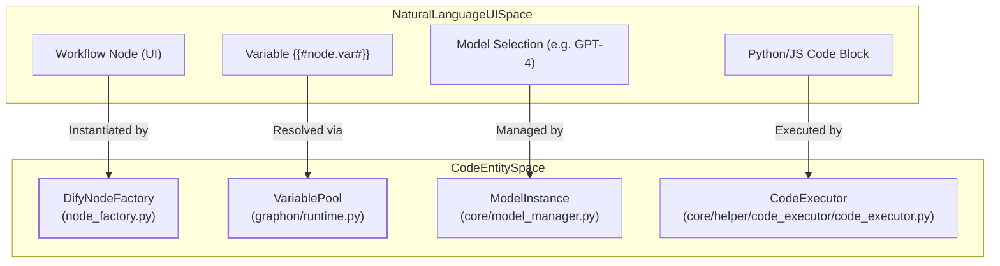
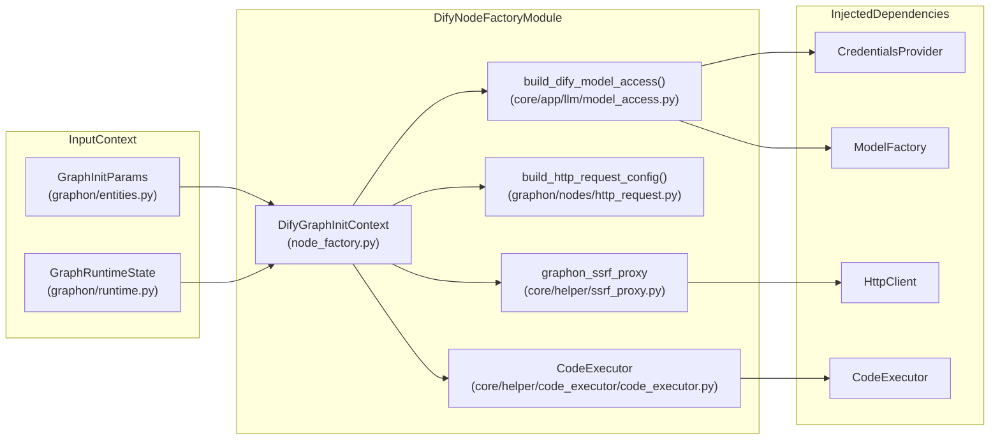
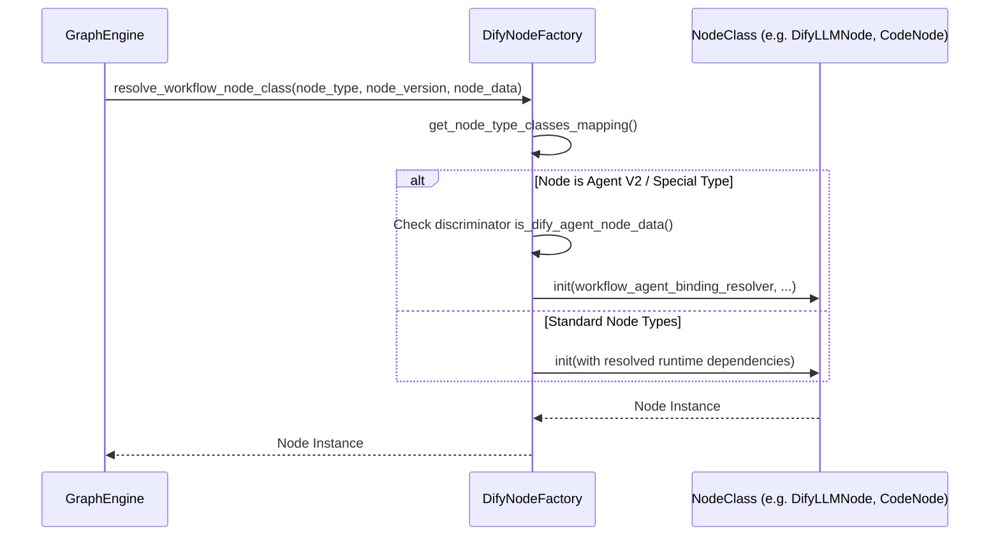
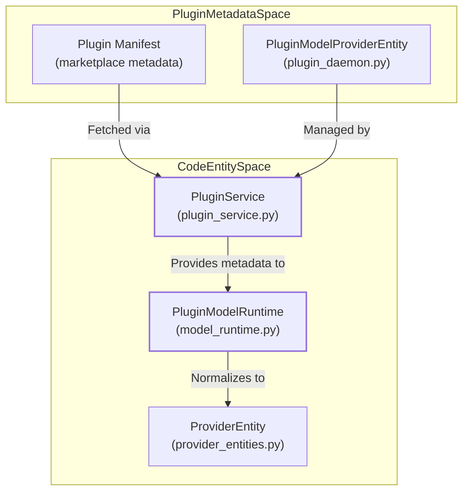
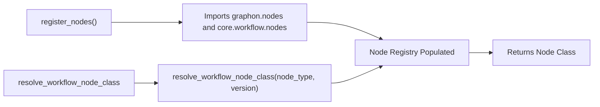

<!-- source: DeepWiki mcp.deepwiki.com · repo langgenius/dify · page 5.2 Node Factory and Dependency Injection · fetched 2026-10-26 -->

# Node Factory and Dependency Injection

Relevant source files

The following files were used as context for generating this wiki page:

- [api/core/plugin/impl/model.py](api/core/plugin/impl/model.py)
- [api/core/plugin/impl/model_runtime.py](api/core/plugin/impl/model_runtime.py)
- [api/core/plugin/plugin_service.py](api/core/plugin/plugin_service.py)
- [api/core/workflow/node_factory.py](api/core/workflow/node_factory.py)
- [api/core/workflow/node_runtime.py](api/core/workflow/node_runtime.py)
- [api/services/human_input_delivery_test_service.py](api/services/human_input_delivery_test_service.py)
- [api/services/plugin/dependencies_analysis.py](api/services/plugin/dependencies_analysis.py)
- [api/services/plugin/plugin_migration.py](api/services/plugin/plugin_migration.py)
- [api/services/rag_pipeline/rag_pipeline_transform_service.py](api/services/rag_pipeline/rag_pipeline_transform_service.py)
- [api/tests/unit_tests/core/plugin/test_model_runtime_adapter.py](api/tests/unit_tests/core/plugin/test_model_runtime_adapter.py)
- [api/tests/unit_tests/core/workflow/nodes/tool/test_tool_node_runtime.py](api/tests/unit_tests/core/workflow/nodes/tool/test_tool_node_runtime.py)
- [api/tests/unit_tests/core/workflow/test_node_factory.py](api/tests/unit_tests/core/workflow/test_node_factory.py)
- [api/tests/unit_tests/core/workflow/test_node_runtime.py](api/tests/unit_tests/core/workflow/test_node_runtime.py)
- [api/tests/unit_tests/services/plugin/__init__.py](api/tests/unit_tests/services/plugin/__init__.py)
- [api/tests/unit_tests/services/plugin/conftest.py](api/tests/unit_tests/services/plugin/conftest.py)
- [api/tests/unit_tests/services/plugin/test_dependencies_analysis.py](api/tests/unit_tests/services/plugin/test_dependencies_analysis.py)
- [api/tests/unit_tests/services/plugin/test_endpoint_service.py](api/tests/unit_tests/services/plugin/test_endpoint_service.py)
- [api/tests/unit_tests/services/plugin/test_oauth_service.py](api/tests/unit_tests/services/plugin/test_oauth_service.py)
- [api/tests/unit_tests/services/plugin/test_plugin_migration.py](api/tests/unit_tests/services/plugin/test_plugin_migration.py)
- [api/tests/unit_tests/services/plugin/test_plugin_service.py](api/tests/unit_tests/services/plugin/test_plugin_service.py)
- [api/tests/unit_tests/services/plugin/test_plugin_service_installation.py](api/tests/unit_tests/services/plugin/test_plugin_service_installation.py)
- [api/tests/unit_tests/services/rag_pipeline/test_rag_pipeline_transform_service.py](api/tests/unit_tests/services/rag_pipeline/test_rag_pipeline_transform_service.py)
- [api/tests/unit_tests/services/test_human_input_delivery_test_service.py](api/tests/unit_tests/services/test_human_input_delivery_test_service.py)

This page provides a technical deep dive into the `DifyNodeFactory` pattern, node instantiation, and the dependency injection mechanism within the Dify workflow engine. It explains in detail how the system converts workflow graph definitions into executable Python node instances, injecting required runtime dependencies based on node types and workflow context.

---

## System Architecture: From DSL to Code Entities

The Dify workflow engine transforms a workflow graph, typically defined in a Domain Specific Language (DSL) or constructed via UI, into a set of executable Python objects. The `DifyNodeFactory` is the core component responsible for this translation. It ensures each instantiated node is provided with the proper runtime dependencies, such as model access credentials, code execution capabilities, HTTP clients, file managers, and memory components.

### Mapping: Natural Language / UI Space to Code Entity Space

This diagram maps common user-facing concepts and workflow artifacts to their corresponding backend code entities and classes during node instantiation:

**Explanation:**

- Workflow nodes defined in UI are instantiated by `DifyNodeFactory` to actual node objects [api/core/workflow/node_factory.py:59-66]().
- Variables referenced in workflow are resolved dynamically via `VariablePool` [api/core/workflow/node_factory.py:75-76]() (implicitly used by `GraphRuntimeState`).
- Model selections in the UI translate to `ModelInstance` objects managing model invocation [api/core/workflow/node_factory.py:21-22]().
- User code snippets are run via `CodeExecutor` instances injected into relevant nodes [api/core/workflow/node_factory.py:16-19]().

Sources: [api/core/workflow/node_factory.py:16-66](), [api/core/workflow/node_factory.py:75-76](), [api/core/workflow/node_factory.py:113-137]()

---

## DifyNodeFactory Implementation

The node instantiation and dependency injection logic is coordinated around workflow initialization parameters (`GraphInitParams`) and runtime state (`GraphRuntimeState`).

### Initialization and Dependency Resolution Flow

When a workflow execution begins, the factory resolves various dependencies needed by all node types. This includes building model access providers, HTTP clients with SSRF proxy, code executors for script nodes, and file reference factories, all derived from the current workflow run context [api/core/workflow/node_factory.py:88-111]().

The dependency resolution pipeline:

- `DifyGraphInitContext` encapsulates explicit graph-init values owned by the workflow layer [api/core/workflow/node_factory.py:88-111]().
- `build_dify_model_access` creates credential providers and model factories, providing model invocation abstractions [api/core/workflow/node_factory.py:12-12]().
- HTTP request config and SSRF proxy client are configured to manage external calls safely [api/core/workflow/node_factory.py:20-20](), [api/core/workflow/node_factory.py:71-71]().
- `CodeExecutor` handles sandboxed code execution for code node types [api/core/workflow/node_factory.py:16-19]().

Sources: [api/core/workflow/node_factory.py:12-20](), [api/core/workflow/node_factory.py:71-71](), [api/core/workflow/node_factory.py:88-111]()

### Key Dependencies Managed by DifyNodeFactory

| Dependency Category | Code Entity | Source / Implementation |
| ------------------- | ----------- | ----------------------- |
| **Model Access** | `CredentialsProvider`, `ModelFactory` | `build_dify_model_access()` [api/core/workflow/node_factory.py:12-12]() |
| **Code Execution** | `CodeExecutor` | `core.helper.code_executor.code_executor` [api/core/workflow/node_factory.py:16-19]() |
| **HTTP Client** | `graphon_ssrf_proxy` | `core.helper.ssrf_proxy` [api/core/workflow/node_factory.py:20-20]() |
| **File Management** | `DifyFileReferenceFactory` | `core.workflow.node_runtime` [api/core/workflow/node_runtime.py:33-33]() |

Sources: [api/core/workflow/node_factory.py:12-20](), [api/core/workflow/node_runtime.py:33-33]()

---

## Node Instantiation Logic

The central resolution logic maps node types and versions to specific Python classes using the node registry [api/core/workflow/node_factory.py:128-161]().

### Detailed Node Creation Sequence

### Special Adapters and Runtime Components

Dify uses specialized runtime adapters to meet extended node interface contracts while keeping backend logic decoupled from lower-level graph primitives:

- `DifyPreparedLLM`: Simplifies full `ModelManager` into a lightweight LLM invocation facade for nodes [api/core/workflow/node_runtime.py:35-35]().
- `DifyFileReferenceFactory`: Bridges raw file reference data into Dify's file storage logic [api/core/workflow/node_runtime.py:33-33]().
- `DifyToolFileManager`: Manages temporary file lifecycles for tool execution nodes [api/core/workflow/node_runtime.py:39-39]().
- `DifyHumanInputNodeRuntime`: Implements specialized runtime for Human-in-the-loop nodes [api/core/workflow/node_runtime.py:34-34]().
- `WorkflowAgentBindingResolver`: Resolves agent-to-workflow bindings for Agent V2 nodes [api/core/workflow/node_factory.py:50-50]().

Sources: [api/core/workflow/node_factory.py:25-52](), [api/core/workflow/node_factory.py:128-161](), [api/core/workflow/node_runtime.py:33-39]()

---

## Plugin-Backed Model Runtime Integration

Dify incorporates a plugin system for extending model provider support dynamically [api/core/plugin/plugin_service.py:1-15](). This is integrated through `PluginModelClient` and `PluginModelRuntime` [api/tests/unit_tests/core/plugin/test_model_runtime_adapter.py:15-18]().

### Mapping Plugin Runtime Space to Code Entities

**Key Points:**

- `PluginService` manages tenant-scoped plugin metadata and discovery [api/core/plugin/plugin_service.py:1-15]().
- `PluginModelRuntime` is an adapter encapsulating plugin model execution [api/tests/unit_tests/core/plugin/test_model_runtime_adapter.py:15-18]().
- This allows nodes to resolve tenant-specific model providers transparently via `ModelInstance` [api/core/workflow/node_factory.py:22-22]().

Sources: [api/core/workflow/node_factory.py:22-22](), [api/core/plugin/plugin_service.py:1-15](), [api/tests/unit_tests/core/plugin/test_model_runtime_adapter.py:15-18]()

---

## Variable and File Dependency Injection

During the node lifecycle, runtime variables and file resources are injected via specialized pools and factories.

### Variable Pool and System Variables

`VariablePool` acts as the unified interface for accessing variables. System variables are resolved using system variable selectors [api/core/workflow/node_factory.py:56-56]().

| Component | Description | Source / Usage |
|-----------|-------------|---------------|
| `VariablePool` | Interface for dynamic variable resolution | `graphon.runtime.GraphRuntimeState` [api/core/workflow/node_factory.py:80-80]() |
| `DifyPromptMessageSerializer` | Serializes complex prompt variables | [api/core/workflow/node_runtime.py:37-37]() |
| `SystemVariableKey` | Keys for system-level metadata (user, query, etc.) | [api/core/workflow/node_factory.py:56-56]() |

### File Reference Injection

Files are transformed using `DifyFileReferenceFactory` [api/core/workflow/node_runtime.py:33-33](). This factory handles the translation between raw storage data and node-consumable file objects.

Sources: [api/core/workflow/node_factory.py:56-56](), [api/core/workflow/node_factory.py:80-80](), [api/core/workflow/node_runtime.py:33-37]()

---

## Registry and Discovery of Node Classes

The workflow engine uses a node registry that combines built-in implementations with Dify-specific nodes [api/core/workflow/node_factory.py:113-137]().

- `register_nodes()` imports `graphon.nodes` and `core.workflow.nodes` packages recursively to trigger self-registration [api/core/workflow/node_factory.py:113-122]().
- `resolve_workflow_node_class(node_type, node_version, node_data)` maps a node type and version to the registered Python class [api/core/workflow/node_factory.py:140-161]().
- `get_node_type_classes_mapping()` returns a read-only snapshot of the production node registry [api/core/workflow/node_factory.py:128-137]().

### Node Registry Loading and Lookup Flow

Sources: [api/core/workflow/node_factory.py:113-161]()

---

# Summary

The `DifyNodeFactory` mechanism converts workflow graph nodes into executable Python objects. It orchestrates injected dependencies such as:

- Model access components (`CredentialsProvider`, `ModelFactory`) [api/core/workflow/node_factory.py:12-12]()
- HTTP clients with SSRF protection [api/core/workflow/node_factory.py:20-20]()
- `CodeExecutor` for script nodes [api/core/workflow/node_factory.py:16-19]()
- `DifyFileReferenceFactory` and `DifyToolFileManager` for handling file lifecycle [api/core/workflow/node_runtime.py:33-39]()

The factory uses a centralized node registry to dynamically resolve node types and versions, enabling flexible extensibility and consistent node behavior [api/core/workflow/node_factory.py:113-137]().

Sources: [api/core/workflow/node_factory.py:12-20](), [api/core/workflow/node_factory.py:113-137](), [api/core/workflow/node_runtime.py:33-39]()

---

