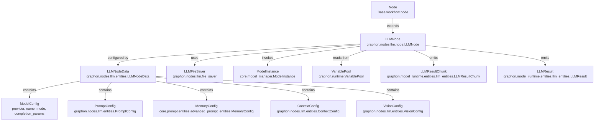
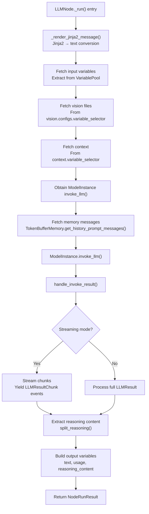
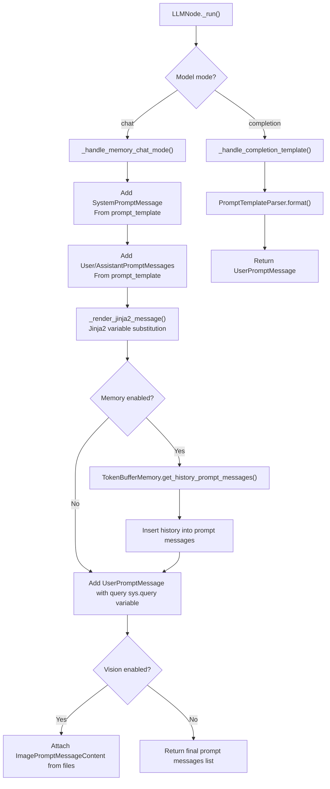
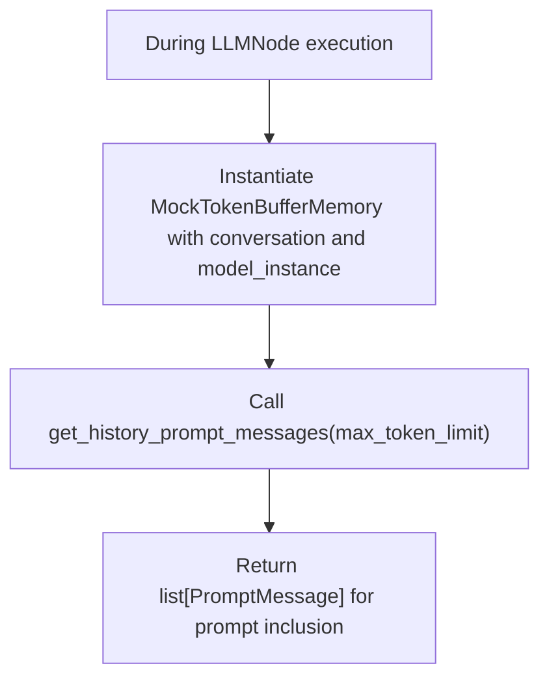
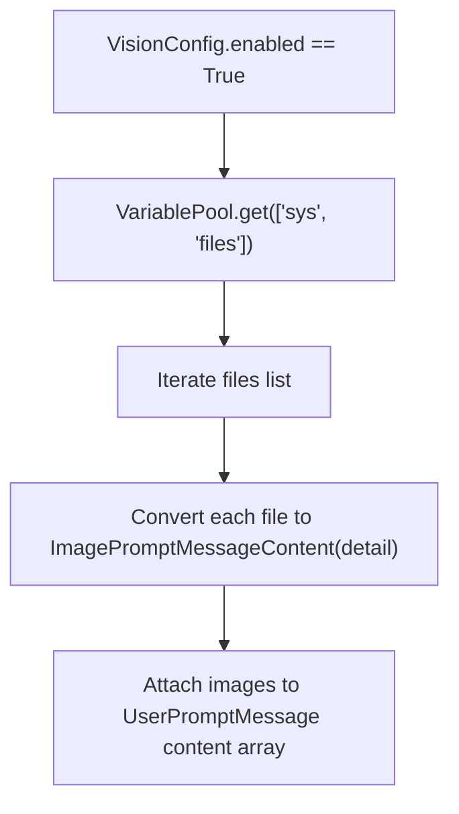
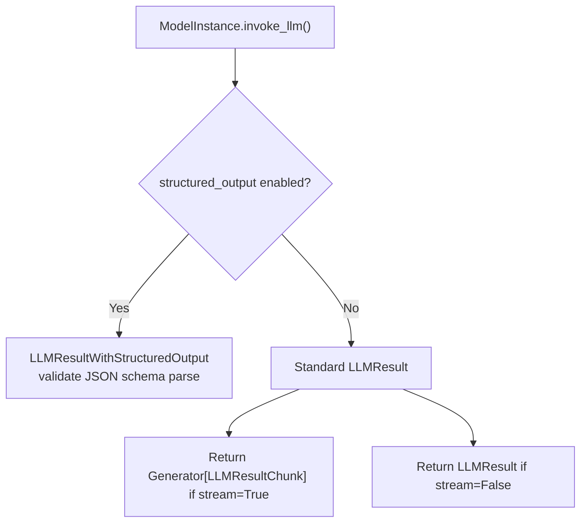
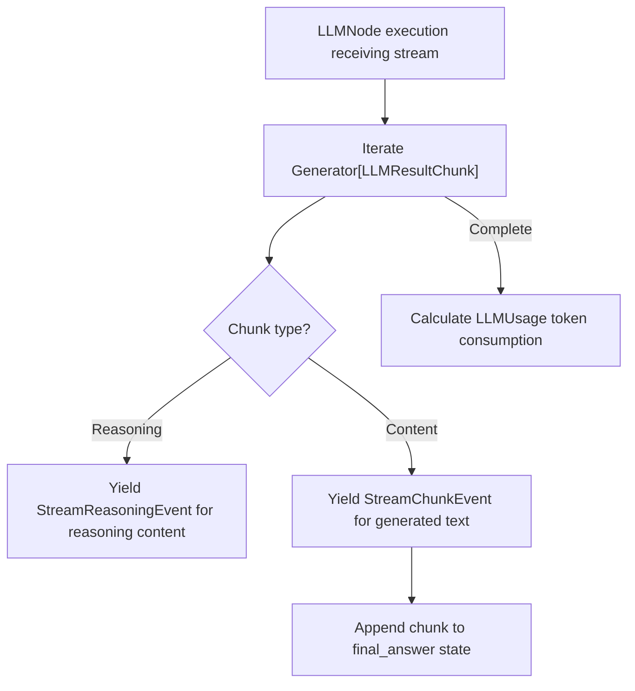
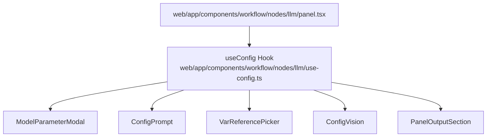

<!-- source: DeepWiki mcp.deepwiki.com · repo langgenius/dify · page 5.3 LLM Node Implementation · fetched 2026-10-26 -->

# LLM Node Implementation

Relevant source files

The following files were used as context for generating this wiki page:

- [api/core/app/apps/advanced_chat/generate_task_pipeline.py](api/core/app/apps/advanced_chat/generate_task_pipeline.py)
- [api/core/app/apps/workflow/generate_task_pipeline.py](api/core/app/apps/workflow/generate_task_pipeline.py)
- [api/core/app/entities/queue_entities.py](api/core/app/entities/queue_entities.py)
- [api/core/app/entities/task_entities.py](api/core/app/entities/task_entities.py)
- [api/core/app/llm/model_access.py](api/core/app/llm/model_access.py)
- [api/core/app/task_pipeline/based_generate_task_pipeline.py](api/core/app/task_pipeline/based_generate_task_pipeline.py)
- [api/core/app/task_pipeline/easy_ui_based_generate_task_pipeline.py](api/core/app/task_pipeline/easy_ui_based_generate_task_pipeline.py)
- [api/core/app/task_pipeline/message_cycle_manager.py](api/core/app/task_pipeline/message_cycle_manager.py)
- [api/tasks/app_generate/workflow_execute_task.py](api/tasks/app_generate/workflow_execute_task.py)
- [api/tasks/async_workflow_tasks.py](api/tasks/async_workflow_tasks.py)
- [api/tests/unit_tests/core/app/apps/test_advanced_chat_app_generator.py](api/tests/unit_tests/core/app/apps/test_advanced_chat_app_generator.py)
- [api/tests/unit_tests/core/app/llm/test_model_access.py](api/tests/unit_tests/core/app/llm/test_model_access.py)
- [api/tests/unit_tests/core/app/task_pipeline/test_easy_ui_based_generate_task_pipeline.py](api/tests/unit_tests/core/app/task_pipeline/test_easy_ui_based_generate_task_pipeline.py)
- [api/tests/unit_tests/core/app/task_pipeline/test_easy_ui_based_generate_task_pipeline_core.py](api/tests/unit_tests/core/app/task_pipeline/test_easy_ui_based_generate_task_pipeline_core.py)
- [api/tests/unit_tests/core/app/task_pipeline/test_message_cycle_manager_optimization.py](api/tests/unit_tests/core/app/task_pipeline/test_message_cycle_manager_optimization.py)
- [api/tests/unit_tests/core/prompt/test_advanced_prompt_transform.py](api/tests/unit_tests/core/prompt/test_advanced_prompt_transform.py)
- [api/tests/unit_tests/core/workflow/graph_engine/test_mock_nodes.py](api/tests/unit_tests/core/workflow/graph_engine/test_mock_nodes.py)
- [api/tests/unit_tests/core/workflow/nodes/llm/test_node.py](api/tests/unit_tests/core/workflow/nodes/llm/test_node.py)
- [api/tests/unit_tests/tasks/test_async_workflow_tasks.py](api/tests/unit_tests/tasks/test_async_workflow_tasks.py)
- [api/tests/unit_tests/tasks/test_mail_send_task.py](api/tests/unit_tests/tasks/test_mail_send_task.py)
- [api/tests/unit_tests/tasks/test_workflow_execute_task.py](api/tests/unit_tests/tasks/test_workflow_execute_task.py)
- [web/app/components/app/configuration/index.tsx](web/app/components/app/configuration/index.tsx)
- [web/app/components/workflow/datasets-detail-store/store.ts](web/app/components/workflow/datasets-detail-store/store.ts)
- [web/app/components/workflow/nodes/knowledge-retrieval/components/metadata/condition-list/condition-common-variable-selector.tsx](web/app/components/workflow/nodes/knowledge-retrieval/components/metadata/condition-list/condition-common-variable-selector.tsx)
- [web/app/components/workflow/nodes/knowledge-retrieval/components/metadata/condition-list/condition-number.tsx](web/app/components/workflow/nodes/knowledge-retrieval/components/metadata/condition-list/condition-number.tsx)
- [web/app/components/workflow/nodes/knowledge-retrieval/components/metadata/condition-list/condition-string.tsx](web/app/components/workflow/nodes/knowledge-retrieval/components/metadata/condition-list/condition-string.tsx)
- [web/app/components/workflow/nodes/llm/__tests__/utils.spec.ts](web/app/components/workflow/nodes/llm/__tests__/utils.spec.ts)
- [web/app/components/workflow/nodes/llm/components/json-schema-config-modal/error-message.tsx](web/app/components/workflow/nodes/llm/components/json-schema-config-modal/error-message.tsx)
- [web/app/components/workflow/nodes/llm/components/json-schema-config-modal/json-importer.tsx](web/app/components/workflow/nodes/llm/components/json-schema-config-modal/json-importer.tsx)
- [web/app/components/workflow/nodes/llm/components/json-schema-config-modal/visual-editor/context.tsx](web/app/components/workflow/nodes/llm/components/json-schema-config-modal/visual-editor/context.tsx)
- [web/app/components/workflow/nodes/llm/components/json-schema-config-modal/visual-editor/store.ts](web/app/components/workflow/nodes/llm/components/json-schema-config-modal/visual-editor/store.ts)
- [web/app/components/workflow/nodes/llm/panel.tsx](web/app/components/workflow/nodes/llm/panel.tsx)
- [web/app/components/workflow/nodes/llm/use-config.ts](web/app/components/workflow/nodes/llm/use-config.ts)
- [web/app/components/workflow/nodes/llm/utils.ts](web/app/components/workflow/nodes/llm/utils.ts)
- [web/app/components/workflow/nodes/parameter-extractor/panel.tsx](web/app/components/workflow/nodes/parameter-extractor/panel.tsx)
- [web/app/components/workflow/nodes/question-classifier/panel.tsx](web/app/components/workflow/nodes/question-classifier/panel.tsx)
- [web/app/components/workflow/types.ts](web/app/components/workflow/types.ts)
- [web/utils/completion-params.ts](web/utils/completion-params.ts)
- [web/utils/draft-07.json](web/utils/draft-07.json)
- [web/utils/index.ts](web/utils/index.ts)
- [web/utils/validators.ts](web/utils/validators.ts)

## Purpose and Scope

This page documents the implementation of the LLM Node in Dify's workflow engine. The LLM Node is responsible for orchestrating large language model invocations within workflows, including prompt construction with variable interpolation, integration with memory for conversational context, handling multimodal inputs such as images, and processing responses—including streamed outputs, structured data, and reasoning content extraction.

The discussion includes the architecture of the `LLMNode` class, the data flow during node execution, prompt formation, memory and knowledge context integration, model invocation, and response handling. For broader workflow and node factory context, see [Workflow Definition and Execution Model (5.1)]() and [Node Factory and Dependency Injection (5.2)](). For quota and model management, see [LLM Integration and Model Management (6.0)]().

---

## Node Class Architecture

The core implementation of the LLM Node is in the `LLMNode` class. It extends the base `Node` class and adds specialized logic to handle LLM prompts, memory, context, and invocation.

### LLMNode Class and Associated Types

The `LLMNodeData` defines the node data payload including the model configuration, prompt templates, memory and context settings, and vision (e.g., image) configurations managed in the frontend and passed to the backend node [api/tests/unit_tests/core/workflow/nodes/llm/test_node.py:65-70]().

`LLMNode` leverages:

- `ModelInstance` to perform the actual model invocation [api/core/model_manager.py:35-40]().
- `LLMFileSaver` to manage file persistence for the node [graphon/nodes/llm/file_saver.py]().
- `VariablePool` to access runtime variables bound to the execution context [graphon/runtime.py:86]().
- Serialization and deserialization of prompt messages via a `PromptMessageSerializerProtocol`.

**Sources:** [api/tests/unit_tests/core/workflow/nodes/llm/test_node.py:58-85](), [api/core/model_manager.py:35-63](), [api/tests/unit_tests/core/workflow/nodes/llm/test_node.py:65-70]()

---

## Node Execution Lifecycle

The LLM Node execution proceeds through a well-defined pipeline involving prompt preparation, context and memory fetching, model invocation, and response handling.

### Execution Flow Overview

The `_run()` method of `LLMNode` orchestrates this. After formatting prompt templates by rendering Jinja2 variables via `_render_jinja2_message` [graphon/nodes/llm/node.py:85](), it loads vision files and retrieval context. The node then fetches memory history via `MockTokenBufferMemory.get_history_prompt_messages` [api/tests/unit_tests/core/workflow/nodes/llm/test_node.py:97-102](). The LLM is invoked via `ModelInstance.invoke_llm` [api/core/model_manager.py:145-150]() and either streamed or awaited. Response chunks are parsed to separate text and reasoning content using `split_reasoning` [graphon/nodes/llm/node.py:86]().

**Sources:** [graphon/nodes/llm/node.py](), [api/core/model_manager.py:145-150](), [api/tests/unit_tests/core/workflow/nodes/llm/test_node.py:97-102]()

---

## Prompt Construction Pipeline

Prompt construction is a key responsibility, combining templates, variable substitution, memory, context, and multimodal inputs.

### Prompt Assembly Pipeline

For chat mode, the node builds a messages list including `SystemPromptMessage`, `UserPromptMessage`, and `AssistantPromptMessage` [graphon/model_runtime/entities/message_entities.py:39-41](). If memory is enabled, it includes conversation history via `MockTokenBufferMemory`. Vision-enabled nodes add image files as `ImagePromptMessageContent` [graphon/model_runtime/entities/message_entities.py:33]().

### Variable Types and Transformations

| Variable Type | Source | Transformation |
| :--- | :--- | :--- |
| `{{input_var}}` | User inputs or upstream outputs | Substituted via Jinja2 in templates [graphon/nodes/llm/node.py:85]() |
| `#context#` | Knowledge retrieval output | Assembled from document segments [core/prompt/utils/prompt_template_parser.py:128]() |
| `#histories#` | Conversation memory | Retrieved from `MockTokenBufferMemory` [api/tests/unit_tests/core/workflow/nodes/llm/test_node.py:97]() |
| `#files#` | Vision files variable selector | Transformed to `ImagePromptMessageContent` [graphon/model_runtime/entities/message_entities.py:33]() |

**Sources:** [graphon/nodes/llm/node.py:85](), [core/prompt/utils/prompt_template_parser.py:124-136](), [api/tests/unit_tests/core/workflow/nodes/llm/test_node.py:97]()

---

## Memory Integration

To handle conversational multi-turn contexts, the LLM Node integrates with `MockTokenBufferMemory` which stores past prompt messages.

### Memory Flow

The memory fetch prepend the last N messages based on token or message count limits [api/tests/unit_tests/core/workflow/nodes/llm/test_node.py:97-102]().

**Sources:** [api/tests/unit_tests/core/workflow/nodes/llm/test_node.py:94-105]()

---

## Multimodal Support (Vision Integration)

LLM nodes may enable vision support where image files are passed as prompt attachments.

### Vision File Processing

The vision configuration references variables indicating files to embed alongside textual prompts as structured message content [api/tests/unit_tests/core/workflow/nodes/llm/test_node.py:68-70](). The `_build_image_file` method in `test_node.py` demonstrates how `File` objects are constructed for testing, which are then converted into `ImagePromptMessageContent` [api/tests/unit_tests/core/workflow/nodes/llm/test_node.py:189-196]().

**Sources:** [api/tests/unit_tests/core/workflow/nodes/llm/test_node.py:68-70](), [api/tests/unit_tests/core/workflow/nodes/llm/test_node.py:189-196]()

---

## Model Invocation

The node invokes the model via `ModelInstance` which abstracts provider interactions.

### Invocation Architecture and Modes

The node supports both streaming and blocking invocation modes [api/core/model_manager.py:145-150](), optionally parsing structured output formats [graphon/model_runtime/entities/llm_entities.py:30-31]().

**Sources:** [api/core/model_manager.py:145-150](), [graphon/model_runtime/entities/llm_entities.py:30-31]()

---

## Response Processing and Streaming

Response chunks from streaming calls are iterated and parsed for text and reasoning events.

### Streaming Response Handling

The node separates reasoning tags or content from plain text using `StreamReasoningEvent` and `StreamChunkEvent` [graphon/node_events.py:57-58]().

**Sources:** [graphon/node_events.py:57-58](), [api/core/model_manager.py:170-190]()

---

## Configuration and UI

The frontend UI for configuring the LLM node is implemented in React. It uses the `useConfig` hook for managing model selection, prompt editing, and memory.

### Frontend Configuration Hook Diagram

The panel supports editing prompt templates, selecting multimodal file inputs, and adjusting model parameters [web/app/components/workflow/nodes/llm/panel.tsx:54-89](). It uses `fetchAndMergeValidCompletionParams` to validate model parameters [web/utils/completion-params.ts:27-32]() and `useModelListAndDefaultModelAndCurrentProviderAndModel` to manage model selection [web/app/components/workflow/nodes/llm/use-config.ts:7]().

**Sources:** [web/app/components/workflow/nodes/llm/panel.tsx:29-33](), [web/app/components/workflow/nodes/llm/panel.tsx:54-89](), [web/utils/completion-params.ts:27-32](), [web/app/components/workflow/nodes/llm/use-config.ts:7]()

---

