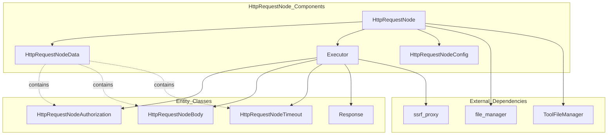
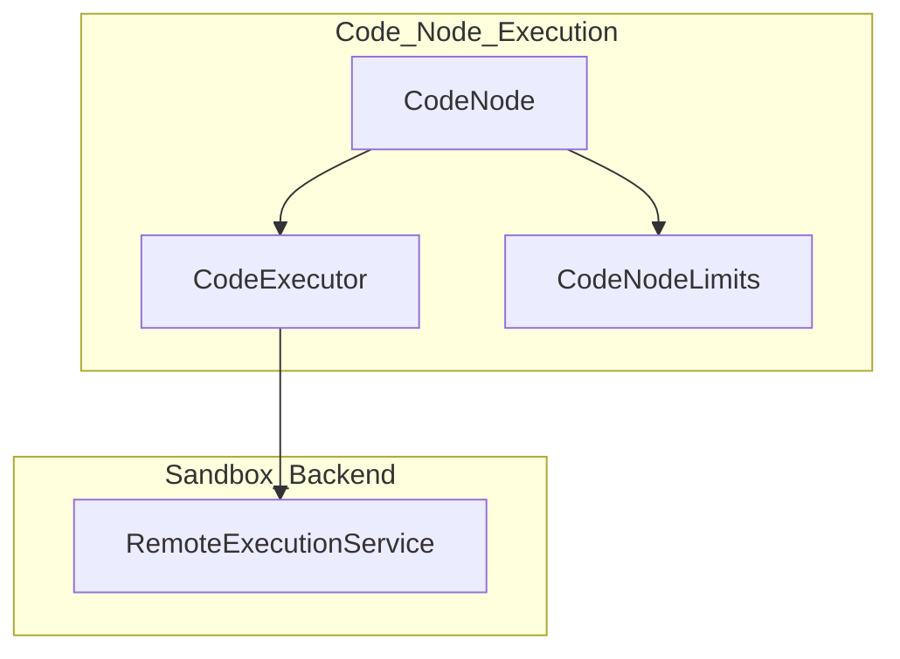
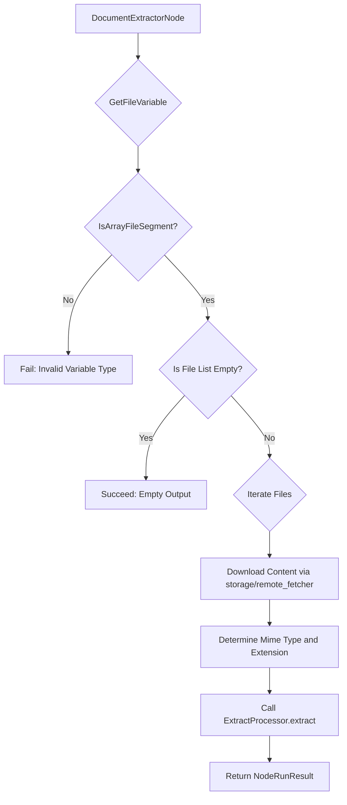
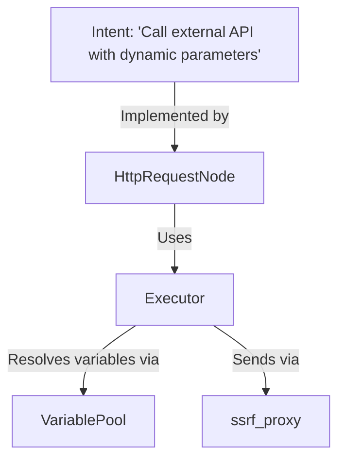
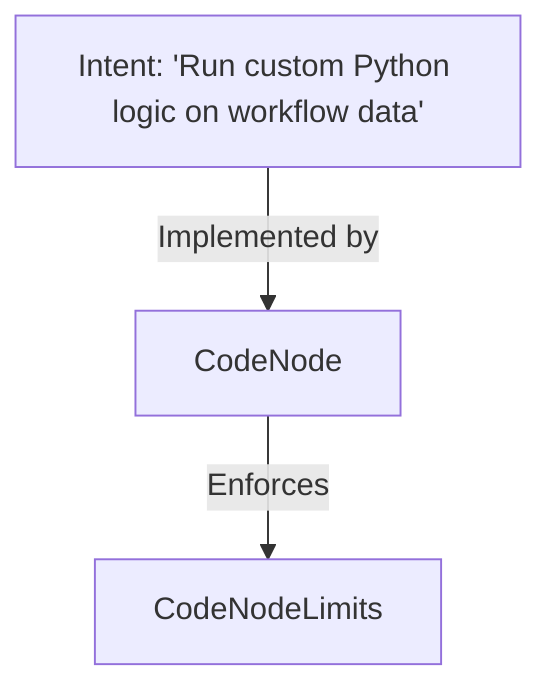

<!-- source: DeepWiki mcp.deepwiki.com · repo langgenius/dify · page 5.4 HTTP Request, Code and Document Extractor Nodes · fetched 2026-10-26 -->

# HTTP Request, Code and Document Extractor Nodes

Relevant source files

The following files were used as context for generating this wiki page:

- [api/controllers/console/workspace/skills.py](api/controllers/console/workspace/skills.py)
- [api/core/extension/api_based_extension_requestor.py](api/core/extension/api_based_extension_requestor.py)
- [api/core/helper/ssrf_proxy.py](api/core/helper/ssrf_proxy.py)
- [api/core/llm_generator/output_parser/structured_output.py](api/core/llm_generator/output_parser/structured_output.py)
- [api/core/rag/extractor/extract_processor.py](api/core/rag/extractor/extract_processor.py)
- [api/core/rag/extractor/pdf_extractor.py](api/core/rag/extractor/pdf_extractor.py)
- [api/core/rag/extractor/word_extractor.py](api/core/rag/extractor/word_extractor.py)
- [api/providers/vdb/vdb-alibabacloud-mysql/tests/unit_tests/test_alibabacloud_mysql_factory.py](api/providers/vdb/vdb-alibabacloud-mysql/tests/unit_tests/test_alibabacloud_mysql_factory.py)
- [api/providers/vdb/vdb-analyticdb/tests/unit_tests/test_analyticdb_vector.py](api/providers/vdb/vdb-analyticdb/tests/unit_tests/test_analyticdb_vector.py)
- [api/providers/vdb/vdb-baidu/tests/unit_tests/test_baidu_vector.py](api/providers/vdb/vdb-baidu/tests/unit_tests/test_baidu_vector.py)
- [api/providers/vdb/vdb-chroma/tests/unit_tests/test_chroma_vector.py](api/providers/vdb/vdb-chroma/tests/unit_tests/test_chroma_vector.py)
- [api/providers/vdb/vdb-clickzetta/tests/unit_tests/test_clickzetta_vector.py](api/providers/vdb/vdb-clickzetta/tests/unit_tests/test_clickzetta_vector.py)
- [api/providers/vdb/vdb-couchbase/tests/unit_tests/test_couchbase_vector.py](api/providers/vdb/vdb-couchbase/tests/unit_tests/test_couchbase_vector.py)
- [api/providers/vdb/vdb-elasticsearch/src/dify_vdb_elasticsearch/elasticsearch_vector.py](api/providers/vdb/vdb-elasticsearch/src/dify_vdb_elasticsearch/elasticsearch_vector.py)
- [api/providers/vdb/vdb-elasticsearch/tests/unit_tests/test_elasticsearch_ja_vector.py](api/providers/vdb/vdb-elasticsearch/tests/unit_tests/test_elasticsearch_ja_vector.py)
- [api/providers/vdb/vdb-elasticsearch/tests/unit_tests/test_elasticsearch_vector.py](api/providers/vdb/vdb-elasticsearch/tests/unit_tests/test_elasticsearch_vector.py)
- [api/providers/vdb/vdb-hologres/tests/unit_tests/test_hologres_vector.py](api/providers/vdb/vdb-hologres/tests/unit_tests/test_hologres_vector.py)
- [api/providers/vdb/vdb-huawei-cloud/src/dify_vdb_huawei_cloud/huawei_cloud_vector.py](api/providers/vdb/vdb-huawei-cloud/src/dify_vdb_huawei_cloud/huawei_cloud_vector.py)
- [api/providers/vdb/vdb-huawei-cloud/tests/unit_tests/test_huawei_cloud_vector.py](api/providers/vdb/vdb-huawei-cloud/tests/unit_tests/test_huawei_cloud_vector.py)
- [api/providers/vdb/vdb-iris/tests/unit_tests/test_iris_vector.py](api/providers/vdb/vdb-iris/tests/unit_tests/test_iris_vector.py)
- [api/providers/vdb/vdb-lindorm/tests/unit_tests/test_lindorm_vector.py](api/providers/vdb/vdb-lindorm/tests/unit_tests/test_lindorm_vector.py)
- [api/providers/vdb/vdb-opengauss/tests/unit_tests/test_opengauss.py](api/providers/vdb/vdb-opengauss/tests/unit_tests/test_opengauss.py)
- [api/providers/vdb/vdb-opensearch/src/dify_vdb_opensearch/opensearch_vector.py](api/providers/vdb/vdb-opensearch/src/dify_vdb_opensearch/opensearch_vector.py)
- [api/providers/vdb/vdb-pgvecto-rs/tests/unit_tests/test_pgvecto_rs.py](api/providers/vdb/vdb-pgvecto-rs/tests/unit_tests/test_pgvecto_rs.py)
- [api/providers/vdb/vdb-pgvector/src/dify_vdb_pgvector/pgvector.py](api/providers/vdb/vdb-pgvector/src/dify_vdb_pgvector/pgvector.py)
- [api/providers/vdb/vdb-tablestore/src/dify_vdb_tablestore/tablestore_vector.py](api/providers/vdb/vdb-tablestore/src/dify_vdb_tablestore/tablestore_vector.py)
- [api/providers/vdb/vdb-vastbase/pyproject.toml](api/providers/vdb/vdb-vastbase/pyproject.toml)
- [api/providers/vdb/vdb-vastbase/src/dify_vdb_vastbase/vastbase_vector.py](api/providers/vdb/vdb-vastbase/src/dify_vdb_vastbase/vastbase_vector.py)
- [api/providers/vdb/vdb-vastbase/tests/unit_tests/test_vastbase_vector.py](api/providers/vdb/vdb-vastbase/tests/unit_tests/test_vastbase_vector.py)
- [api/providers/vdb/vdb-weaviate/src/dify_vdb_weaviate/weaviate_vector.py](api/providers/vdb/vdb-weaviate/src/dify_vdb_weaviate/weaviate_vector.py)
- [api/providers/vdb/vdb-weaviate/tests/unit_tests/test_doc_id_cleanup_41714.py](api/providers/vdb/vdb-weaviate/tests/unit_tests/test_doc_id_cleanup_41714.py)
- [api/providers/vdb/vdb-weaviate/tests/unit_tests/test_weaviate_vector.py](api/providers/vdb/vdb-weaviate/tests/unit_tests/test_weaviate_vector.py)
- [api/tests/unit_tests/controllers/common/test_fields.py](api/tests/unit_tests/controllers/common/test_fields.py)
- [api/tests/unit_tests/controllers/console/workspace/test_skills.py](api/tests/unit_tests/controllers/console/workspace/test_skills.py)
- [api/tests/unit_tests/core/extension/test_api_based_extension_requestor.py](api/tests/unit_tests/core/extension/test_api_based_extension_requestor.py)
- [api/tests/unit_tests/core/extension/test_extensible.py](api/tests/unit_tests/core/extension/test_extensible.py)
- [api/tests/unit_tests/core/extension/test_extension.py](api/tests/unit_tests/core/extension/test_extension.py)
- [api/tests/unit_tests/core/external_data_tool/api/test_api.py](api/tests/unit_tests/core/external_data_tool/api/test_api.py)
- [api/tests/unit_tests/core/external_data_tool/test_base.py](api/tests/unit_tests/core/external_data_tool/test_base.py)
- [api/tests/unit_tests/core/external_data_tool/test_external_data_fetch.py](api/tests/unit_tests/core/external_data_tool/test_external_data_fetch.py)
- [api/tests/unit_tests/core/external_data_tool/test_factory.py](api/tests/unit_tests/core/external_data_tool/test_factory.py)
- [api/tests/unit_tests/core/helper/code_executor/test_template_transformer.py](api/tests/unit_tests/core/helper/code_executor/test_template_transformer.py)
- [api/tests/unit_tests/core/helper/test_ssrf_proxy.py](api/tests/unit_tests/core/helper/test_ssrf_proxy.py)
- [api/tests/unit_tests/core/llm_generator/output_parser/test_rule_config_generator.py](api/tests/unit_tests/core/llm_generator/output_parser/test_rule_config_generator.py)
- [api/tests/unit_tests/core/llm_generator/output_parser/test_structured_output.py](api/tests/unit_tests/core/llm_generator/output_parser/test_structured_output.py)
- [api/tests/unit_tests/core/moderation/test_content_moderation.py](api/tests/unit_tests/core/moderation/test_content_moderation.py)
- [api/tests/unit_tests/core/rag/datasource/keyword/jieba/test_stopwords.py](api/tests/unit_tests/core/rag/datasource/keyword/jieba/test_stopwords.py)
- [api/tests/unit_tests/core/rag/datasource/keyword/test_keyword_base.py](api/tests/unit_tests/core/rag/datasource/keyword/test_keyword_base.py)
- [api/tests/unit_tests/core/rag/datasource/keyword/test_keyword_factory.py](api/tests/unit_tests/core/rag/datasource/keyword/test_keyword_factory.py)
- [api/tests/unit_tests/core/rag/datasource/vdb/test_field.py](api/tests/unit_tests/core/rag/datasource/vdb/test_field.py)
- [api/tests/unit_tests/core/rag/datasource/vdb/test_vector_base.py](api/tests/unit_tests/core/rag/datasource/vdb/test_vector_base.py)
- [api/tests/unit_tests/core/rag/embedding/test_embedding_base.py](api/tests/unit_tests/core/rag/embedding/test_embedding_base.py)
- [api/tests/unit_tests/core/rag/extractor/test_extract_processor.py](api/tests/unit_tests/core/rag/extractor/test_extract_processor.py)
- [api/tests/unit_tests/core/rag/extractor/test_pdf_extractor.py](api/tests/unit_tests/core/rag/extractor/test_pdf_extractor.py)
- [api/tests/unit_tests/core/rag/extractor/test_text_extractor.py](api/tests/unit_tests/core/rag/extractor/test_text_extractor.py)
- [api/tests/unit_tests/core/rag/extractor/test_word_extractor.py](api/tests/unit_tests/core/rag/extractor/test_word_extractor.py)
- [api/tests/unit_tests/core/rag/extractor/unstructured/test_unstructured_extractors.py](api/tests/unit_tests/core/rag/extractor/unstructured/test_unstructured_extractors.py)
- [api/tests/unit_tests/core/rag/indexing/processor/conftest.py](api/tests/unit_tests/core/rag/indexing/processor/conftest.py)
- [api/tests/unit_tests/core/rag/retrieval/test_dataset_retrieval_attachment_entry.py](api/tests/unit_tests/core/rag/retrieval/test_dataset_retrieval_attachment_entry.py)
- [api/tests/unit_tests/enterprise/telemetry/test_enterprise_trace.py](api/tests/unit_tests/enterprise/telemetry/test_enterprise_trace.py)

This document describes the HTTP Request, Code Execution, and Document Extractor nodes in the Dify workflow engine. These nodes enable workflows to interact with external services via HTTP with template variable substitution, execute custom code logic within sandboxed environments with security and resource limits, and extract text content from various document types.

---

## HTTP Request Node Architecture

The `HttpRequestNode` supports sending HTTP requests in workflows with powerful features like templated variables, flexible authentication, and security safeguards including SSRF protection. It composes modular entities for configuration, authorization, timeout management, and dynamic request body serialization.

### Component Structure

- `HttpRequestNode`: Main node class handling the workflow execution logic.
- `HttpRequestNodeData`: Holds per-node HTTP request configuration, including method, URL, headers, params, body, authorization, and timeout.
- `Executor`: Responsible for resolving templated variables, building the request, applying security policies, and invoking the external HTTP call.
- `HttpRequestNodeConfig`: Global/system config defining limits such as timeout maxima and response size bounds.
- `HttpRequestNodeAuthorization`, `HttpRequestNodeBody`, `HttpRequestNodeTimeout`, and `Response`: Detailed entity models for respective parts of the HTTP request lifecycle.

Sources: [api/tests/unit_tests/core/workflow/nodes/http_request/test_http_request_executor.py:7-16](), [api/tests/unit_tests/core/workflow/nodes/http_request/test_http_request_node.py:14-16](), [api/tests/unit_tests/core/workflow/nodes/http_request/test_http_request_node.py:119-129]()

---

### Configuration and Initialization

The node configuration is derived from `HttpRequestNodeConfig`, which defines node-wide execution constraints based on `dify_config`.

| Parameter | Type | Purpose | Source File / Logic |
|---|---|---|---|
| `max_connect_timeout` | int | Max connect timeout (seconds) | `dify_config.HTTP_REQUEST_MAX_CONNECT_TIMEOUT` |
| `max_read_timeout` | int | Max read timeout (seconds) | `dify_config.HTTP_REQUEST_MAX_READ_TIMEOUT` |
| `max_write_timeout` | int | Max write timeout (seconds) | `dify_config.HTTP_REQUEST_MAX_WRITE_TIMEOUT` |
| `max_binary_size` | int | Max binary response size (B) | `dify_config.HTTP_REQUEST_NODE_MAX_BINARY_SIZE` |
| `ssl_verify` | bool | Enable SSL certificate verify | `dify_config.HTTP_REQUEST_NODE_SSL_VERIFY` |

Sources: [api/tests/unit_tests/core/workflow/nodes/http_request/test_http_request_executor.py:19-27](), [api/tests/unit_tests/core/workflow/nodes/http_request/test_http_request_node.py:19-27]()

---

## Template Variable Substitution in HTTP Requests

The HTTP Request node supports Jinja2-like templating to substitute variables during execution across request components. The special syntax is `{{#node_id.variable#}}` to refer to data from the `VariablePool`.

### Variable Resolution Flow

- The `Executor` reads the HTTP request's templated strings and resolves variable placeholders via an internal `VariablePool`.
- **JSON Body Handling**: The Executor serializes resolved objects as JSON automatically when they are embedded in JSON bodies.
- **Nested Objects**: Supports deep object resolution within JSON templates, e.g., `'{"object": {{#pre_node_id.object#}}}'`.

Sources: [api/tests/unit_tests/core/workflow/nodes/http_request/test_http_request_executor.py:30-84](), [api/tests/unit_tests/core/workflow/nodes/http_request/test_http_request_executor.py:86-142](), [api/tests/unit_tests/core/workflow/nodes/http_request/test_http_request_executor.py:144-180]()

---

## Authorization Methods

The HTTP Request node supports a variety of authorization schemes configured by the `HttpRequestNodeAuthorization` entity:

| Authorization Type | Description | Implementation Reference |
|---|---|---|
| `no-auth` | No authentication | [api/tests/integration_tests/workflow/nodes/test_http.py:138-139]() |
| `api-key` (basic) | API key with basic encoding | [api/tests/integration_tests/workflow/nodes/test_http.py:104-107]() |
| `api-key` (custom) | Custom API key with user-defined header | [api/tests/integration_tests/workflow/nodes/test_http.py:169-173]() |

Missing or empty keys in custom API key auth raise `AuthorizationConfigError`. [api/tests/integration_tests/workflow/nodes/test_http.py:193-202]()

Sources: [api/tests/integration_tests/workflow/nodes/test_http.py:104-202]()

---

## Security Considerations for HTTP Requests

The `core.helper.ssrf_proxy` module is crucial for securing outbound HTTP requests. It acts as an SSRF-protected HTTP client, ensuring that all external HTTP interactions adhere to network and proxy policies.

### SSRF Protection Mechanism

The `ssrf_proxy` module [api/core/helper/ssrf_proxy.py:1-11]() is designed to prevent Server-Side Request Forgery (SSRF) attacks. It achieves this by:
- Routing requests through a configured proxy if `SSRF_PROXY_ALL_URL`, `SSRF_PROXY_HTTP_URL`, or `SSRF_PROXY_HTTPS_URL` are set in the Dify configuration [api/core/helper/ssrf_proxy.py:87-101]().
- Enforcing connection limits and timeouts to prevent resource exhaustion [api/core/helper/ssrf_proxy.py:37-41]().
- Providing retry mechanisms for transient errors with exponential backoff [api/core/helper/ssrf_proxy.py:166-169]().

### Key Functions and Classes

- `make_request(method, url, max_retries, stream_response, **kwargs)`: The primary function for sending SSRF-protected HTTP requests. It handles retries, timeouts, and integrates with the underlying `httpx` client [api/core/helper/ssrf_proxy.py:163-169]().
- `_get_ssrf_client(ssl_verify_enabled)`: Retrieves a pooled `httpx.Client` instance, configured with or without SSL verification and proxy settings [api/core/helper/ssrf_proxy.py:104-111]().
- `MaxRetriesExceededError`: Raised when the maximum number of retries is exceeded for a request [api/core/helper/ssrf_proxy.py:44-47]().
- `ResponseTooLargeError`: Raised when an identity response exceeds the configured byte limit [api/core/helper/ssrf_proxy.py:56-59]().
- `UnsupportedResponseEncodingError`: Raised when response encoding prevents safe decoded-size enforcement [api/core/helper/ssrf_proxy.py:62-65]().

Sources: [api/core/helper/ssrf_proxy.py:1-169](), [api/tests/unit_tests/core/helper/test_ssrf_proxy.py:1-181]()

---

## Code Execution Node Architecture

The `CodeNode` enables the execution of code snippets in supported languages (Python, JavaScript) inside a sandboxed environment.

### Sandbox Integration and Request Flow

- `CodeNode`: Main workflow node invoking code execution.
- `CodeExecutor`: Manages code payload transformation and communication with the remote sandbox.
- `CodeNodeLimits`: Enforces strict resource and data shape constraints on code outputs.

Sources: [api/tests/integration_tests/workflow/nodes/test_code.py:67-83](), [api/tests/unit_tests/core/workflow/nodes/code/code_node_spec.py:12-21]()

---

### Security and Resource Limits

The `CodeNode` enforces strict limits via `CodeNodeLimits` to prevent resource exhaustion or maliciously large outputs.

| Limit | Logic Reference | Purpose |
|---|---|---|
| `max_string_length` | [api/tests/unit_tests/core/workflow/nodes/code/code_node_spec.py:13-13]() | Prevents oversized string outputs. |
| `max_depth` | [api/tests/unit_tests/core/workflow/nodes/code/code_node_spec.py:17-17]() | Limits nesting depth of returned objects. |
| `max_number` | [api/tests/unit_tests/core/workflow/nodes/code/code_node_spec.py:14-14]() | Caps the maximum allowed numeric value. |

If these limits are exceeded, the node raises specific exceptions like `DepthLimitError` or `OutputValidationError`.

Sources: [api/tests/unit_tests/core/workflow/nodes/code/code_node_spec.py:12-69](), [api/tests/integration_tests/workflow/nodes/test_code.py:73-82]()

---

## Document Extractor Node

The `DocumentExtractorNode` is responsible for extracting text content from various file types within a workflow using modules such as `ExtractProcessor` [api/core/rag/extractor/extract_processor.py:45-127](), `PdfExtractor` [api/core/rag/extractor/pdf_extractor.py:28-118](), and `WordExtractor` [api/core/rag/extractor/word_extractor.py:37-110]().

### Extraction Process

- **Variable Retrieval**: Retrieves file segments from the `VariablePool`.
- **Extraction Processing**: Dispatches to specific extractors (`PdfExtractor`, `WordExtractor`, `TextExtractor`, etc.) via `ExtractProcessor`.

Sources: [api/core/rag/extractor/extract_processor.py:45-142](), [api/core/rag/extractor/pdf_extractor.py:28-118](), [api/core/rag/extractor/word_extractor.py:37-110]()

---

## Summary Diagrams Bridging Natural Language & Code

### HTTP Request Node: Intent to Entity Mapping

Sources: [api/core/helper/ssrf_proxy.py:163-169]()

### Code Execution Node: Intent to Entity Mapping

Sources: [api/tests/unit_tests/core/workflow/nodes/code/code_node_spec.py:12-21]()

---

