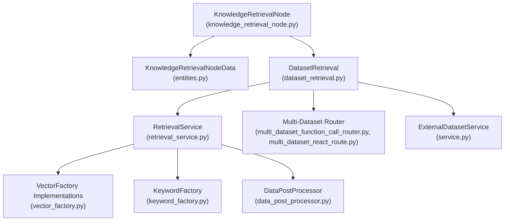
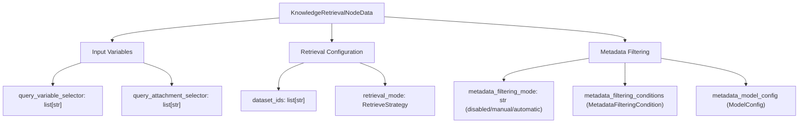
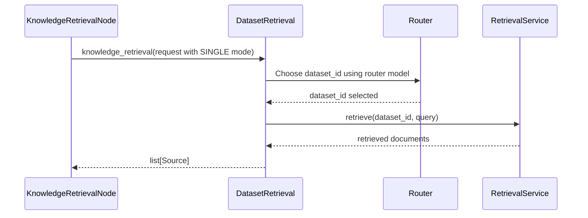
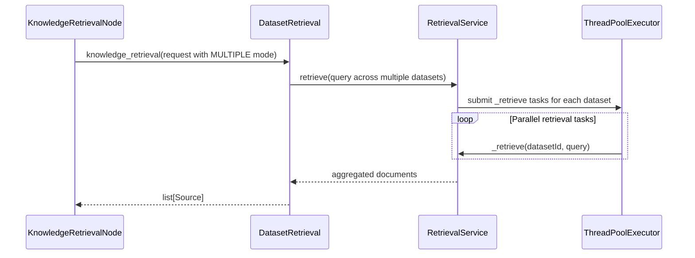
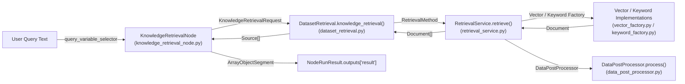

<!-- source: DeepWiki mcp.deepwiki.com · repo langgenius/dify · page 5.5 Knowledge Retrieval Node · fetched 2026-10-26 -->

# Knowledge Retrieval Node

Relevant source files

The following files were used as context for generating this wiki page:

- [api/core/app/apps/agent_chat/app_runner.py](api/core/app/apps/agent_chat/app_runner.py)
- [api/core/app/apps/base_app_runner.py](api/core/app/apps/base_app_runner.py)
- [api/core/app/apps/chat/app_runner.py](api/core/app/apps/chat/app_runner.py)
- [api/core/app/apps/completion/app_runner.py](api/core/app/apps/completion/app_runner.py)
- [api/core/callback_handler/index_tool_callback_handler.py](api/core/callback_handler/index_tool_callback_handler.py)
- [api/core/plugin/backwards_invocation/app.py](api/core/plugin/backwards_invocation/app.py)
- [api/core/rag/datasource/retrieval_service.py](api/core/rag/datasource/retrieval_service.py)
- [api/core/rag/retrieval/dataset_retrieval.py](api/core/rag/retrieval/dataset_retrieval.py)
- [api/core/tools/utils/dataset_retriever/dataset_multi_retriever_tool.py](api/core/tools/utils/dataset_retriever/dataset_multi_retriever_tool.py)
- [api/core/tools/utils/dataset_retriever/dataset_retriever_tool.py](api/core/tools/utils/dataset_retriever/dataset_retriever_tool.py)
- [api/core/workflow/nodes/knowledge_retrieval/knowledge_retrieval_node.py](api/core/workflow/nodes/knowledge_retrieval/knowledge_retrieval_node.py)
- [api/services/hit_testing_service.py](api/services/hit_testing_service.py)
- [api/tests/unit_tests/core/app/apps/chat/test_base_app_runner_multimodal.py](api/tests/unit_tests/core/app/apps/chat/test_base_app_runner_multimodal.py)
- [api/tests/unit_tests/core/callback_handler/test_index_tool_callback_handler.py](api/tests/unit_tests/core/callback_handler/test_index_tool_callback_handler.py)
- [api/tests/unit_tests/core/plugin/test_backwards_invocation_app.py](api/tests/unit_tests/core/plugin/test_backwards_invocation_app.py)
- [api/tests/unit_tests/core/rag/datasource/test_datasource_retrieval.py](api/tests/unit_tests/core/rag/datasource/test_datasource_retrieval.py)
- [api/tests/unit_tests/core/rag/retrieval/test_dataset_retrieval.py](api/tests/unit_tests/core/rag/retrieval/test_dataset_retrieval.py)
- [api/tests/unit_tests/core/rag/retrieval/test_dataset_retrieval_methods.py](api/tests/unit_tests/core/rag/retrieval/test_dataset_retrieval_methods.py)
- [api/tests/unit_tests/core/tools/utils/test_misc_utils_extra.py](api/tests/unit_tests/core/tools/utils/test_misc_utils_extra.py)
- [api/tests/unit_tests/extensions/otel/test_retrieval_tracing.py](api/tests/unit_tests/extensions/otel/test_retrieval_tracing.py)

The **Knowledge Retrieval Node** (`KnowledgeRetrievalNode`) integrates Retrieval-Augmented Generation (RAG) capabilities into workflows, enabling querying of knowledge bases (datasets) to retrieve relevant document segments. This retrieved information can then serve as contextual input for Large Language Models (LLMs) downstream, facilitating AI responses grounded in specific knowledge.

This page details:
- The node implementation and configuration.
- Underlying retrieval strategies.
- Metadata filtering mechanisms.
- Data flow and integration with retrieval services.
- Rate limiting and usage tracking.

---

## Node Overview and Architecture

The `KnowledgeRetrievalNode` is a core workflow node designed to fetch knowledge from one or more datasets through RAG retrieval. It tracks LLM usage and supports multiple retrieval strategies including single dataset via routing model and multiple datasets in parallel.

### Key Properties

| Property          | Value                                               | Source                                                       |
|-------------------|-----------------------------------------------------|--------------------------------------------------------------|
| Node Type         | `BuiltinNodeTypes.KNOWLEDGE_RETRIEVAL`              | [api/core/workflow/nodes/knowledge_retrieval/knowledge_retrieval_node.py:69-69]() |
| Node Class        | `KnowledgeRetrievalNode`                             | [api/core/workflow/nodes/knowledge_retrieval/knowledge_retrieval_node.py:68-68]() |
| Input             | Query string variable, attachments variable          | [api/core/workflow/nodes/knowledge_retrieval/knowledge_retrieval_node.py:114-137]() |
| Output            | Array of `Source` objects wrapped in `ArrayObjectSegment` | [api/core/workflow/nodes/knowledge_retrieval/knowledge_retrieval_node.py:143-143]() |
| Execution Model   | Sequential execution; retrieves knowledge using `DatasetRetrieval` service | [api/core/workflow/nodes/knowledge_retrieval/knowledge_retrieval_node.py:101-155]() |

### Architecture Diagram: Node to Retrieval Components

This diagram shows how the `KnowledgeRetrievalNode` depends on a request data model, invokes the `DatasetRetrieval` service which internally coordinates with the `RetrievalService` and possibly routers for multi-dataset selection, leveraging vector and keyword vector DB factories, and processes results with post-processing tools. External datasets are handled via a separate external service.

Sources:  
[api/core/workflow/nodes/knowledge_retrieval/knowledge_retrieval_node.py:68-94](),   
[api/core/rag/retrieval/dataset_retrieval.py:127-182](),  
[api/core/rag/datasource/retrieval_service.py:93-173]()

---

## Node Configuration Model

The node configuration is encapsulated in the `KnowledgeRetrievalNodeData` entity, which defines input selectors, retrieval strategy, and metadata filtering configuration.

### Configuration Attributes

The node selects the query text and attachments from workflow variables, specifies datasets to retrieve from, chooses a retrieval mode (single dataset routing or multiple parallel retrieval), and configures metadata filtering which can be disabled, manually specified, or automatically inferred via an LLM.

Sources:  
[api/core/workflow/nodes/knowledge_retrieval/entities.py:37-41](),  
[api/core/workflow/nodes/knowledge_retrieval/knowledge_retrieval_node.py:114-137]()

---

## Retrieval Strategies

The retrieval implementation supports two main modes defined by `retrieval_mode`:

### 1. Single Retrieval Mode (LLM Router Based)

In this mode, an LLM router analyzes the user's query and selects the most relevant dataset before performing retrieval. The router implements either a function-call API model (`FunctionCallMultiDatasetRouter`) or a React-style reasoning model (`ReactMultiDatasetRouter`) depending on the configured router.

- The router selects `dataset_id` based on the query and dataset descriptions.
- Post router selection, the system calls `RetrievalService.retrieve()` to fetch relevant documents from the chosen dataset.

#### Single Mode Call Flow

### 2. Multiple Retrieval Mode (Parallel Retrieval)

This mode queries all selected datasets concurrently using a thread pool executor.

- `RetrievalService` submits parallel retrieval tasks to each dataset using `ThreadPoolExecutor` [api/core/rag/datasource/retrieval_service.py:120-120]().
- Results are aggregated, deduplicated, and optionally reranked using post-processing.
- Final aggregated document sources are returned to the node.

#### Multiple Mode Call Flow

Sources:  
[api/core/rag/retrieval/dataset_retrieval.py:149-155](),  
[api/core/rag/datasource/retrieval_service.py:97-173]()

---

## Metadata Filtering

Metadata filtering enables restricting search results by document metadata, improving retrieval precision.

### Filtering Modes

| Mode      | Description                                                                |
|-----------|----------------------------------------------------------------------------|
| `disabled` | No metadata filtering is applied.                                         |
| `manual`   | Uses user-provided structured filter conditions (`MetadataFilteringCondition`). |
| `automatic`| Uses an LLM to extract filter conditions from the query automatically via prompt templates |

### Mechanism

- For manual filtering, variables from workflow are applied to template through the variable pool.
- For automatic mode, a dedicated LLM prompt chain generates structured JSON filter conditions using `get_metadata_filter_condition` [api/core/rag/retrieval/dataset_retrieval.py:192-207]().
- Filtering is applied in retrieval by constraining document candidates with metadata conditions.

### Prompt Templates for Automatic Filtering

The system employs specific system and user prompt templates for automatic metadata extraction in the retrieval pipeline:
- `METADATA_FILTER_SYSTEM_PROMPT` [api/core/rag/retrieval/template_prompts.py:60-60]()
- `METADATA_FILTER_USER_PROMPT_1` [api/core/rag/retrieval/template_prompts.py:61-61]()
- `METADATA_FILTER_ASSISTANT_PROMPT_1` [api/core/rag/retrieval/template_prompts.py:57-57]()

Sources:  
[api/core/rag/retrieval/dataset_retrieval.py:57-64](),  
[api/core/rag/retrieval/dataset_retrieval.py:184-207](),  
[api/core/workflow/nodes/knowledge_retrieval/knowledge_retrieval_node.py:185-202]()

---

## Node Execution and Data Flow

### Internal Execution (`_run()` method)

1. **Input Extraction and Validation**  
   Extracts the query text and attachments from the workflow's variable pool based on selectors. Validates types (query must be a string; attachments must be file references) [api/core/workflow/nodes/knowledge_retrieval/knowledge_retrieval_node.py:114-137]().

2. **Create Retrieval Request**  
   Packages query, attachments, dataset selections, metadata filtering mode, and other retrieval options into `KnowledgeRetrievalRequest` fed to `DatasetRetrieval.knowledge_retrieval()` [api/core/workflow/nodes/knowledge_retrieval/knowledge_retrieval_node.py:193-207]().

3. **Execute Retrieval**  
   Calls `DatasetRetrieval.knowledge_retrieval()`, which performs dataset access, routing (if applicable), and results aggregation [api/core/rag/retrieval/dataset_retrieval.py:149-155]().

4. **Return Results**  
   Maps retrieved document sources to workflow output variables as an array segment (`ArrayObjectSegment`) for use in downstream nodes [api/core/workflow/nodes/knowledge_retrieval/knowledge_retrieval_node.py:143-143]().

5. **Error Handling**  
   Catches known retrieval exceptions (e.g., `RateLimitExceededError`, `KnowledgeRetrievalNodeError`) and returns failure results with error details and usage data [api/core/workflow/nodes/knowledge_retrieval/knowledge_retrieval_node.py:156-183]().

### Data Flow Diagram (Natural Language Space → Code Entity Space)

Sources:  
[api/core/workflow/nodes/knowledge_retrieval/knowledge_retrieval_node.py:101-155](),  
[api/core/rag/retrieval/dataset_retrieval.py:127-155](),  
[api/core/rag/datasource/retrieval_service.py:97-126]()

---

## Indexing and Post-Processing

The RAG system supports diverse indexing and post-processing for retrieved documents, enabling versatility in knowledge representation.

- **Index Processors**  
  - `IndexStructureType.PARAGRAPH_INDEX`: Processes standard paragraph chunking.
  - `IndexStructureType.QA_INDEX`: Structures document segments into Q&A format.
  - `IndexStructureType.PARENT_CHILD_INDEX`: Manages hierarchical document structures with parent-child relationships [api/core/rag/index_processor/constant/index_type.py:10-12]().

- **Hit Testing and Callbacks**  
  When retrieved documents are returned, the system updates hit counts for document segments using `DatasetIndexToolCallbackHandler.on_tool_end()` [api/core/callback_handler/index_tool_callback_handler.py:55-93](). This feedback improves dataset usage analytics and ranking.

Sources:  
[api/core/rag/datasource/retrieval_service.py:19-22](),  
[api/core/callback_handler/index_tool_callback_handler.py:21-102]()

---

## Rate Limiting and Usage Tracking

### Rate Limiting Enforcement

To prevent excessive knowledge retrieval calls per tenant, the node invokes a rate limit check `_check_knowledge_rate_limit(request.tenant_id)` [api/core/rag/retrieval/dataset_retrieval.py:156-156](). This verifies request frequency against usage logs stored in `RateLimitLog` [api/core/rag/retrieval/dataset_retrieval.py:91-91]().

### LLM Usage Tracking

- When the chosen retrieval strategy employs an LLM (e.g., a router model or automatic metadata filtering), token usage and cost are collected using `LLMUsage` [api/core/rag/retrieval/dataset_retrieval.py:143-152]().
- Usage info is encapsulated and propagated through to workflow execution metadata:
  - `WorkflowNodeExecutionMetadataKey.TOTAL_TOKENS` [api/core/workflow/nodes/knowledge_retrieval/knowledge_retrieval_node.py:150-150]()
  - `WorkflowNodeExecutionMetadataKey.TOTAL_PRICE` [api/core/workflow/nodes/knowledge_retrieval/knowledge_retrieval_node.py:151-151]()
  - `WorkflowNodeExecutionMetadataKey.CURRENCY` [api/core/workflow/nodes/knowledge_retrieval/knowledge_retrieval_node.py:152-152]()

Sources:  
[api/core/workflow/nodes/knowledge_retrieval/knowledge_retrieval_node.py:149-152](),  
[api/core/rag/retrieval/dataset_retrieval.py:143-152]()

---

# Summary

The `KnowledgeRetrievalNode` integrates RAG knowledge retrieval into workflows with flexible dataset routing, multi-dataset parallel retrieval, and rich metadata filtering. Its architecture couples workflow execution, retrieval services, and vector database implementations. Usage tracking and rate limiting maintain operational control and observability.

Sources:  
- [api/core/workflow/nodes/knowledge_retrieval/knowledge_retrieval_node.py:68-183]()  
- [api/core/rag/retrieval/dataset_retrieval.py:127-182]()  
- [api/core/rag/datasource/retrieval_service.py:93-173]()  
- [api/core/callback_handler/index_tool_callback_handler.py:21-102]()

---

