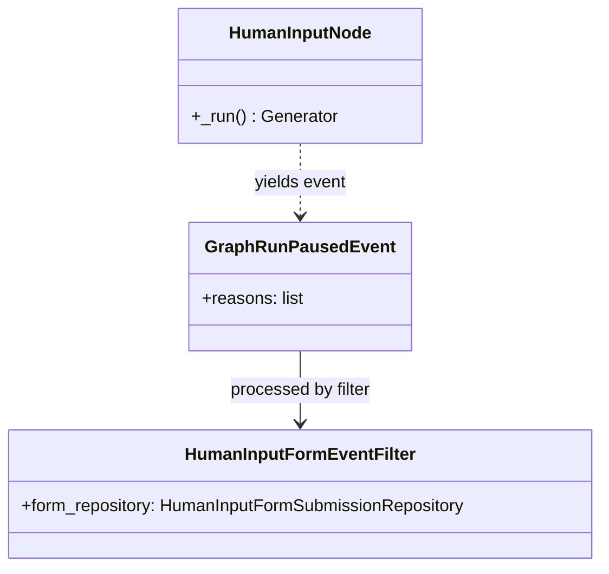
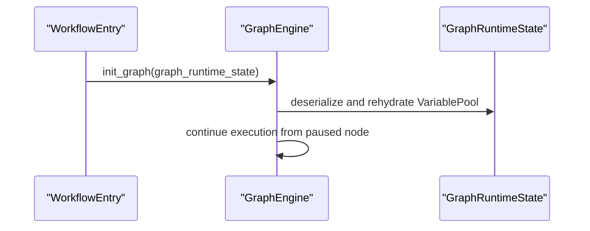
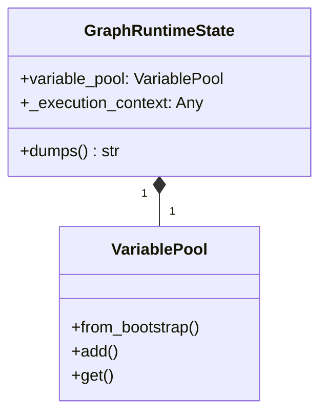

<!-- source: DeepWiki mcp.deepwiki.com · repo langgenius/dify · page 5.6 Human Input Node and Pause-Resume Mechanism · fetched 2026-10-26 -->

# Human Input Node and Pause-Resume Mechanism

<details>
<summary>Relevant source files</summary>

The following files were used as context for generating this wiki page:

- [api/controllers/trigger/trigger.py](api/controllers/trigger/trigger.py)
- [api/controllers/web/human_input_form.py](api/controllers/web/human_input_form.py)
- [api/controllers/web/site.py](api/controllers/web/site.py)
- [api/core/app/apps/base_app_queue_manager.py](api/core/app/apps/base_app_queue_manager.py)
- [api/core/app/apps/message_based_app_queue_manager.py](api/core/app/apps/message_based_app_queue_manager.py)
- [api/core/app/apps/pipeline/pipeline_queue_manager.py](api/core/app/apps/pipeline/pipeline_queue_manager.py)
- [api/core/app/apps/workflow/app_queue_manager.py](api/core/app/apps/workflow/app_queue_manager.py)
- [api/core/workflow/nodes/human_input/boundary.py](api/core/workflow/nodes/human_input/boundary.py)
- [api/core/workflow/nodes/human_input/callback.py](api/core/workflow/nodes/human_input/callback.py)
- [api/core/workflow/nodes/human_input/constants.py](api/core/workflow/nodes/human_input/constants.py)
- [api/core/workflow/workflow_entry.py](api/core/workflow/workflow_entry.py)
- [api/services/file_service.py](api/services/file_service.py)
- [api/services/icon_configuration.py](api/services/icon_configuration.py)
- [api/services/retention/workflow_run/restore_archived_workflow_run.py](api/services/retention/workflow_run/restore_archived_workflow_run.py)
- [api/services/web_app_runtime_query_service.py](api/services/web_app_runtime_query_service.py)
- [api/tests/test_containers_integration_tests/controllers/web/test_human_input_form.py](api/tests/test_containers_integration_tests/controllers/web/test_human_input_form.py)
- [api/tests/test_containers_integration_tests/controllers/web/test_site.py](api/tests/test_containers_integration_tests/controllers/web/test_site.py)
- [api/tests/test_containers_integration_tests/services/test_file_service.py](api/tests/test_containers_integration_tests/services/test_file_service.py)
- [api/tests/unit_tests/controllers/trigger/test_trigger.py](api/tests/unit_tests/controllers/trigger/test_trigger.py)
- [api/tests/unit_tests/controllers/web/test_human_input_form.py](api/tests/unit_tests/controllers/web/test_human_input_form.py)
- [api/tests/unit_tests/controllers/web/test_site.py](api/tests/unit_tests/controllers/web/test_site.py)
- [api/tests/unit_tests/core/app/apps/test_base_app_queue_manager.py](api/tests/unit_tests/core/app/apps/test_base_app_queue_manager.py)
- [api/tests/unit_tests/core/app/apps/test_legacy_stop_graphengine_lifecycle.py](api/tests/unit_tests/core/app/apps/test_legacy_stop_graphengine_lifecycle.py)
- [api/tests/unit_tests/core/app/apps/test_message_based_app_queue_manager.py](api/tests/unit_tests/core/app/apps/test_message_based_app_queue_manager.py)
- [api/tests/unit_tests/core/app/apps/workflow/test_app_queue_manager.py](api/tests/unit_tests/core/app/apps/workflow/test_app_queue_manager.py)
- [api/tests/unit_tests/core/datasource/test_file_upload.py](api/tests/unit_tests/core/datasource/test_file_upload.py)
- [api/tests/unit_tests/core/rag/datasource/keyword/jieba/test_jieba.py](api/tests/unit_tests/core/rag/datasource/keyword/jieba/test_jieba.py)
- [api/tests/unit_tests/core/workflow/nodes/human_input/test_human_input_form_filled_event.py](api/tests/unit_tests/core/workflow/nodes/human_input/test_human_input_form_filled_event.py)
- [api/tests/unit_tests/core/workflow/test_human_input_callback.py](api/tests/unit_tests/core/workflow/test_human_input_callback.py)
- [api/tests/unit_tests/core/workflow/test_workflow_entry.py](api/tests/unit_tests/core/workflow/test_workflow_entry.py)
- [api/tests/unit_tests/core/workflow/test_workflow_entry_helpers.py](api/tests/unit_tests/core/workflow/test_workflow_entry_helpers.py)
- [api/tests/unit_tests/models/test_app_session_accessors.py](api/tests/unit_tests/models/test_app_session_accessors.py)
- [api/tests/unit_tests/services/retention/workflow_run/test_restore_archived_workflow_run.py](api/tests/unit_tests/services/retention/workflow_run/test_restore_archived_workflow_run.py)
- [api/tests/unit_tests/services/test_file_service.py](api/tests/unit_tests/services/test_file_service.py)
- [api/tests/unit_tests/services/test_icon_configuration.py](api/tests/unit_tests/services/test_icon_configuration.py)
- [api/tests/unit_tests/services/test_remote_file_service.py](api/tests/unit_tests/services/test_remote_file_service.py)
- [api/tests/unit_tests/services/test_web_app_runtime_query_service.py](api/tests/unit_tests/services/test_web_app_runtime_query_service.py)
- [api/tests/unit_tests/services/workflow/test_node_output_inspector_service.py](api/tests/unit_tests/services/workflow/test_node_output_inspector_service.py)

</details>


## Purpose and Scope

This page provides a detailed technical overview of the Human Input Node within Dify's workflow engine and its associated pause-resume mechanism. It covers how the node is implemented to request and await human input via dynamically rendered forms, how the workflow execution state is paused and persisted, and how the workflow is resumed upon user submission. The documentation also explains the state persistence, delivery, and lifecycle management of human input forms, including timeout and error handling.

## Architecture Overview

The human input and pause-resume mechanism in Dify is architected using specialized classes and layers enabling the workflow engine (`GraphEngine`) to pause execution and later resume seamlessly when an external human input event occurs.

### Key Components and Code Entities

| Natural Language Concept | Code Entity Name | File Path |
| :----------------------- | :--------------- | :-------- |
| Node Implementation | `HumanInputNode` | [api/tests/unit_tests/core/workflow/nodes/human_input/test_human_input_form_filled_event.py:75-75]() |
| Pause Reason Signaling | `HumanInputFormEventFilter` | [api/core/workflow/nodes/human_input/boundary.py:10-10]() |
| Runtime Graph Execution State | `GraphRuntimeState` | [api/core/workflow/workflow_entry.py:48-48]() |
| Workflow Entry Point | `WorkflowEntry` | [api/core/workflow/workflow_entry.py:102-118]() |
| Human Input Form Model | `HumanInputForm` | [api/tests/unit_tests/core/workflow/nodes/human_input/test_human_input_form_filled_event.py:100-110]() |
| Workflow Status Event | `QueueWorkflowPausedEvent` | [api/core/app/apps/workflow/app_queue_manager.py:13-13]() |
| Human Input Service | `HumanInputService` | [api/controllers/web/human_input_form.py:36-38]() |

### System Diagram: From Natural Language to Code Entities

```mermaid
graph TB
    subgraph "Natural Language Space"
        UserSubmit["User Submits Form"]
        FormTimeout["Form Timeout Triggered"]
        WorkflowDesigner["Workflow Designer UI"]
    end

    subgraph "Code Entity Space"
        HumanInputNode_Code[HumanInputNode]
        HumanInputFormEventFilter_Code[HumanInputFormEventFilter]
        GraphRuntimeState_Code[GraphRuntimeState]
        WorkflowEntry_Code[WorkflowEntry]
        HumanInputForm_Model[HumanInputForm]
        QueueWorkflowPausedEvent_Code[QueueWorkflowPausedEvent]
        HumanInputService_Code[HumanInputService]
        HumanInputFormApi_Code[/api/form/human_input/<form_token>]

        HumanInputNode_Code -- "yields pause with" --> HumanInputFormEventFilter_Code
        HumanInputFormEventFilter_Code -- "filters events for" --> WorkflowEntry_Code
        WorkflowEntry_Code -- "persists" --> GraphRuntimeState_Code
        GraphRuntimeState_Code -- "stored in" --> HumanInputForm_Model
        HumanInputForm_Model -- "managed by" --> HumanInputService_Code
        HumanInputService_Code -- "accessed via" --> HumanInputFormApi_Code
        HumanInputFormApi_Code -- "receives" --> UserSubmit
        WorkflowEntry_Code -- "publishes" --> QueueWorkflowPausedEvent_Code
        FormTimeout -- "triggers" --> QueueWorkflowPausedEvent_Code
        WorkflowDesigner -- "configures" --> HumanInputNode_Code
    end
```

**Sources:**
- [api/tests/unit_tests/core/workflow/nodes/human_input/test_human_input_form_filled_event.py:75-75]()
- [api/core/workflow/nodes/human_input/boundary.py:10-10]()
- [api/core/workflow/workflow_entry.py:48-48]()
- [api/core/workflow/workflow_entry.py:102-118]()
- [api/tests/unit_tests/core/workflow/nodes/human_input/test_human_input_form_filled_event.py:100-110]()
- [api/core/app/apps/workflow/app_queue_manager.py:13-13]()
- [api/controllers/web/human_input_form.py:36-38]()
- [api/controllers/web/human_input_form.py:108-109]()

---

## HumanInputNode Implementation

The `HumanInputNode` is a workflow node specialized for requesting human input via a form and pausing the workflow execution until the form is submitted or times out.

### Node Data Structure and Classes

- The node's data includes the form definition with input fields and user actions.
- When run, the node yields a pause event with a `HumanInputRequired` pause reason including form details.
- This pause event is a special `GraphRunPausedEvent` that the workflow engine recognizes.



**Core Execution Flow:**

1. The `HumanInputNode` triggers when the workflow engine reaches this node [api/tests/unit_tests/core/workflow/nodes/human_input/test_human_input_form_filled_event.py:75-75]().
2. It prepares form data and the `iter_dify_graph_engine_events` function applies the `HumanInputFormEventFilter` to events [api/core/workflow/workflow_entry.py:76-77]().
3. The `GraphEngine` intercepts the pause event and suspends execution [api/core/workflow/workflow_entry.py:153-156]().
4. The current runtime state (`GraphRuntimeState`) and form state are persisted in the database for later resumption.
5. The workflow's status is updated to `PAUSED` [api/core/app/apps/base_app_queue_manager.py:115-115]().

**Sources:**
- [api/tests/unit_tests/core/workflow/nodes/human_input/test_human_input_form_filled_event.py:75-75]()
- [api/core/workflow/workflow_entry.py:76-77]()
- [api/core/workflow/workflow_entry.py:153-156]()
- [api/core/app/apps/base_app_queue_manager.py:115-115]()

---

## Pause-Resume Mechanism

Dify workflows support a pause-resume mechanism implemented via serialization of the runtime state and persistence of human input form contexts.

### Workflow Resumption Flow

Upon user submission of the human input form, the workflow resumes by loading the serialized paused state. The `WorkflowEntry` handles the initialization of the graph from the resumed state.



- The paused workflow state is stored as a serialized `GraphRuntimeState` in the database [api/core/workflow/workflow_entry.py:115-115]().
- The `WorkflowEntry` is initialized with a `graph_runtime_state` and `response_stream_filter` for resuming a paused run [api/core/workflow/workflow_entry.py:115-117]().
- In `WorkflowEntry.__init__()`, if a `graph_runtime_state` is provided, it is used to initialize the `GraphEngine` [api/core/workflow/workflow_entry.py:153-156]().

### Event Handling for Paused Workflow UI Updates

The `AppQueueManager` dispatches events related to human input to the client:

- `QueueWorkflowPausedEvent` is published when the workflow pauses for human input [api/core/app/apps/workflow/app_queue_manager.py:37-38]().
- `QueueStopEvent` or `QueueErrorEvent` are published if the workflow stops or encounters an error [api/core/app/apps/base_app_queue_manager.py:98-102](), [api/core/app/apps/base_app_queue_manager.py:145-153]().

**Sources:**
- [api/core/workflow/workflow_entry.py:115-115]()
- [api/core/workflow/workflow_entry.py:115-117]()
- [api/core/workflow/workflow_entry.py:153-156]()
- [api/core/app/apps/workflow/app_queue_manager.py:37-38]()
- [api/core/app/apps/base_app_queue_manager.py:98-102]()
- [api/core/app/apps/base_app_queue_manager.py:145-153]()

---

## State Persistence Layer

The `GraphRuntimeState` captures the entire execution context of the workflow at the point of pause.

### Persistence Details

- Serialization is performed by invoking `GraphRuntimeState.dumps()` [api/core/workflow/workflow_entry.py:48-48]().
- Variables, including system variables like `workflow_run_id`, are preserved to ensure consistency upon resumption [api/core/workflow/workflow_entry.py:26-31]().
- The `WorkflowEntry` uses `GraphRuntimeState` to manage these transitions between active and paused states [api/core/workflow/workflow_entry.py:115-115]().



**Sources:**
- [api/core/workflow/workflow_entry.py:48-48]()
- [api/core/workflow/workflow_entry.py:26-31]()
- [api/core/workflow/workflow_entry.py:115-115]()
- [api/core/workflow/workflow_entry.py:151-151]()
- [api/tests/unit_tests/core/workflow/test_workflow_entry.py:60-66]()
- [api/tests/unit_tests/core/workflow/test_workflow_entry.py:161-166]()

---

## Form Delivery and Notification

When a workflow pauses, the system generates form data and manages delivery tracking.

### Human Input Form Lifecycle

- The `HumanInputFormApi` handles requests for form definitions and submissions [api/controllers/web/human_input_form.py:150-152]().
- The `HumanInputFormDefinitionResponse` and `HumanInputFormSubmitPayload` define the structure for form data exchange [api/controllers/web/human_input_form.py:48-55](), [api/controllers/web/human_input_form.py:33-33]().
- Forms can expire, and the `HumanInputService` ensures forms are active before access or submission [api/controllers/web/human_input_form.py:183-183]().
- Rate limiting is applied to form access and submission to prevent abuse [api/controllers/web/human_input_form.py:91-105]().

### Variable Truncation for State Management

Dify enforces size limits on workflow state variables during pause serialization to ensure database efficiency.

- The `WorkflowEntry` uses `ResponseStreamFilter` to manage the stream of events, which can include variable data [api/core/workflow/workflow_entry.py:60-61]().
- The `HumanInputFormEventFilter` is applied to filter graph events related to human input forms [api/core/workflow/workflow_entry.py:76-77]().

```mermaid
graph LR
    subgraph Web API
        HumanInputFormApi["/api/form/human_input/<string:form_token>"]
        HumanInputFormUploadTokenApi["/api/form/human_input/<string:form_token>/upload-token"]
    end

    subgraph Service Layer
        HumanInputService["HumanInputService"]
    end

    subgraph Data Models
        HumanInputForm["HumanInputForm (models.human_input)"]
        FormInputConfig["FormInputConfig (entities)"]
    end

    HumanInputFormApi -- GET --> HumanInputService: get_form_by_token
    HumanInputFormApi -- POST --> HumanInputService: submit_form
    HumanInputFormUploadTokenApi -- POST --> HumanInputService: issue_upload_token
    HumanInputService --> HumanInputForm: CRUD operations
    HumanInputFormApi --> FormInputConfig: defines form structure
```

**Sources:**
- [api/controllers/web/human_input_form.py:150-152]()
- [api/controllers/web/human_input_form.py:48-55]()
- [api/controllers/web/human_input_form.py:33-33]()
- [api/controllers/web/human_input_form.py:183-183]()
- [api/controllers/web/human_input_form.py:91-105]()
- [api/core/workflow/workflow_entry.py:60-61]()
- [api/core/workflow/workflow_entry.py:76-77]()

---

# Summary

The Human Input Node and Pause-Resume mechanism allow Dify workflows to transition from automated execution to human-mediated steps. By serializing the `GraphRuntimeState` and persisting it, the system can halt execution safely, wait for external input via the `HumanInputForm` model, and resume execution precisely where it left off. This architecture is supported by the `HumanInputService` and rehydrated by the `WorkflowEntry` during resumption.

---

