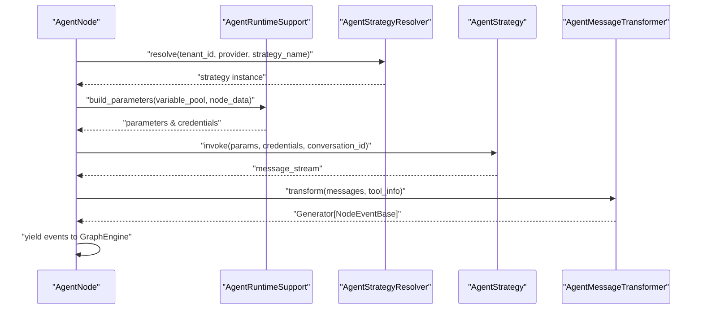
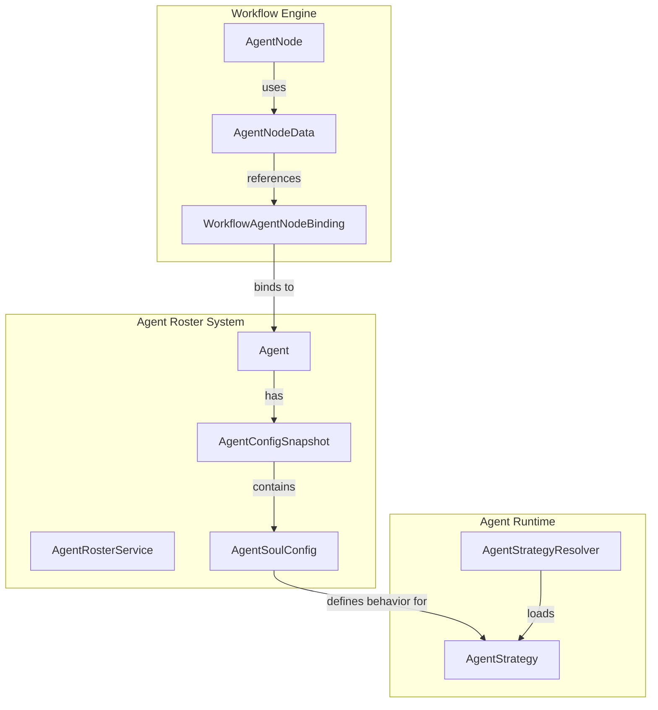
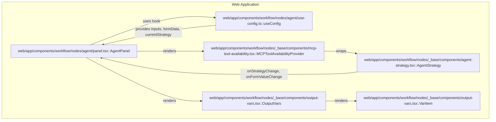

<!-- source: DeepWiki mcp.deepwiki.com · repo langgenius/dify · page 5.7 Agent Node in Workflows · fetched 2026-10-26 -->

# Agent Node in Workflows

Relevant source files

The following files were used as context for generating this wiki page:

- [api/clients/agent_backend/__init__.py](api/clients/agent_backend/__init__.py)
- [api/clients/agent_backend/client.py](api/clients/agent_backend/client.py)
- [api/clients/agent_backend/event_adapter.py](api/clients/agent_backend/event_adapter.py)
- [api/clients/agent_backend/fake_client.py](api/clients/agent_backend/fake_client.py)
- [api/clients/agent_backend/request_builder.py](api/clients/agent_backend/request_builder.py)
- [api/core/agent/plugin_entities.py](api/core/agent/plugin_entities.py)
- [api/core/app/apps/agent_app/session_store.py](api/core/app/apps/agent_app/session_store.py)
- [api/core/workflow/nodes/agent/agent_node.py](api/core/workflow/nodes/agent/agent_node.py)
- [api/core/workflow/nodes/agent/entities.py](api/core/workflow/nodes/agent/entities.py)
- [api/core/workflow/nodes/agent/events.py](api/core/workflow/nodes/agent/events.py)
- [api/core/workflow/nodes/agent/message_transformer.py](api/core/workflow/nodes/agent/message_transformer.py)
- [api/core/workflow/nodes/agent/think_tags.py](api/core/workflow/nodes/agent/think_tags.py)
- [api/core/workflow/nodes/agent_v2/agent_node.py](api/core/workflow/nodes/agent_v2/agent_node.py)
- [api/core/workflow/nodes/agent_v2/binding_resolver.py](api/core/workflow/nodes/agent_v2/binding_resolver.py)
- [api/core/workflow/nodes/agent_v2/file_tenant_validator.py](api/core/workflow/nodes/agent_v2/file_tenant_validator.py)
- [api/core/workflow/nodes/agent_v2/output_adapter.py](api/core/workflow/nodes/agent_v2/output_adapter.py)
- [api/core/workflow/nodes/agent_v2/output_type_checker.py](api/core/workflow/nodes/agent_v2/output_type_checker.py)
- [api/core/workflow/nodes/agent_v2/runtime_request_builder.py](api/core/workflow/nodes/agent_v2/runtime_request_builder.py)
- [api/core/workflow/nodes/agent_v2/session_store.py](api/core/workflow/nodes/agent_v2/session_store.py)
- [api/core/workflow/nodes/agent_v2/validators.py](api/core/workflow/nodes/agent_v2/validators.py)
- [api/models/agent_config_entities.py](api/models/agent_config_entities.py)
- [api/tests/unit_tests/clients/agent_backend/test_client.py](api/tests/unit_tests/clients/agent_backend/test_client.py)
- [api/tests/unit_tests/clients/agent_backend/test_event_adapter.py](api/tests/unit_tests/clients/agent_backend/test_event_adapter.py)
- [api/tests/unit_tests/clients/agent_backend/test_fake_client.py](api/tests/unit_tests/clients/agent_backend/test_fake_client.py)
- [api/tests/unit_tests/clients/agent_backend/test_request_builder.py](api/tests/unit_tests/clients/agent_backend/test_request_builder.py)
- [api/tests/unit_tests/core/app/apps/agent_app/test_session_store.py](api/tests/unit_tests/core/app/apps/agent_app/test_session_store.py)
- [api/tests/unit_tests/core/workflow/nodes/agent/__init__.py](api/tests/unit_tests/core/workflow/nodes/agent/__init__.py)
- [api/tests/unit_tests/core/workflow/nodes/agent/test_agent_node.py](api/tests/unit_tests/core/workflow/nodes/agent/test_agent_node.py)
- [api/tests/unit_tests/core/workflow/nodes/agent/test_message_transformer.py](api/tests/unit_tests/core/workflow/nodes/agent/test_message_transformer.py)
- [api/tests/unit_tests/core/workflow/nodes/agent_v2/test_agent_node.py](api/tests/unit_tests/core/workflow/nodes/agent_v2/test_agent_node.py)
- [api/tests/unit_tests/core/workflow/nodes/agent_v2/test_binding_resolver.py](api/tests/unit_tests/core/workflow/nodes/agent_v2/test_binding_resolver.py)
- [api/tests/unit_tests/core/workflow/nodes/agent_v2/test_file_tenant_validator.py](api/tests/unit_tests/core/workflow/nodes/agent_v2/test_file_tenant_validator.py)
- [api/tests/unit_tests/core/workflow/nodes/agent_v2/test_output_adapter.py](api/tests/unit_tests/core/workflow/nodes/agent_v2/test_output_adapter.py)
- [api/tests/unit_tests/core/workflow/nodes/agent_v2/test_output_failure_orchestrator.py](api/tests/unit_tests/core/workflow/nodes/agent_v2/test_output_failure_orchestrator.py)
- [api/tests/unit_tests/core/workflow/nodes/agent_v2/test_output_file_rebacker.py](api/tests/unit_tests/core/workflow/nodes/agent_v2/test_output_file_rebacker.py)
- [api/tests/unit_tests/core/workflow/nodes/agent_v2/test_output_type_checker.py](api/tests/unit_tests/core/workflow/nodes/agent_v2/test_output_type_checker.py)
- [api/tests/unit_tests/core/workflow/nodes/agent_v2/test_runtime_request_builder.py](api/tests/unit_tests/core/workflow/nodes/agent_v2/test_runtime_request_builder.py)
- [api/tests/unit_tests/core/workflow/nodes/agent_v2/test_session_store.py](api/tests/unit_tests/core/workflow/nodes/agent_v2/test_session_store.py)
- [api/tests/unit_tests/core/workflow/nodes/agent_v2/test_validators.py](api/tests/unit_tests/core/workflow/nodes/agent_v2/test_validators.py)
- [web/app/components/base/markdown/__tests__/markdown-utils.spec.ts](web/app/components/base/markdown/__tests__/markdown-utils.spec.ts)
- [web/app/components/devtools/react-scan/loader.tsx](web/app/components/devtools/react-scan/loader.tsx)
- [web/app/components/plugins/marketplace/hydration-server.tsx](web/app/components/plugins/marketplace/hydration-server.tsx)
- [web/app/components/plugins/plugin-page/__tests__/context-provider.spec.tsx](web/app/components/plugins/plugin-page/__tests__/context-provider.spec.tsx)
- [web/app/components/plugins/plugin-page/context-provider.tsx](web/app/components/plugins/plugin-page/context-provider.tsx)
- [web/app/components/plugins/plugin-page/context.ts](web/app/components/plugins/plugin-page/context.ts)
- [web/app/components/plugins/plugin-page/plugins-panel.tsx](web/app/components/plugins/plugin-page/plugins-panel.tsx)
- [web/app/components/plugins/types.ts](web/app/components/plugins/types.ts)
- [web/app/components/workflow/nodes/_base/components/field.tsx](web/app/components/workflow/nodes/_base/components/field.tsx)
- [web/app/components/workflow/nodes/agent/panel.tsx](web/app/components/workflow/nodes/agent/panel.tsx)
- [web/app/components/workflow/nodes/agent/types.ts](web/app/components/workflow/nodes/agent/types.ts)
- [web/app/components/workflow/nodes/agent/use-config.ts](web/app/components/workflow/nodes/agent/use-config.ts)
- [web/app/components/workflow/nodes/code/panel.tsx](web/app/components/workflow/nodes/code/panel.tsx)
- [web/service/use-plugins.ts](web/service/use-plugins.ts)

This document details the `AgentNode` implementation within the Dify workflow graph engine. It focuses on the node’s role in invoking agentic strategies, the strategy resolver pattern, the binding mechanism between agents and workflows, and the invocation differences between inline and roster agents from workflow nodes.

## Purpose and Scope

The `AgentNode` [api/core/workflow/nodes/agent/agent_node.py:30-30]() is a specialized node that integrates agent execution into workflows. Unlike conventional nodes that perform predetermined actions, the `AgentNode` dynamically resolves and invokes an agent strategy based on configuration, enabling flexible AI agent behavior embedded within the workflow execution graph.

This page covers:
- The implementation approach for `AgentNode` and how it fits into the workflow graph.
- The strategy resolver pattern for locating and invoking agent logic.
- Agent-workflow binding concepts distinguishing inline agents from roster agents.
- How the workflow engine triggers agent invocation differently depending on agent binding.
- Frontend and validation mechanisms related to the AgentNode.

## AgentNode Implementation

The `AgentNode` extends the base `Node` class and targets the `BuiltinNodeTypes.AGENT` type [api/core/workflow/nodes/agent/agent_node.py:31-31](). Its constructor receives several critical strategy-related dependencies:

- `AgentStrategyResolver`: Resolves and returns a concrete agent strategy implementation [api/core/workflow/nodes/agent/agent_node.py:33-33]().
- `AgentStrategyPresentationProvider`: Supplies UI presentation details like icons [api/core/workflow/nodes/agent/agent_node.py:34-34]().
- `AgentRuntimeSupport`: Builds parameters and credentials for agent invocation [api/core/workflow/nodes/agent/agent_node.py:35-35]().
- `AgentMessageTransformer`: Converts streaming messages from agents into events the workflow graph can handle [api/core/workflow/nodes/agent/agent_node.py:36-36]().

### Execution Flow

The core runtime logic occurs in the `_run()` method [api/core/workflow/nodes/agent/agent_node.py:101-190]():

1.  **Context Extraction**: Obtains the `DifyRunContext` from the execution state [api/core/workflow/nodes/agent/agent_node.py:104-104]().
2.  **Strategy Resolution**: Using the resolver, it retrieves the strategy instance configured for the node (e.g., plugin-based agents) [api/core/workflow/nodes/agent/agent_node.py:107-111]().
3.  **Parameter Preparation**: `AgentRuntimeSupport` translates workflow variables and node data into the concrete parameters needed for invocation [api/core/workflow/nodes/agent/agent_node.py:124-133]().
4.  **Agent Invocation**: The resolved strategy's `invoke()` method is called, producing a `message_stream` [api/core/workflow/nodes/agent/agent_node.py:150-156]().
5.  **Message Transformation**: These streamed messages are transformed into node events using `AgentMessageTransformer` and yielded back to the graph engine [api/core/workflow/nodes/agent/agent_node.py:169-188]().

### Key `_run()` Flow Mermaid Diagram

Title: AgentNode Runtime Execution Flow

Sources: [api/core/workflow/nodes/agent/agent_node.py:101-190](), [api/core/workflow/nodes/agent/entities.py:12-28]()

## Strategy Resolver Pattern

The `AgentStrategyResolver` interface enables flexible selection of the proper agent implementation at runtime. The `AgentNode` delegates the heavy lifting of finding the logic to this resolver [api/core/workflow/nodes/agent/agent_node.py:107-111]().

This pattern supports multiple agent providers, including built-in and plugin-based strategies, letting the workflow engine remain agnostic of the agent implementation details.

| Class/Protocol | Role |
|----------------|------|
| `AgentStrategyResolver` | Abstracts agent strategy lookup [api/core/workflow/nodes/agent/strategy_protocols.py:23-23](). |
| `AgentStrategy` | Protocol defining the `invoke` and `get_parameters` methods. |
| `AgentNodeData` | Pydantic model storing strategy name, provider name, and parameter mappings [api/core/workflow/nodes/agent/entities.py:12-28](). |

Sources: [api/core/workflow/nodes/agent/agent_node.py:33-59](), [api/core/workflow/nodes/agent/entities.py:12-28]()

## Agent-Workflow Binding & Invocation

The system distinguishes two major ways a workflow node can invoke agents:

### 1. Roster Agent Binding
- Refers to a pre-existing shared agent defined in the **Agent Roster**.
- The workflow node references this roster agent by its unique identifier.
- This mode supports agent reuse across multiple workflows.
- Validation for roster agents ensures they are `ROSTER` scoped and have an active snapshot [api/core/workflow/nodes/agent_v2/validators.py:147-151]().

### 2. Inline Agent Binding
- An inline, workflow-only agent living inside the workflow definition itself.
- Often defined as `WORKFLOW_ONLY` scope [api/tests/unit_tests/core/workflow/nodes/agent_v2/test_validators.py:53-53]().
- Invocation triggers a specialized runtime with its own configuration stored within the node data.

### Workflow Agent Binding Diagram

Title: Workflow to Agent Entity Mapping

Sources: [api/core/workflow/nodes/agent/agent_node.py:107-111](), [api/core/workflow/nodes/agent/entities.py:12-28](), [api/core/workflow/nodes/agent_v2/validators.py:147-151](), [api/tests/unit_tests/core/workflow/nodes/agent_v2/test_validators.py:53-53]()

## AgentNode Output Variables

The `AgentNode` exposes several output variables automatically mapped from the agent event stream. These are rendered in the UI for downstream node consumption:

| Output Variable | Type | Description |
|-----------------|------|-------------|
| `text` | String | Plain text response from the agent. |
| `usage` | Object | Token usage and cost statistics. |
| `files` | Array[File] | Files generated or referenced by the agent. |
| `json` | Array[Object] | Structured JSON output. |

Sources: [web/app/components/workflow/nodes/agent/panel.tsx:95-119]()

## Frontend Agent Node Configuration

The frontend React components supporting `AgentNode` include:

- **AgentPanel** (`web/app/components/workflow/nodes/agent/panel.tsx`): Provides the node configuration UI, allowing users to select agent strategy via the `AgentStrategy` component. It also handles memory configuration and displays output variables.
- **useConfig hook** (`web/app/components/workflow/nodes/agent/use-config.ts`): Manages state, variable filtering, and legacy data formatting for the `AgentPanel`.
- **AgentStrategy** (`web/app/components/workflow/nodes/_base/components/agent-strategy.tsx`): A reusable component for selecting and configuring agent strategies, including their parameters.
- **MCPToolAvailabilityProvider** (`web/app/components/workflow/nodes/_base/components/mcp-tool-availability.tsx`): Checks if the current agent strategy version supports the Model Context Protocol (MCP).

### Frontend Component Interaction

Title: Agent Node Frontend Architecture

Sources: [web/app/components/workflow/nodes/agent/panel.tsx:18-128](), [web/app/components/workflow/nodes/agent/use-config.ts](), [web/app/components/plugins/types.ts:18-23]()

## Summary

The `AgentNode` is the critical integration point for embedding AI agents inside workflows. It leverages a **Strategy Resolver** to dynamically load agent logic, supports both **Roster** and **Inline** agent configurations, and provides a structured set of output variables (`text`, `usage`, `files`, `json`) for workflow interoperability.

Sources:
- [api/core/workflow/nodes/agent/agent_node.py:30-190]()
- [api/core/workflow/nodes/agent/entities.py:12-28]()
- [api/core/workflow/nodes/agent_v2/validators.py:147-151]()
- [api/tests/unit_tests/core/workflow/nodes/agent_v2/test_validators.py:53-53]()
- [web/app/components/workflow/nodes/agent/panel.tsx:18-128]()
- [web/app/components/workflow/nodes/agent/use-config.ts]()
- [web/app/components/plugins/types.ts:18-23]()

---

