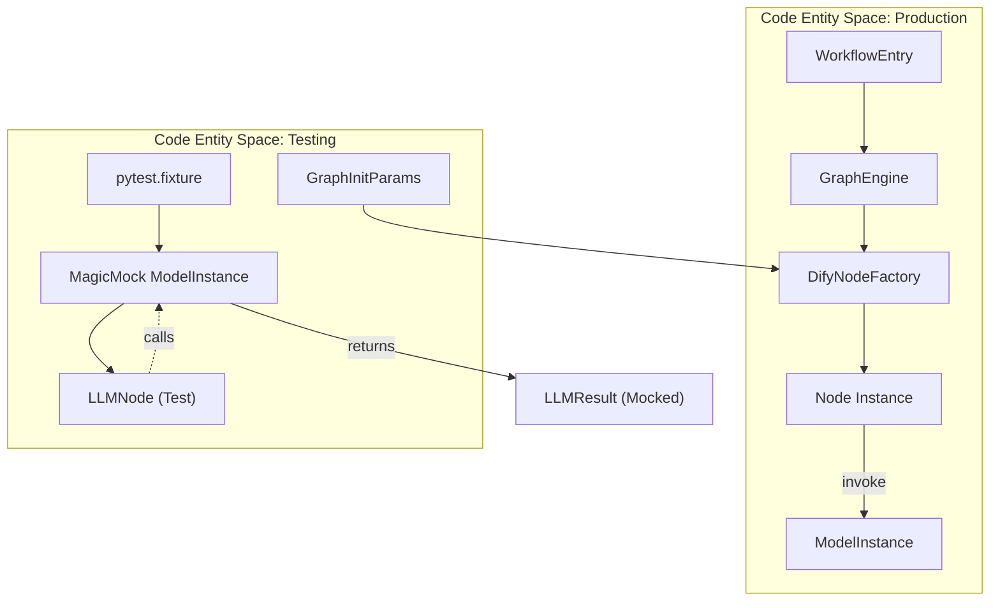
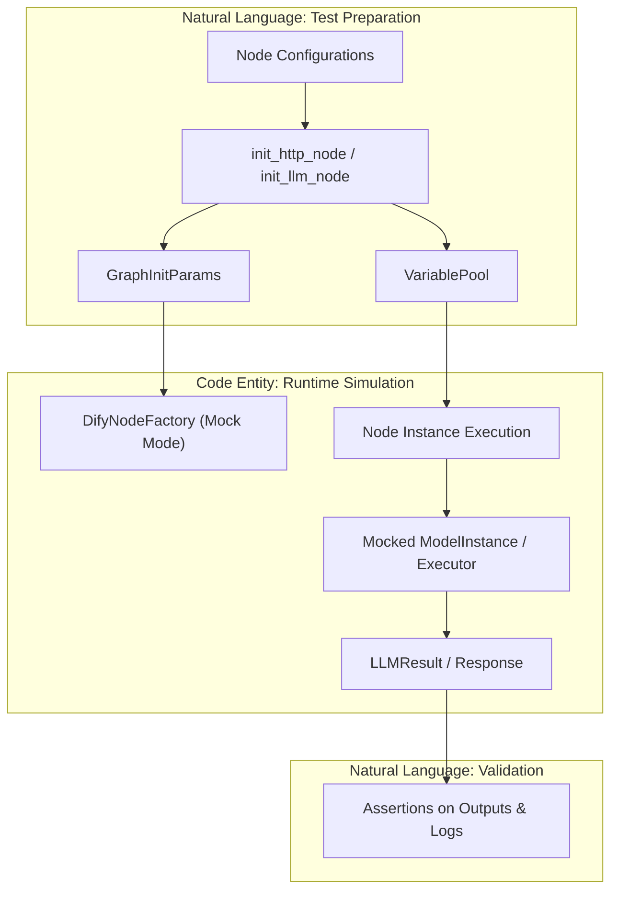

<!-- source: DeepWiki mcp.deepwiki.com · repo langgenius/dify · page 5.8 Workflow Testing and Mock System · fetched 2026-10-26 -->

# Workflow Testing and Mock System

Relevant source files

The following files were used as context for generating this wiki page:

- [api/.ruff.toml](api/.ruff.toml)
- [api/core/app/app_config/common/parameters_mapping/__init__.py](api/core/app/app_config/common/parameters_mapping/__init__.py)
- [api/core/app/task_pipeline/message_file_utils.py](api/core/app/task_pipeline/message_file_utils.py)
- [api/core/entities/mcp_provider.py](api/core/entities/mcp_provider.py)
- [api/core/external_data_tool/api/api.py](api/core/external_data_tool/api/api.py)
- [api/core/model_manager.py](api/core/model_manager.py)
- [api/core/workflow/human_input_policy.py](api/core/workflow/human_input_policy.py)
- [api/libs/helper.py](api/libs/helper.py)
- [api/migrations/versions/2026_03_02_1805-0ec65df55790_add_indexes_for_human_input_forms.py](api/migrations/versions/2026_03_02_1805-0ec65df55790_add_indexes_for_human_input_forms.py)
- [api/models/human_input.py](api/models/human_input.py)
- [api/services/data_source/provider_service.py](api/services/data_source/provider_service.py)
- [api/tasks/annotation/batch_import_annotations_task.py](api/tasks/annotation/batch_import_annotations_task.py)
- [api/tasks/annotation/disable_annotation_reply_task.py](api/tasks/annotation/disable_annotation_reply_task.py)
- [api/tasks/annotation/enable_annotation_reply_task.py](api/tasks/annotation/enable_annotation_reply_task.py)
- [api/tasks/clean_notion_document_task.py](api/tasks/clean_notion_document_task.py)
- [api/tasks/deal_dataset_index_update_task.py](api/tasks/deal_dataset_index_update_task.py)
- [api/tasks/document_indexing_update_task.py](api/tasks/document_indexing_update_task.py)
- [api/tasks/mail_account_deletion_task.py](api/tasks/mail_account_deletion_task.py)
- [api/tasks/recover_document_indexing_task.py](api/tasks/recover_document_indexing_task.py)
- [api/tasks/trigger_subscription_refresh_tasks.py](api/tasks/trigger_subscription_refresh_tasks.py)
- [api/tests/unit_tests/agent_runtime_fixtures.py](api/tests/unit_tests/agent_runtime_fixtures.py)
- [api/tests/unit_tests/conftest.py](api/tests/unit_tests/conftest.py)
- [api/tests/unit_tests/core/agent/test_cot_agent_runner.py](api/tests/unit_tests/core/agent/test_cot_agent_runner.py)
- [api/tests/unit_tests/core/agent/test_fc_agent_runner.py](api/tests/unit_tests/core/agent/test_fc_agent_runner.py)
- [api/tests/unit_tests/core/app/apps/agent_chat/test_agent_chat_app_config_manager.py](api/tests/unit_tests/core/app/apps/agent_chat/test_agent_chat_app_config_manager.py)
- [api/tests/unit_tests/core/app/apps/agent_chat/test_agent_chat_app_generator.py](api/tests/unit_tests/core/app/apps/agent_chat/test_agent_chat_app_generator.py)
- [api/tests/unit_tests/core/app/apps/agent_chat/test_agent_chat_app_runner.py](api/tests/unit_tests/core/app/apps/agent_chat/test_agent_chat_app_runner.py)
- [api/tests/unit_tests/core/app/apps/chat/test_app_generator_and_runner.py](api/tests/unit_tests/core/app/apps/chat/test_app_generator_and_runner.py)
- [api/tests/unit_tests/core/app/apps/completion/test_completion_app_config_manager.py](api/tests/unit_tests/core/app/apps/completion/test_completion_app_config_manager.py)
- [api/tests/unit_tests/core/app/apps/completion/test_completion_completion_app_generator.py](api/tests/unit_tests/core/app/apps/completion/test_completion_completion_app_generator.py)
- [api/tests/unit_tests/core/app/apps/workflow/test_generate_task_pipeline.py](api/tests/unit_tests/core/app/apps/workflow/test_generate_task_pipeline.py)
- [api/tests/unit_tests/core/app/task_pipeline/test_easy_ui_message_end_files.py](api/tests/unit_tests/core/app/task_pipeline/test_easy_ui_message_end_files.py)
- [api/tests/unit_tests/core/mcp/client/test_session.py](api/tests/unit_tests/core/mcp/client/test_session.py)
- [api/tests/unit_tests/core/mcp/test_error.py](api/tests/unit_tests/core/mcp/test_error.py)
- [api/tests/unit_tests/core/test_model_manager.py](api/tests/unit_tests/core/test_model_manager.py)
- [api/tests/unit_tests/core/variables/test_segment.py](api/tests/unit_tests/core/variables/test_segment.py)
- [api/tests/unit_tests/core/variables/test_segment_type.py](api/tests/unit_tests/core/variables/test_segment_type.py)
- [api/tests/unit_tests/core/variables/test_variables.py](api/tests/unit_tests/core/variables/test_variables.py)
- [api/tests/unit_tests/core/workflow/graph_engine/test_table_runner.py](api/tests/unit_tests/core/workflow/graph_engine/test_table_runner.py)
- [api/tests/unit_tests/core/workflow/test_enrich_pause_reasons.py](api/tests/unit_tests/core/workflow/test_enrich_pause_reasons.py)
- [api/tests/unit_tests/core/workflow/test_human_input_policy.py](api/tests/unit_tests/core/workflow/test_human_input_policy.py)
- [api/tests/unit_tests/libs/test_helper.py](api/tests/unit_tests/libs/test_helper.py)
- [api/tests/unit_tests/services/test_human_input_service.py](api/tests/unit_tests/services/test_human_input_service.py)
- [api/tests/unit_tests/tasks/test_document_indexing_update_task.py](api/tests/unit_tests/tasks/test_document_indexing_update_task.py)
- [api/tests/unit_tests/test_sqlite_fixtures.py](api/tests/unit_tests/test_sqlite_fixtures.py)

The Workflow Testing and Mock System in Dify provides a comprehensive framework aimed at validating workflow execution in isolation from real external services such as LLM providers or HTTP endpoints. This is achieved by injecting mock implementations of workflow nodes, enabling deterministic and fast tests. The system further supports flexible table-driven testing for different node types by configuring input scenarios and expected behaviors.

This page discusses the design and implementation of the mock system, the factory patterns for node instantiation, table-driven testing strategies, and integration test workflows.

---

## MockNodeFactory and Node Mocking

At the core of the system is the use of a customized **Node Factory** that enables substituting real node classes with mock variants. This allows unit tests and integration tests to simulate node behaviors without calling live LLMs, external APIs, or other side effects.

### Implementation and Data Flow

- The main production factory for workflow nodes is the `DifyNodeFactory` class. It is responsible for instantiating workflow node classes according to node type and version declarations in the workflow graph [api/core/workflow/node_factory.py:70-73]().
- The factory references a centralized node registry powered by the base `Node` class from the `graphon` library, which maps each workflow node type and version to a Python class [api/core/workflow/node_factory.py:124-133]().
- For testing, special mock factories leverage Python's `unittest.mock.MagicMock` or custom lightweight mocks to replace components such as model instances inside LLM nodes, or HTTP clients for HTTP request nodes [api/tests/unit_tests/core/workflow/graph_engine/test_mock_nodes.py:67-73]().
- The workflow engine obtains node instances from the factory. When using a mock factory, these nodes return controlled fixed data or simulated results as configured by the test setup.
- The test environment orchestrates these substitutions by configuring the `GraphInitParams` and `GraphRuntimeState` with mock data and injecting mock dependencies [api/tests/unit_tests/core/workflow/graph_engine/test_mock_nodes.py:61-62]().
- The `DifyGraphInitContext` dataclass represents explicit graph initialization parameters owned by the workflow layer, encapsulating the workflow id, graph configuration, run context values, and call depth [api/core/workflow/node_factory.py:85-106]().

Sources:
- [api/core/workflow/node_factory.py:70-73]()
- [api/core/workflow/node_factory.py:85-106]()
- [api/core/workflow/node_factory.py:124-133]()
- [api/tests/unit_tests/core/workflow/graph_engine/test_mock_nodes.py:61-62]()
- [api/tests/unit_tests/core/workflow/graph_engine/test_mock_nodes.py:67-73]()

### Key Components

| Component | Role | Source |
| :--- | :--- | :--- |
| `DifyNodeFactory` | Factory class for instantiating workflow node classes by type/version, supports mocking. | [api/core/workflow/node_factory.py:70-73]() |
| `DifyGraphInitContext` | Data container for explicit workflow graph initialization context used in node factory. | [api/core/workflow/node_factory.py:85-106]() |
| `VariablePool` | Maintains variable context during mock execution, supporting variable injection and retrieval. | [api/tests/unit_tests/core/variables/test_segment.py:79-88]() |
| `LLMNode` (mocked) | LLMNode's internal `ModelInstance` is replaced with a `MagicMock` to simulate LLM responses. | [api/tests/unit_tests/core/workflow/graph_engine/test_mock_nodes.py:67-73]() |
| `Executor` | Executes HTTP requests, can be mocked to generate logs without real network calls. | [api/tests/unit_tests/core/workflow/graph_engine/test_mock_nodes.py:22-22]() |

Sources:
- [api/core/workflow/node_factory.py:70-73]()
- [api/core/workflow/node_factory.py:85-106]()
- [api/core/workflow/node_factory.py:124-133]()
- [api/tests/unit_tests/core/variables/test_segment.py:79-88]()
- [api/tests/unit_tests/core/workflow/graph_engine/test_mock_nodes.py:22-22]()
- [api/tests/unit_tests/core/workflow/graph_engine/test_mock_nodes.py:61-62]()
- [api/tests/unit_tests/core/workflow/graph_engine/test_mock_nodes.py:67-73]()

---

### Code Entity Space to Mock System Diagram

This diagram relates core production classes involved in workflow execution to their corresponding test/mock components for LLM node mocking.

Sources:
- [api/core/workflow/node_factory.py:70-73]()
- [api/tests/unit_tests/core/workflow/graph_engine/test_mock_nodes.py:67-73]()

---

## Table-Driven Testing for Workflows

Dify uses **parameterized testing** extensively to validate multiple scenarios of node execution using `pytest.mark.parametrize`. This allows running the same test logic on different node configuration data and expected outcomes, greatly increasing test coverage with less duplication.

The `WorkflowRunner` class [api/tests/unit_tests/core/workflow/graph_engine/test_table_runner.py:109-112]() provides a framework for executing `WorkflowTestCase` instances [api/tests/unit_tests/core/workflow/graph_engine/test_table_runner.py:55-68](). It loads workflow definitions from YAML fixture files [api/tests/unit_tests/core/workflow/graph_engine/test_table_runner.py:131-137]() and constructs a `Graph` instance [api/tests/unit_tests/core/workflow/graph_engine/test_table_runner.py:146-147]().

### HTTP Request Node Testing

- Defined in integration tests under `tests/integration_tests/workflow/nodes/test_http.py`.
- The helper function `init_http_node` constructs a minimal graph configuration including a start node and the HTTP request node configured from test parameters [api/tests/unit_tests/core/workflow/test_node_factory.py:111-147]().
- A `VariablePool` is initialized with system variables simulating user/environment variables needed for the node [api/tests/unit_tests/core/workflow/test_node_factory.py:150-179]().
- Different authorization modes are tested (`no-auth`, `api-key`, `custom`), ensuring the HTTP client executor serializes headers correctly and constructs request data per configuration [api/tests/unit_tests/core/workflow/graph_engine/test_mock_nodes.py:77-79]().
- Raw HTTP request strings are inspected with `Executor.to_log()` to verify headers, query params, and JSON body with variable interpolation [api/tests/unit_tests/core/workflow/graph_engine/test_mock_nodes.py:108-123]().

### LLM Node Testing

- The tests mock the `ModelInstance.invoke_llm` call to return a controlled `LLMResult` object, allowing assertion of prompt correctness and output handling [api/tests/unit_tests/core/workflow/graph_engine/test_mock_nodes.py:153-166]().
- Fixtures build a complete node instance with mock dependencies, including mock prompt message serializer and file savers [api/tests/unit_tests/core/workflow/graph_engine/test_mock_nodes.py:67-76]().
- Tests verify that prompt templates interpolate variables from the `VariablePool` and that usage metadata (token counts, prices) is reported correctly after invocation [api/tests/unit_tests/core/workflow/graph_engine/test_mock_nodes.py:18-19]().

Sources:
- [api/tests/unit_tests/core/workflow/graph_engine/test_mock_nodes.py:18-19]()
- [api/tests/unit_tests/core/workflow/graph_engine/test_mock_nodes.py:67-76]()
- [api/tests/unit_tests/core/workflow/graph_engine/test_mock_nodes.py:77-79]()
- [api/tests/unit_tests/core/workflow/graph_engine/test_mock_nodes.py:108-123]()
- [api/tests/unit_tests/core/workflow/graph_engine/test_mock_nodes.py:153-166]()
- [api/tests/unit_tests/core/workflow/graph_engine/test_table_runner.py:55-68]()
- [api/tests/unit_tests/core/workflow/graph_engine/test_table_runner.py:109-112]()
- [api/tests/unit_tests/core/workflow/graph_engine/test_table_runner.py:131-137]()
- [api/tests/unit_tests/core/workflow/graph_engine/test_table_runner.py:146-147]()
- [api/tests/unit_tests/core/workflow/test_node_factory.py:111-147]()
- [api/tests/unit_tests/core/workflow/test_node_factory.py:150-179]()

### Table-Driven Testing Data Flow Diagram

Sources:
- [api/tests/unit_tests/core/workflow/graph_engine/test_mock_nodes.py:18-19]()
- [api/tests/unit_tests/core/workflow/graph_engine/test_mock_nodes.py:67-76]()
- [api/tests/unit_tests/core/workflow/graph_engine/test_mock_nodes.py:77-79]()
- [api/tests/unit_tests/core/workflow/graph_engine/test_mock_nodes.py:108-123]()
- [api/tests/unit_tests/core/workflow/graph_engine/test_mock_nodes.py:153-166]()
- [api/tests/unit_tests/core/workflow/test_node_factory.py:111-147]()
- [api/tests/unit_tests/core/workflow/test_node_factory.py:150-179]()

---

## Integration Testing Infrastructure

Beyond unit- and node-level testing, Dify implements integration tests that validate end-to-end workflow execution with background tasks and database interactions.

### Node Configuration Defaults
The testing system also validates the generation of default configurations for nodes. For example, `HttpRequestNode.get_default_config()` is tested to ensure it correctly merges injected `HttpRequestNodeConfig` filters with literal defaults [api/tests/unit_tests/core/workflow/graph_engine/test_mock_nodes.py:22-22]().

Sources:
- [api/tests/unit_tests/core/workflow/graph_engine/test_mock_nodes.py:22-22]()

---

## Key Functions and Helpers for Mocking

### `_build_llm_model_schema(*, features: list[ModelFeature] | None = None) -> AIModelEntity`
- A helper function used in tests to construct a mock `AIModelEntity` for LLM nodes. This allows defining specific model features for testing purposes without relying on actual model provider configurations. [api/tests/unit_tests/core/workflow/test_node_factory.py:80-85]()

### `_ModelInstanceStub`
- A stub class that mimics the `ModelInstance` interface, used to inject controlled behavior into LLM nodes during testing. It allows setting mock return values for `invoke_llm` and `get_llm_num_tokens`. [api/tests/unit_tests/core/workflow/test_node_factory.py:131-148]()

### `_build_run_context(*, invoke_from: InvokeFrom | str = InvokeFrom.DEBUGGER) -> dict[str, object]`
- Creates a mock `run_context` dictionary, which is essential for initializing workflow nodes with tenant, app, user, and invocation source information. This ensures that nodes behave as if they are running within a Dify application context. [api/tests/unit_tests/core/workflow/test_node_runtime.py:159-166]()

### `resolve_workflow_node_class`
- Resolves the production node class for a requested type/version. This function is crucial for the `DifyNodeFactory` to correctly identify and instantiate the appropriate node implementation, including handling versioning and specific node data types like `AGENT` nodes. [api/core/workflow/node_factory.py:140-162]()

| Helper Function | Usage | Source |
| :--- | :--- | :--- |
| `_build_llm_model_schema` | Creates a mock `AIModelEntity` for LLM node testing. | [api/tests/unit_tests/core/workflow/test_node_factory.py:80-85]() |
| `_ModelInstanceStub` | Provides a stub for `ModelInstance` to control LLM node behavior. | [api/tests/unit_tests/core/workflow/test_node_factory.py:131-148]() |
| `_build_run_context` | Generates a mock `run_context` for node initialization. | [api/tests/unit_tests/core/workflow/test_node_runtime.py:159-166]() |
| `resolve_workflow_node_class` | Resolves the production node class for a requested type/version. | [api/core/workflow/node_factory.py:140-162]() |

Sources:
- [api/core/workflow/node_factory.py:140-162]()
- [api/tests/unit_tests/core/workflow/test_node_factory.py:80-85]()
- [api/tests/unit_tests/core/workflow/test_node_factory.py:131-148]()
- [api/tests/unit_tests/core/workflow/test_node_runtime.py:159-166]()

---

# Summary

The Dify workflow testing architecture centers on flexible mock factories and table-driven test cases. The `DifyNodeFactory` pattern facilitates replacing real node runtime components with mocks to simulate node execution reliably and repeatably in unit and integration tests. This infrastructure supports end-to-end workflow validation with real persistence layers and asynchronous task execution while isolating complex external interactions to mocks. Table-driven tests verify node behavior across diverse input cases to improve code quality and maintainability in this graph-driven AI platform.

Sources:
- [api/core/workflow/node_factory.py:70-106]()
- [api/tests/unit_tests/core/workflow/graph_engine/test_mock_nodes.py:18-19]()
- [api/tests/unit_tests/core/workflow/graph_engine/test_mock_nodes.py:22-22]()
- [api/tests/unit_tests/core/workflow/graph_engine/test_mock_nodes.py:67-76]()
- [api/tests/unit_tests/core/workflow/graph_engine/test_mock_nodes.py:77-79]()
- [api/tests/unit_tests/core/workflow/graph_engine/test_mock_nodes.py:108-123]()
- [api/tests/unit_tests/core/workflow/graph_engine/test_mock_nodes.py:153-166]()
- [api/tests/unit_tests/core/workflow/test_node_factory.py:80-85]()
- [api/tests/unit_tests/core/workflow/test_node_factory.py:111-147]()
- [api/tests/unit_tests/core/workflow/test_node_factory.py:131-148]()
- [api/tests/unit_tests/core/workflow/test_node_factory.py:150-179]()
- [api/tests/unit_tests/core/workflow/test_node_runtime.py:159-166]()

---

