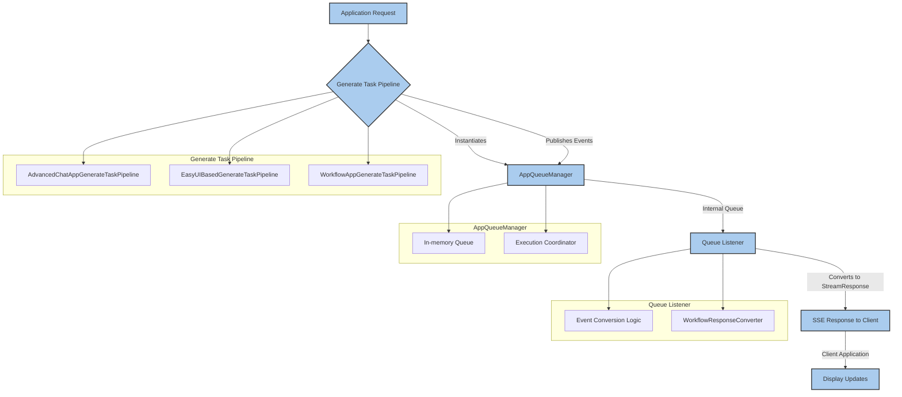
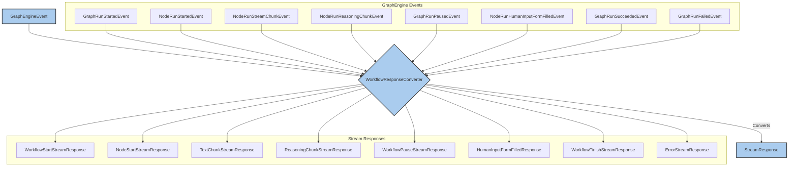

<!-- source: DeepWiki mcp.deepwiki.com · repo langgenius/dify · page 5.9 Streaming Task Pipelines and Queue Managers · fetched 2026-10-26 -->

# Streaming Task Pipelines and Queue Managers

<details>
<summary>Relevant source files</summary>

The following files were used as context for generating this wiki page:

- [api/core/app/app_config/easy_ui_based_app/dataset/manager.py](api/core/app/app_config/easy_ui_based_app/dataset/manager.py)
- [api/core/app/apps/advanced_chat/app_runner.py](api/core/app/apps/advanced_chat/app_runner.py)
- [api/core/app/apps/advanced_chat/generate_task_pipeline.py](api/core/app/apps/advanced_chat/generate_task_pipeline.py)
- [api/core/app/apps/agent_app/app_config_manager.py](api/core/app/apps/agent_app/app_config_manager.py)
- [api/core/app/apps/agent_app/app_variable_projection.py](api/core/app/apps/agent_app/app_variable_projection.py)
- [api/core/app/apps/common/workflow_response_converter.py](api/core/app/apps/common/workflow_response_converter.py)
- [api/core/app/apps/execution_coordinator.py](api/core/app/apps/execution_coordinator.py)
- [api/core/app/apps/pipeline/pipeline_runner.py](api/core/app/apps/pipeline/pipeline_runner.py)
- [api/core/app/apps/workflow/app_runner.py](api/core/app/apps/workflow/app_runner.py)
- [api/core/app/apps/workflow/command_channels.py](api/core/app/apps/workflow/command_channels.py)
- [api/core/app/apps/workflow/generate_task_pipeline.py](api/core/app/apps/workflow/generate_task_pipeline.py)
- [api/core/app/apps/workflow/stop_aware_ready_queue.py](api/core/app/apps/workflow/stop_aware_ready_queue.py)
- [api/core/app/apps/workflow_app_runner.py](api/core/app/apps/workflow_app_runner.py)
- [api/core/app/entities/queue_entities.py](api/core/app/entities/queue_entities.py)
- [api/core/app/entities/task_entities.py](api/core/app/entities/task_entities.py)
- [api/core/app/features/annotation_reply/annotation_reply.py](api/core/app/features/annotation_reply/annotation_reply.py)
- [api/core/app/llm/model_access.py](api/core/app/llm/model_access.py)
- [api/core/app/task_pipeline/based_generate_task_pipeline.py](api/core/app/task_pipeline/based_generate_task_pipeline.py)
- [api/core/app/task_pipeline/easy_ui_based_generate_task_pipeline.py](api/core/app/task_pipeline/easy_ui_based_generate_task_pipeline.py)
- [api/core/app/task_pipeline/message_cycle_manager.py](api/core/app/task_pipeline/message_cycle_manager.py)
- [api/core/helper/position_helper.py](api/core/helper/position_helper.py)
- [api/core/prompt/utils/prompt_message_util.py](api/core/prompt/utils/prompt_message_util.py)
- [api/core/workflow/llm_environment_variable.py](api/core/workflow/llm_environment_variable.py)
- [api/services/variable_truncator.py](api/services/variable_truncator.py)
- [api/services/workflow_event_snapshot_service.py](api/services/workflow_event_snapshot_service.py)
- [api/services/workflow_node_execution_trace_service.py](api/services/workflow_node_execution_trace_service.py)
- [api/services/workflow_run_service.py](api/services/workflow_run_service.py)
- [api/tasks/app_generate/workflow_execute_task.py](api/tasks/app_generate/workflow_execute_task.py)
- [api/tasks/async_workflow_tasks.py](api/tasks/async_workflow_tasks.py)
- [api/tasks/remove_app_and_related_data_task.py](api/tasks/remove_app_and_related_data_task.py)
- [api/tests/integration_tests/tasks/test_remove_app_and_related_data_task.py](api/tests/integration_tests/tasks/test_remove_app_and_related_data_task.py)
- [api/tests/test_containers_integration_tests/services/test_end_user_service.py](api/tests/test_containers_integration_tests/services/test_end_user_service.py)
- [api/tests/test_containers_integration_tests/tasks/test_remove_app_and_related_data_task.py](api/tests/test_containers_integration_tests/tasks/test_remove_app_and_related_data_task.py)
- [api/tests/unit_tests/core/app/app_config/easy_ui_based_app/test_dataset_manager.py](api/tests/unit_tests/core/app/app_config/easy_ui_based_app/test_dataset_manager.py)
- [api/tests/unit_tests/core/app/app_config/easy_ui_based_app/test_prompt_template_manager.py](api/tests/unit_tests/core/app/app_config/easy_ui_based_app/test_prompt_template_manager.py)
- [api/tests/unit_tests/core/app/apps/advanced_chat/test_app_config_manager.py](api/tests/unit_tests/core/app/apps/advanced_chat/test_app_config_manager.py)
- [api/tests/unit_tests/core/app/apps/advanced_chat/test_app_runner_conversation_variables.py](api/tests/unit_tests/core/app/apps/advanced_chat/test_app_runner_conversation_variables.py)
- [api/tests/unit_tests/core/app/apps/advanced_chat/test_app_runner_input_moderation.py](api/tests/unit_tests/core/app/apps/advanced_chat/test_app_runner_input_moderation.py)
- [api/tests/unit_tests/core/app/apps/agent_app/test_app_config_manager.py](api/tests/unit_tests/core/app/apps/agent_app/test_app_config_manager.py)
- [api/tests/unit_tests/core/app/apps/agent_app/test_input_guards.py](api/tests/unit_tests/core/app/apps/agent_app/test_input_guards.py)
- [api/tests/unit_tests/core/app/apps/chat/test_app_config_manager.py](api/tests/unit_tests/core/app/apps/chat/test_app_config_manager.py)
- [api/tests/unit_tests/core/app/apps/common/test_workflow_response_converter_human_input.py](api/tests/unit_tests/core/app/apps/common/test_workflow_response_converter_human_input.py)
- [api/tests/unit_tests/core/app/apps/common/test_workflow_response_converter_resumption.py](api/tests/unit_tests/core/app/apps/common/test_workflow_response_converter_resumption.py)
- [api/tests/unit_tests/core/app/apps/common/test_workflow_response_converter_truncation.py](api/tests/unit_tests/core/app/apps/common/test_workflow_response_converter_truncation.py)
- [api/tests/unit_tests/core/app/apps/test_advanced_chat_app_generator.py](api/tests/unit_tests/core/app/apps/test_advanced_chat_app_generator.py)
- [api/tests/unit_tests/core/app/apps/test_execution_coordinator.py](api/tests/unit_tests/core/app/apps/test_execution_coordinator.py)
- [api/tests/unit_tests/core/app/apps/test_message_based_app_generator.py](api/tests/unit_tests/core/app/apps/test_message_based_app_generator.py)
- [api/tests/unit_tests/core/app/apps/test_workflow_app_runner_core.py](api/tests/unit_tests/core/app/apps/test_workflow_app_runner_core.py)
- [api/tests/unit_tests/core/app/apps/test_workflow_app_runner_single_node.py](api/tests/unit_tests/core/app/apps/test_workflow_app_runner_single_node.py)
- [api/tests/unit_tests/core/app/apps/test_workflow_pause_events.py](api/tests/unit_tests/core/app/apps/test_workflow_pause_events.py)
- [api/tests/unit_tests/core/app/apps/workflow/test_app_config_manager.py](api/tests/unit_tests/core/app/apps/workflow/test_app_config_manager.py)
- [api/tests/unit_tests/core/app/apps/workflow/test_command_channels.py](api/tests/unit_tests/core/app/apps/workflow/test_command_channels.py)
- [api/tests/unit_tests/core/app/apps/workflow/test_generate_task_pipeline_core.py](api/tests/unit_tests/core/app/apps/workflow/test_generate_task_pipeline_core.py)
- [api/tests/unit_tests/core/app/apps/workflow/test_stop_aware_ready_queue.py](api/tests/unit_tests/core/app/apps/workflow/test_stop_aware_ready_queue.py)
- [api/tests/unit_tests/core/app/features/test_annotation_reply.py](api/tests/unit_tests/core/app/features/test_annotation_reply.py)
- [api/tests/unit_tests/core/app/llm/test_model_access.py](api/tests/unit_tests/core/app/llm/test_model_access.py)
- [api/tests/unit_tests/core/app/task_pipeline/test_easy_ui_based_generate_task_pipeline.py](api/tests/unit_tests/core/app/task_pipeline/test_easy_ui_based_generate_task_pipeline.py)
- [api/tests/unit_tests/core/app/task_pipeline/test_easy_ui_based_generate_task_pipeline_core.py](api/tests/unit_tests/core/app/task_pipeline/test_easy_ui_based_generate_task_pipeline_core.py)
- [api/tests/unit_tests/core/app/task_pipeline/test_message_cycle_manager_optimization.py](api/tests/unit_tests/core/app/task_pipeline/test_message_cycle_manager_optimization.py)
- [api/tests/unit_tests/core/app/workflow/test_observability_layer_extra.py](api/tests/unit_tests/core/app/workflow/test_observability_layer_extra.py)
- [api/tests/unit_tests/core/prompt/test_advanced_prompt_transform.py](api/tests/unit_tests/core/prompt/test_advanced_prompt_transform.py)
- [api/tests/unit_tests/core/workflow/graph_engine/test_mock_nodes.py](api/tests/unit_tests/core/workflow/graph_engine/test_mock_nodes.py)
- [api/tests/unit_tests/core/workflow/nodes/agent/test_agent_entities.py](api/tests/unit_tests/core/workflow/nodes/agent/test_agent_entities.py)
- [api/tests/unit_tests/core/workflow/nodes/llm/test_node.py](api/tests/unit_tests/core/workflow/nodes/llm/test_node.py)
- [api/tests/unit_tests/services/test_end_user_service.py](api/tests/unit_tests/services/test_end_user_service.py)
- [api/tests/unit_tests/services/test_variable_truncator.py](api/tests/unit_tests/services/test_variable_truncator.py)
- [api/tests/unit_tests/services/test_workflow_node_execution_trace_service.py](api/tests/unit_tests/services/test_workflow_node_execution_trace_service.py)
- [api/tests/unit_tests/services/test_workflow_run_service.py](api/tests/unit_tests/services/test_workflow_run_service.py)
- [api/tests/unit_tests/services/test_workflow_run_service_pause.py](api/tests/unit_tests/services/test_workflow_run_service_pause.py)
- [api/tests/unit_tests/services/workflow/test_workflow_converter_additional.py](api/tests/unit_tests/services/workflow/test_workflow_converter_additional.py)
- [api/tests/unit_tests/services/workflow/test_workflow_event_snapshot_service.py](api/tests/unit_tests/services/workflow/test_workflow_event_snapshot_service.py)
- [api/tests/unit_tests/tasks/test_async_workflow_tasks.py](api/tests/unit_tests/tasks/test_async_workflow_tasks.py)
- [api/tests/unit_tests/tasks/test_mail_send_task.py](api/tests/unit_tests/tasks/test_mail_send_task.py)
- [api/tests/unit_tests/tasks/test_remove_app_and_related_data_task.py](api/tests/unit_tests/tasks/test_remove_app_and_related_data_task.py)
- [api/tests/unit_tests/tasks/test_workflow_execute_task.py](api/tests/unit_tests/tasks/test_workflow_execute_task.py)

</details>


This page details how Dify handles real-time communication for advanced chat, workflow, and easy-UI applications. It focuses on the architecture of streaming task pipelines, the role of `AppQueueManager` in managing events, the various task entities involved, and the message lifecycle. The core mechanism involves converting internal queue events into Server-Sent Events (SSE) responses, enabling dynamic and interactive user experiences.

## Overview of Streaming Task Pipelines

Dify's streaming task pipelines are responsible for processing application-generated events and transforming them into a stream of responses that can be consumed by client applications. This is particularly crucial for interactive applications like chat and workflows, where immediate feedback and continuous updates are essential. The pipelines leverage a queue-based system to handle events asynchronously and efficiently.

The primary components involved are:
*   **`AppQueueManager`**: Manages the queue of events for a specific task, handling publishing and listening.
*   **`BasedGenerateTaskPipeline`**: The abstract base class for all generate task pipelines, providing common functionalities.
*   **`AdvancedChatAppGenerateTaskPipeline`**: Handles streaming for advanced chat applications, which often involve complex workflows.
*   **`EasyUIBasedGenerateTaskPipeline`**: Manages streaming for simpler chat and completion applications.
*   **`WorkflowAppGenerateTaskPipeline`**: Specifically designed for streaming events from workflow executions.
*   **Task Entities**: A set of Pydantic models (`StreamResponse` and its subclasses) that define the structure of events sent to the client.
*   **`MessageCycleManager`**: Manages the lifecycle of messages, including generating conversation names and handling annotations.
*   **`WorkflowResponseConverter`**: Converts internal workflow events into a format suitable for streaming to the client.

### Core Data Flow

The general data flow for streaming tasks involves:
1.  An application (e.g., chat, workflow) initiates a generation task.
2.  A specific `GenerateTaskPipeline` (e.g., `AdvancedChatAppGenerateTaskPipeline`) is instantiated.
3.  This pipeline interacts with an `AppQueueManager` to publish internal events.
4.  The `AppQueueManager` places these events into an in-memory queue.
5.  A listener (typically the client-facing API endpoint) consumes events from the queue.
6.  The `GenerateTaskPipeline` converts these internal events into `StreamResponse` objects.
7.  These `StreamResponse` objects are then sent to the client as SSE.



Sources:
- [api/core/app/apps/advanced_chat/generate_task_pipeline.py:143-146]()
- [api/core/app/task_pipeline/easy_ui_based_generate_task_pipeline.py:72-75]()
- [api/core/app/apps/workflow/generate_task_pipeline.py:76-79]()
- [api/core/app/apps/base_app_queue_manager.py:50-58]()

## AppQueueManager

The `AppQueueManager` [api/core/app/apps/base_app_queue_manager.py:50-58]() is a crucial component responsible for managing the event queue for a specific application task. It acts as an intermediary between the task execution logic and the client-facing SSE stream.

### Initialization and Task Management

When an `AppQueueManager` is initialized, it takes a `task_id`, `user_id`, and `invoke_from` [api/core/app/apps/base_app_queue_manager.py:50-58](). It sets up an in-memory `queue.Queue` [api/core/app/apps/base_app_queue_manager.py:65]() to hold `AppQueueEvent` objects. It also uses Redis to store a `_task_belong_cache_key` [api/core/app/apps/base_app_queue_manager.py:61-62]() to associate the task with a user, which is crucial for stopping tasks.

```python
class AppQueueManager(ABC):
    def __init__(self, task_id: str, user_id: str, invoke_from: InvokeFrom):
        # ... initialization ...
        self._task_id = task_id
        self._user_id = user_id
        self._invoke_from = invoke_from
        # ...
        q: queue.Queue[WorkflowQueueMessage | MessageQueueMessage | None] = queue.Queue()
        self._q = q
        # ...
```
Sources:
- [api/core/app/apps/base_app_queue_manager.py:50-66]()

### Event Publishing

The `publish` method [api/core/app/apps/base_app_queue_manager.py:164-171]() allows various parts of the application (e.g., `TASK_PIPELINE` or `APPLICATION_MANAGER`) to add events to the queue. Before publishing, it performs a check to ensure no SQLAlchemy model instances are directly passed, as these are not serializable for the queue [api/core/app/apps/base_app_queue_manager.py:171]().

```python
    def publish(self, event: AppQueueEvent, pub_from: PublishFrom) -> None:
        """
        Publish event to queue
        :param event:
        :param pub_from:
        :return:
        """
        self._check_for_sqlalchemy_models(event.model_dump())
        self._publish(event, pub_from)
```
Sources:
- [api/core/app/apps/base_app_queue_manager.py:164-171]()

### Event Listening and Streaming

The `listen` method [api/core/app/apps/base_app_queue_manager.py:76-110]() is a generator that continuously yields events from the queue. It includes logic for:
*   **Timeout handling**: The `_execution_coordinator` [api/core/app/apps/base_app_queue_manager.py:71-74]() monitors the task and can publish a `QueueStopEvent` if a timeout occurs [api/core/app/apps/base_app_queue_manager.py:128-133]().
*   **User-initiated stops**: It checks `_is_stopped()` [api/core/app/apps/base_app_queue_manager.py:96]() to see if the user has manually stopped the task and publishes a `QueueStopEvent` [api/core/app/apps/base_app_queue_manager.py:100-102]() if so.
*   **Ping events**: Periodically sends `QueuePingEvent` [api/core/app/apps/base_app_queue_manager.py:105]() to keep the connection alive and inform the client that the task is still active.
*   **Resource cleanup**: Ensures that the `_graph_runtime_state` is released and the task's Redis cache entry is cleared when listening stops [api/core/app/apps/base_app_queue_manager.py:109-110]().

```python
    def listen(self):
        """
        Listen to queue
        :return:
        """
        self._execution_coordinator.start_watchdog()
        start_time = time.monotonic()
        last_ping_time: int | float = 0
        try:
            while True:
                try:
                    message = self._q.get(timeout=1)
                    if message is None:
                        break

                    yield message
                except queue.Empty:
                    continue
                finally:
                    elapsed_time = time.monotonic() - start_time
                    manually_stopped = self._is_stopped()
                    if manually_stopped and self._execution_coordinator.request_abort("App task was stopped"):
                        # publish two messages to make sure the client can receive the stop signal
                        # and stop listening after the stop signal processed
                        self.publish(
                            QueueStopEvent(stopped_by=QueueStopEvent.StopBy.USER_MANUAL), PublishFrom.TASK_PIPELINE
                        )

                    if elapsed_time // 10 > last_ping_time:
                        self.publish(QueuePingEvent(), PublishFrom.TASK_PIPELINE)
                        last_ping_time = elapsed_time // 10
        finally:
            self._execution_coordinator.listener_closed(segment_completed=self._listener_segment_completed.is_set())
            self._graph_runtime_state = None  # Release reference once consumers finish or close the generator.
```
Sources:
- [api/core/app/apps/base_app_queue_manager.py:76-110]()

### Graph Runtime State

The `AppQueueManager` can hold a reference to a `GraphRuntimeState` [api/core/app/apps/base_app_queue_manager.py:154-162](), which is essential for workflow applications to maintain and resume execution state. This state is released once the listener closes.

## Generate Task Pipelines

Dify implements several specialized generate task pipelines, each tailored to different application types. These pipelines inherit from `BasedGenerateTaskPipeline` [api/core/app/task_pipeline/based_generate_task_pipeline.py]() and are responsible for orchestrating the generation process, publishing events, and converting them into streamable responses.

### `BasedGenerateTaskPipeline`

This abstract base class [api/core/app/task_pipeline/based_generate_task_pipeline.py]() provides the fundamental structure and common methods for all generate task pipelines. It initializes with an `application_generate_entity`, an `AppQueueManager`, and a `stream` flag.

### `AdvancedChatAppGenerateTaskPipeline`

This pipeline [api/core/app/apps/advanced_chat/generate_task_pipeline.py:143]() is used for advanced chat applications, which often involve complex workflows. It extends `GraphRuntimeStateSupport` [api/core/app/apps/advanced_chat/generate_task_pipeline.py:143]() to manage the workflow's runtime state.

Key responsibilities include:
*   **Initialization**: Takes `AdvancedChatAppGenerateEntity`, `WorkflowSnapshot`, `AppQueueManager`, `ConversationSnapshot`, `MessageSnapshot`, user details, and a `DraftVariableSaverFactory` [api/core/app/apps/advanced_chat/generate_task_pipeline.py:150-159]().
*   **System Variables**: Builds `_workflow_system_variables` [api/core/app/apps/advanced_chat/generate_task_pipeline.py:178-187]() based on the message query, files, conversation, and app details.
*   **Response Conversion**: Uses `WorkflowResponseConverter` [api/core/app/apps/advanced_chat/generate_task_pipeline.py:188-192]() to transform internal workflow events into `StreamResponse` objects.
*   **Event Handling**: Contains a `_process_queue_event` method [api/core/app/apps/advanced_chat/generate_task_pipeline.py:200-203]() that matches incoming `AppQueueEvent` types to corresponding `StreamResponse` types. This method handles a wide array of events, including:
    *   `QueueWorkflowStartedEvent` -> `WorkflowStartStreamResponse` [api/core/app/apps/advanced_chat/generate_task_pipeline.py:209-210]()
    *   `QueueNodeStartedEvent` -> `NodeStartStreamResponse` [api/core/app/apps/advanced_chat/generate_task_pipeline.py:220-221]()
    *   `QueueTextChunkEvent` -> `TextChunkStreamResponse` [api/core/app/apps/advanced_chat/generate_task_pipeline.py:260-261]()
    *   `QueueReasoningChunkEvent` -> `ReasoningChunkStreamResponse` [api/core/app/apps/advanced_chat/generate_task_pipeline.py:268-269]()
    *   `QueueHumanInputFormFilledEvent` -> `HumanInputFormFilledResponse` [api/core/app/apps/advanced_chat/generate_task_pipeline.py:300-301]()
    *   `QueueWorkflowPausedEvent` -> `WorkflowPauseStreamResponse` [api/core/app/apps/advanced_chat/generate_task_pipeline.py:310-311]()
    *   `QueueAdvancedChatMessageEndEvent` -> `MessageEndStreamResponse` [api/core/app/apps/advanced_chat/generate_task_pipeline.py:320-321]()
    *   `QueueErrorEvent` -> `ErrorStreamResponse` [api/core/app/apps/advanced_chat/generate_task_pipeline.py:330-331]()

```python
class AdvancedChatAppGenerateTaskPipeline(GraphRuntimeStateSupport):
    """
    AdvancedChatAppGenerateTaskPipeline is a class that generate stream output and state management for Application.
    """

    def __init__(
        self,
        application_generate_entity: AdvancedChatAppGenerateEntity,
        workflow: WorkflowSnapshot,
        queue_manager: AppQueueManager,
        conversation: ConversationSnapshot,
        message: MessageSnapshot,
        user: Union[Account, EndUser],
        stream: bool,
        dialogue_count: int,
        draft_var_saver_factory: DraftVariableSaverFactory,
    ):
        self._base_task_pipeline = BasedGenerateTaskPipeline(
            application_generate_entity=application_generate_entity,
            queue_manager=queue_manager,
            stream=stream,
        )
        # ... other initializations ...
        self._workflow_response_converter = WorkflowResponseConverter(
            application_generate_entity=application_generate_entity,
            user=user,
            system_variables=self._workflow_system_variables,
        )
```
Sources:
- [api/core/app/apps/advanced_chat/generate_task_pipeline.py:143-192]()

### `EasyUIBasedGenerateTaskPipeline`

This pipeline [api/core/app/task_pipeline/easy_ui_based_generate_task_pipeline.py:72]() handles simpler chat and completion applications. It manages the `EasyUITaskState` [api/core/app/task_pipeline/easy_ui_based_generate_task_pipeline.py:77]() which includes the `LLMResult`.

Key features:
*   **Initialization**: Takes `EasyUIAppGenerateEntity`, `AppQueueManager`, `Conversation`, `Message`, and a `stream` flag [api/core/app/task_pipeline/easy_ui_based_generate_task_pipeline.py:81-86]().
*   **Conversation Name Generation**: Initiates a background thread to generate a conversation name if it's a new conversation [api/core/app/task_pipeline/easy_ui_based_generate_task_pipeline.py:126-131]().
*   **Blocking vs. Streaming**: Provides methods `_to_blocking_response` [api/core/app/task_pipeline/easy_ui_based_generate_task_pipeline.py:139-169]() and `_to_stream_response` [api/core/app/task_pipeline/easy_ui_based_generate_task_pipeline.py:123]() to handle both blocking and streaming responses based on the `stream` flag.
*   **Event Mapping**: Converts various `Queue` events into `StreamResponse` types, such as `QueueLLMChunkEvent` to `MessageStreamResponse` [api/core/app/task_pipeline/easy_ui_based_generate_task_pipeline.py:200-201]() and `QueueAgentThoughtEvent` to `AgentThoughtStreamResponse` [api/core/app/task_pipeline/easy_ui_based_generate_task_pipeline.py:230-231]().

```python
class EasyUIBasedGenerateTaskPipeline(BasedGenerateTaskPipeline[EasyUIAppGenerateEntity]):
    """
    EasyUIBasedGenerateTaskPipeline is a class that generate stream output and state management for Application.
    """

    _task_state: EasyUITaskState
    _precomputed_event_type: StreamEvent | None = None

    def __init__(
        self,
        application_generate_entity: EasyUIAppGenerateEntity,
        queue_manager: AppQueueManager,
        conversation: Conversation,
        message: Message,
        stream: bool,
    ):
        super().__init__(
            application_generate_entity=application_generate_entity,
            queue_manager=queue_manager,
            stream=stream,
        )
        # ... other initializations ...
        self._task_state = EasyUITaskState(
            llm_result=LLMResult(
                model=self._model_config.model,
                prompt_messages=[],
                message=AssistantPromptMessage(content=""),
                usage=LLMUsage.empty_usage(),
            )
        )
```
Sources:
- [api/core/app/task_pipeline/easy_ui_based_generate_task_pipeline.py:72-109]()

### `WorkflowAppGenerateTaskPipeline`

This pipeline [api/core/app/apps/workflow/generate_task_pipeline.py:76]() is specifically for applications built on Dify's workflow engine. It also extends `GraphRuntimeStateSupport` [api/core/app/apps/workflow/generate_task_pipeline.py:76]().

Key aspects:
*   **Initialization**: Similar to `AdvancedChatAppGenerateTaskPipeline`, it takes `WorkflowAppGenerateEntity`, `Workflow`, `AppQueueManager`, user details, and `DraftVariableSaverFactory` [api/core/app/apps/workflow/generate_task_pipeline.py:81-89]().
*   **Workflow System Variables**: Builds system variables relevant to workflow execution [api/core/app/apps/workflow/generate_task_pipeline.py:111-117]().
*   **Response Conversion**: Uses `WorkflowResponseConverter` [api/core/app/apps/workflow/generate_task_pipeline.py:118-122]() for event transformation.
*   **Blocking vs. Streaming**: Supports both blocking and streaming responses [api/core/app/apps/workflow/generate_task_pipeline.py:134-138]().
*   **Human Input Handling**: Specifically handles `HumanInputRequiredResponse` [api/core/app/apps/workflow/generate_task_pipeline.py:152-153]() for workflows that pause for user input.

```python
class WorkflowAppGenerateTaskPipeline(GraphRuntimeStateSupport):
    """
    WorkflowAppGenerateTaskPipeline is a class that generate stream output and state management for Application.
    """

    def __init__(
        self,
        application_generate_entity: WorkflowAppGenerateEntity,
        workflow: Workflow,
        queue_manager: AppQueueManager,
        user: Union[Account, EndUser],
        stream: bool,
        draft_var_saver_factory: DraftVariableSaverFactory,
    ):
        self._base_task_pipeline = BasedGenerateTaskPipeline(
            application_generate_entity=application_generate_entity,
            queue_manager=queue_manager,
            stream=stream,
        )
        # ... other initializations ...
        self._workflow_response_converter = WorkflowResponseConverter(
            application_generate_entity=application_generate_entity,
            user=user,
            system_variables=self._workflow_system_variables,
        )
```
Sources:
- [api/core/app/apps/workflow/generate_task_pipeline.py:76-122]()

## Task Entities and StreamResponse

The `core.app.entities.task_entities` module [api/core/app/entities/task_entities.py]() defines the Pydantic models used for streaming responses. These models represent the various events that can be sent to the client.

### `StreamEvent` Enum

The `StreamEvent` enum [api/core/app/entities/task_entities.py:62-96]() defines the types of events that can be streamed, such as `PING`, `ERROR`, `MESSAGE`, `AGENT_THOUGHT`, `WORKFLOW_STARTED`, `NODE_STARTED`, `HUMAN_INPUT_REQUIRED`, etc.

```python
class StreamEvent(StrEnum):
    """
    Stream event
    """

    PING = "ping"
    ERROR = "error"
    MESSAGE = "message"
    MESSAGE_END = "message_end"
    TTS_MESSAGE = "tts_message"
    TTS_MESSAGE_END = "tts_message_end"
    MESSAGE_FILE = "message_file"
    MESSAGE_REPLACE = "message_replace"
    AGENT_THOUGHT = "agent_thought"
    AGENT_MESSAGE = "agent_message"
    WORKFLOW_STARTED = "workflow_started"
    WORKFLOW_PAUSED = "workflow_paused"
    WORKFLOW_FINISHED = "workflow_finished"
    NODE_STARTED = "node_started"
    NODE_FINISHED = "node_finished"
    NODE_RETRY = "node_retry"
    ITERATION_STARTED = "iteration_started"
    ITERATION_NEXT = "iteration_next"
    ITERATION_COMPLETED = "iteration_completed"
    LOOP_STARTED = "loop_started"
    LOOP_NEXT = "loop_next"
    LOOP_COMPLETED = "loop_completed"
    TEXT_CHUNK = "text_chunk"
    TEXT_REPLACE = "text_replace"
    REASONING_CHUNK = "reasoning_chunk"
    AGENT_LOG = "agent_log"
    HUMAN_INPUT_REQUIRED = "human_input_required"
    HUMAN_INPUT_FORM_FILLED = "human_input_form_filled"
    HUMAN_INPUT_FORM_TIMEOUT = "human_input_form_timeout"
```
Sources:
- [api/core/app/entities/task_entities.py:62-96]()

### `StreamResponse` Base Class

All streamable events inherit from `StreamResponse` [api/core/app/entities/task_entities.py:98-105](), which includes the `event` type and `task_id`.

### Specific StreamResponse Types

The module defines numerous specific `StreamResponse` subclasses for different event types, such as:
*   `ErrorStreamResponse` [api/core/app/entities/task_entities.py:107-114]()
*   `MessageStreamResponse` [api/core/app/entities/task_entities.py:117-126]() (for LLM text chunks)
*   `MessageEndStreamResponse` [api/core/app/entities/task_entities.py:147-155]() (signals the end of a message)
*   `AgentThoughtStreamResponse` [api/core/app/entities/task_entities.py:180-194]() (for agent reasoning steps)
*   `WorkflowStartStreamResponse` [api/core/app/entities/task_entities.py:206-225]() (signals the start of a workflow run)
*   `WorkflowPauseStreamResponse` [api/core/app/entities/task_entities.py:252-271]() (when a workflow pauses, e.g., for human input)
*   `HumanInputRequiredResponse` [api/core/app/entities/task_entities.py:400-410]() (when human input is needed)

## Message Cycle Management

The `MessageCycleManager` [api/core/app/task_pipeline/message_cycle_manager.py:45]() is responsible for managing various aspects of the message lifecycle within the streaming pipelines.

### Conversation Name Generation

For chat applications, it can automatically generate a conversation name in a background thread if it's a new conversation [api/core/app/task_pipeline/message_cycle_manager.py:78-114](). This involves using `LLMGenerator` [api/core/app/task_pipeline/message_cycle_manager.py:146]() to create a descriptive name based on the initial query.

```python
    def generate_conversation_name(
        self, *, conversation_id: str, query: str, message_id: str | None = None
    ) -> Thread | None:
        """
        Generate conversation name.
        :param conversation_id: conversation id
        :param query: query
        :return: thread
        """
        if isinstance(self._application_generate_entity, CompletionAppGenerateEntity):
            return None

        is_first_message = self._application_generate_entity.is_new_conversation
        extras = self._application_generate_entity.extras
        auto_generate_conversation_name = extras.get("auto_generate_conversation_name", True)

        thread: Thread | None = None
        if auto_generate_conversation_name and is_first_message:
            # start generate thread
            # time.sleep not block other logic
            thread = Timer(
                1,
                self._generate_conversation_name_worker,
                kwargs={
                    "flask_app": current_app._get_current_object(),  # type: ignore
                    "conversation_id": conversation_id,
                    "query": query,
                    "message_id": message_id,
                },
            )
            thread.daemon = True
            thread.start()

        if is_first_message:
            self._application_generate_entity.is_new_conversation = False

        return thread
```
Sources:
- [api/core/app/task_pipeline/message_cycle_manager.py:78-114]()

### Annotation Reply Handling

It handles `QueueAnnotationReplyEvent` [api/core/app/task_pipeline/message_cycle_manager.py:163-180]() by retrieving the `MessageAnnotation` and enriching the `TaskStateMetadata` with `AnnotationReply` information.

## WorkflowResponseConverter

The `WorkflowResponseConverter` [api/core/app/apps/common/workflow_response_converter.py:124]() plays a critical role in transforming raw workflow events from the `GraphEngine` into structured `StreamResponse` objects suitable for client consumption.

### Initialization and System Variables

It initializes with the application generate entity, user, and system variables [api/core/app/apps/common/workflow_response_converter.py:130-136](). It also prepares workflow inputs by handling special values and system variable injection [api/core/app/apps/common/workflow_response_converter.py:152-163]().

### Event Conversion Logic

The `convert` method [api/core/app/apps/common/workflow_response_converter.py:176-179]() is the core of this class. It takes a `GraphEngineEvent` and converts it into one or more `StreamResponse` objects. This involves:
*   **Workflow Lifecycle Events**: Converts `GraphRunStartedEvent` to `WorkflowStartStreamResponse` [api/core/app/apps/common/workflow_response_converter.py:180-200](), `GraphRunSucceededEvent` to `WorkflowFinishStreamResponse` [api/core/app/apps/common/workflow_response_converter.py:202-222](), etc.
*   **Node Execution Events**: Transforms `NodeRunStartedEvent` to `NodeStartStreamResponse` [api/core/app/apps/common/workflow_response_converter.py:240-259](), `NodeRunSucceededEvent` to `NodeFinishStreamResponse` [api/core/app/apps/common/workflow_response_converter.py:261-280](), and so on.
*   **Human Input Events**: Handles `NodeRunHumanInputFormFilledEvent` to `HumanInputFormFilledResponse` [api/core/app/apps/common/workflow_response_converter.py:360-374]() and `GraphRunPausedEvent` to `WorkflowPauseStreamResponse` [api/core/app/apps/common/workflow_response_converter.py:376-400]().
*   **Agent and Reasoning Events**: Converts `NodeRunAgentLogEvent` to `AgentLogStreamResponse` [api/core/app/apps/common/workflow_response_converter.py:402-416]() and `NodeRunReasoningChunkEvent` to `ReasoningChunkStreamResponse` [api/core/app/apps/common/workflow_response_converter.py:418-432]().
*   **Variable Truncation**: Uses `VariableTruncator` [api/services/variable_truncator.py:77]() to ensure that large variable values in workflow outputs are truncated before being sent to the client, preventing excessive payload sizes [api/core/app/apps/common/workflow_response_converter.py:140-144]().


Sources:
- [api/core/app/apps/common/workflow_response_converter.py:124-148]()
- [api/core/app/apps/common/workflow_response_converter.py:176-432]()
- [api/services/variable_truncator.py:77]()

## Workflow Entry and Graph Engine

The `WorkflowEntry` class [api/core/workflow/workflow_entry.py:102]() is the entry point for executing workflows. It initializes the `GraphEngine` [api/core/workflow/workflow_entry.py:153-162]() which is responsible for running the workflow graph.

### `iter_dify_graph_engine_events`

This function [api/core/workflow/workflow_entry.py:56-79]() wraps the `GraphEngine.run()` method and applies Dify-specific filters to the events. This ensures that the events streamed to the client are compatible with Dify's response format and include necessary information like human input form events.

```python
def iter_dify_graph_engine_events(
    engine: GraphEngine,
    response_stream_filter: ResponseStreamFilter | None = None,
) -> Generator[GraphEngineEvent, None, None]:
    """
    Apply Dify's response streaming compatibility filter to GraphEngine events.

    Graphon v0.5.0 emits raw variable stream chunks and requires callers to opt
    into the legacy response-ordered stream behavior that Dify exposes to its
    workflow runners and tests.

    ``response_stream_filter``, when supplied, must be the same instance a
    caller intends to persist on pause (see ``PauseStatePersistenceLayer``) so
    the filter's ``paths_map`` reflects everything the engine has actually
    streamed for this run.
    """
    yield from filter_graph_events(
        engine.run(),
        context=GraphEventFilterContext.from_engine(engine),
        filters=[
            HumanInputFormEventFilter(form_repository=HumanInputFormSubmissionRepository()),
            response_stream_filter or ResponseStreamFilter(),
        ],
    )
```
Sources:
- [api/core/workflow/workflow_entry.py:56-79]()

### `WorkflowBasedAppRunner`

This class [api/core/app/apps/workflow_app_runner.py:161]() is responsible for running workflow-based applications. It initializes the `Graph` and `GraphEngine` and handles the execution of the workflow, publishing events to the `AppQueueManager`. It also manages the `GraphRuntimeState` for pausing and resuming workflows.

Sources:
- [api/core/workflow/workflow_entry.py:102]()
- [api/core/workflow/workflow_entry.py:153-162]()
- [api/core/app/apps/workflow_app_runner.py:161]()

## Conclusion

The streaming task pipelines and queue managers in Dify form a robust system for delivering real-time, interactive experiences across various application types. By leveraging `AppQueueManager` for event handling, specialized `GenerateTaskPipeline` implementations for different app modes, and `WorkflowResponseConverter` for event transformation, Dify efficiently converts internal application events into a continuous stream of SSE responses for client applications. This architecture ensures responsiveness, scalability, and a rich user experience for advanced chat, workflow, and easy-UI applications.

---

