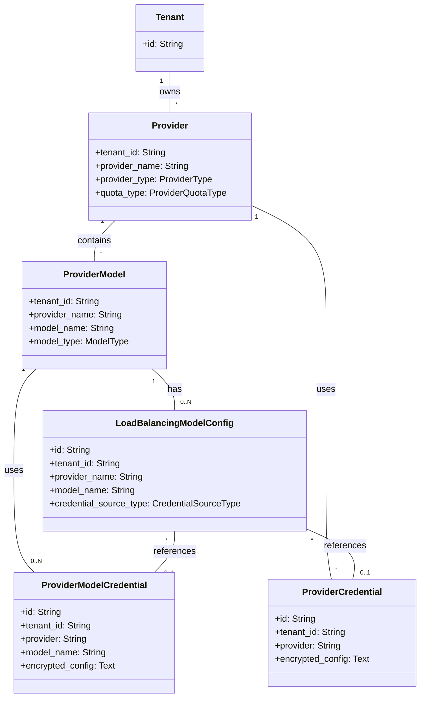
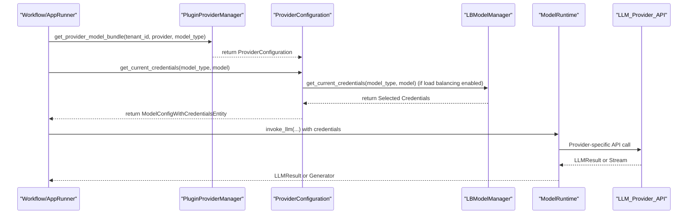
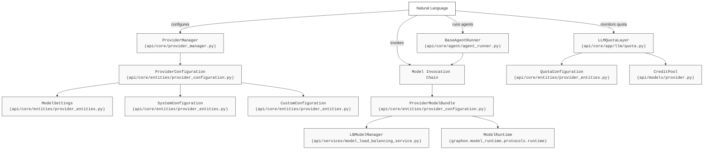

<!-- source: DeepWiki mcp.deepwiki.com · repo langgenius/dify · page 6 LLM Integration and Model Management · fetched 2026-10-26 -->

# LLM Integration and Model Management

Relevant source files

The following files were used as context for generating this wiki page:

- [api/core/app/app_config/easy_ui_based_app/model_config/converter.py](api/core/app/app_config/easy_ui_based_app/model_config/converter.py)
- [api/core/entities/knowledge_entities.py](api/core/entities/knowledge_entities.py)
- [api/core/entities/model_entities.py](api/core/entities/model_entities.py)
- [api/core/entities/provider_configuration.py](api/core/entities/provider_configuration.py)
- [api/core/entities/provider_entities.py](api/core/entities/provider_entities.py)
- [api/core/provider_manager.py](api/core/provider_manager.py)
- [api/services/entities/model_provider_entities.py](api/services/entities/model_provider_entities.py)
- [api/services/model_load_balancing_service.py](api/services/model_load_balancing_service.py)
- [api/tests/test_containers_integration_tests/services/test_model_provider_service.py](api/tests/test_containers_integration_tests/services/test_model_provider_service.py)
- [api/tests/unit_tests/core/entities/test_entities_provider_configuration.py](api/tests/unit_tests/core/entities/test_entities_provider_configuration.py)
- [api/tests/unit_tests/core/test_provider_configuration.py](api/tests/unit_tests/core/test_provider_configuration.py)
- [api/tests/unit_tests/core/test_provider_manager.py](api/tests/unit_tests/core/test_provider_manager.py)

## Purpose and Scope

This document provides a high-level overview of Dify’s Language Model (LLM) integration and model management subsystem. This subsystem abstracts diverse LLM providers (such as OpenAI, Anthropic, and others) behind a unified interface to enable seamless integration, configuration, credential handling, quota enforcement, and invocation.

It covers the core architectural components involved in provider and model configuration, managing credentials, invoking models, and monitoring usage through quotas and credit pools.

For in-depth technical details, see the following child pages:
- **[Provider and Model Architecture](#6.1)**: `ModelManager` and `ProviderManager`, provider configurations, model catalogs, and credential management.
- **[Model Invocation Pipeline](#6.2)**: Details of the invocation flow including `CredentialsProvider`, `ModelFactory`, `ModelInstance` creation, and execution pipeline.
- **[Quota Management and Credit Pools](#6.3)**: Quota layers, usage calculation, quota deduction, and credit pool management for various usage tiers.
- **[Classic Agent Runners (CoT / Function Calling)](#6.4)**: The legacy agent runtime: `BaseAgentRunner`, CoT and function-calling agent runners, prompt transforms, and agent-chat app integration.

---

## Provider and Model Architecture

The provider and model architecture in Dify defines a multi-tenant system where each tenant (workspace) can configure and manage multiple LLM providers and their models.

At the core is the `ProviderManager` class [api/core/provider_manager.py:43]() which orchestrates assembling `ProviderConfiguration` entities for each tenant. These configurations maintain system defaults, custom user credentials, model enablement status, and load balancing settings.

### Core Entities and Relationships

Several SQLAlchemy models and domain entities represent providers, their models, credentials, and load balancing configurations:

Each tenant manages multiple providers (`Provider` [api/models/provider.py:53]()), which have multiple models (`ProviderModel` [api/models/provider.py:54]()). Providers and individual models can each have credentials that are encrypted and stored separately (`ProviderCredential` [api/models/provider.py:55]() and `ProviderModelCredential` [api/models/provider.py:56]()). Load balancing configurations enable multi-key credential rotation per model (`LoadBalancingModelConfig` [api/models/provider.py:53]()).

### Provider Configuration Composition

The `ProviderManager` aggregated all components for a tenant into `ProviderConfiguration` objects [api/core/entities/provider_configuration.py:84](). These configurations encapsulate:

- **SystemConfiguration**: Managed by Dify, controlling hosted quota types (trial, paid, free), token limits, and global credentials [api/core/entities/provider_entities.py:83]().
- **CustomConfiguration**: Tenant-supplied credentials and models with granular control over keys and model-specific overrides [api/core/entities/provider_entities.py:135]().
- **ModelSettings**: Individual model enablement, load balancing toggles, and credential mapping [api/core/entities/provider_entities.py:153]().

For full details, see **[Provider and Model Architecture](#6.1)**.

**Sources:**  
[api/core/provider_manager.py:43](),  
[api/models/provider.py:53-56](),  
[api/core/entities/provider_configuration.py:84](),  
[api/core/entities/provider_entities.py:83](),  
[api/core/entities/provider_entities.py:135](),  
[api/core/entities/provider_entities.py:153]()

---

## Model Invocation Pipeline

The invocation pipeline is the runtime mechanism that translates application requests into API calls to the underlying LLM provider.

### ModelInstance: The Runtime Abstraction

The `ModelInstance` class represents an active LLM model configured with specific credentials for invocation. It encapsulates:

- The resolved provider and model configuration bundle (`ProviderModelBundle` [api/core/entities/provider_configuration.py:20]())
- Current model credentials, automatically pulled from the associated provider configuration [api/core/app/app_config/easy_ui_based_app/model_config/converter.py:36-38]()
- `LBModelManager` for rotating credentials if load balancing is enabled [api/services/model_load_balancing_service.py:16]()

### Invocation Flow

Applications retrieve a `ModelInstance` from `ModelManager` and invoke methods like `invoke_llm()` passing prompt messages and parameters.

The `ModelRuntime` abstracts provider-specific API calls, while `ProviderConfiguration` manages context and configuration. Streaming responses, callbacks, and error handling are integrated at this layer.

For details on callback orchestration, streaming, and error strategies, see **[Model Invocation Pipeline](#6.2)**.

**Sources:**  
[api/core/entities/provider_configuration.py:20](),  
[api/core/app/app_config/easy_ui_based_app/model_config/converter.py:36-38](),  
[api/services/model_load_balancing_service.py:16]()

---

## Quota and Credit Management

Dify enforces usage quotas and credit pools to control tenant costs and protect hosted resources.

### Quota Types and Units

Quota is tracked per provider/system via:

- **ProviderQuotaType**: `PAID`, `FREE`, `TRIAL` [api/core/entities/provider_entities.py:18]()
- **QuotaUnit**: `TIMES`, `TOKENS`, or `CREDITS` [api/core/entities/provider_entities.py:36]()

Quota configurations (`QuotaConfiguration` [api/core/entities/provider_entities.py:61]()) store limits and usage:

| Field          | Description                               |
| -------------- | -----------------------------------------|
| `quota_limit`  | Maximum allowed quota for the pool       |
| `quota_used`   | Current usage tracked                     |
| `is_valid`     | Validity flag, e.g., quota exhausted     |
| `restrict_models` | Models impacted by this quota           |

[api/core/entities/provider_entities.py:61-71]()

### Load Balancing and Cooldowns

With support for multiple credentials per model, `LBModelManager` handles load balancing by rotating credentials to distribute API requests [api/services/model_load_balancing_service.py:16](). It tracks credential health and applies cooldowns when rate limits are hit [api/services/model_load_balancing_service.py:40-46]() (implicitly via `LBModelManager`'s internal logic).

### Credit Pool Integration

Quota deductions interact with tenant credit pools, ensuring fair usage and monetization enforcement.

For detailed usage deduction, quota checks, and credit pool management, see **[Quota Management and Credit Pools](#6.3)**.

**Sources:**  
[api/core/entities/provider_entities.py:18](),  
[api/core/entities/provider_entities.py:36](),  
[api/core/entities/provider_entities.py:61-71](),  
[api/services/model_load_balancing_service.py:16](),  
[api/services/model_load_balancing_service.py:40-46]()

---

## Model Settings and Tenant Defaults

Tenant administrators can fine-tune available models and default provider selection within their workspace.

- **ModelSettings** entities represent model-specific configuration like on/off status and load balancing toggle [api/core/entities/provider_entities.py:153]().
- **TenantDefaultModel** tracks the preferred default model per `ModelType` for each tenant [api/models/provider.py:60]().
- Obfuscated credentials support ensures that API keys are masked and safely handled in provider listing and configuration UIs without revealing secrets [api/core/entities/provider_configuration.py:167-176]() (referring to `obfuscated_credentials` method).

These settings are accessible and modifiable via `ModelLoadBalancingService` [api/services/model_load_balancing_service.py:53-93]().

**Sources:**
[api/core/entities/provider_entities.py:153](),
[api/models/provider.py:60](),
[api/core/entities/provider_configuration.py:167-176](),
[api/services/model_load_balancing_service.py:53-93]()

---

## Classic Agent Runners (CoT / Function Calling)

Dify includes a legacy agent runtime system, primarily used for Chain-of-Thought (CoT) and function-calling agents. This system is distinct from the newer Agenton-based runtime (see [Agenton Framework and Layer Architecture](#13.1)).

The `BaseAgentRunner` serves as the foundation for these classic agents. It orchestrates the agent's reasoning process, which often involves:
- **Prompt Transforms**: Modifying or enhancing prompts based on agent logic or context.
- **Function Calling**: Integrating with external tools or functions to extend the LLM's capabilities.

These classic agent runners are integrated into chat applications, allowing users to interact with agents that perform multi-step reasoning or tool use.

For a detailed exploration of the legacy agent runtime, prompt transforms, and their integration, see **[Classic Agent Runners (CoT / Function Calling)](#6.4)**.

**Sources:**
[api/core/agent/agent_runner.py:20-25]()

---

# Summary Diagram: LLM Integration System — Natural Language to Code Entity Mapping

---

# Related Links

- **[Provider and Model Architecture](#6.1)**  
- **[Model Invocation Pipeline](#6.2)**  
- **[Quota Management and Credit Pools](#6.3)**  
- **[Classic Agent Runners (CoT / Function Calling)](#6.4)**

---

**Sources:**  
- [api/core/provider_manager.py:43]()  
- [api/core/entities/provider_configuration.py:20]()  
- [api/core/entities/provider_configuration.py:84]()  
- [api/core/entities/provider_configuration.py:167-176]()  
- [api/core/entities/provider_entities.py:18]()  
- [api/core/entities/provider_entities.py:36]()  
- [api/core/entities/provider_entities.py:61-71]()  
- [api/core/entities/provider_entities.py:83]()  
- [api/core/entities/provider_entities.py:135]()  
- [api/core/entities/provider_entities.py:153]()  
- [api/core/app/app_config/easy_ui_based_app/model_config/converter.py:36-38]()  
- [api/services/model_load_balancing_service.py:16]()  
- [api/services/model_load_balancing_service.py:40-46]()  
- [api/services/model_load_balancing_service.py:53-93]()  
- [api/models/provider.py:53-56]()  
- [api/models/provider.py:60]()  
- [api/core/agent/agent_runner.py:20-25]()

---

