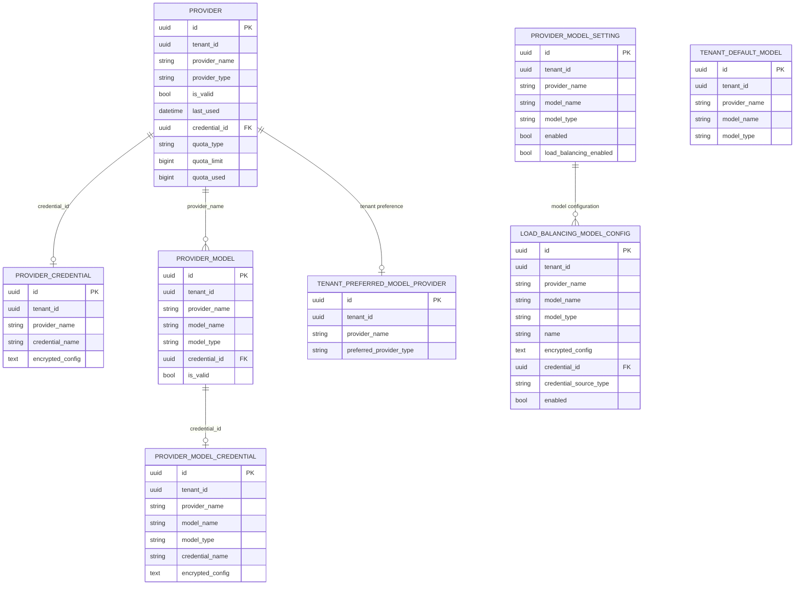
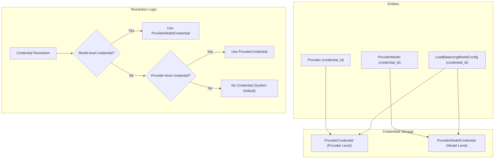
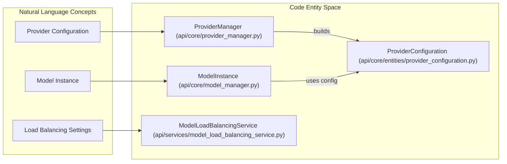
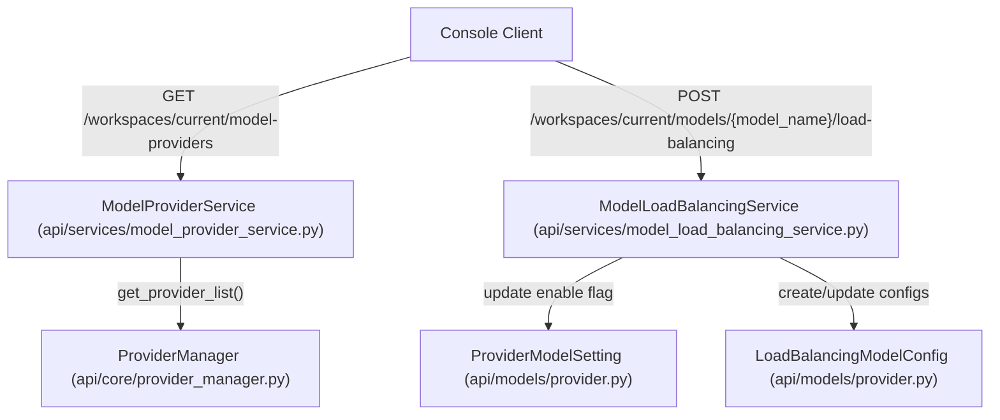

<!-- source: DeepWiki mcp.deepwiki.com · repo langgenius/dify · page 6.1 Provider and Model Architecture · fetched 2026-10-26 -->

# Provider and Model Architecture

<details>
<summary>Relevant source files</summary>

The following files were used as context for generating this wiki page:

- [api/.ruff.toml](api/.ruff.toml)
- [api/core/app/app_config/easy_ui_based_app/model_config/converter.py](api/core/app/app_config/easy_ui_based_app/model_config/converter.py)
- [api/core/entities/knowledge_entities.py](api/core/entities/knowledge_entities.py)
- [api/core/entities/mcp_provider.py](api/core/entities/mcp_provider.py)
- [api/core/entities/model_entities.py](api/core/entities/model_entities.py)
- [api/core/entities/provider_configuration.py](api/core/entities/provider_configuration.py)
- [api/core/entities/provider_entities.py](api/core/entities/provider_entities.py)
- [api/core/external_data_tool/api/api.py](api/core/external_data_tool/api/api.py)
- [api/core/model_manager.py](api/core/model_manager.py)
- [api/core/provider_manager.py](api/core/provider_manager.py)
- [api/libs/helper.py](api/libs/helper.py)
- [api/services/data_source/provider_service.py](api/services/data_source/provider_service.py)
- [api/services/entities/model_provider_entities.py](api/services/entities/model_provider_entities.py)
- [api/services/model_load_balancing_service.py](api/services/model_load_balancing_service.py)
- [api/tasks/annotation/batch_import_annotations_task.py](api/tasks/annotation/batch_import_annotations_task.py)
- [api/tasks/annotation/disable_annotation_reply_task.py](api/tasks/annotation/disable_annotation_reply_task.py)
- [api/tasks/annotation/enable_annotation_reply_task.py](api/tasks/annotation/enable_annotation_reply_task.py)
- [api/tasks/clean_notion_document_task.py](api/tasks/clean_notion_document_task.py)
- [api/tasks/deal_dataset_index_update_task.py](api/tasks/deal_dataset_index_update_task.py)
- [api/tasks/document_indexing_update_task.py](api/tasks/document_indexing_update_task.py)
- [api/tasks/mail_account_deletion_task.py](api/tasks/mail_account_deletion_task.py)
- [api/tasks/recover_document_indexing_task.py](api/tasks/recover_document_indexing_task.py)
- [api/tasks/trigger_subscription_refresh_tasks.py](api/tasks/trigger_subscription_refresh_tasks.py)
- [api/tests/test_containers_integration_tests/services/test_model_provider_service.py](api/tests/test_containers_integration_tests/services/test_model_provider_service.py)
- [api/tests/unit_tests/core/entities/test_entities_provider_configuration.py](api/tests/unit_tests/core/entities/test_entities_provider_configuration.py)
- [api/tests/unit_tests/core/mcp/client/test_session.py](api/tests/unit_tests/core/mcp/client/test_session.py)
- [api/tests/unit_tests/core/mcp/test_error.py](api/tests/unit_tests/core/mcp/test_error.py)
- [api/tests/unit_tests/core/test_model_manager.py](api/tests/unit_tests/core/test_model_manager.py)
- [api/tests/unit_tests/core/test_provider_configuration.py](api/tests/unit_tests/core/test_provider_configuration.py)
- [api/tests/unit_tests/core/test_provider_manager.py](api/tests/unit_tests/core/test_provider_manager.py)
- [api/tests/unit_tests/core/variables/test_segment.py](api/tests/unit_tests/core/variables/test_segment.py)
- [api/tests/unit_tests/core/variables/test_segment_type.py](api/tests/unit_tests/core/variables/test_segment_type.py)
- [api/tests/unit_tests/core/variables/test_variables.py](api/tests/unit_tests/core/variables/test_variables.py)
- [api/tests/unit_tests/core/workflow/graph_engine/test_table_runner.py](api/tests/unit_tests/core/workflow/graph_engine/test_table_runner.py)
- [api/tests/unit_tests/libs/test_helper.py](api/tests/unit_tests/libs/test_helper.py)
- [api/tests/unit_tests/tasks/test_document_indexing_update_task.py](api/tests/unit_tests/tasks/test_document_indexing_update_task.py)

</details>


## Purpose and Scope

This page details the architecture and implementation of the provider and model management subsystem in Dify, responsible for:

- Managing model providers and their configurations per tenant/workspace.
- Resolving and securely managing credentials on both provider and per-model levels.
- Offering load balancing capabilities to distribute requests across multiple credentials.
- Creating runtime model instances ready for invocation, encapsulating resolved provider/model/credential data.

It focuses on the key classes and data flows connecting the database models, configuration assembly (via `ProviderManager` and `ProviderConfiguration`), and request-scoped runtime objects (`ModelInstance`). The goal is to help engineers understand how the system organizes multiple providers and their models, handles credentials, and enables load balancing.

---

## Core Database Schema

The backend stores provider and model metadata using multiple SQLAlchemy ORM models. These define the main entities:

- `Provider`: Represents a provider registration for a tenant, with type (system or custom), credential references, and quota info [api/models/provider.py:49-127]().
- `ProviderModel`: Represents models under a provider, with optional separate credentials [api/models/provider.py:129-177]().
- `ProviderCredential` / `ProviderModelCredential`: Store encrypted credentials at the provider or model level [api/models/provider.py:315-366]().
- `ProviderModelSetting`: Settings tied to per-model enablement and load balancing [api/models/provider.py:257-282]().
- `LoadBalancingModelConfig`: Defines multiple credentials for load balancing per model [api/models/provider.py:284-312]().

### ER Diagram of Key Provider/Model Entities and Relationships



**Sources:** [api/models/provider.py:49-366]()

---

## Provider Types and Quota System

### Provider Types

Two primary provider types are tracked:

| Provider Type | Description | Usage |
|---|---|---|
| `SYSTEM` | Built-in, predefined providers | Dify-managed hosted providers|
| `CUSTOM` | User-configured or self-hosted setups | Custom API or local models |

These types are enumerated in `ProviderType` [api/models/provider.py:56]().

### Quota Types

To manage API usage quotas, three quota types exist at the provider system level (`ProviderQuotaType`):

| Quota Type | Description | Tracked In |
|---|---|---|
| `PAID` | Paid hosting quota | Deducted from `Provider.quota_used`|
| `FREE` | Free-tier quota (not managed by Dify) | Not tracked internally |
| `TRIAL` | Time or usage-limited trial quota | Managed and deducted |

In cloud deployments, hosting configurations initialize quota limits and types for system providers like Azure OpenAI or Anthropic [api/core/hosting_configuration.py:52-66]().

**Sources:**
[api/models/provider.py:19-28]()
[api/core/entities/provider_entities.py:28]()
[api/core/hosting_configuration.py:52-66]()

---

## Provider and ProviderModel Structure

### Provider

The `Provider` entity represents a configured model provider for a tenant:

```python
class Provider(TypeBase):
    id: Mapped[str]  # UUID PK
    tenant_id: Mapped[str]
    provider_name: Mapped[str]  # e.g., "openai"
    provider_type: Mapped[str]  # "system" or "custom"
    is_valid: Mapped[bool]  # Credential validity
    credential_id: Mapped[str | None]  # FK to ProviderCredential
    quota_type: Mapped[str | None]
    quota_limit: Mapped[int | None]
    quota_used: Mapped[int | None]
```

Credential linkage here references the provider-level credential used by default [api/models/provider.py:49-127]().

### ProviderModel

`ProviderModel` represents specific models under a provider, allowing credential overrides:

```python
class ProviderModel(TypeBase):
    id: Mapped[str]  # UUID PK
    tenant_id: Mapped[str]
    provider_name: Mapped[str]
    model_name: Mapped[str]  # e.g., "gpt-4"
    model_type: Mapped[str]  # e.g., "llm"
    credential_id: Mapped[str | None]  # FK to ProviderModelCredential for override
    is_valid: Mapped[bool]
```

**Sources:** [api/models/provider.py:129-177]()

---

## Credential Management Architecture

Credentials are stored encrypted and can exist at two levels:

- **Provider-level:** Shared by all models of a provider.
- **Model-level:** Specific to an individual model, enabling separate API keys or tokens per model.

Both `ProviderCredential` and `ProviderModelCredential` hold encrypted credentials. They are referenced by `credential_id` fields in `Provider` and `ProviderModel`, respectively, or by load balancing configs.

### Credential Access Logic



Credentials are encrypted using `encrypter.encrypt_token` when stored and decrypted during runtime configuration assembly using `ProviderCredentialsCache` [api/core/helper/model_provider_cache.py:35]().

**Sources:**
[api/models/provider.py:315-338]()
[api/models/provider.py:341-366]()
[api/core/helper/model_provider_cache.py:35]()

---

## Load Balancing Architecture

Dify supports multiple credentials per model to enable load balancing for managing quotas and high availability. This is controlled by:

- `ProviderModelSetting.load_balancing_enabled`: Flag enables/disables LB per model [api/models/provider.py:273]().
- `LoadBalancingModelConfig`: Stores multiple credential configurations per model for load balancing [api/models/provider.py:284-312]().

### Load Balancing Data and Runtime Flow

```mermaid
graph TB
    subgraph "Configuration Tables"
        PMS["ProviderModelSetting - load_balancing_enabled flag"]
        LBC1["LoadBalancingModelConfig #1<br/>name='__inherit__'<br/>credential_id=null<br/>credential_source_type='provider'"]
        LBC2["LoadBalancingModelConfig #2<br/>name='API Key 2'<br/>encrypted_config=...<br/>credential_source_type='custom'"]
    end

    subgraph "Runtime Flow"
        REQUEST["Model Invocation Request"]
        CHECK_LB{"Is Load Balancing Enabled?"}
        SINGLE_CRED["Use Default Provider Credential"]
        LOAD_LB_CONFIGS["Load All Enabled LB Configs for Model"]
        SELECT_CRED["LBModelManager Chooses Credential"]
        EXECUTE["Invoke Model with Selected Credential"]

        REQUEST --> CHECK_LB
        CHECK_LB -->|No| SINGLE_CRED
        CHECK_LB -->|Yes| LOAD_LB_CONFIGS
        LOAD_LB_CONFIGS --> SELECT_CRED
        SELECT_CRED --> EXECUTE
        SINGLE_CRED --> EXECUTE
```

At runtime, if load balancing is enabled for a model, `ModelInstance` will instantiate an `LBModelManager` (a credentials selector) with all LB configs available. This object handles credential selection per request, including cooldowns and priority logic [api/core/model_manager.py:68-73]().

**Sources:**
[api/models/provider.py:284-312]()
[api/core/model_manager.py:68-73]()
[api/services/model_load_balancing_service.py:48-180]()

---

## Runtime Architecture: Manager and ModelInstance

### ProviderManager

- Located in `api/core/provider_manager.py`.
- Aggregates provider configurations for a tenant.
- Loads all info from DB and cache, merges multiple data sources into `ProviderConfiguration` instances.
- Provides the central registry that console APIs and runtime layers query for configurations [api/core/provider_manager.py:64-79]().

### ProviderConfiguration

- Located in `api/core/entities/provider_configuration.py`.
- Represents a single provider’s full configuration for a tenant.
- Encapsulates provider entity, credentials (system vs custom), model settings, quota info.
- Supports methods to get current credentials, enable/disable models, bind runtime, and more [api/core/entities/provider_configuration.py:60-81]().

### ModelInstance

- Located in `api/core/model_manager.py`.
- A runtime representation of a model ready for invocation.
- Holds resolved credentials, parameters, model schema, and optional `LBModelManager`.
- Responsible for invoking the LLM (or other model type) with the correct resolved credentials [api/core/model_manager.py:50-73]().

---

### Credential Resolution in ProviderConfiguration

The method `get_current_credentials(model_type, model)` returns the credential dictionary for a requested model by:

- Checking if a custom credential is set per model in `model_settings`.
- Falling back to the provider-level credential if no model-level override exists.
- Returning `None` if no credentials were configured (e.g., system-default/no credentials) [api/core/entities/provider_configuration.py:157-250]().

---

### Bridge: Natural Language Concepts to Code Entities



**Sources:**
[api/core/provider_manager.py:64-79]()
[api/core/entities/provider_configuration.py:60-81]()
[api/core/model_manager.py:50-73]()
[api/services/model_load_balancing_service.py:48-51]()

---

## Model Provider Service and Load Balancing Control

### ModelProviderService

- API layer service used by console controllers.
- Retrieves and modifies provider/model configurations at a higher abstraction.
- Handles tenant defaults (`TenantDefaultModel`) and preferred providers (`TenantPreferredModelProvider`) for UI and API correctness [api/models/provider.py:180-255]().

### ModelLoadBalancingService

- Manages LB enable/disable lifecycle.
- Ensures existence and priority of an `__inherit__` config to represent inherited provider or model credentials [api/services/model_load_balancing_service.py:159-176]().
- Queries and updates `LoadBalancingModelConfig` entries [api/services/model_load_balancing_service.py:53-94]().

---

### Bridge: Request Flow and Data Updates to Code Entities



**Sources:**
[api/services/model_load_balancing_service.py:53-154]()
[api/models/provider.py:257-282]()
[api/models/provider.py:284-312]()
[api/services/data_source/provider_service.py:10-13]() (Implicitly used by API controllers)

---

## Plugin Integration and Provider Discovery

With the introduction of the plugin system, providers can be installed via plugins. The `PluginService` handles the discovery and caching of these plugin-based model providers.

- `PluginModelProviderDeclaration`: The declaration schema returned by the plugin daemon for a provider [api/core/plugin/entities/plugin_daemon.py:86-89]().
- `PluginModelProviderBinding`: Stores metadata for model providers installed via plugins [api/core/plugin/entities/plugin_daemon.py:91-103]().
- `create_plugin_provider_manager()`: This function is used to create a `ProviderManager` instance that includes plugin-based model providers [api/core/plugin/impl/model_runtime_factory.py:14-15]().

**Sources:**
[api/core/plugin/entities/plugin_daemon.py:86-103]()
[api/core/plugin/impl/model_runtime_factory.py:14-15]()

---

# Summary

The Provider and Model architecture in Dify forms a cohesive system to register, configure, and securely manage LLM providers and their models per tenant. It:

- Uses rich database models with encrypted credential storage.
- Offers runtime managers (`ProviderManager`, `ProviderConfiguration`) to assemble tenant-scoped configurations.
- Implements a `ModelInstance` abstraction representing an LLM invocation ready object.
- Supports load balancing via multi-credential configs dynamically selected at runtime.
- Exposes services to the API layer for provider and model management with credential and load balancing updates.
- Integrates with the plugin system to allow dynamic extension of model providers.

This layered approach enables scalable integration with many providers, addressing credentials, quotas, and advanced invocation needs seamlessly.

---

**References:**
- [api/models/provider.py:49-366]()
- [api/core/provider_manager.py:64-79]()
- [api/core/entities/provider_configuration.py:60-250]()
- [api/core/model_manager.py:50-73]()
- [api/services/model_load_balancing_service.py:48-180]()
- [api/core/hosting_configuration.py:52-66]()
- [api/core/plugin/entities/plugin_daemon.py:86-103]()
- [api/core/plugin/impl/model_runtime_factory.py:14-15]()
- [api/services/data_source/provider_service.py:10-13]()

---

