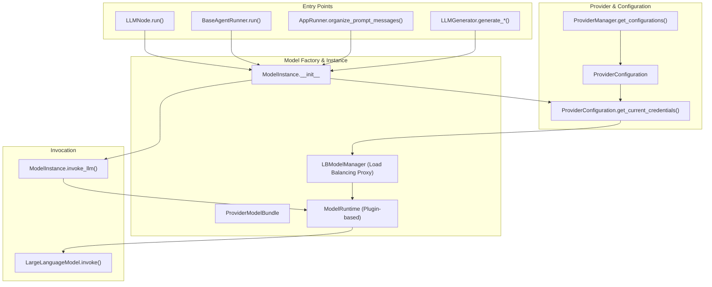
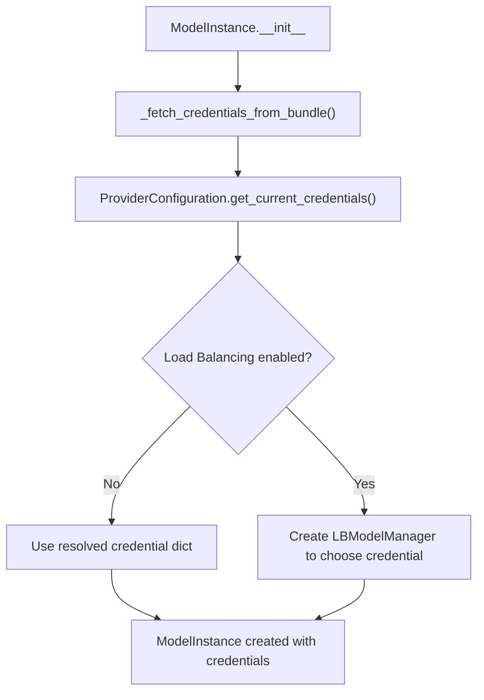
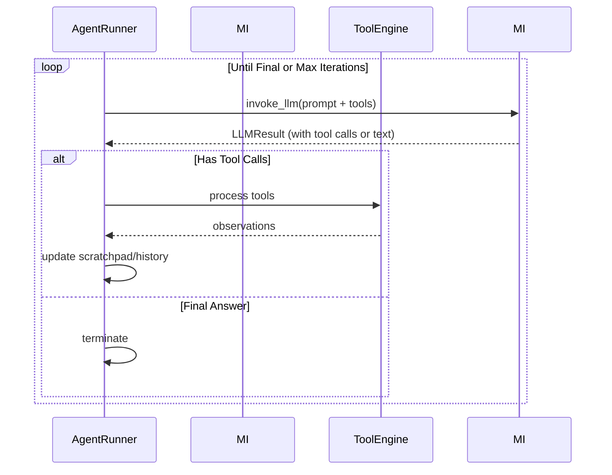

<!-- source: DeepWiki mcp.deepwiki.com · repo langgenius/dify · page 6.2 Model Invocation Pipeline · fetched 2026-10-26 -->

# Model Invocation Pipeline

<details>
<summary>Relevant source files</summary>

The following files were used as context for generating this wiki page:

- [api/controllers/console/app/generator.py](api/controllers/console/app/generator.py)
- [api/controllers/service_api/app/file_preview.py](api/controllers/service_api/app/file_preview.py)
- [api/core/llm_generator/entities.py](api/core/llm_generator/entities.py)
- [api/core/llm_generator/llm_generator.py](api/core/llm_generator/llm_generator.py)
- [api/core/llm_generator/output_parser/suggested_questions_after_answer.py](api/core/llm_generator/output_parser/suggested_questions_after_answer.py)
- [api/core/llm_generator/prompts.py](api/core/llm_generator/prompts.py)
- [api/core/plugin/impl/model.py](api/core/plugin/impl/model.py)
- [api/core/plugin/impl/model_runtime.py](api/core/plugin/impl/model_runtime.py)
- [api/core/plugin/plugin_service.py](api/core/plugin/plugin_service.py)
- [api/core/workflow/node_factory.py](api/core/workflow/node_factory.py)
- [api/core/workflow/node_runtime.py](api/core/workflow/node_runtime.py)
- [api/core/workflow/nodes/human_input/pause_reason.py](api/core/workflow/nodes/human_input/pause_reason.py)
- [api/migrations/versions/2026_08_14_1200-56124e050600_add_conversation_cleanup_index.py](api/migrations/versions/2026_08_14_1200-56124e050600_add_conversation_cleanup_index.py)
- [api/repositories/message_file_preview_repository.py](api/repositories/message_file_preview_repository.py)
- [api/services/agent/runtime_config_service.py](api/services/agent/runtime_config_service.py)
- [api/services/human_input_delivery_test_service.py](api/services/human_input_delivery_test_service.py)
- [api/services/message_file_preview_service.py](api/services/message_file_preview_service.py)
- [api/services/message_service.py](api/services/message_service.py)
- [api/services/plugin/dependencies_analysis.py](api/services/plugin/dependencies_analysis.py)
- [api/services/plugin/plugin_migration.py](api/services/plugin/plugin_migration.py)
- [api/services/rag_pipeline/rag_pipeline_transform_service.py](api/services/rag_pipeline/rag_pipeline_transform_service.py)
- [api/tasks/delete_conversation_task.py](api/tasks/delete_conversation_task.py)
- [api/tests/unit_tests/controllers/console/app/test_generator_api.py](api/tests/unit_tests/controllers/console/app/test_generator_api.py)
- [api/tests/unit_tests/controllers/service_api/app/test_file_preview.py](api/tests/unit_tests/controllers/service_api/app/test_file_preview.py)
- [api/tests/unit_tests/controllers/test_rbac_route_resource_contract.py](api/tests/unit_tests/controllers/test_rbac_route_resource_contract.py)
- [api/tests/unit_tests/core/llm_generator/test_llm_generator.py](api/tests/unit_tests/core/llm_generator/test_llm_generator.py)
- [api/tests/unit_tests/core/plugin/test_model_runtime_adapter.py](api/tests/unit_tests/core/plugin/test_model_runtime_adapter.py)
- [api/tests/unit_tests/core/workflow/nodes/tool/test_tool_node_runtime.py](api/tests/unit_tests/core/workflow/nodes/tool/test_tool_node_runtime.py)
- [api/tests/unit_tests/core/workflow/test_node_factory.py](api/tests/unit_tests/core/workflow/test_node_factory.py)
- [api/tests/unit_tests/core/workflow/test_node_runtime.py](api/tests/unit_tests/core/workflow/test_node_runtime.py)
- [api/tests/unit_tests/repositories/test_app_definition_query_repository_agent.py](api/tests/unit_tests/repositories/test_app_definition_query_repository_agent.py)
- [api/tests/unit_tests/repositories/test_message_file_preview_repository.py](api/tests/unit_tests/repositories/test_message_file_preview_repository.py)
- [api/tests/unit_tests/services/agent/test_agent_runtime_config_service.py](api/tests/unit_tests/services/agent/test_agent_runtime_config_service.py)
- [api/tests/unit_tests/services/plugin/__init__.py](api/tests/unit_tests/services/plugin/__init__.py)
- [api/tests/unit_tests/services/plugin/conftest.py](api/tests/unit_tests/services/plugin/conftest.py)
- [api/tests/unit_tests/services/plugin/test_dependencies_analysis.py](api/tests/unit_tests/services/plugin/test_dependencies_analysis.py)
- [api/tests/unit_tests/services/plugin/test_endpoint_service.py](api/tests/unit_tests/services/plugin/test_endpoint_service.py)
- [api/tests/unit_tests/services/plugin/test_oauth_service.py](api/tests/unit_tests/services/plugin/test_oauth_service.py)
- [api/tests/unit_tests/services/plugin/test_plugin_migration.py](api/tests/unit_tests/services/plugin/test_plugin_migration.py)
- [api/tests/unit_tests/services/plugin/test_plugin_service.py](api/tests/unit_tests/services/plugin/test_plugin_service.py)
- [api/tests/unit_tests/services/plugin/test_plugin_service_installation.py](api/tests/unit_tests/services/plugin/test_plugin_service_installation.py)
- [api/tests/unit_tests/services/rag_pipeline/test_rag_pipeline_transform_service.py](api/tests/unit_tests/services/rag_pipeline/test_rag_pipeline_transform_service.py)
- [api/tests/unit_tests/services/test_external_dataset_service.py](api/tests/unit_tests/services/test_external_dataset_service.py)
- [api/tests/unit_tests/services/test_human_input_delivery_test_service.py](api/tests/unit_tests/services/test_human_input_delivery_test_service.py)
- [api/tests/unit_tests/services/test_message_file_preview_service.py](api/tests/unit_tests/services/test_message_file_preview_service.py)
- [api/tests/unit_tests/services/test_message_service.py](api/tests/unit_tests/services/test_message_service.py)

</details>


## Purpose and Scope

This page documents the detailed model invocation pipeline in Dify, covering the credential provisioning, model factory usage, model instance creation, and the invocation flow of Large Language Models (LLMs). It explains how providers and credentials are resolved, how model instances encapsulate execution context, and how the system manages streaming versus blocking calls. This leaf page complements related topics on provider and model architecture [6.1]() and quota management [6.3]().

---

## Core Invocation Architecture

At the heart of Dify's model invocation pipeline are the `ProviderManager`, `ProviderConfiguration`, `ModelInstance`, and `ModelManager` classes. The pipeline starts from high-level application or agent runners and funnels down to LLM runtime invocation.

### System Flow Overview



This diagram illustrates key components and their interactions starting from prompt generation or agent running, provider configuration and credential lookup, model instance creation, load balancing credential selection, and finally LLM invocation.

**Sources:**  
[api/core/model_manager.py:35-56]()  
[api/core/provider_manager.py:20-81, 96-130]()  
[api/core/entities/provider_configuration.py:60-180]()  
[api/core/app/apps/base_app_runner.py:56-165]()  
[api/core/agent/base_agent_runner.py:51-81]()
[api/core/llm_generator/llm_generator.py:28-29, 63-64]()

---

## Detailed Credential Provisioning and `ProviderConfiguration`

The `ProviderConfiguration` entity encapsulates all the information and logic required to manage one provider's runtime configuration including:

- System-provided credentials and custom credential overrides [api/core/entities/provider_configuration.py:84-113]()
- Model enablement and disabling rules [api/core/entities/provider_configuration.py:93-94]()
- Load balancing configurations at the model level [api/core/entities/provider_configuration.py:92-93]()
- Switching between system and custom provider types [api/core/entities/provider_configuration.py:109-110]()

Key methods related to credential provisioning:

- `get_current_credentials(model_type, model)`: Returns the current credential dict for a given model, resolving the credential from system or custom settings appropriately. It returns `None` if the model is disabled or the credentials are not present or invalid [api/core/entities/provider_configuration.py:170-180]().

- Credential secrets are masked when exposed via `obfuscated_credentials()` which hides only secret inputs (e.g., API keys) while leaving other fields visible for debugging [api/core/entities/provider_configuration.py:199-206]().  

The configurations are fetched via `ProviderManager.get_configurations(tenant_id)` which provides a dictionary of provider names to `ProviderConfiguration` entities [api/core/provider_manager.py:102-120]().

**Sources:**
[api/core/entities/provider_configuration.py:84-206]()
[api/core/provider_manager.py:102-120]()

---

## Model Instance Creation and Credential Resolution

The `ModelInstance` class represents a specific model ready for runtime invocation. It contains:

- The associated `ProviderModelBundle` which bundles the underlying provider schema and models [api/core/model_manager.py:41-43]()
- The model name and provider name [api/core/model_manager.py:42-43]()
- Resolved credentials for invocation, either from system or from a load balancing proxy [api/core/model_manager.py:44-46]()
- Optional load balancing manager (`LBModelManager`) that selects credentials from multiple sources [api/core/model_manager.py:51-56]()

### Credential Resolution Flow inside `ModelInstance.__init__`



If the tenant's `ProviderConfiguration` enables load balancing on the model, `LBModelManager` is instantiated to act as a proxy to dynamically select credentials for each call [api/core/model_manager.py:103-114]().

If not, the credentials from the provider configuration are used directly [api/core/model_manager.py:44-46]().

The `get_model_schema()` method returns the associated `AIModelEntity` which contains model features and properties such as context size to guide token management [api/core/model_manager.py:58-63]().

**Sources:**
[api/core/model_manager.py:35-117]()

---

## Invocation Flow in `ModelInstance.invoke_llm`

The main function to invoke the LLM is `ModelInstance.invoke_llm()`. This method can be called in streaming or blocking mode and accepts:

- Prompt messages in internal `PromptMessage` format [api/core/model_manager.py:156-157]()
- Model parameters to customize generation (like `max_tokens`, `temperature`) [api/core/model_manager.py:157-158]()
- Tools for interactive calls if the model supports tool usage [api/core/model_manager.py:158-159]()
- Stop tokens, callbacks, and request metadata [api/core/model_manager.py:159-162]()

Internally, the invocation is dispatched through the configured `ModelRuntime` from the plugin architecture which interacts with provider APIs [api/core/model_manager.py:177-195]().

**Key points:**

- If load balancing is enabled, invocation uses the credentials chosen by `LBModelManager` [api/core/model_manager.py:177-185]().
- Streamed results yield incremental tokens or chunks, while blocking returns a final complete `LLMResult` [api/core/model_manager.py:125-141]().
- Model parameters and credentials can be adjusted dynamically before the call.

**Sources:**
[api/core/model_manager.py:119-255]()

---

## Prompt Preparation & Token Management in App Runners

Before runtime invocation, prompts are carefully constructed and token limits adjusted:

- `AppRunner.recalc_llm_max_tokens()` fetches the context window size from the model schema and adjusts `max_tokens` to ensure the sum fits [api/core/app/apps/base_app_runner.py:56-89]().

- Prompt messages can be transformed to simple or advanced templates based on app config in `organize_prompt_messages()` for chat or completion apps [api/core/app/apps/base_app_runner.py:90-165]().

This ensures that runtime calls respect model constraints and optimized prompt usage.

---

## Agent Invocation Pipeline

Agent runners such as `CotAgentRunner` and `FunctionCallAgentRunner` build on top of this invocation pipeline for iterative reasoning loops:

- Tools are converted to `PromptMessageTool` for LLM input [api/core/agent/base_agent_runner.py:141-157]()
- Model is repeatedly invoked until a final answer or max iterations are reached [api/core/agent/fc_agent_runner.py:145-170]()
- Intermediate thoughts are persisted as `MessageAgentThought` for traceability [api/core/agent/fc_agent_runner.py:153-159]()
- Streamed or blocking dispatch adapts to model features (e.g. streaming tool calls) [api/core/agent/base_agent_runner.py:120-124]().



**Sources:**
[api/core/agent/base_agent_runner.py:51-160]()
[api/core/agent/fc_agent_runner.py:101-170]()
[api/core/agent/cot_agent_runner.py:49-180]()

---

## LLM Generator Invocation

The `LLMGenerator` class [api/core/llm_generator/llm_generator.py:46]() provides various utility functions that leverage LLMs for tasks like generating conversation titles, code, suggested questions, or structured outputs. These functions also utilize the core model invocation pipeline.

For example, `LLMGenerator.generate_conversation_name()` [api/core/llm_generator/llm_generator.py:1000-1001]() uses a `ModelInstance` obtained from `ModelManager.for_tenant()` [api/core/llm_generator/llm_generator.py:1005]() to invoke the LLM with a specific prompt (`CONVERSATION_TITLE_PROMPT`) [api/core/llm_generator/llm_generator.py:18]().

Similarly, `LLMGenerator.generate_code()` [api/core/llm_generator/llm_generator.py:600-601]() takes a `ModelConfig` and an instruction, resolves the `ModelInstance` [api/core/llm_generator/llm_generator.py:610](), and invokes it with a language-specific code generation prompt [api/core/llm_generator/llm_generator.py:20-23]().

The `_normalize_completion_params` function [api/core/llm_generator/llm_generator.py:67-88]() is used to prepare model parameters, ensuring compatibility with various model runtimes by handling `stop` sequences and non-positive token limits.

**Sources:**
[api/core/llm_generator/llm_generator.py:46, 67-88, 1000-1005]()
[api/core/llm_generator/prompts.py:1-22, 24-95]()
[api/controllers/console/app/generator.py:32]()
[api/services/message_service.py:13]()
[api/tests/unit_tests/core/llm_generator/test_llm_generator.py:18]()

---

## Plugin Model Runtime

Dify's architecture supports extending model capabilities through plugins. The `PluginModelRuntime` acts as an adapter, allowing plugin-defined models to integrate seamlessly into the Dify model invocation pipeline.

### `PluginModelRuntime` and `PluginModelClient`

The `PluginModelRuntime` class [api/core/plugin/impl/model_runtime.py:29-30]() implements the `ModelRuntime` interface, delegating actual model interactions to a `PluginModelClient` [api/core/plugin/impl/model_runtime.py:32-33](). This client communicates with the plugin daemon to perform operations like fetching model schemas, invoking LLMs, or performing embeddings.

```mermaid
graph TD
    subgraph "Dify Core"
        ModelInstance["ModelInstance"]
        DifyModelFactory["DifyModelFactory"]
    end

    subgraph "Plugin Integration"
        PluginModelRuntime["PluginModelRuntime"]
        PluginModelClient["PluginModelClient"]
        PluginDaemon["Plugin Daemon (External Process)"]
    end

    ModelInstance -- "Uses" --> PluginModelRuntime
    DifyModelFactory -- "Creates" --> PluginModelRuntime
    PluginModelRuntime -- "Delegates to" --> PluginModelClient
    PluginModelClient -- "Communicates with" --> PluginDaemon
    PluginDaemon -- "Hosts & Runs" --> "Plugin-defined Models"
```

The `DifyModelFactory` [api/core/app/llm/model_access.py:13-14]() is responsible for creating `ModelInstance` objects, and when a model is identified as coming from a plugin, it uses `create_plugin_model_assembly` [api/core/plugin/impl/model_runtime_factory.py:13-14]() to construct the necessary `PluginModelRuntime` and `PluginModelClient`.

### Model Provider Discovery

`PluginModelRuntime.fetch_model_providers()` [api/core/plugin/impl/model_runtime.py:40-41]() retrieves model provider declarations from the plugin daemon via `PluginModelClient.fetch_model_providers()` [api/core/plugin/impl/model.py:100-101](). These declarations are then transformed into `ProviderEntity` objects that Dify understands. The `PluginService` caches these declarations to optimize performance and reduce calls to the plugin daemon [api/core/plugin/plugin_service.py:101-102]().

### Credential Handling for Plugin Models

For plugin models, credentials are provided to the `PluginModelRuntime` during its creation [api/core/plugin/impl/model_runtime.py:32-33](). These credentials are then passed to the `PluginModelClient` and subsequently to the plugin daemon when invoking a model. This ensures that plugin models operate with the correct authentication.

**Sources:**
[api/core/plugin/impl/model_runtime.py:29-33, 40-41]()
[api/core/plugin/impl/model.py:100-101]()
[api/core/plugin/impl/model_runtime_factory.py:13-14]()
[api/core/app/llm/model_access.py:13-14]()
[api/core/plugin/plugin_service.py:101-102]()
[api/tests/unit_tests/core/plugin/test_model_runtime_adapter.py:111-139]()

---

## Load Balancing and High Availability

Dify supports load balancing at the credential level for custom providers:

- Enabled via provider or model settings indicating `load_balancing_enabled` [api/core/entities/provider_configuration.py:92-93]()
- The `LBModelManager` mediates credential selection, providing fallback and cooldown-aware rotation among keys or endpoints [api/core/model_manager.py:83-116]()
- Load balancing is transparent to the `ModelInstance.invoke_llm` method — credentials are abstracted behind the manager [api/core/model_manager.py:177-185]()
- The configuration and toggling of load balancing are managed by `ModelLoadBalancingService` [api/services/model_load_balancing_service.py:48-180]()

---

## Summary

The model invocation pipeline in Dify seamlessly connects provider configurations, credentials, and runtime models to application and agent runners. It handles:

- Credential and provider configuration resolution (`ProviderManager` and `ProviderConfiguration`)
- Model instance creation with dynamic load balancing support (`ModelInstance` and `LBModelManager`)
- Prompt preparation and token management in app runners
- Invocation streaming or blocking calls via plugin-based runtime layers
- Specialized LLM utility functions via `LLMGenerator`

This architecture allows Dify to flexibly support multiple LLM providers, dynamic credential management, and complex invocation flows required for AI applications.

---

# Glossary Table of Key Invocation Entities

| Entity                   | Role Description                                   | Source Path & Lines                  |
|--------------------------|----------------------------------------------------|------------------------------------|
| `ProviderManager`        | Manages provider configurations across tenants    | [api/core/provider_manager.py:79-120]() |
| `ProviderConfiguration`  | Encapsulates one provider's settings and credentials | [api/core/entities/provider_configuration.py:84-113]() |
| `ModelInstance`          | Represents a callable model with resolved credentials | [api/core/model_manager.py:35-80]()    |
| `LBModelManager`         | Load balancing proxy selecting credentials dynamically | [api/core/model_manager.py:83-116]()   |
| `LLMGenerator`           | Provides utility functions for LLM-based generation | [api/core/llm_generator/llm_generator.py:46]() |
| `PluginModelRuntime`     | Adapter for plugin-defined models                  | [api/core/plugin/impl/model_runtime.py:29-30]() |
| `PluginModelClient`      | Communicates with the plugin daemon                | [api/core/plugin/impl/model.py:30-31]() |
| `AppRunner`              | Prepares prompts, manages app execution flow       | [api/core/app/apps/base_app_runner.py:14-165]() |
| `AgentRunner`            | Handles agent iterative invocation loops            | [api/core/agent/base_agent_runner.py:51-127]() |

---

**Sources:**  
- [api/core/model_manager.py:35-117,119-255]()  
- [api/core/provider_manager.py:20-81,96-130]()  
- [api/core/entities/provider_configuration.py:60-206]()  
- [api/core/agent/base_agent_runner.py:51-160]()
- [api/core/agent/fc_agent_runner.py:36-170]()  
- [api/services/model_load_balancing_service.py:40-180]()
- [api/core/plugin/impl/model_runtime.py:29-33, 40-41]()
- [api/core/plugin/impl/model.py:30-31, 100-101]()
- [api/core/plugin/impl/model_runtime_factory.py:13-14]()
- [api/core/app/llm/model_access.py:13-14]()
- [api/core/plugin/plugin_service.py:101-102]()
- [api/core/llm_generator/llm_generator.py:46, 67-88, 1000-1005]()
- [api/core/llm_generator/prompts.py:1-22, 24-95]()

---

