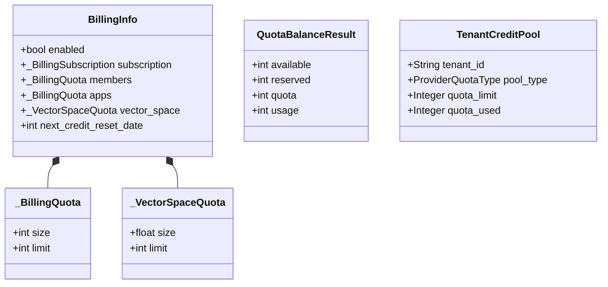
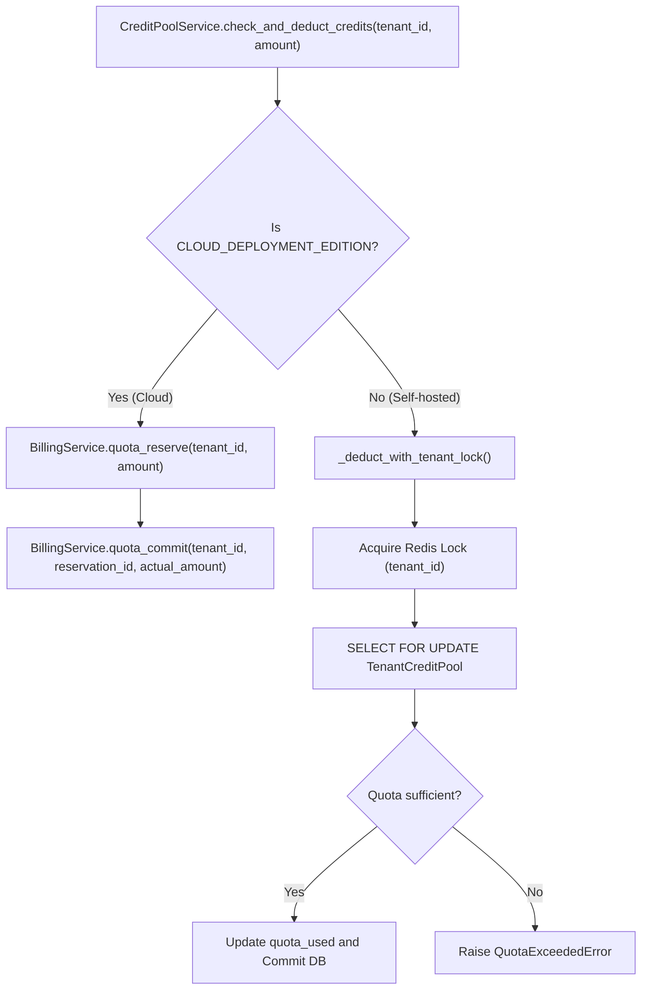
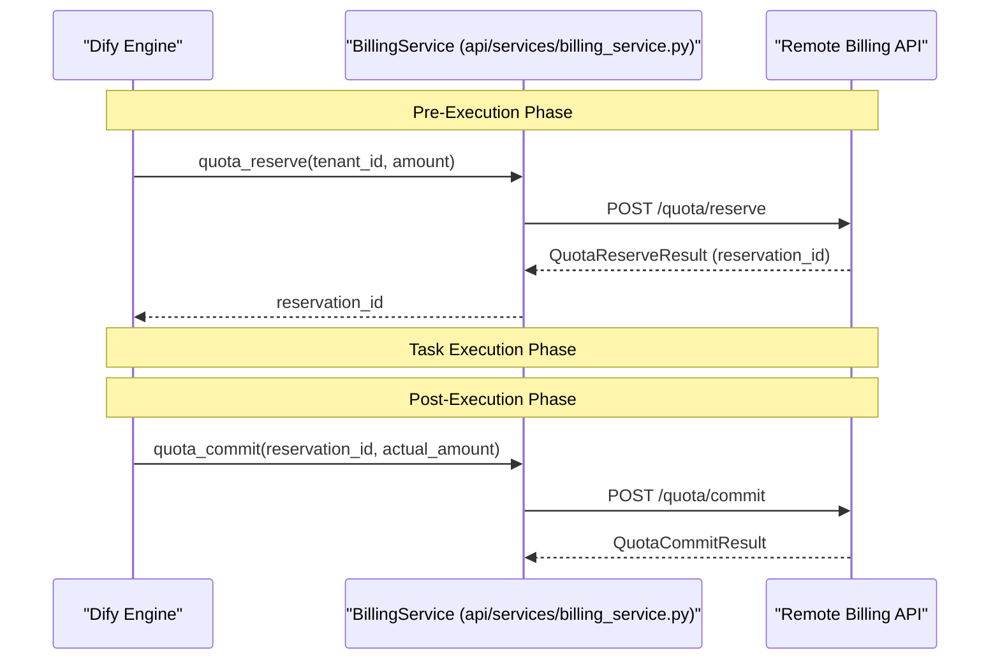
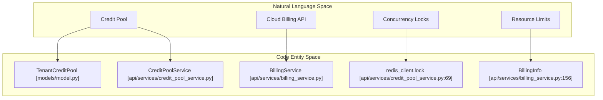
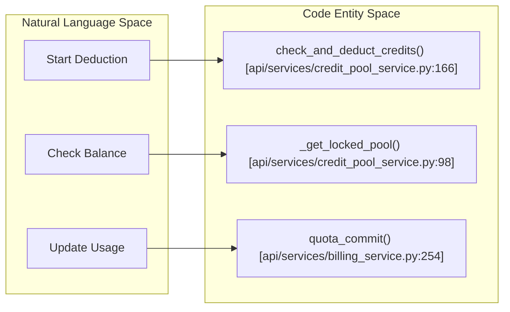

<!-- source: DeepWiki mcp.deepwiki.com · repo langgenius/dify · page 6.3 Quota Management and Credit Pools · fetched 2026-10-26 -->

# Quota Management and Credit Pools

Relevant source files

The following files were used as context for generating this wiki page:

- [api/controllers/console/__init__.py](api/controllers/console/__init__.py)
- [api/controllers/console/billing/billing.py](api/controllers/console/billing/billing.py)
- [api/controllers/console/billing/compliance.py](api/controllers/console/billing/compliance.py)
- [api/controllers/console/error.py](api/controllers/console/error.py)
- [api/controllers/console/feature.py](api/controllers/console/feature.py)
- [api/core/app/llm/__init__.py](api/core/app/llm/__init__.py)
- [api/core/app/llm/quota.py](api/core/app/llm/quota.py)
- [api/core/app/workflow/layers/__init__.py](api/core/app/workflow/layers/__init__.py)
- [api/events/event_handlers/update_provider_when_message_created.py](api/events/event_handlers/update_provider_when_message_created.py)
- [api/openapi/markdown/web-openapi.md](api/openapi/markdown/web-openapi.md)
- [api/services/attachment_service.py](api/services/attachment_service.py)
- [api/services/billing_service.py](api/services/billing_service.py)
- [api/services/credit_pool_service.py](api/services/credit_pool_service.py)
- [api/services/feature_service.py](api/services/feature_service.py)
- [api/services/plugin/plugin_parameter_service.py](api/services/plugin/plugin_parameter_service.py)
- [api/services/trigger/trigger_provider_service.py](api/services/trigger/trigger_provider_service.py)
- [api/services/trigger/trigger_subscription_builder_service.py](api/services/trigger/trigger_subscription_builder_service.py)
- [api/tests/test_containers_integration_tests/conftest.py](api/tests/test_containers_integration_tests/conftest.py)
- [api/tests/test_containers_integration_tests/services/plugin/test_plugin_permission_service.py](api/tests/test_containers_integration_tests/services/plugin/test_plugin_permission_service.py)
- [api/tests/test_containers_integration_tests/services/test_billing_service.py](api/tests/test_containers_integration_tests/services/test_billing_service.py)
- [api/tests/test_containers_integration_tests/services/test_credit_pool_service.py](api/tests/test_containers_integration_tests/services/test_credit_pool_service.py)
- [api/tests/test_containers_integration_tests/services/test_feature_service.py](api/tests/test_containers_integration_tests/services/test_feature_service.py)
- [api/tests/test_containers_integration_tests/services/test_trigger_provider_service.py](api/tests/test_containers_integration_tests/services/test_trigger_provider_service.py)
- [api/tests/test_containers_integration_tests/tasks/test_delete_account_task.py](api/tests/test_containers_integration_tests/tasks/test_delete_account_task.py)
- [api/tests/test_containers_integration_tests/test_container_state_isolation.py](api/tests/test_containers_integration_tests/test_container_state_isolation.py)
- [api/tests/unit_tests/controllers/console/billing/test_billing.py](api/tests/unit_tests/controllers/console/billing/test_billing.py)
- [api/tests/unit_tests/controllers/console/test_feature.py](api/tests/unit_tests/controllers/console/test_feature.py)
- [api/tests/unit_tests/core/app/test_llm_quota.py](api/tests/unit_tests/core/app/test_llm_quota.py)
- [api/tests/unit_tests/events/test_update_provider_when_message_created.py](api/tests/unit_tests/events/test_update_provider_when_message_created.py)
- [api/tests/unit_tests/fields/test_message_fields.py](api/tests/unit_tests/fields/test_message_fields.py)
- [api/tests/unit_tests/services/test_billing_service.py](api/tests/unit_tests/services/test_billing_service.py)
- [api/tests/unit_tests/services/test_credit_pool_service.py](api/tests/unit_tests/services/test_credit_pool_service.py)
- [api/tests/unit_tests/services/test_trigger_provider_service.py](api/tests/unit_tests/services/test_trigger_provider_service.py)
- [api/tests/unit_tests/services/test_trigger_subscription_builder_service.py](api/tests/unit_tests/services/test_trigger_subscription_builder_service.py)
- [packages/contracts/generated/api/console/installed-apps/types.gen.ts](packages/contracts/generated/api/console/installed-apps/types.gen.ts)
- [packages/contracts/generated/api/console/installed-apps/zod.gen.ts](packages/contracts/generated/api/console/installed-apps/zod.gen.ts)
- [packages/contracts/generated/api/console/system-features/types.gen.ts](packages/contracts/generated/api/console/system-features/types.gen.ts)
- [packages/contracts/generated/api/console/system-features/zod.gen.ts](packages/contracts/generated/api/console/system-features/zod.gen.ts)
- [packages/contracts/generated/api/web/types.gen.ts](packages/contracts/generated/api/web/types.gen.ts)
- [packages/contracts/generated/api/web/zod.gen.ts](packages/contracts/generated/api/web/zod.gen.ts)
- [web/app/components/header/license-badge/__tests__/index.spec.tsx](web/app/components/header/license-badge/__tests__/index.spec.tsx)
- [web/app/components/header/license-badge/index.tsx](web/app/components/header/license-badge/index.tsx)
- [web/test/console/system-features.ts](web/test/console/system-features.ts)

## Purpose and Scope

This document describes the quota management system and credit pool architecture in Dify. It covers how the platform tracks and enforces usage limits for LLM API calls, feature usage, and resource allocation across different deployment tiers (Cloud vs. Self-hosted). It specifically details the implementation of quota checking and deduction, the `BillingService` for cloud integration, and the `CreditPoolService` for accounting.

For information about model provider configuration and credentials, see [Provider and Model Architecture (6.1)](). For information about workflow execution and node lifecycle, see [Workflow Definition and Execution Model (5.1)]().

---

## System Overview

The quota management system provides usage tracking and enforcement for LLM invocations and platform resources. It operates through four primary mechanisms:

| Mechanism | Purpose | Scope |
| :--- | :--- | :--- |
| **LLM Quota Configuration** | Defines quota types (Trial, Free, Paid) and model restrictions | Per-provider, per-tenant |
| **Billing Service** | Manages hosted trial/paid credit balances and reservations | Cloud-only, per-tenant |
| **Credit Pool Service** | Unified interface for credit accounting and database row locking | Per-tenant |

**Key Characteristics:**

*   **Pre-execution validation**: Quota availability is checked before tasks or LLM calls begin via decorators and service-layer checks. Enforces plan and billing limits at the controller layer. [api/controllers/console/wraps.py:188-191]()
*   **Reservation/Commit Pattern**: Cloud billing uses a `reserve` and `commit` flow to ensure accuracy during streaming or long-running tasks when the final token usage is unknown upfront. [api/services/billing_service.py:78-93]()
*   **Concurrency Protection**: Credit deductions are guarded by a tenant-level Redis lock followed by a database `SELECT ... FOR UPDATE` row lock to ensure atomic updates and prevent race conditions. [api/services/credit_pool_service.py:67-99]()
*   **Multi-tier support**: Plans range from `SANDBOX` to `TEAM` in Cloud. [api/services/feature_service.py:23]()

Sources: [api/controllers/console/wraps.py:188-191](), [api/services/billing_service.py:78-93](), [api/services/credit_pool_service.py:67-99](), [api/services/feature_service.py:23]()

---

## Core Components and Data Model

### Feature and Billing Models

The system uses Pydantic `TypeAdapter` and `TypedDict` to define limits for various platform resources. These are populated by the `BillingService` which aggregates data from environment variables and the Billing API.

Title: Quota and Billing Data Structures

**Resource Limits Descriptions:**
*   `members`: Maximum number of workspace members allowed. [api/services/billing_service.py:168]()
*   `apps`: Maximum number of applications allowed for a tenant. [api/services/billing_service.py:169]()
*   `vector_space`: Storage quota for knowledge base and document vectors. [api/services/billing_service.py:170]()

The `TenantCreditPool` database model tracks workplace credit pools by tenant and pool type (e.g., Trial, Paid), with tracking of quota limits and usage. [api/services/credit_pool_service.py:30-34]()

Sources: [api/services/billing_service.py:166-177](), [api/services/credit_pool_service.py:30-34](), [api/services/billing_service.py:95-100]()

---

## Quota Checking and Deduction Flow

### Credit Pool Management

The `CreditPoolService` centralizes credit checking and deduction. It supports two modes:

*   **Cloud mode (`dify_config.DEPLOYMENT_EDITION == DeploymentEdition.CLOUD`)**: Interacts with remote `BillingService` API for reservation and commit. [api/services/credit_pool_service.py:147-149](), [api/services/credit_pool_service.py:179-202]()
*   **Self-hosted mode**: Directly interacts with the local database `TenantCreditPool` via transactional row locking and Redis locking. [api/services/credit_pool_service.py:210-224]()

Title: Credit Deduction Logic Flow

**Key Functions:**
*   `check_and_deduct_credits`: Deducts exact requested credits or raises `QuotaExceededError`. [api/services/credit_pool_service.py:166-234]()
*   `deduct_credits_capped`: Deducts as many credits as possible up to requested amount, never raising `QuotaExceededError` on insufficient funds. [api/services/credit_pool_service.py:236-288]()
*   `_deduct_with_tenant_lock`: Manages thread safety via Redis tenant locks (`credit_pool:tenant:{tenant_id}:deduct_lock`). [api/services/credit_pool_service.py:67-88]()

Sources: [api/services/credit_pool_service.py:67-88](), [api/services/credit_pool_service.py:166-288](), [api/services/credit_pool_service.py:147-149]()

---

## Cloud Edition Quota Lifecycle

In Dify Cloud, the `BillingService` manages quota lifecycle using a distributed reservation system. This ensures quota consistency during LLM streaming calls.

Title: Billing Reservation and Commit Sequence

Sources: [api/services/billing_service.py:240-267](), [api/services/billing_service.py:78-93]()

---

## Rate Limiting and Controller Enforcement

Dify applies quota enforcement at the API controller level:

*   **Compliance Download Rate Limiting**: A special `RateLimiter` instance limits compliance report downloads (4 per 60 seconds). [api/services/billing_service.py:204]()
*   **Paid Plan Required**: The `cloud_edition_billing_paid_plan_required` decorator restricts access to Dify Cloud specific billing endpoints. [api/controllers/console/billing/billing.py]()
*   **Tenant Membership**: The `BillingService.is_tenant_owner_or_admin` method ensures only authorized users can access billing information. [api/services/billing_service.py:313-333]()

Sources: [api/services/billing_service.py:204](), [api/controllers/console/billing/billing.py](), [api/services/billing_service.py:313-333]()

---

## Natural Language to Code Entity Mapping

### 1. Quota System Mapping

Sources: [api/services/credit_pool_service.py](), [api/services/billing_service.py:156](), [api/services/credit_pool_service.py:69]()

### 2. Deduction Flow Mapping

Sources: [api/services/credit_pool_service.py:166](), [api/services/credit_pool_service.py:98](), [api/services/billing_service.py:254]()

---

## Summary of Key Classes

| Class | Responsibility |
| :--- | :--- |
| `BillingService` | Manages communication with remote billing API for quota reservation, commit, and subscription info. [api/services/billing_service.py:218]() |
| `CreditPoolService` | Provides thread-safe local credit pool accounting with Redis tenant locks and DB row-level locking. [api/services/credit_pool_service.py:47]() |
| `TenantCreditPool` | DB model storing per-tenant credit pool state (type, limit, usage). [models/model.py]() |
| `CreditPoolBalance` | Data class representing current balance and sufficiency utility. [api/services/credit_pool_service.py:22]() |

Sources: [api/services/billing_service.py:218](), [api/services/credit_pool_service.py:47](), [api/services/credit_pool_service.py:22]()

---

