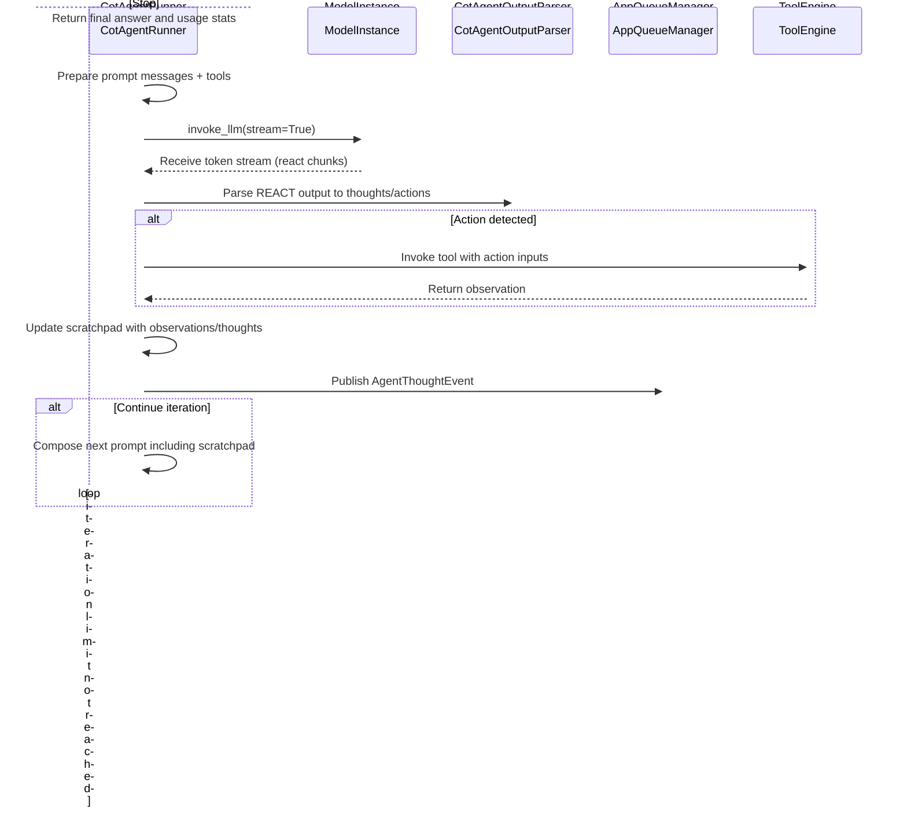
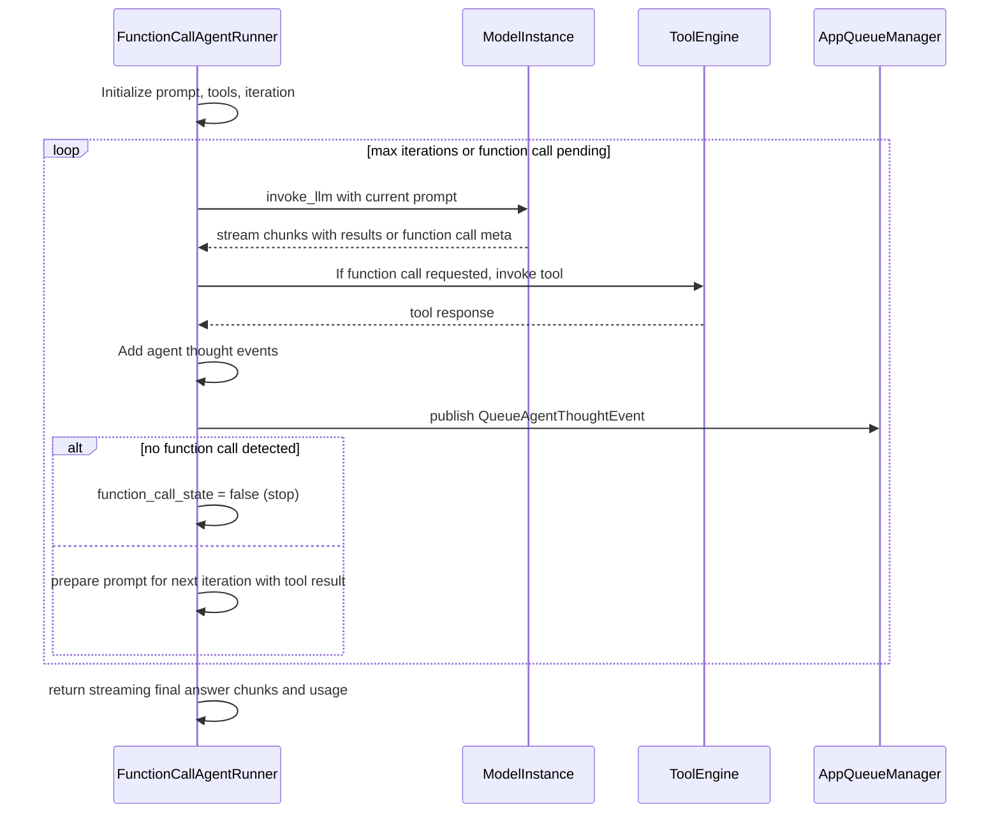
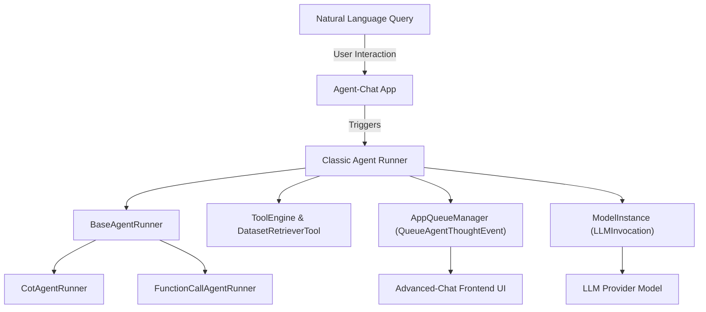
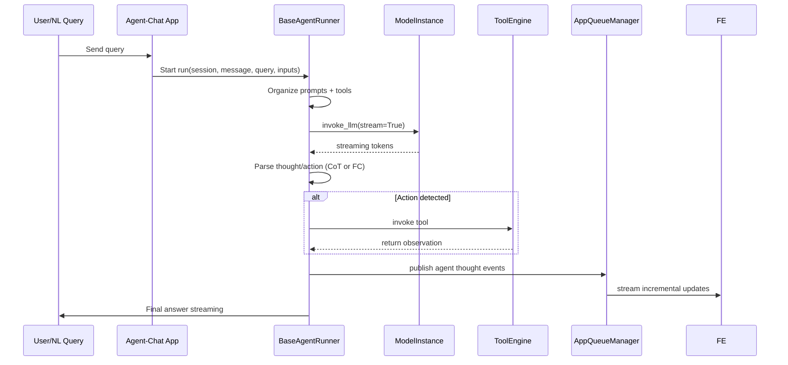

<!-- source: DeepWiki mcp.deepwiki.com · repo langgenius/dify · page 6.4 Classic Agent Runners (CoT / Function Calling) · fetched 2026-10-26 -->

# Classic Agent Runners (CoT / Function Calling)

<details>
<summary>Relevant source files</summary>

The following files were used as context for generating this wiki page:

- [api/core/agent/base_agent_runner.py](api/core/agent/base_agent_runner.py)
- [api/core/agent/cot_agent_runner.py](api/core/agent/cot_agent_runner.py)
- [api/core/agent/fc_agent_runner.py](api/core/agent/fc_agent_runner.py)
- [api/core/agent/output_parser/cot_output_parser.py](api/core/agent/output_parser/cot_output_parser.py)
- [api/core/app/app_config/common/parameters_mapping/__init__.py](api/core/app/app_config/common/parameters_mapping/__init__.py)
- [api/core/app/task_pipeline/message_file_utils.py](api/core/app/task_pipeline/message_file_utils.py)
- [api/core/entities/parameter_entities.py](api/core/entities/parameter_entities.py)
- [api/core/plugin/entities/parameters.py](api/core/plugin/entities/parameters.py)
- [api/core/schemas/resolver.py](api/core/schemas/resolver.py)
- [api/core/workflow/human_input_policy.py](api/core/workflow/human_input_policy.py)
- [api/migrations/versions/2026_03_02_1805-0ec65df55790_add_indexes_for_human_input_forms.py](api/migrations/versions/2026_03_02_1805-0ec65df55790_add_indexes_for_human_input_forms.py)
- [api/models/human_input.py](api/models/human_input.py)
- [api/providers/vdb/vdb-analyticdb/src/dify_vdb_analyticdb/analyticdb_vector_openapi.py](api/providers/vdb/vdb-analyticdb/src/dify_vdb_analyticdb/analyticdb_vector_openapi.py)
- [api/services/quota_service.py](api/services/quota_service.py)
- [api/tests/unit_tests/agent_runtime_fixtures.py](api/tests/unit_tests/agent_runtime_fixtures.py)
- [api/tests/unit_tests/conftest.py](api/tests/unit_tests/conftest.py)
- [api/tests/unit_tests/core/agent/conftest.py](api/tests/unit_tests/core/agent/conftest.py)
- [api/tests/unit_tests/core/agent/output_parser/test_cot_output_parser.py](api/tests/unit_tests/core/agent/output_parser/test_cot_output_parser.py)
- [api/tests/unit_tests/core/agent/strategy/test_base.py](api/tests/unit_tests/core/agent/strategy/test_base.py)
- [api/tests/unit_tests/core/agent/strategy/test_plugin.py](api/tests/unit_tests/core/agent/strategy/test_plugin.py)
- [api/tests/unit_tests/core/agent/test_base_agent_runner.py](api/tests/unit_tests/core/agent/test_base_agent_runner.py)
- [api/tests/unit_tests/core/agent/test_cot_agent_runner.py](api/tests/unit_tests/core/agent/test_cot_agent_runner.py)
- [api/tests/unit_tests/core/agent/test_cot_chat_agent_runner.py](api/tests/unit_tests/core/agent/test_cot_chat_agent_runner.py)
- [api/tests/unit_tests/core/agent/test_cot_completion_agent_runner.py](api/tests/unit_tests/core/agent/test_cot_completion_agent_runner.py)
- [api/tests/unit_tests/core/agent/test_fc_agent_runner.py](api/tests/unit_tests/core/agent/test_fc_agent_runner.py)
- [api/tests/unit_tests/core/app/apps/agent_chat/test_agent_chat_app_config_manager.py](api/tests/unit_tests/core/app/apps/agent_chat/test_agent_chat_app_config_manager.py)
- [api/tests/unit_tests/core/app/apps/agent_chat/test_agent_chat_app_generator.py](api/tests/unit_tests/core/app/apps/agent_chat/test_agent_chat_app_generator.py)
- [api/tests/unit_tests/core/app/apps/agent_chat/test_agent_chat_app_runner.py](api/tests/unit_tests/core/app/apps/agent_chat/test_agent_chat_app_runner.py)
- [api/tests/unit_tests/core/app/apps/chat/test_app_generator_and_runner.py](api/tests/unit_tests/core/app/apps/chat/test_app_generator_and_runner.py)
- [api/tests/unit_tests/core/app/apps/completion/test_completion_app_config_manager.py](api/tests/unit_tests/core/app/apps/completion/test_completion_app_config_manager.py)
- [api/tests/unit_tests/core/app/apps/completion/test_completion_completion_app_generator.py](api/tests/unit_tests/core/app/apps/completion/test_completion_completion_app_generator.py)
- [api/tests/unit_tests/core/app/apps/workflow/test_generate_task_pipeline.py](api/tests/unit_tests/core/app/apps/workflow/test_generate_task_pipeline.py)
- [api/tests/unit_tests/core/app/task_pipeline/test_easy_ui_message_end_files.py](api/tests/unit_tests/core/app/task_pipeline/test_easy_ui_message_end_files.py)
- [api/tests/unit_tests/core/plugin/test_plugin_entities.py](api/tests/unit_tests/core/plugin/test_plugin_entities.py)
- [api/tests/unit_tests/core/workflow/test_enrich_pause_reasons.py](api/tests/unit_tests/core/workflow/test_enrich_pause_reasons.py)
- [api/tests/unit_tests/core/workflow/test_human_input_policy.py](api/tests/unit_tests/core/workflow/test_human_input_policy.py)
- [api/tests/unit_tests/services/test_human_input_service.py](api/tests/unit_tests/services/test_human_input_service.py)
- [api/tests/unit_tests/test_sqlite_fixtures.py](api/tests/unit_tests/test_sqlite_fixtures.py)

</details>


## Purpose and Scope

This page documents the legacy agent runtime in the Dify codebase, covering the main components involved in classic agent execution, specifically Chain-of-Thought (CoT) and Function Calling (FC) agent runners. It explains the design and implementation of the `BaseAgentRunner` as the foundational class, and its specialized descendants for CoT (`CotAgentRunner`) and Function Calling (`FunctionCallAgentRunner`) modes. It also covers prompt transformations, the tool invocation system integrated within prompt construction and streaming, and how agents interoperate with the advanced-chat application to produce streaming thought/action events.

This runtime is considered legacy but remains a core foundation for many agent-related workflows in Dify.

---

## 1. Overview of Classic Agent Runners

The classic agent runners implement agent runtime logic where an LLM iteratively generates thoughts and actions, optionally invokes external tools, observes outputs, and refines its response. They extend the common base provided by `BaseAgentRunner` and realize concrete algorithm flows and prompting specific to CoT or FC paradigms.

### Key Classes

- **`BaseAgentRunner`** — Abstract base class encapsulating common agent runtime state, prompt history management, tool initialization, usage handling, and overall lifecycle management for agent runs.

- **`CotAgentRunner`** — Implements the Chain-of-Thought agent logic. It iteratively prompts the model for reasoning steps, parsing actions and observations, invoking tools, and deciding when to stop.

- **`FunctionCallAgentRunner`** — Implements a function-calling style interaction model leveraging LLM function call support. The runner orchestrates prompt composition, tool calls, streaming parsing, and iterative execution loops based on tool availability and model instructions.

These are defined respectively in:

- `api/core/agent/base_agent_runner.py` [api/core/agent/base_agent_runner.py:51-488]()
- `api/core/agent/cot_agent_runner.py` [api/core/agent/cot_agent_runner.py:42-175]()
- `api/core/agent/fc_agent_runner.py` [api/core/agent/fc_agent_runner.py:48-164]()

---

## 2. BaseAgentRunner: The Foundation

The `BaseAgentRunner` class is derived from `AppRunner`. It encapsulates the core state and facilities required for agent runs, including:

- **Initialization and State:**

  - Holds references to tenant, session, conversation context, app config (`AgentChatAppConfig`), model config (`ModelConfigWithCredentialsEntity`), and the runtime model instance [api/core/agent/base_agent_runner.py:69-83]().
  - Maintains the agent's memory buffer using `TokenBufferMemory` [api/core/agent/base_agent_runner.py:78]().
  - Records tool instances and associated prompt message tool metadata [api/core/agent/base_agent_runner.py:141-167]().
  - Manages agent "thought count" measured as the number of agent thought messages associated with the current message [api/core/agent/base_agent_runner.py:108-117]().
  - Configures LLM features like streaming tool call ability, vision-enabled mode, and file access for vision inputs [api/core/agent/base_agent_runner.py:121-126]().

- **Memory and Prompt History:**

  - The method `organize_agent_history()` extracts, orders, and prepares historical conversation messages for prompt construction, optionally injecting memory and context [api/core/agent/base_agent_runner.py:79-81]().

- **Tool Initialization and Conversion:**

  - Converts agent tool entities to `PromptMessageTool` objects consumable by the LLM runtime, via `_convert_tool_to_prompt_message_tool()` [api/core/agent/base_agent_runner.py:141-160]().
  - Similarly handles dataset retriever tools with `_convert_dataset_retriever_tool_to_prompt_message_tool()` [api/core/agent/base_agent_runner.py:162-167]().

- **Agent Thought Messaging:**

  - Creates new agent thought events/messages that represent the agent's reasoning steps, enabling streaming of intermediate thought fragments [api/core/agent/base_agent_runner.py:291-314]().
  - Handles publishing of agent thoughts to an app queue manager, facilitating real-time frontend update propagation [api/core/agent/cot_agent_runner.py:127-129]().

- **Config and Feature Detection:**

  - Reads configuration to detect max iteration limits [api/core/agent/fc_agent_runner.py:120]().
  - Inspects the LLM model schema for features like `STREAM_TOOL_CALL` and `VISION` to condition runtime behavior [api/core/agent/base_agent_runner.py:121-126]().

- **Usage Accounting:**

  - Manages aggregation and recording of LLM usage statistics like token counts and costs through embedded callback handler integration (`DifyAgentCallbackHandler`) [api/core/agent/base_agent_runner.py:85]().

### Data Flow Sketch

```mermaid
flowchart TD
    A[User Input / Query] --> B[BaseAgentRunner]
    B --> C[Organize Prompt History & Memory]
    B --> D[Convert Agent Tools to PromptMessageTool]
    B --> E[Compose Prompt Messages]
    B --> F[Invoke Model (ModelInstance)]
    F --> G[LLM Streaming Responses]
    G --> H[Agent Thought & Action Parsing]
    H --> I[Tool Invocation]
    I --> F
    H --> J[Publish Agent Thought Events (AppQueueManager)]
    J --> K[Agent-Chat Frontend Streaming]
```

Sources:
`api/core/agent/base_agent_runner.py`
`api/core/agent/cot_agent_runner.py`
`api/core/agent/fc_agent_runner.py`

---

## 3. Chain-of-Thought Agent Runner (`CotAgentRunner`)

`CotAgentRunner` inherits from `BaseAgentRunner` and implements the Chain-of-Thought legacy style agent execution where the model alternates between generating reasoning thoughts and invoking tools/actions incrementally until an answer is formed or iteration limit is reached.

### Highlights of Implementation

- **Iterative Loop:** The `run()` method executes multiple iterations up to max steps; each iteration recomposes prompt messages including past agent scratchpad units, recent conversation, query, and tool metadata [api/core/agent/cot_agent_runner.py:108-115]().

- **Prompt and Tool Preparation:** It initializes tools for the agent to call, translates them into prompt messages, and forms the prompt messages for the current step [api/core/agent/cot_agent_runner.py:85-86, 132]().

- **Streaming LLM Invocation:** The runner streams tokens from the model `invoke_llm()` call and uses `CotAgentOutputParser` to parse the model's intermediary REACT outputs into agent thoughts, actions, and observations [api/core/agent/cot_agent_runner.py:146-157]().

- **Agent Scratchpad:** Maintains an in-memory scratchpad of agent reasoning steps (`AgentScratchpadUnit`) for prompt context [api/core/agent/cot_agent_runner.py:158-164]().

- **Agent Thought Publishing:** On each iteration (especially on the first), it publishes thought events via `queue_manager` to downstream message consumers [api/core/agent/cot_agent_runner.py:127-129, 167-170]().

- **Usage Counting:** Aggregates usage statistics for chargeback and monitoring [api/core/agent/cot_agent_runner.py:94-105]().

- **Stopping Conditions:** Stops when no tool calls are returned or max iteration is reached; throws `AgentMaxIterationError` on exceeding iterations [api/core/agent/cot_agent_runner.py:108, 112]().

### Iteration Data Flow (Simplified)



Sources:
`api/core/agent/cot_agent_runner.py`
`api/core/agent/base_agent_runner.py`

---

## 4. Function Calling Agent Runner (`FunctionCallAgentRunner`)

`FunctionCallAgentRunner` provides a more modern function calling style agent runtime that leverages LLM-support for explicit function call semantics extended with streaming and tool invocation features.

### Key Features

- **Function Call Loop:** Iterates with multiple calls to the LLM, which may request function/tool calls encoded in streamed chunk data [api/core/agent/fc_agent_runner.py:145]().

- **Tool Invocation:** Interprets function call usages, calls tool functions, collects responses, and feeds back to the model in subsequent prompts [api/core/agent/fc_agent_runner.py:300-302, 310-312]().

- **Vision Support:** If enabled, parses image file previews referenced in tool responses and prepares them as embedded prompt message contents [api/core/agent/fc_agent_runner.py:49-101]().

- **Agent Thought Creation:** Creates agent thought events/messages with empty content placeholders at iteration start for UI updates [api/core/agent/fc_agent_runner.py:153-159]().

- **Token Usage Tracking:** Aggregates and updates prompt and completion tokens, prices, etc. [api/core/agent/fc_agent_runner.py:131-142]().

- **Prompt Assembly:** Organizes prompt messages dynamically for each iteration [api/core/agent/fc_agent_runner.py:162]().

- **Stop Condition:** When function call state is false (no tool call detected), or iteration limit is reached, terminates iteration [api/core/agent/fc_agent_runner.py:123, 145]().

### Function Calling Iteration Diagram



Sources:
`api/core/agent/fc_agent_runner.py`
`api/core/agent/base_agent_runner.py`

---

## 5. Prompt Transforms and Tool Integration in Agent Runners

Classic agent runners heavily rely on prompt transforms and LLM prompt message construction facilitated by:

- **Prompt History Processing:** Maintains a history buffer (`self.history_prompt_messages`) using extracted thread messages [api/core/agent/base_agent_runner.py:79-81]().

- **Tool Injection:** Converts agent tools and dataset retriever tools into LLM prompt message tools. These are included in the prompt context and control the API surface the LLM can invoke during generation [api/core/agent/base_agent_runner.py:141-167]().

- **File/Image Reference in Tool Output:**

  - The FC agent runner extracts file preview IDs from tool responses via regex to build special prompt message contents with image metadata, used when vision-enablement is active [api/core/agent/fc_agent_runner.py:49-101]().

- **Callback Handlers:**

  - `DifyAgentCallbackHandler` and `DatasetIndexToolCallbackHandler` hook into the lifecycle to track token usage and dataset hits [api/core/agent/base_agent_runner.py:85-106]().

- **Queue Manager Integration:**

  - Agent thought, result, and file events use `AppQueueManager` subclasses for publishing events that frontend clients subscribe to for streaming updates [api/core/agent/cot_agent_runner.py:127-129]().

---

## 6. Agent-Chat App Integration

Agent runners produce **agent thoughts** (intermediate states of agent reasoning), **tool invocations**, and **final messages** as part of the advanced chat user experience.

- Agent thoughts are created and tracked in the database (`MessageAgentThought`) linked to the conversation [api/core/agent/base_agent_runner.py:291-314]().

- Thought events (`QueueAgentThoughtEvent`) are published to a queue system, enabling clients to stream incremental updates [api/core/agent/cot_agent_runner.py:127-129]().

- When the agent finishes, a `QueueMessageEndEvent` is sent to close the stream [api/core/agent/cot_agent_runner.py:430-432]().

This integration ensures a smooth, interactive user experience with iterative model reasoning visible in the frontend.

---

## 7. Summary Diagrams Connecting Natural Language Space to Code Entities

### Classic Agent Architecture Overview



### Agent Runner Execution Flow



---

## 8. Key Functions and Methods

| Function / Method | Location | Description |
|---|---|---|
| `BaseAgentRunner.__init__()` | `api/core/agent/base_agent_runner.py:51-78` | Initialize runner state and memory, tools, model etc. |
| `BaseAgentRunner.organize_agent_history()` | `api/core/agent/base_agent_runner.py:79-81` | Process prompt history for the agent |
| `BaseAgentRunner._convert_tool_to_prompt_message_tool()` | `api/core/agent/base_agent_runner.py:141-160` | Convert AgentToolEntity to LLM prompt tool metadata |
| `CotAgentRunner.run()` | `api/core/agent/cot_agent_runner.py:51-175` | Execute iterative CoT agent run with streaming output |
| `FunctionCallAgentRunner.run()` | `api/core/agent/fc_agent_runner.py:103-164` | Execute iterative function calling agent run with streaming |
| `BaseAgentRunner.create_agent_thought()` | `api/core/agent/base_agent_runner.py:291-314` | Create thought message and store in DB |
| `CotAgentOutputParser.handle_react_stream_output()` | `api/core/agent/output_parser/cot_output_parser.py` | Parse streaming model output into agent thoughts/actions |
| `AppQueueManager.publish(event, source)` | `api/core/app/apps/base_app_queue_manager.py` | Publish streaming events for realtime updates |

---

## 9. Summary

- The classic agent runners in Dify implement a multi-iteration reasoning and tool-calling loop leveraging LLM streaming APIs.
- The base agent runner defines common facilities, with CoT and FC runners specializing prompt handling and interaction with tools.
- The system integrates tightly with the app queue manager for live agent thought streaming.
- Tools are exposed to the LLM via prompt messages to support integrated tool use.
- This runtime continues supporting legacy and existing agent-chat features with fine-grained control and streaming capabilities.

---

Sources:
- `api/core/agent/base_agent_runner.py`
- `api/core/agent/cot_agent_runner.py`
- `api/core/agent/fc_agent_runner.py`
- `api/core/agent/output_parser/cot_output_parser.py`
- `api/core/app/apps/base_app_queue_manager.py`

---

