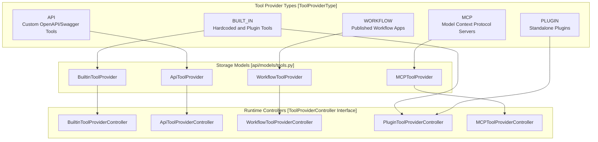
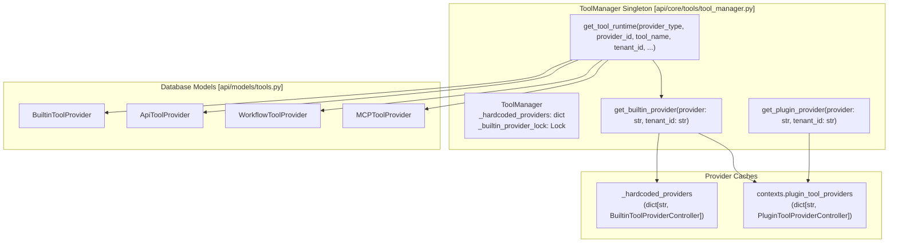
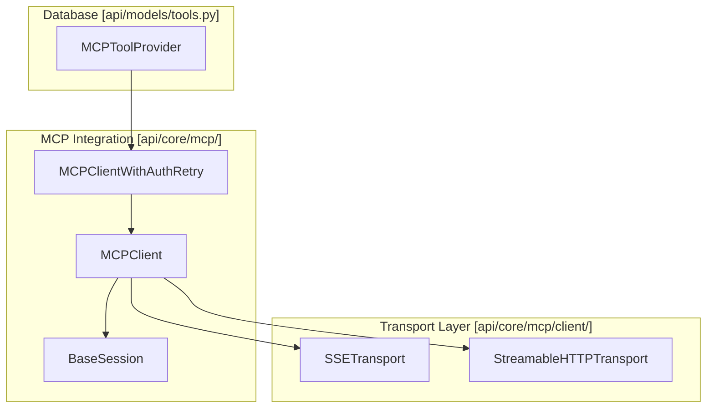

<!-- source: DeepWiki mcp.deepwiki.com · repo langgenius/dify · page 7 Tool, Trigger and Plugin Ecosystem · fetched 2026-10-26 -->

# Tool, Trigger and Plugin Ecosystem

Relevant source files

The following files were used as context for generating this wiki page:

- [api/controllers/console/workspace/tool_providers.py](api/controllers/console/workspace/tool_providers.py)
- [api/core/mcp/client/sse_client.py](api/core/mcp/client/sse_client.py)
- [api/core/mcp/client/streamable_client.py](api/core/mcp/client/streamable_client.py)
- [api/core/mcp/mcp_client.py](api/core/mcp/mcp_client.py)
- [api/core/mcp/session/base_session.py](api/core/mcp/session/base_session.py)
- [api/core/mcp/session/client_session.py](api/core/mcp/session/client_session.py)
- [api/core/tools/__base/tool_provider.py](api/core/tools/__base/tool_provider.py)
- [api/core/tools/mcp_tool/provider.py](api/core/tools/mcp_tool/provider.py)
- [api/core/tools/tool_manager.py](api/core/tools/tool_manager.py)
- [api/core/workflow/human_input_adapter.py](api/core/workflow/human_input_adapter.py)
- [api/services/tools/api_tools_manage_service.py](api/services/tools/api_tools_manage_service.py)
- [api/services/tools/builtin_tools_manage_service.py](api/services/tools/builtin_tools_manage_service.py)
- [api/services/tools/mcp_tools_manage_service.py](api/services/tools/mcp_tools_manage_service.py)
- [api/services/tools/tools_transform_service.py](api/services/tools/tools_transform_service.py)
- [api/services/tools/workflow_tools_manage_service.py](api/services/tools/workflow_tools_manage_service.py)
- [api/tests/unit_tests/core/app/workflow/test_persistence_layer.py](api/tests/unit_tests/core/app/workflow/test_persistence_layer.py)
- [api/tests/unit_tests/core/mcp/test_mcp_tool_pagination.py](api/tests/unit_tests/core/mcp/test_mcp_tool_pagination.py)
- [api/tests/unit_tests/core/tools/test_tool_manager.py](api/tests/unit_tests/core/tools/test_tool_manager.py)
- [api/tests/unit_tests/core/workflow/test_human_input_adapter.py](api/tests/unit_tests/core/workflow/test_human_input_adapter.py)
- [api/tests/unit_tests/services/tools/test_builtin_tools_manage_service.py](api/tests/unit_tests/services/tools/test_builtin_tools_manage_service.py)
- [api/tests/unit_tests/services/tools/test_mcp_tools_transform.py](api/tests/unit_tests/services/tools/test_mcp_tools_transform.py)

## Purpose and Scope

This document describes the tool and plugin architecture in Dify, covering how external tools are integrated, managed, and executed within applications. The tool ecosystem enables agent chat applications and workflow nodes to invoke external functionality through five distinct provider types: built-in tools, API-based tools, workflow-as-tool, plugin-based tools, and MCP (Model Context Protocol) servers. Additionally, it introduces the trigger system for event-driven workflows.

For details, see:
- [Tool Provider Types and Architecture](#7.1) — `ToolManager` singleton, `ToolProviderController` interface, and different provider types.
- [Built-in and API Tool Integration](#7.2) — `BuiltinToolProvider`, `ApiToolProvider`, credential management, and tool runtime creation.
- [MCP Protocol Integration](#7.3) — Model Context Protocol implementation, `MCPClient`, transport layer, and server communication.
- [Plugin Daemon and Execution Environment](#7.4) — Plugin daemon service, plugin installation, security isolation, and marketplace integration.
- [Trigger Providers, Subscriptions and Webhooks](#7.5) — `TriggerProviderService` and `TriggerSubscriptionBuilderService`, OAuth credential handling, webhook endpoints, scheduled triggers, and workflow trigger logs.

---

## Tool Provider Type Taxonomy

Dify supports five distinct tool provider types, each serving different integration patterns and use cases. These types are defined in the `ToolProviderType` enum which includes `PLUGIN`, `BUILT_IN`, `WORKFLOW`, `API`, `APP`, `DATASET_RETRIEVAL`, and `MCP` [api/core/tools/entities/tool_entities.py:65-76]().

### Provider Type Overview and Code Entity Mapping

| Provider Type | Storage Model | Controller Class | Typical Use Case |
|---------------|---------------|------------------|------------------|
| `BUILT_IN` | `BuiltinToolProvider` [models/tools.py:60]() | `BuiltinToolProviderController` [api/core/tools/builtin_tool/provider.py:29]() | Pre-packaged tools (e.g., Google, Wikipedia) |
| `API` | `ApiToolProvider` [models/tools.py:60]() | `ApiToolProviderController` [api/core/tools/custom_tool/provider.py:32]() | Custom user-defined OpenAPI/Swagger tools |
| `WORKFLOW` | `WorkflowToolProvider` [models/tools.py:60]() | `WorkflowToolProviderController` [api/core/tools/workflow_as_tool/provider.py:54]() | Workflow apps published as tools |
| `PLUGIN` | None (runtime only) | `PluginToolProviderController` [api/core/tools/plugin_tool/provider.py:48]() | Runtime plugin tools managed by plugin daemon |
| `MCP` | `MCPToolProvider` [models/tools.py:30]() | `MCPToolProviderController` [api/core/tools/mcp_tool/provider.py:46]() | Remote Model Context Protocol servers |

**Sources:** [api/core/tools/entities/tool_entities.py:65-76](), [models/tools.py:30-60](), [api/core/tools/tool_manager.py:27-55]()

---

## ToolManager: Central Coordination Singleton

The `ToolManager` class is the core singleton that coordinates tool provider discovery, credential management, and tool runtime instantiation across all provider types [api/core/tools/tool_manager.py:95-188](). It handles caching of built-in providers, plugin providers, and creation of runtime tool instances needed for invocation.

### ToolManager Architecture and Workflow

- `get_builtin_provider()` retrieves either a hardcoded built-in provider or a plugin-based provider for the tenant [api/core/tools/tool_manager.py:116-138]().
- `get_plugin_provider()` loads provider controllers from plugin-managed tool providers stored in context-local cache [api/core/tools/tool_manager.py:141-176]().
- `get_tool_runtime()` instantiates a tool runtime instance based on provider type, credentials, and tool name, returning subclasses of `Tool` like `BuiltinTool`, `PluginTool`, `ApiTool`, `WorkflowTool`, or `MCPTool` [api/core/tools/tool_manager.py:179-189]().

The `ToolManager` acts as the single entry point for components wanting to use any tool or invoke providers uniformly.

For detailed architecture and singleton patterns, see [Tool Provider Types and Architecture](#7.1).

**Sources:** [api/core/tools/tool_manager.py:95-188]()

---

## Built-in and API Tool Integration

Dify includes several built-in tools pre-packaged and maintained in `BuiltinToolProviderController` instances. Users can also define API tools dynamically by uploading OpenAPI or Swagger specs. These are managed by `ApiToolProviderController`. Tool credentials are managed via encrypted storage specific to each provider and tenant.

### Key Components

- **BuiltinToolManageService** handles CRUD and credential management for built-in providers [api/services/tools/builtin_tools_manage_service.py:41-152]().
- **ApiToolManageService** manages API tool providers, including parsing OpenAPI schemas and creating tool bundles [api/services/tools/api_tools_manage_service.py:60-140]().
- The **ToolTransformService** converts between database models and API-facing entities, handling icons, credentials, and tool metadata [api/services/tools/tools_transform_service.py:37-109]().

### OpenAPI Schema Parsing

The OpenAPI or Swagger specification parsing into internal tool bundles is done by `ApiBasedToolSchemaParser`, which translates the schema JSON/YAML into executable API tool configurations [api/core/tools/utils/parser.py:32-67](). It supports complex schema features like `$ref` and `allOf` [api/core/tools/utils/parser.py:73-148]().

This mechanism supports credential injection, parameter schema validation, and integrates with frontend tool definition UIs.

For details on credential management, schema parsing, and runtime tool creation, see [Built-in and API Tool Integration](#7.2).

**Sources:**  
- [api/services/tools/builtin_tools_manage_service.py:41-152]()  
- [api/services/tools/api_tools_manage_service.py:60-140]()  
- [api/services/tools/tools_transform_service.py:37-109]()  
- [api/core/tools/utils/parser.py:32-148]()

---

## MCP Protocol Integration

Dify's MCP integration allows it to extend with external MCP servers, which are networked tool providers speaking the Model Context Protocol.

### MCP Components and Workflow

- **MCPToolManageService** manages persistent MCP providers in the database, handling creation, updates, and credential encryption [api/services/tools/mcp_tools_manage_service.py:78-140]().
- The **MCPClient** encapsulates communication with MCP servers, supporting reliable transport over SSE and streamable HTTP via specialized clients [api/core/mcp/mcp_client.py:46](), [api/core/mcp/client/streamable_client.py:19]().
- Authentication is managed with `MCPClientWithAuthRetry`, which wraps the client to handle token refresh and error retries [api/services/tools/mcp_tools_manage_service.py:19]().

MCP providers are stored with encrypted server info and credentials to secure communication [api/services/tools/mcp_tools_manage_service.py:152-176](). The tool runtime for MCP tools coordinates the invocation through the MCP client layer.

For detailed transport layer and server communication details, see [MCP Protocol Integration](#7.3).

**Sources:**  
- [api/services/tools/mcp_tools_manage_service.py:19-176]()  
- [api/core/mcp/mcp_client.py:46]()  
- [api/core/mcp/client/streamable_client.py:19]()  
- [api/core/mcp/client/sse_client.py:41]()

---

## Plugin Daemon and Execution Environment

Plugins are external components running in a separate plugin daemon to provide dynamic tool capabilities. This isolation ensures security and scalability.

### Plugin Tool Handling

- `PluginToolManager` loads and manages installed plugins, fetching tool provider declarations dynamically [api/core/tools/tool_manager.py:25]().
- `PluginToolProviderController` implements the `ToolProviderController` interface for plugin-provided tools, enabling runtime tool discovery and execution [api/core/tools/plugin_tool/provider.py:48]().
- The `ToolManager.get_plugin_provider()` ensures the plugin tool provider is loaded and cached per tenant, interfacing with the plugin daemon service [api/core/tools/tool_manager.py:141-176]().
- URLs for plugin icons are generated by `ToolTransformService` using the plugin system [api/services/tools/tools_transform_service.py:87-94]().

This mechanism offers a unified interface for plugin tools similar to built-in tools, enabling tool invocation without difference at the runtime level.

For security isolation, plugin installation, and marketplace integration, see [Plugin Daemon and Execution Environment](#7.4).

**Sources:**  
- [api/core/tools/plugin_tool/provider.py:48]()  
- [api/core/tools/tool_manager.py:25-176]()  
- [api/services/tools/tools_transform_service.py:87-94]()

---

## Tool Execution Engine

The `ToolEngine` class orchestrates the invocation of tools from various providers, handling parameter conversion, runtime invocation, output parsing, and callback events [api/core/tools/tool_engine.py:43-170]().

### Invocation Methods

- **Agent Execution:** `agent_invoke()` is designed for agent chat applications invoking tools, integrating with `DifyAgentCallbackHandler`. It parses input, forwards calls to tool runtimes, collects outputs, handles error cases, and manages message files [api/core/tools/tool_engine.py:49-157]().
- **Workflow Execution:** `generic_invoke()` supports workflow nodes invoking tools, including nested workflow tool calls and streaming response handling [api/core/tools/tool_engine.py:160-178]().

### Workflow Tool Execution

- The `WorkflowTool` class wraps workflow apps as tools. Its invocation runs the underlying workflow graph via `WorkflowAppGenerator` and transforms the workflow outputs into tool messages consumable by callers [api/core/tools/workflow_as_tool/tool.py:40-153]().

### Tool Output Handling

- The engine extracts binary responses, creates message files, and converts tool invoke messages into strings suitable for LLM continuations or UI display [api/core/tools/tool_engine.py:109-115]().
- Errors during invocation propagate callback events to notify the calling system [api/core/tools/tool_engine.py:130-155]().

This engine provides a consistent invocation layer across diverse tool provider types and execution contexts.

**Sources:**  
- [api/core/tools/tool_engine.py:43-178]()  
- [api/core/tools/workflow_as_tool/tool.py:40-153]()

---

## Trigger Providers, Subscriptions and Webhooks

The trigger system enables workflows to be initiated by external events. This system supports various trigger providers, manages subscriptions, and handles webhook interactions.

### Key Components

- **TriggerProviderService**: This service manages the lifecycle of trigger providers, including their registration and configuration.
- **TriggerSubscriptionBuilderService**: Handles the creation and management of subscriptions to trigger events. This includes setting up OAuth credentials and configuring webhook endpoints.
- **OAuth Credential Handling**: The system integrates with OAuth flows to securely authenticate with external services for triggers.
- **Webhook Endpoints**: Dify exposes webhook endpoints that external services can call to initiate workflows.
- **Scheduled Triggers**: Workflows can be configured to run on a schedule, managed by the trigger system.
- **Workflow Trigger Logs**: Detailed logs are maintained for all trigger-initiated workflow runs, aiding in debugging and monitoring.

For detailed information on trigger providers, subscription management, and webhook configurations, see [Trigger Providers, Subscriptions and Webhooks](#7.5).

**Sources:** (No specific file paths provided in the prompt for Trigger Providers, Subscriptions and Webhooks, so this section is high-level based on the description.)

---

# Summary

The Tool and Plugin ecosystem in Dify is modular and extensible, centered on the `ToolManager` singleton that unifies access to built-in, API, workflow, plugin, and MCP protocol tools. Built-in and API tools rely on static or user-defined schemas, while plugin and MCP providers dynamically add tool capabilities through secure, isolated runtimes or networked servers. The `ToolEngine` underpins execution across these tools, supporting rich invocation semantics required by agents and workflows. Additionally, the trigger system provides robust capabilities for event-driven workflow automation through various providers, subscriptions, and webhooks.

Further details and developer guides are available in the respective child pages linked above.

---

