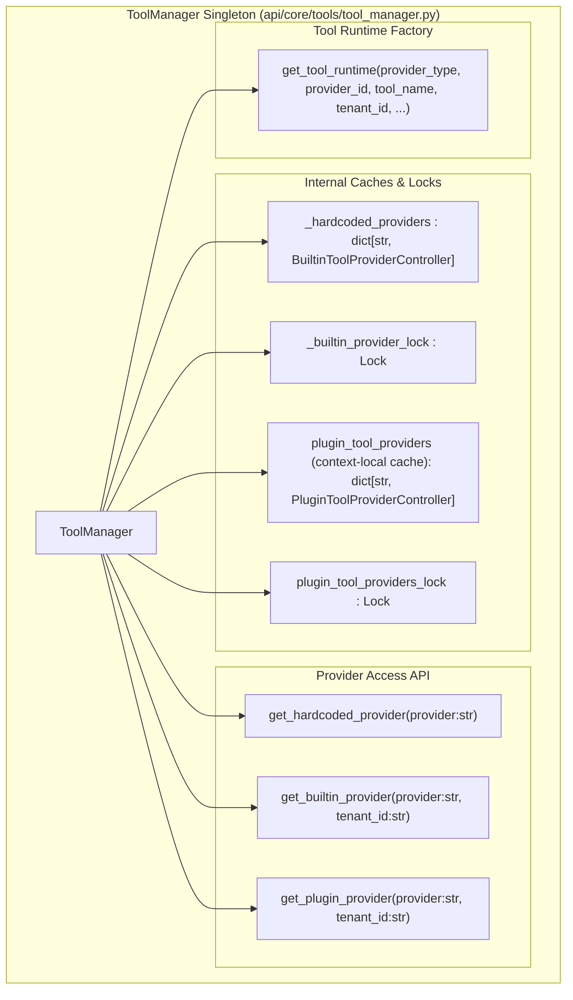
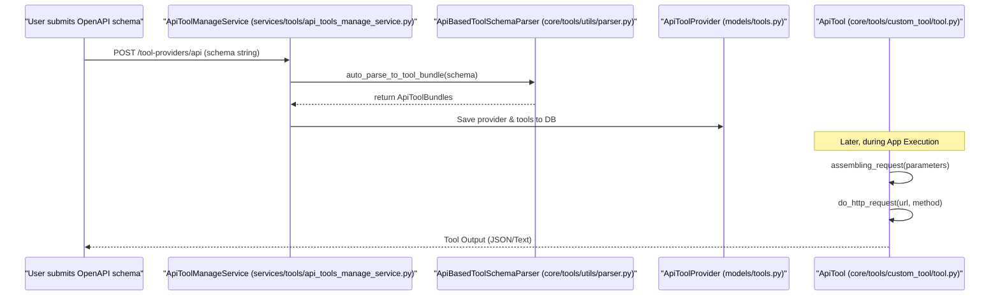
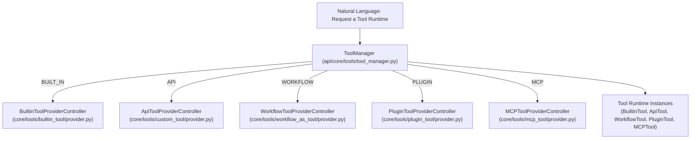
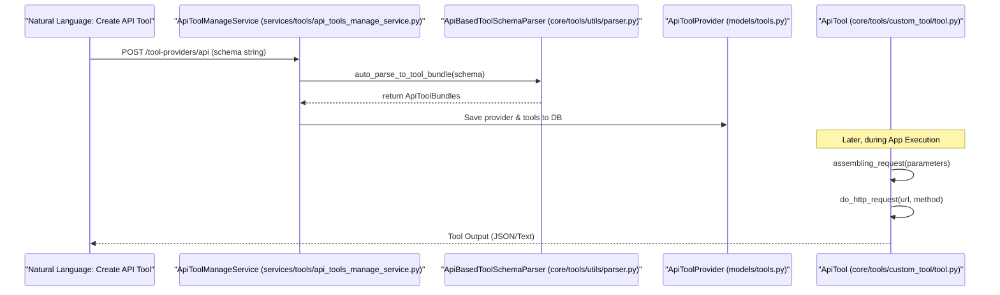

<!-- source: DeepWiki mcp.deepwiki.com · repo langgenius/dify · page 7.1 Tool Provider Types and Architecture · fetched 2026-10-26 -->

# Tool Provider Types and Architecture

<details>
<summary>Relevant source files</summary>

The following files were used as context for generating this wiki page:

- [api/controllers/console/workspace/tool_providers.py](api/controllers/console/workspace/tool_providers.py)
- [api/controllers/files/tool_files.py](api/controllers/files/tool_files.py)
- [api/controllers/inner_api/agent/files.py](api/controllers/inner_api/agent/files.py)
- [api/core/mcp/client/sse_client.py](api/core/mcp/client/sse_client.py)
- [api/core/mcp/client/streamable_client.py](api/core/mcp/client/streamable_client.py)
- [api/core/mcp/mcp_client.py](api/core/mcp/mcp_client.py)
- [api/core/mcp/session/base_session.py](api/core/mcp/session/base_session.py)
- [api/core/mcp/session/client_session.py](api/core/mcp/session/client_session.py)
- [api/core/plugin/utils/converter.py](api/core/plugin/utils/converter.py)
- [api/core/tools/__base/tool.py](api/core/tools/__base/tool.py)
- [api/core/tools/__base/tool_provider.py](api/core/tools/__base/tool_provider.py)
- [api/core/tools/builtin_tool/provider.py](api/core/tools/builtin_tool/provider.py)
- [api/core/tools/builtin_tool/providers/time/tools/localtime_to_timestamp.py](api/core/tools/builtin_tool/providers/time/tools/localtime_to_timestamp.py)
- [api/core/tools/builtin_tool/providers/time/tools/weekday.py](api/core/tools/builtin_tool/providers/time/tools/weekday.py)
- [api/core/tools/builtin_tool/providers/webscraper/webscraper.yaml](api/core/tools/builtin_tool/providers/webscraper/webscraper.yaml)
- [api/core/tools/custom_tool/provider.py](api/core/tools/custom_tool/provider.py)
- [api/core/tools/entities/tool_bundle.py](api/core/tools/entities/tool_bundle.py)
- [api/core/tools/entities/tool_entities.py](api/core/tools/entities/tool_entities.py)
- [api/core/tools/errors.py](api/core/tools/errors.py)
- [api/core/tools/mcp_tool/provider.py](api/core/tools/mcp_tool/provider.py)
- [api/core/tools/signature.py](api/core/tools/signature.py)
- [api/core/tools/tool_engine.py](api/core/tools/tool_engine.py)
- [api/core/tools/tool_file_manager.py](api/core/tools/tool_file_manager.py)
- [api/core/tools/tool_label_manager.py](api/core/tools/tool_label_manager.py)
- [api/core/tools/tool_manager.py](api/core/tools/tool_manager.py)
- [api/core/tools/utils/dataset_retriever/dataset_retriever_base_tool.py](api/core/tools/utils/dataset_retriever/dataset_retriever_base_tool.py)
- [api/core/tools/utils/dataset_retriever_tool.py](api/core/tools/utils/dataset_retriever_tool.py)
- [api/core/tools/utils/parser.py](api/core/tools/utils/parser.py)
- [api/core/tools/utils/workflow_configuration_sync.py](api/core/tools/utils/workflow_configuration_sync.py)
- [api/core/tools/workflow_as_tool/provider.py](api/core/tools/workflow_as_tool/provider.py)
- [api/core/tools/workflow_as_tool/tool.py](api/core/tools/workflow_as_tool/tool.py)
- [api/core/workflow/human_input_adapter.py](api/core/workflow/human_input_adapter.py)
- [api/libs/gmpy2_pkcs10aep_cipher.py](api/libs/gmpy2_pkcs10aep_cipher.py)
- [api/libs/sendgrid.py](api/libs/sendgrid.py)
- [api/services/tool_file_download_service.py](api/services/tool_file_download_service.py)
- [api/services/tools/api_tools_manage_service.py](api/services/tools/api_tools_manage_service.py)
- [api/services/tools/builtin_tools_manage_service.py](api/services/tools/builtin_tools_manage_service.py)
- [api/services/tools/mcp_tools_manage_service.py](api/services/tools/mcp_tools_manage_service.py)
- [api/services/tools/tools_transform_service.py](api/services/tools/tools_transform_service.py)
- [api/services/tools/workflow_tools_manage_service.py](api/services/tools/workflow_tools_manage_service.py)
- [api/tests/test_containers_integration_tests/services/tools/__init__.py](api/tests/test_containers_integration_tests/services/tools/__init__.py)
- [api/tests/test_containers_integration_tests/services/tools/test_api_tools_manage_service.py](api/tests/test_containers_integration_tests/services/tools/test_api_tools_manage_service.py)
- [api/tests/unit_tests/controllers/files/test_tool_files.py](api/tests/unit_tests/controllers/files/test_tool_files.py)
- [api/tests/unit_tests/controllers/inner_api/test_agent_files.py](api/tests/unit_tests/controllers/inner_api/test_agent_files.py)
- [api/tests/unit_tests/core/app/workflow/test_persistence_layer.py](api/tests/unit_tests/core/app/workflow/test_persistence_layer.py)
- [api/tests/unit_tests/core/mcp/test_mcp_tool_pagination.py](api/tests/unit_tests/core/mcp/test_mcp_tool_pagination.py)
- [api/tests/unit_tests/core/tools/test_base_tool.py](api/tests/unit_tests/core/tools/test_base_tool.py)
- [api/tests/unit_tests/core/tools/test_builtin_tool_provider.py](api/tests/unit_tests/core/tools/test_builtin_tool_provider.py)
- [api/tests/unit_tests/core/tools/test_builtin_tools_extra.py](api/tests/unit_tests/core/tools/test_builtin_tools_extra.py)
- [api/tests/unit_tests/core/tools/test_custom_tool.py](api/tests/unit_tests/core/tools/test_custom_tool.py)
- [api/tests/unit_tests/core/tools/test_custom_tool_provider.py](api/tests/unit_tests/core/tools/test_custom_tool_provider.py)
- [api/tests/unit_tests/core/tools/test_dataset_retriever_tool.py](api/tests/unit_tests/core/tools/test_dataset_retriever_tool.py)
- [api/tests/unit_tests/core/tools/test_mcp_tool.py](api/tests/unit_tests/core/tools/test_mcp_tool.py)
- [api/tests/unit_tests/core/tools/test_mcp_tool_provider.py](api/tests/unit_tests/core/tools/test_mcp_tool_provider.py)
- [api/tests/unit_tests/core/tools/test_plugin_tool.py](api/tests/unit_tests/core/tools/test_plugin_tool.py)
- [api/tests/unit_tests/core/tools/test_plugin_tool_provider.py](api/tests/unit_tests/core/tools/test_plugin_tool_provider.py)
- [api/tests/unit_tests/core/tools/test_signature.py](api/tests/unit_tests/core/tools/test_signature.py)
- [api/tests/unit_tests/core/tools/test_tool_engine.py](api/tests/unit_tests/core/tools/test_tool_engine.py)
- [api/tests/unit_tests/core/tools/test_tool_entities.py](api/tests/unit_tests/core/tools/test_tool_entities.py)
- [api/tests/unit_tests/core/tools/test_tool_file_manager.py](api/tests/unit_tests/core/tools/test_tool_file_manager.py)
- [api/tests/unit_tests/core/tools/test_tool_label_manager.py](api/tests/unit_tests/core/tools/test_tool_label_manager.py)
- [api/tests/unit_tests/core/tools/test_tool_manager.py](api/tests/unit_tests/core/tools/test_tool_manager.py)
- [api/tests/unit_tests/core/tools/test_tool_provider_controller.py](api/tests/unit_tests/core/tools/test_tool_provider_controller.py)
- [api/tests/unit_tests/core/tools/utils/__init__.py](api/tests/unit_tests/core/tools/utils/__init__.py)
- [api/tests/unit_tests/core/tools/utils/test_encryption.py](api/tests/unit_tests/core/tools/utils/test_encryption.py)
- [api/tests/unit_tests/core/tools/utils/test_model_invocation_utils.py](api/tests/unit_tests/core/tools/utils/test_model_invocation_utils.py)
- [api/tests/unit_tests/core/tools/utils/test_parser.py](api/tests/unit_tests/core/tools/utils/test_parser.py)
- [api/tests/unit_tests/core/tools/workflow_as_tool/test_provider.py](api/tests/unit_tests/core/tools/workflow_as_tool/test_provider.py)
- [api/tests/unit_tests/core/tools/workflow_as_tool/test_tool.py](api/tests/unit_tests/core/tools/workflow_as_tool/test_tool.py)
- [api/tests/unit_tests/core/workflow/test_human_input_adapter.py](api/tests/unit_tests/core/workflow/test_human_input_adapter.py)
- [api/tests/unit_tests/services/test_tool_file_download_service.py](api/tests/unit_tests/services/test_tool_file_download_service.py)
- [api/tests/unit_tests/services/test_upload_file_delivery_service.py](api/tests/unit_tests/services/test_upload_file_delivery_service.py)
- [api/tests/unit_tests/services/tools/test_api_tools_manage_service.py](api/tests/unit_tests/services/tools/test_api_tools_manage_service.py)
- [api/tests/unit_tests/services/tools/test_builtin_tools_manage_service.py](api/tests/unit_tests/services/tools/test_builtin_tools_manage_service.py)
- [api/tests/unit_tests/services/tools/test_mcp_tools_transform.py](api/tests/unit_tests/services/tools/test_mcp_tools_transform.py)
- [dify-agent/src/dify_agent/agent_stub/server/agent_stub_files.py](dify-agent/src/dify_agent/agent_stub/server/agent_stub_files.py)
- [dify-agent/tests/local/dify_agent/agent_stub/server/test_agent_stub_files.py](dify-agent/tests/local/dify_agent/agent_stub/server/test_agent_stub_files.py)
- [web/app/components/workflow/nodes/_base/components/__tests__/form-input-item.helpers.spec.ts](web/app/components/workflow/nodes/_base/components/__tests__/form-input-item.helpers.spec.ts)
- [web/app/components/workflow/nodes/_base/components/form-input-item.helpers.ts](web/app/components/workflow/nodes/_base/components/form-input-item.helpers.ts)

</details>


This document describes the architecture of Dify's tool provider system, which enables integration of external tools and services into workflows and agent applications. The tool provider framework supports multiple provider types, each with distinct characteristics and integration patterns managed via the `ToolManager` singleton and specialized controllers.

## Purpose and Scope

The tool provider system abstracts tool discovery, credential management, and invocation across multiple distinct provider types:

- **Built-in providers**: Hardcoded tools packaged with Dify (e.g., search, weather).
- **API providers**: User-defined OpenAPI/Swagger-based tools.
- **Workflow providers**: Published workflows exposed as reusable tools.
- **Plugin providers**: Tools distributed via the plugin marketplace and managed by the plugin daemon.
- **MCP providers**: Tools exposed via Model Context Protocol servers.
- **Dataset Retrieval**: Specialized tools for knowledge base interaction.

This page covers the architectural patterns, data models, and controller interfaces that enable this multi-provider system.

---

## Tool Provider Type Taxonomy

### Enumeration Definition

The `ToolProviderType` enum defines all supported provider categories used for routing and identification throughout the system.

```python
class ToolProviderType(StrEnum):
    """
    Enum class for tool provider
    """
    PLUGIN = auto()
    BUILT_IN = "builtin"
    WORKFLOW = auto()
    API = auto()
    APP = auto()
    DATASET_RETRIEVAL = "dataset-retrieval"
    MCP = auto()
```

This enum is defined in [api/core/tools/entities/tool_entities.py:65-77]() and forms the basis for distinguishing tool providers across the codebase.

### Provider Type Comparison

| Provider Type        | Discovery Method        | DB Model / Storage         | Schema Source               | Multi-Tenancy               |
|---------------------|------------------------|----------------------------|-----------------------------|-----------------------------|
| `BUILT_IN`          | Filesystem / hardcoded | `BuiltinToolProvider`      | Python classes              | Tenant-scoped credentials    |
| `API`               | User creation          | `ApiToolProvider`          | OpenAPI/Swagger schema      | Tenant-scoped               |
| `WORKFLOW`          | Published workflows    | `WorkflowToolProvider`     | Workflow graph schema       | Tenant-scoped               |
| `PLUGIN`            | Marketplace plugins    | Plugin Manifest + DB       | Plugin manifests            | Tenant-scoped               |
| `MCP`               | MCP discovery          | `MCPToolProvider`          | MCP Protocol (JSON-RPC like)| Tenant-scoped               |
| `DATASET_RETRIEVAL` | Knowledge base dataset | No direct DB model         | Dataset metadata            | Tenant-scoped               |

This taxonomy guides the system in routing requests, managing credentials, and invoking the correct tool implementations.

**Sources:**  
[api/core/tools/entities/tool_entities.py:65-77]()  
[api/core/tools/tool_manager.py:30-56]()  
[models/tools.py:30-60]()  
[api/core/tools/entities/api_entities.py:35-55]()

---

## ToolManager Singleton Architecture

The `ToolManager` is the central orchestrator responsible for managing tool provider controllers, caching built-in providers, and creating tool runtime instances.

### Core Responsibilities

- **Provider Cache Management**: Maintains a thread-safe cache `_hardcoded_providers` for built-in providers loaded lazily using `load_hardcoded_providers_cache()`.
- **Provider Retrieval APIs**:  
  - `get_hardcoded_provider(provider: str)` returns a built-in provider controller.  
  - `get_builtin_provider(provider: str, tenant_id: str)` returns a built-in or plugin provider controller, preferring built-in but falling back to plugins if needed.  
  - `get_plugin_provider(provider: str, tenant_id: str)` manages plugin provider retrieval and caching per tenant context.
- **Tool Runtime Factory**: `get_tool_runtime(...)` creates runtime instances (e.g., `BuiltinTool`, `ApiTool`, `WorkflowTool`, etc.) according to provider type, tool name, and tenant/user context.

#### Provider Retrieval and Caching

- `get_hardcoded_provider()` ensures built-in providers are loaded once into `_hardcoded_providers` [api/core/tools/tool_manager.py:103-114]().  
- `get_builtin_provider()` handles scenario where a provider is either built-in or a plugin, querying plugin providers using context-local caches guarded by locks [api/core/tools/tool_manager.py:116-139]().  
- Plugin providers are lazy-loaded and cached using the `PluginToolManager` fetch process [api/core/tools/tool_manager.py:141-178]().

### Class and Data Flow Diagram: ToolManager Singleton



**Sources:** [api/core/tools/tool_manager.py:95-178]()

---

## ToolProviderController Interface and Implementations

### Interface Overview

`ToolProviderController` is a protocol interface defining the primary API for all tool providers. It includes method contracts for:

- Tool retrieval: listing tools, checking availability by name.
- Credential schema management: returning required credential shapes and validating credentials.
- Metadata access: labels, icons, descriptions, OAuth client schema.
- Tool execution support: obtaining tool runtime settings.

Each provider type implements this interface differently to encapsulate its specific behaviors and integration needs.

### Known Controller Implementations

| Controller Class                     | Provider Type     | Description                                     |
|------------------------------------|-------------------|------------------------------------------------|
| `BuiltinToolProviderController`    | BUILT_IN          | Manages built-in, static provider tooling.    |
| `ApiToolProviderController`        | API               | Manages OpenAPI/Swagger-based API toolsets.   |
| `WorkflowToolProviderController`   | WORKFLOW          | Exposes published workflows as tools.         |
| `PluginToolProviderController`     | PLUGIN            | Manages plugin-driven tools via marketplace.  |
| `MCPToolProviderController`        | MCP               | Manages MCP protocol-based tool integration.  |

### Architecture Diagram: Controller Interface and Implementations

```mermaid
graph TB
    TPC["ToolProviderController<br/>(abstract interface)"]
    
    BTPC["BuiltinToolProviderController"]
    ATPC["ApiToolProviderController"]
    WTPC["WorkflowToolProviderController"]
    PTPC["PluginToolProviderController"]
    MTPC["MCPToolProviderController"]
    
    TPC --> BTPC
    TPC --> ATPC
    TPC --> WTPC
    TPC --> PTPC
    TPC --> MTPC
    
    BTPC -.loads built-in tools from filesystem-> FS["core/tools/builtin_tool/providers"]
    ATPC -.manages models-> APDB["ApiToolProvider DB models"]
    WTPC -.manages models-> WTPDB["WorkflowToolProvider DB models"]
    PTPC -.uses plugin manager-> PM["PluginToolManager, plugin manifest"]
    MTPC -.manages models-> MTPDB["MCPToolProvider DB models"]
```

**Sources:**  
[api/core/tools/tool_manager.py:28]()  
[api/core/tools/__base/tool_provider.py:1-20]()

---

## API Tool Providers and Schema Parsing

API Tool Providers enable integration of external HTTP API services using user-submitted OpenAPI or Swagger schemas.

### Schema Parsing and Tool Bundles

- The `ApiBasedToolSchemaParser` utility parses OpenAPI specifications into internal `ApiToolBundle` objects representing individual API endpoints as callable tools [api/core/tools/utils/parser.py:33-36]().
- The parser performs resolution of references, server environment selection, parameters parsing, and content-type processing [api/core/tools/utils/parser.py:43-145]().
- It normalizes parameter types, handles nested schema references, and extracts credential requirements.
  
### Service Interface and Workflow

- The `ApiToolManageService` handles user commands to create API tool providers by parsing schemas and storing provider and tool data in the database [api/services/tools/api_tools_manage_service.py:130-176]().
- It provides functions to validate schemas, list tools, and manage credentials tied to these providers [api/services/tools/api_tools_manage_service.py:61-127]().

### ApiTool Runtime Behavior

The `ApiTool` class embodies the runtime logic for invoking API tools:

- **Request Assembly**: on invocation, headers and query parameters are built out, injecting credential tokens or API keys as required.  
- **HTTP Execution**: HTTP requests are issued through an SSRF-protected proxy to prevent server-side request forgery vulnerabilities.  
- **Response Handling**: The tool processes JSON or text responses, converts outputs, and handles errors according to provider specifications.

### API Tools Execution Diagram



**Sources:**  
[api/core/tools/utils/parser.py:32-145]()  
[api/services/tools/api_tools_manage_service.py:61-176]()  
[api/core/tools/custom_tool/tool.py:39-200]()

---

## MCP Protocol Integration

MCP (Model Context Protocol) provides a JSON-RPC-like protocol to integrate with external MCP servers exposing tools as runtime services.

### Key Components

- **MCPToolProviderController**: Manages metadata, credentials, and tool lists for MCP providers.  
- **MCPToolManageService**: Service managing lifecycle, credential encryption, OAuth flows, and reconnection logic for MCP providers [api/services/tools/mcp_tools_manage_service.py:79-176]().  
- **MCPClientWithAuthRetry**: Client with authentication retries to communicate with MCP servers.  
- **BaseSession**: Core MCP session abstraction managing bidirectional streaming of messages.

### Invocation Flow

- MCP tools are invoked remotely using standardized JSON-RPC requests.  
- Results include mixed content types like plain text, images (e.g., base64 or URLs), and embedded HTML.  
- The system handles authentication challenges and refresh tokens transparently.

**Sources:**  
[api/services/tools/mcp_tools_manage_service.py:79-176]()  
[api/core/tools/mcp_tool/tool.py:38-105]()  
[api/core/mcp/session/base_session.py:123-160]()

---

## Bridging Natural Language to Code Entities

### System Architecture Overview

This diagram links natural language concepts like "Request Tool Runtime" to precise code components within the tool provider architecture:



### API Tool Creation and Execution Flow

This sequence represents the flow from schema provisioning to tool execution for API-based tools:



**Sources:** [api/core/tools/tool_manager.py:95-178]()  
[api/services/tools/api_tools_manage_service.py:129-176]()  
[api/core/tools/custom_tool/tool.py:39-200]()

---

## Summary of Key Classes and Their Roles

| Class                            | Location                          | Role                                                                                   |
|---------------------------------|---------------------------------|----------------------------------------------------------------------------------------|
| `ToolManager`                   | [api/core/tools/tool_manager.py:95]() | Singleton managing provider controllers and runtime tool instances.                    |
| `ToolProviderController`        | [api/core/tools/__base/tool_provider.py:1-20]() | Interface for all tool provider controllers, defining core methods.                    |
| `BuiltinToolProviderController` | [api/core/tools/builtin_tool/provider.py:1-140]() | Built-in provider controller managing static tools and credential schema.              |
| `ApiToolProviderController`     | [api/core/tools/custom_tool/provider.py:1-160]() | Controller for API-based tools using OpenAPI, managing schema and runtime.              |
| `WorkflowToolProviderController`| [api/core/tools/workflow_as_tool/provider.py:1-110]() | Manages workflows exposed as callable tools.                                          |
| `PluginToolProviderController`  | [api/core/tools/plugin_tool/provider.py:1-85]() | Manages plugin-based tools including fetching and caching plugin metadata.             |
| `MCPToolProviderController`     | [api/core/tools/mcp_tool/provider.py:1-115]()  | Handles MCP protocol tool provider specifics.                                         |
| `ApiBasedToolSchemaParser`      | [api/core/tools/utils/parser.py:32]() | Parses OpenAPI/Swagger specifications into internal ApiToolBundles.                   |
| `ApiToolManageService`          | [api/services/tools/api_tools_manage_service.py:60]() | Service handling CRUD and schema parsing for API tools.                               |
| `BuiltinToolManageService`      | [api/services/tools/builtin_tools_manage_service.py:41]() | Service managing credentials and metadata for built-in tools.                         |
| `ToolEngine`                   | [api/core/tools/tool_engine.py:40-130]() | Engine for executing tools, handling invocation and dispatch to runtimes.             |

---

## Tool Files and Tool Engine Overview

### Tool Files

Tool file management occurs separately under `api/controllers/files/tool_files.py` managing file upload and association with invocation for tools producing or consuming files.

### Tool Engine

The `ToolEngine` class orchestrates tool invocation lifecycle, handling parameter parsing, invocation start/end callbacks, message transformation, error handling, and binary file extraction. It supports both agent and generic workflow invocation flows.

- Invokes the underlying `Tool` object with parsed parameters [api/core/tools/tool_engine.py:86]().
- Dispatches execution callbacks for tool lifecycle events [api/core/tools/tool_engine.py:84]().
- Transforms tool messages for agent consumption and manages output file binaries [api/core/tools/tool_engine.py:99-113]().

**Sources:**  
[api/core/tools/tool_engine.py:40-157]()  
[api/controllers/files/tool_files.py:1-81]()

---

This page provides a comprehensive technical overview of Dify's tool provider architecture and components, bridging conceptual tool types with concrete code entities and workflows to aid new engineers integrating or extending the tool ecosystem.

**Sources:**  
[api/core/tools/tool_manager.py]()  
[api/core/tools/entities/tool_entities.py]()  
[api/core/tools/__base/tool_provider.py]()  
[api/core/tools/utils/parser.py]()  
[api/services/tools/api_tools_manage_service.py]()  
[api/services/tools/mcp_tools_manage_service.py]()  
[api/core/tools/mcp_tool/tool.py]()  
[api/core/tools/workflow_as_tool/tool.py]()  
[api/core/tools/tool_engine.py]()

---

