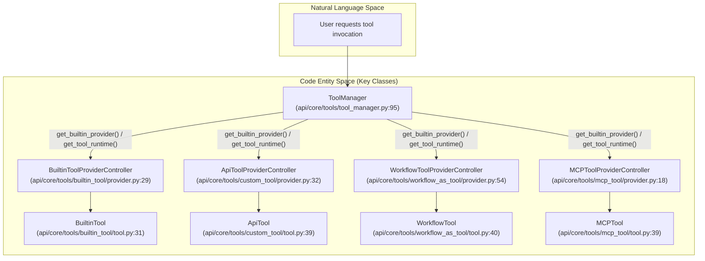

<!-- source: DeepWiki mcp.deepwiki.com · repo langgenius/dify · page 7.2 Built-in and API Tool Integration · fetched 2026-10-26 -->

# Built-in and API Tool Integration

Relevant source files

The following files were used as context for generating this wiki page:

- [api/configs/middleware/vdb/milvus_config.py](api/configs/middleware/vdb/milvus_config.py)
- [api/configs/secret_key.py](api/configs/secret_key.py)
- [api/controllers/common/helpers.py](api/controllers/common/helpers.py)
- [api/core/app/file_access/__init__.py](api/core/app/file_access/__init__.py)
- [api/core/app/file_access/controller.py](api/core/app/file_access/controller.py)
- [api/core/app/file_access/scope.py](api/core/app/file_access/scope.py)
- [api/core/app/workflow/file_runtime.py](api/core/app/workflow/file_runtime.py)
- [api/core/datasource/datasource_file_manager.py](api/core/datasource/datasource_file_manager.py)
- [api/core/datasource/utils/message_transformer.py](api/core/datasource/utils/message_transformer.py)
- [api/core/mcp/auth/auth_flow.py](api/core/mcp/auth/auth_flow.py)
- [api/core/mcp/auth_client.py](api/core/mcp/auth_client.py)
- [api/core/mcp/entities.py](api/core/mcp/entities.py)
- [api/core/mcp/error.py](api/core/mcp/error.py)
- [api/core/mcp/types.py](api/core/mcp/types.py)
- [api/core/rag/datasource/vdb/field.py](api/core/rag/datasource/vdb/field.py)
- [api/core/tools/custom_tool/tool.py](api/core/tools/custom_tool/tool.py)
- [api/core/tools/mcp_tool/tool.py](api/core/tools/mcp_tool/tool.py)
- [api/core/tools/utils/message_transformer.py](api/core/tools/utils/message_transformer.py)
- [api/extensions/ext_set_secretkey.py](api/extensions/ext_set_secretkey.py)
- [api/factories/file_factory/builders.py](api/factories/file_factory/builders.py)
- [api/factories/file_factory/remote.py](api/factories/file_factory/remote.py)
- [api/libs/exception.py](api/libs/exception.py)
- [api/libs/flask_utils.py](api/libs/flask_utils.py)
- [api/libs/smtp.py](api/libs/smtp.py)
- [api/providers/vdb/vdb-analyticdb/src/dify_vdb_analyticdb/analyticdb_vector_sql.py](api/providers/vdb/vdb-analyticdb/src/dify_vdb_analyticdb/analyticdb_vector_sql.py)
- [api/providers/vdb/vdb-baidu/src/dify_vdb_baidu/baidu_vector.py](api/providers/vdb/vdb-baidu/src/dify_vdb_baidu/baidu_vector.py)
- [api/providers/vdb/vdb-clickzetta/tests/integration_tests/test_docker_integration.py](api/providers/vdb/vdb-clickzetta/tests/integration_tests/test_docker_integration.py)
- [api/providers/vdb/vdb-lindorm/src/dify_vdb_lindorm/lindorm_vector.py](api/providers/vdb/vdb-lindorm/src/dify_vdb_lindorm/lindorm_vector.py)
- [api/providers/vdb/vdb-milvus/src/dify_vdb_milvus/milvus_vector.py](api/providers/vdb/vdb-milvus/src/dify_vdb_milvus/milvus_vector.py)
- [api/providers/vdb/vdb-milvus/tests/unit_tests/test_milvus.py](api/providers/vdb/vdb-milvus/tests/unit_tests/test_milvus.py)
- [api/services/knowledge/dataset_read_service.py](api/services/knowledge/dataset_read_service.py)
- [api/tests/unit_tests/controllers/openapi/test_app_describe_builder.py](api/tests/unit_tests/controllers/openapi/test_app_describe_builder.py)
- [api/tests/unit_tests/core/agent/test_plugin_entities.py](api/tests/unit_tests/core/agent/test_plugin_entities.py)
- [api/tests/unit_tests/core/datasource/test_datasource_file_manager.py](api/tests/unit_tests/core/datasource/test_datasource_file_manager.py)
- [api/tests/unit_tests/core/datasource/test_datasource_manager.py](api/tests/unit_tests/core/datasource/test_datasource_manager.py)
- [api/tests/unit_tests/core/mcp/auth/test_auth_flow.py](api/tests/unit_tests/core/mcp/auth/test_auth_flow.py)
- [api/tests/unit_tests/core/mcp/client/test_sse.py](api/tests/unit_tests/core/mcp/client/test_sse.py)
- [api/tests/unit_tests/core/mcp/fixtures.py](api/tests/unit_tests/core/mcp/fixtures.py)
- [api/tests/unit_tests/core/mcp/session/test_base_session.py](api/tests/unit_tests/core/mcp/session/test_base_session.py)
- [api/tests/unit_tests/core/mcp/session/test_client_session.py](api/tests/unit_tests/core/mcp/session/test_client_session.py)
- [api/tests/unit_tests/core/mcp/test_auth_client_inheritance.py](api/tests/unit_tests/core/mcp/test_auth_client_inheritance.py)
- [api/tests/unit_tests/core/mcp/test_entities.py](api/tests/unit_tests/core/mcp/test_entities.py)
- [api/tests/unit_tests/core/mcp/test_mcp_client.py](api/tests/unit_tests/core/mcp/test_mcp_client.py)
- [api/tests/unit_tests/core/mcp/test_types.py](api/tests/unit_tests/core/mcp/test_types.py)
- [api/tests/unit_tests/core/rag/datasource/test_retrieval_attachment_access.py](api/tests/unit_tests/core/rag/datasource/test_retrieval_attachment_access.py)
- [api/tests/unit_tests/core/tools/utils/test_message_transformer.py](api/tests/unit_tests/core/tools/utils/test_message_transformer.py)
- [api/tests/unit_tests/factories/test_build_from_mapping.py](api/tests/unit_tests/factories/test_build_from_mapping.py)
- [api/tests/unit_tests/factories/test_file_factory.py](api/tests/unit_tests/factories/test_file_factory.py)
- [api/tests/unit_tests/libs/test_email_i18n.py](api/tests/unit_tests/libs/test_email_i18n.py)
- [api/tests/unit_tests/libs/test_flask_utils.py](api/tests/unit_tests/libs/test_flask_utils.py)
- [api/tests/unit_tests/libs/test_sendgrid_client.py](api/tests/unit_tests/libs/test_sendgrid_client.py)
- [api/tests/unit_tests/libs/test_smtp_client.py](api/tests/unit_tests/libs/test_smtp_client.py)
- [api/tests/unit_tests/tools/test_api_tool.py](api/tests/unit_tests/tools/test_api_tool.py)
- [api/tests/unit_tests/tools/test_mcp_tool.py](api/tests/unit_tests/tools/test_mcp_tool.py)

This page documents the detailed implementation and integration of built-in tool providers and API-based custom tools in Dify. It covers key components such as `BuiltinToolProvider` and `ApiToolProviderController`, credential management strategies, OpenAPI schema parsing, message transformers for tool responses, and runtime creation for invoking these tools. The purpose is to explain how Dify supports multiple types of tool providers, their common interfaces, and the flow from user specification to runtime invocation, including middleware transformations and credentials handling.

---

## 1. Tool Provider Type System

Dify adopts a type-based provider system to support various tool integration modalities, enumerated as values in the `ToolProviderType` enum:

| Provider Type | Enum Value | Description |
|---|---|---|
| Built-in | `builtin` | Hardcoded internal tools implemented directly in code. |
| API | `api` | Custom tools based on external REST APIs (OpenAPI). |
| Workflow | `workflow` | Published Dify Workflows exposed as tools. |
| MCP (Model Context Protocol) | `mcp` | Integration with MCP servers for tool invocation. |
| Dataset Retrieval | `dataset-retrieval` | Tools backed by knowledge base retrievals. |

Each provider type is associated with specific classes for managing tools, credentials, and runtime:

The `ToolManager` class is a singleton responsible for loading and caching tool providers, resolving providers by type (built-in, plugin, API, MCP), and creating tool runtime instances for invocation [api/core/tools/tool_manager.py:95-187]().

Sources:
- [api/core/tools/entities/tool_entities.py:65-76]()
- [api/core/tools/tool_manager.py:95-187]()
- [api/core/tools/builtin_tool/provider.py:20-70]()
- [api/core/tools/custom_tool/provider.py:20-70]()
- [api/core/tools/mcp_tool/provider.py:10-50]()
- [api/core/tools/workflow_as_tool/provider.py:40-100]()

---

## 2. Built-in Tool Provider: `BuiltinToolProviderController`

Built-in providers are pre-defined sets of tools implemented and loaded from code or static files. They provide curated capabilities with largely fixed interfaces.

- **Loading & Caching:** Hardcoded providers are cached to prevent repeated loading (`_hardcoded_providers` cache).
- **Credential Management:** Supports multiple credential types and schemas for OAuth or API keys.
- **Tool Listing:** Exposes interface to list tools, get tool info, and update credentials.
- **Provider Lookup:** `ToolManager.get_builtin_provider()` returns the `BuiltinToolProviderController` or falls back to plugin providers if applicable.

The `BuiltinToolManageService` provides higher-level APIs for credential management, OAuth client parameter handling, and provides integration points for frontends to list built-in tools and update credentials securely [api/services/tools/builtin_tools_manage_service.py:42-171]().

**Credential visibility and OAuth parameters** are managed carefully with built-in tools supporting system/global credentials and tenant-level credential scopes.

Sources:
- [api/core/tools/tool_manager.py:95-187]()
- [api/services/tools/builtin_tools_manage_service.py:42-171]()

---

## 3. API Tool Provider: `ApiToolProviderController` and `ApiTool`

API Tools allow users to integrate third-party REST APIs by providing an OpenAPI/Swagger specification.

### 3.1 Schema Parsing and Tool Bundles

- Tool bundles describe the API endpoints as callable tools with typed parameters.
- Schemas are parsed using `ApiBasedToolSchemaParser`, which converts OpenAPI specs into `ApiToolBundle` and parameters [api/core/tools/utils/parser.py:30-145]() and [api/services/tools/api_tools_manage_service.py:60-176]().
- Supported API schema types include OpenAPI, Swagger, OpenAI Plugin spec, and more as defined in `ApiProviderSchemaType`.

### 3.2 Credential and Authentication Support

- Various authentication types are supported per `ApiProviderAuthType`: None, API Key in header, API Key in query.
- Credentials are customizable including headers, prefixes (e.g., "Bearer", "Basic"), managed by `ApiTool` during HTTP request construction [api/core/tools/custom_tool/tool.py:39-165]().
- The `ApiTool.validate_credentials` method performs a test request to the API to ensure the provided credentials are valid [api/core/tools/custom_tool/tool.py:64-80](). This involves assembling the request headers and parameters and executing an HTTP request via `do_http_request` [api/core/tools/custom_tool/tool.py:76](). The response is then validated and parsed by `validate_and_parse_response` [api/core/tools/custom_tool/tool.py:78]().

### 3.3 API Tool Runtime and Invocation

- The `ApiTool` class inherits from base `Tool` and manages executing HTTP requests to configured APIs.
- It constructs requests using credentials and parameters, validates response content types (JSON/Text), and parses results into messages for Dify workflow consumption.
- Credential validation is done by invoking the API with test parameters and checking response formats.
- The `assembling_request` method handles the construction of HTTP headers based on the `auth_type` specified in the credentials, supporting `api_key_header`, `api_key`, and `api_key_query` [api/core/tools/custom_tool/tool.py:86-131]().
- The `validate_and_parse_response` method checks the HTTP status code and content type of the API response, attempting to parse it as JSON if `application/json` is indicated, otherwise treating it as plain text [api/core/tools/custom_tool/tool.py:133-165]().

### 3.4 Admin Tools and Frontend Integration

- The `ApiToolManageService` offers backend management for API tool providers: creation, update, schema parsing, authorization, and icon management [api/services/tools/api_tools_manage_service.py:60-176]().
- Frontend components allow users to paste OpenAPI schemas and test tools interactively before saving.

Sources:
- [api/services/tools/api_tools_manage_service.py:60-176]()
- [api/core/tools/custom_tool/tool.py:39-165]()
- [api/core/tools/utils/parser.py:30-145]()

---

## 4. Workflow as a Tool: `WorkflowToolProviderController` and `WorkflowTool`

Published Dify workflows can be exposed as callable tools:

- The `WorkflowTool` extends `Tool` and runs workflows as tool invocations.
- It manages input parameter injection, invokes the `WorkflowAppGenerator` for workflow execution, and yields outputs as tool messages including JSON, text, or files.
- Pause/resume (human input nodes) are unsupported in workflow tools.
- Usage statistics (e.g., LLM tokens) are tracked and reported.

This approach allows complex multi-step logic flows to be called like "tools" from agents or other workflows.

Sources:
- [api/core/tools/workflow_as_tool/tool.py:40-186]()

---

## 5. MCP Tool Integration

Dify supports Model Context Protocol (MCP) based tool providers via `MCPToolProviderController` and `MCPTool` classes.

- `MCPTool` is initialized with `server_url`, `server_identifier`, and `identity_mode` [api/core/tools/mcp_tool/tool.py:41-62]().
- The `_invoke` method of `MCPTool` calls `invoke_remote_mcp_tool` to interact with the remote MCP server [api/core/tools/mcp_tool/tool.py:78]().
- It processes the `CallToolResult` from the MCP server, handling various content types like `TextContent`, `ImageContent`, `AudioContent`, and `EmbeddedResource` [api/core/tools/mcp_tool/tool.py:84-106]().
- For `TextContent`, it attempts to parse the text as JSON and yields `JSON` messages if successful, otherwise `TEXT` messages [api/core/tools/mcp_tool/tool.py:114-127]().
- `ImageContent` and `AudioContent` are converted into `BLOB` messages with their respective MIME types [api/core/tools/mcp_tool/tool.py:88-91]().
- `EmbeddedResource` can contain `TextResourceContents` or `BlobResourceContents`, which are processed similarly to direct text or blob content [api/core/tools/mcp_tool/tool.py:93-101]().
- If an `output_schema` is defined for the tool and `structuredContent` is present in the result, it yields `VARIABLE` messages; otherwise, it yields a single `JSON` message for the entire `structuredContent` [api/core/tools/mcp_tool/tool.py:108-113]().
- MCP usage metadata (token counts, costs) is extracted from protocol meta fields and logged via `_derive_usage_from_result` [api/core/tools/mcp_tool/tool.py:81-82]().

Sources:
- [api/core/tools/mcp_tool/tool.py:39-171]()
- [api/services/tools/mcp_tools_manage_service.py:79-176]()
- [api/core/mcp/types.py:1-195]()

---

## 6. Tool Runtime Creation and Credential Management

`ToolManager` provides the core runtime resolution and credential association logic:

- Method `get_tool_runtime` returns a `ToolRuntime` instance configured with credentials and provider context [api/core/tools/tool_manager.py:179-187]().
- Credentials are fetched from `ToolProviderCredentialsCache` or decrypted if stored encrypted.
- Runtime instances are created per provider type: `BuiltinToolProviderController` yields `BuiltinTool`; `ApiToolProviderController` yields `ApiTool`.
- Credentials schema and validation strategies vary by provider.

Credential management ensures secure maintenance and masking in the UI:
- Credentials are allowed to be masked with empty strings when sent to the client.
- On update, only provided fields are updated and encrypted.
- OAuth custom clients are supported for built-in providers with separate client param management.
- The `auth_flow.py` module handles OAuth 2.0 authorization flows, including PKCE challenge generation, Redis state management for callbacks, and discovery of OAuth authorization server metadata [api/core/mcp/auth/auth_flow.py:1-745](). This is crucial for tools that require OAuth for authentication.

Sources:
- [api/core/tools/tool_manager.py:179-187]()
- [api/services/tools/builtin_tools_manage_service.py:120-160]()
- [api/core/mcp/auth/auth_flow.py:1-745]()
- [api/tests/unit_tests/core/mcp/auth/test_auth_flow.py:1-179]()

---

## 7. Tool Message Transformation: `ToolFileMessageTransformer`

When tools produce output messages, some may contain files or large binaries.

- `ToolFileMessageTransformer` captures these messages and creates persistent files using `ToolFileManager`.
- Blob messages (binary data) and image URLs are downloaded or stored and replaced with appropriate `ToolInvokeMessage` variants referencing stored files.
- This enables safe, shareable links to tool outputs in UI and workflows.

The data flow is illustrated here:

```mermaid
flowchart LR
    ToolExec["Tool Runtime: Tool._invoke()"]
    MsgBlob["ToolInvokeMessage.MessageType.BLOB / IMAGE"]
    Transformer["ToolFileMessageTransformer.transform_tool_invoke_messages()\n(api/core/tools/utils/message_transformer.py:65)"]
    FileManager["ToolFileManager.create_file_by_raw()\n(api/core/tools/tool_file_manager.py)"]
    ToolFileModel["ToolFile Model Persistence"]
    DB["Storage Backend / DB"]
    ToolFileUrl["ToolFile URL\n(api/core/tools/utils/message_transformer.py:95)"]
    ImageLinkMsg["ToolInvokeMessage.MessageType.IMAGE_LINK"]
    BinaryLinkMsg["ToolInvokeMessage.MessageType.BINARY_LINK"]

    ToolExec --> MsgBlob
    MsgBlob -- "type=BLOB" --> Transformer
    Transformer -- "create_file_by_raw" --> FileManager
    FileManager --> ToolFileModel
    ToolFileModel --> DB
    ToolFileModel --> ToolFileUrl
    ToolFileUrl -- "if image" --> ImageLinkMsg
    ToolFileUrl -- "if not image" --> BinaryLinkMsg

    MsgBlob -- "type=IMAGE" --> Transformer
    Transformer -- "create_file_by_url" --> FileManager
    FileManager --> ToolFileModel
    ToolFileModel --> DB
    ToolFileModel --> ToolFileUrl
    ToolFileUrl --> ImageLinkMsg

    Transformer -- "type=TEXT/LINK" --> PassThrough["Yield original message"]
```

For JSON safety, the transformer uses `safe_json_value` utility to convert complex types such as `datetime`, `UUID`, or numpy scalars into JSON-safe primitives [api/core/tools/utils/message_transformer.py:25-55](). The `ToolFileMessageTransformer` specifically handles `ToolInvokeMessage.MessageType.IMAGE` by attempting to download the image from the provided URL and creating a `ToolFile` record, then yielding an `IMAGE_LINK` message [api/core/tools/utils/message_transformer.py:80-105](). For `ToolInvokeMessage.MessageType.BLOB`, it saves the raw binary data as a `ToolFile` and yields either an `IMAGE_LINK` or `BINARY_LINK` message based on the MIME type [api/core/tools/utils/message_transformer.py:114-156]().

Sources:
- [api/core/tools/utils/message_transformer.py:65-165]()
- [api/core/tools/tool_file_manager.py]()
- [api/core/tools/entities/tool_entities.py:140-226]()
- [api/core/tools/tool_engine.py:86-115]()
- [api/tests/unit_tests/core/tools/utils/test_message_transformer.py]()
- [api/factories/file_factory/builders.py]()
- [api/tests/unit_tests/factories/test_build_from_mapping.py]()
- [api/core/datasource/datasource_file_manager.py]()
- [api/tests/unit_tests/core/datasource/test_datasource_file_manager.py]()

---

## 8. Frontend Integration Overview

Dify web UI fully integrates these concepts:

- **Provider Detail Pages:** Display info for providers and tools, including labels, credentials, icons, and provide update interfaces [web/app/components/tools/provider/detail.tsx:70-165]().

- **Edit API Tool Modal:** Users paste OpenAPI specs, which are parsed client-side and sent to backend for validation. Credential types and parameters are configured here [web/app/components/tools/edit-custom-collection-modal/index.tsx:45-192]().

- **Workflow Tool Config:** Special modal/drawer for mapping workflow inputs to tool parameters and publishing workflows as tools [web/app/components/tools/workflow-tool/index.tsx:138-208]().

These frontend modules interact through backend APIs that perform provider and credential validation, schema parsing, and icon loading.

Sources:
- [web/app/components/tools/provider/detail.tsx:70-165]()
- [web/app/components/tools/edit-custom-collection-modal/index.tsx:45-192]()
- [web/app/components/tools/workflow-tool/index.tsx:138-208]()

---

# Summary

The built-in and API tool integration layer in Dify consists of:

- **Tool Provider Types:** Builtin, API, Workflow, MCP — each with controllers and tool runtime classes.
- **Credential Management:** Secure handling and schema validation per provider with support for OAuth and API Key styles.
- **Schema Parsing:** OpenAPI/Swagger schemas parsed into tool bundles for API tools.
- **Runtime Invocation:** `ToolManager` manages provider and runtime selection for tool invocation.
- **Message Transformation:** Binary and file outputs are saved as files referenced by tool messages.
- **Frontend Integration:** Management UIs allow users to create, edit, and validate tools with rich schema support.

This layered design enables Dify to integrate a broad range of external service APIs and internal workflows as callable tools with consistent invocation and credential semantics.

---

# References to Code Files

- [api/core/tools/tool_manager.py:95-187]()
- [api/core/tools/custom_tool/tool.py:39-165]()
- [api/core/tools/custom_tool/provider.py]()
- [api/core/tools/builtin_tool/provider.py]()
- [api/core/tools/builtin_tool/tool.py]()
- [api/core/tools/workflow_as_tool/tool.py:40-186]()
- [api/core/tools/workflow_as_tool/provider.py]()
- [api/core/tools/utils/parser.py:30-145]()
- [api/services/tools/api_tools_manage_service.py:60-176]()
- [api/services/tools/builtin_tools_manage_service.py:42-171]()
- [api/services/tools/mcp_tools_manage_service.py:79-176]()
- [api/core/tools/utils/message_transformer.py:65-165]()
- [api/core/mcp/auth/auth_flow.py:1-745]()
- [api/core/mcp/types.py:1-195]()
- [api/tests/unit_tests/core/mcp/auth/test_auth_flow.py:1-179]()
- [api/tests/unit_tests/core/tools/utils/test_message_transformer.py]()
- [api/factories/file_factory/builders.py]()
- [api/tests/unit_tests/factories/test_build_from_mapping.py]()
- [api/core/datasource/datasource_file_manager.py]()
- [api/tests/unit_tests/core/datasource/test_datasource_file_manager.py]()
- [web/app/components/tools/provider/detail.tsx:70-165]()
- [web/app/components/tools/edit-custom-collection-modal/index.tsx:45-192]()
- [web/app/components/tools/workflow-tool/index.tsx:138-208]()

---

This page provides a comprehensive technical account of built-in and API tool integration in Dify, including workflows and MCP server integration, covering the major classes, data flow, and credential handling critical to developers extending or troubleshooting tool capabilities.

---

