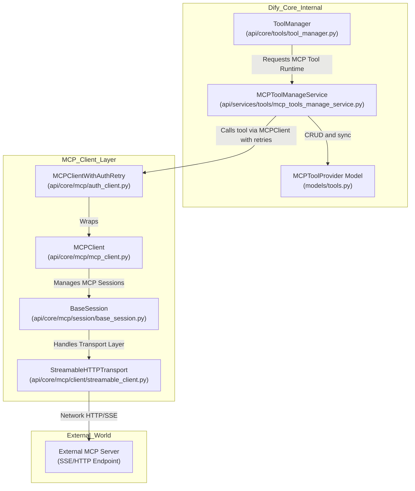
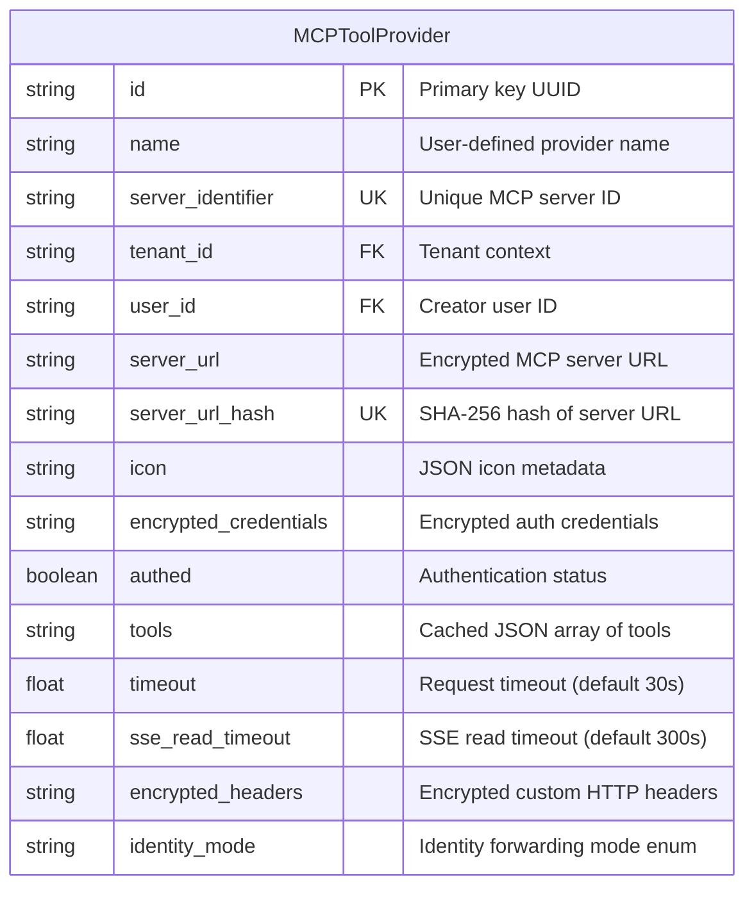
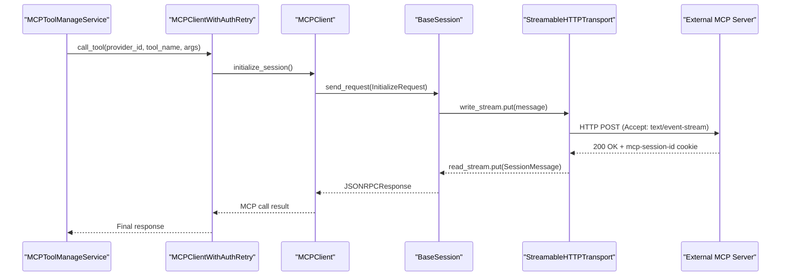

<!-- source: DeepWiki mcp.deepwiki.com · repo langgenius/dify · page 7.3 MCP Protocol Integration · fetched 2026-10-26 -->

# MCP Protocol Integration

<details>
<summary>Relevant source files</summary>

The following files were used as context for generating this wiki page:

- [api/controllers/files/__init__.py](api/controllers/files/__init__.py)
- [api/controllers/mcp/__init__.py](api/controllers/mcp/__init__.py)
- [api/controllers/mcp/mcp.py](api/controllers/mcp/mcp.py)
- [api/controllers/service_api/__init__.py](api/controllers/service_api/__init__.py)
- [api/core/mcp/server/streamable_http.py](api/core/mcp/server/streamable_http.py)
- [api/core/mcp/utils.py](api/core/mcp/utils.py)
- [api/libs/url_utils.py](api/libs/url_utils.py)
- [api/tests/unit_tests/core/datasource/entities/test_datasource_entities.py](api/tests/unit_tests/core/datasource/entities/test_datasource_entities.py)
- [api/tests/unit_tests/core/mcp/client/test_streamable_http.py](api/tests/unit_tests/core/mcp/client/test_streamable_http.py)
- [api/tests/unit_tests/core/mcp/server/__init__.py](api/tests/unit_tests/core/mcp/server/__init__.py)
- [api/tests/unit_tests/core/mcp/server/test_streamable_http.py](api/tests/unit_tests/core/mcp/server/test_streamable_http.py)
- [api/tests/unit_tests/core/mcp/test_utils.py](api/tests/unit_tests/core/mcp/test_utils.py)
- [web/app/components/app/access-point/__tests__/built-in-access-points.spec.tsx](web/app/components/app/access-point/__tests__/built-in-access-points.spec.tsx)
- [web/app/components/app/access-point/__tests__/environment-access-point-cards.spec.tsx](web/app/components/app/access-point/__tests__/environment-access-point-cards.spec.tsx)
- [web/app/components/app/access-point/__tests__/use-access-point-actions.spec.ts](web/app/components/app/access-point/__tests__/use-access-point-actions.spec.ts)
- [web/app/components/app/access-point/__tests__/web-app-card.spec.tsx](web/app/components/app/access-point/__tests__/web-app-card.spec.tsx)
- [web/app/components/app/access-point/built-in-access-points/index.tsx](web/app/components/app/access-point/built-in-access-points/index.tsx)
- [web/app/components/app/access-point/built-in-access-points/web-app-card.tsx](web/app/components/app/access-point/built-in-access-points/web-app-card.tsx)
- [web/app/components/app/access-point/deployed-environment-access-points/environment-web-app-card.tsx](web/app/components/app/access-point/deployed-environment-access-points/environment-web-app-card.tsx)
- [web/app/components/app/access-point/shared/use-access-point-actions.ts](web/app/components/app/access-point/shared/use-access-point-actions.ts)
- [web/app/components/app/overview/settings/__tests__/settings-dialog.browser.spec.tsx](web/app/components/app/overview/settings/__tests__/settings-dialog.browser.spec.tsx)
- [web/app/components/base/app-icon/__tests__/index.spec.tsx](web/app/components/base/app-icon/__tests__/index.spec.tsx)
- [web/app/components/base/app-icon/index.stories.tsx](web/app/components/base/app-icon/index.stories.tsx)
- [web/app/components/base/app-icon/index.tsx](web/app/components/base/app-icon/index.tsx)
- [web/app/components/datasets/create-from-pipeline/list/template-card/details/__tests__/index.spec.tsx](web/app/components/datasets/create-from-pipeline/list/template-card/details/__tests__/index.spec.tsx)
- [web/app/components/datasets/create-from-pipeline/list/template-card/details/index.tsx](web/app/components/datasets/create-from-pipeline/list/template-card/details/index.tsx)
- [web/app/components/datasets/create-from-pipeline/list/template-card/edit-pipeline-info.tsx](web/app/components/datasets/create-from-pipeline/list/template-card/edit-pipeline-info.tsx)
- [web/app/components/datasets/rename-modal/index.tsx](web/app/components/datasets/rename-modal/index.tsx)
- [web/app/components/plugins/card/base/card-icon.tsx](web/app/components/plugins/card/base/card-icon.tsx)
- [web/app/components/tools/mcp/__tests__/modal.spec.tsx](web/app/components/tools/mcp/__tests__/modal.spec.tsx)
- [web/app/components/tools/mcp/modal.tsx](web/app/components/tools/mcp/modal.tsx)
- [web/features/agent-v2/agent-detail/access/components/__tests__/access-surface-cards.spec.tsx](web/features/agent-v2/agent-detail/access/components/__tests__/access-surface-cards.spec.tsx)
- [web/features/agent-v2/agent-detail/access/components/web-app-access-card.tsx](web/features/agent-v2/agent-detail/access/components/web-app-access-card.tsx)

</details>


This document details the Model Context Protocol (MCP) integration in Dify. MCP facilitates dynamic discovery and invocation of external tools exposed by MCP-compliant servers, allowing the Dify agent system to extend its capabilities by integrating with external services seamlessly.

The integration encompasses MCP client implementation, transport communication, server-side handling of MCP requests, and authentication flows required for secure and robust interaction.

For related information on other tool provider types, see [7.1 Tool Provider Types and Architecture]() and for built-in and API tool integration, see [7.2 Built-in and API Tool Integration]().

---

## MCP Protocol Overview

The Model Context Protocol (MCP) is a standardized JSON-RPC-based protocol enabling dynamic tools exposure and invocation over networked servers.

- **External MCP Servers**: Advertise their capabilities as a set of tools via specific REST/SSE endpoints.
- **Dify MCP Client**: Acts as a client to discover, authenticate, and invoke tools remotely.
- **Transport Layer**: Utilizes HTTP with streaming support (SSE) to maintain persistent sessions with MCP servers.
- **Authentication**: Supports API keys, OAuth 2.0, and identity forwarding via special headers.

This protocol allows seamless integration of external model context services into Dify’s tool and agent ecosystem.

Sources: [api/services/tools/mcp_tools_manage_service.py:78-80](), [api/core/mcp/session/base_session.py:13-32]()

---

## System Architecture and Data Flow

The integration involves multiple internal components bridging internal tool management and external MCP servers.

### Conceptual Mapping: Natural Language to Code Entity Space - MCP Integration Mapping 1



This diagram highlights the flow from internal tool management, through the MCP client layers, to the external MCP servers over the network.

Sources:
- [api/core/tools/tool_manager.py:178-199]()
- [api/services/tools/mcp_tools_manage_service.py:78-82]()
- [api/core/mcp/client/streamable_client.py:21-29]()
- [api/core/mcp/session/base_session.py:123-143]()

---

## Database Model Structure for MCP Providers

The `MCPToolProvider` model represents MCP-specific server configurations, including encrypted authentication credentials, cached tool metadata, and server identity parameters.

### MCPToolProvider Table Design



#### Key Implementation Details

- Sensitive fields like server URLs, credentials, and headers are encrypted using tenant-scoped keys via `encrypter.encrypt_token()` to ensure security at rest [api/services/tools/mcp_tools_manage_service.py:152-153]().

- The tools cache JSON stored in `tools` field optimizes runtime access, reducing network calls to the MCP server [api/services/tools/mcp_tools_manage_service.py:33]().

- `identity_mode` supports forwarding of user identity tokens (e.g., SSO) through headers or disables forwarding as per provider configuration [api/services/tools/mcp_tools_manage_service.py:175]().

Sources:
- [api/services/tools/mcp_tools_manage_service.py:141-176]()
- [models/tools.py:1-30]()

---

## MCP Client and Transport Layer

Dify implements a layered MCP client stack to manage protocol communication, persistent session handling, and resilience under authentication failures.

### Communication Lifecycle Diagram



### Layer Responsibilities

- **`MCPClient`**: Handles core JSON-RPC logic with streaming support over HTTP, manages JSON requests, and handles response correlation [api/core/mcp/mcp_client.py:30-50]().

- **`BaseSession`**: Manages JSON-RPC sessions asynchronously, correlating requests/responses and processing incoming streamed messages via receive loops [api/core/mcp/session/base_session.py:138-163]().

- **`StreamableHTTPTransport`**: Provides persistent HTTP connection with Server-Sent Events (SSE) support, managing session affinity via cookies (`mcp-session-id`) [api/core/mcp/client/streamable_client.py:21-29](), [api/core/mcp/client/streamable_client.py:170-176]().

- **`MCPClientWithAuthRetry`**: Decorates `MCPClient` with automatic retry logic to handle OAuth token refresh and other auth failures transparently [api/core/mcp/auth_client.py:19-21]().

Sources:
- [api/core/mcp/client/streamable_client.py:21-29]()
- [api/core/mcp/client/streamable_client.py:170-176]()
- [api/core/mcp/session/base_session.py:123-143]()

---

## MCP Tool Invocation and Output Handling

### Invocation Flow and Output Processing

- `MCPTool` manages invocation by sending parameters to MCP servers and receiving streamed responses via event stream [api/core/tools/mcp_tool/tool.py:68-77]().

- It supports multiple content types including:
  - Text messages or JSON-structured content [api/core/tools/mcp_tool/tool.py:113-127]().

  - Binary blobs (images/audio) decoded from Base64 [api/core/tools/mcp_tool/tool.py:87-90]().

  - Embedded text or binary resource wrappers per MCP protocol spec [api/core/tools/mcp_tool/tool.py:91-102]().

- Newer MCP protocol versions (e.g., "2025-06-18") enable structured output with variable update messages, handled by `MCPTool` to update workflow variable pools dynamically [api/core/tools/mcp_tool/tool.py:107-111]().

### Usage Metadata Extraction

- The MCP protocol embeds usage and cost metadata in `_meta` fields of response messages. `MCPTool` extracts this to a structured `LLMUsage` entity for cost tracking [api/core/tools/mcp_tool/tool.py:155-175]().

### Server-Side MCP Handling in Dify

Dify exposes an MCP server interface to external MCP clients:

- Negotiates protocol versions during initialization in `handle_initialize` [api/core/mcp/server/streamable_http.py:159-177]().

- Serves tool listings extracted from internal app metadata in `handle_list_tools`, supporting structured output per client version [api/core/mcp/server/streamable_http.py:120-130]().

- Processes tool invocation requests in `handle_call_tool` [api/core/mcp/server/streamable_http.py:131-134]().

- Flask RESTx `MCPAppApi` exposes the MCP server REST endpoint [api/controllers/mcp/mcp.py:44-96]().

Sources:
- [api/core/tools/mcp_tool/tool.py:38-109]()
- [api/core/mcp/server/streamable_http.py:60-140]()
- [api/controllers/mcp/mcp.py:44-96]()

---

## Tool Discovery, Provider Management, and Transformation

### Provider Lifecycle Management

- User operations to register MCP providers involve validating server URLs, encrypting credentials and HTTP headers, and persisting records [api/services/tools/mcp_tools_manage_service.py:140-182]().

- Uniqueness is enforced using a SHA-256 hash of the server URL in `server_url_hash` [api/services/tools/mcp_tools_manage_service.py:143-149]().

- Tenant-aware encryption guarantees provider data confidentiality by tenant [api/services/tools/mcp_tools_manage_service.py:152-159]().

### Tool Conversion and Parsing

- MCP-received tool definitions (JSON arrays) are deserialized into Dify internal `ToolApiEntity` objects for consistent UI and runtime interaction.

- This conversion employs Pydantic `TypeAdapter` and detailed schema validation [api/services/tools/tools_transform_service.py:30-66]().

Sources:
- [api/services/tools/mcp_tools_manage_service.py:141-182]()
- [api/services/tools/tools_transform_service.py:34-66]()

---

## Authentication and OAuth Handling

### OAuth 2.0 and Auth Flow

- MCP integration supports OAuth 2.0 PKCE flows, handled by the `auth()` function which manages handshake, token exchange, and redirects [api/core/mcp/auth/auth_flow.py:22-30]().

- OAuth data such as tokens, client info, or code verifiers are encrypted and stored with distinct `OAuthDataType` labels (Tokens, Client Info, Code Verifier, Mixed) [api/services/tools/mcp_tools_manage_service.py:37-43]().

- The retry client layer automatically intercepts 401/403 errors and triggers token refreshes transparent to callers [api/core/mcp/auth_client.py:19-21]().

### Identity Forwarding

- The `identity_mode` enum controls whether Dify forwards user identity tokens (e.g., SSO tokens) as headers (`X-Dify-SSO-Token`) to MCP servers, enabling end-user identity propagation in calls [api/core/tools/mcp_tool/tool.py:35-35]().

Sources:
- [api/controllers/console/workspace/tool_providers.py:42-46]()
- [api/services/tools/mcp_tools_manage_service.py:37-43]()
- [api/core/mcp/auth/auth_flow.py:22-30]()

---

## Security and Multi-Tenancy

- All MCP provider data is strictly scoped by `tenant_id` to maintain strong multi-tenancy isolation [api/services/tools/mcp_tools_manage_service.py:86-115]().

- External MCP HTTP calls route through an SSRF-protected proxy client, preventing unsafe network access [api/core/mcp/utils.py:34-34]().

- Sensitive data fields in API responses replace secrets with placeholders (`[__HIDDEN__]`) to avoid information leakage [api/services/tools/mcp_tools_manage_service.py:31-31]().

- Identity token forwarding through headers is opt-in per-provider to avoid exposing tokens unintentionally [api/core/tools/mcp_tool/tool.py:35-35]().

Sources:
- [api/services/tools/mcp_tools_manage_service.py:31-31]()
- [api/services/tools/mcp_tools_manage_service.py:86-115]()
- [api/core/mcp/utils.py:34-34]()
- [api/core/tools/mcp_tool/tool.py:35-35]()

---

## Frontend Integration

The Dify frontend provides a user interface for managing MCP tool providers. This includes creating, editing, and configuring MCP servers.

### MCP Modal for Configuration

The `MCPModalContent` component [web/app/components/tools/mcp/modal.tsx:71-140]() handles the creation and editing of MCP server configurations.

```mermaid
graph TD
    A[User Interaction] --> B{MCPModalContent<br/>(web/app/components/tools/mcp/modal.tsx)}
    B --> C[Input: Server URL, Name, Identifier, Headers, Auth, Configuration]
    C --> D{Validation<br/>(isValidUrl, isValidServerID)}
    D -- Invalid --> E[Toast Error Message]
    D -- Valid --> F[Format Payload]
    F --> G[onConfirm(payload)]
    G --> H[API Call to Backend]
```

#### Key Frontend Features:

- **Input Fields**: Users can specify the server URL, name, server identifier, custom headers, and authentication details (client ID, client secret) [web/app/components/tools/mcp/modal.tsx:166-174]().
- **Icon Picker**: Allows users to select an icon for the MCP tool, supporting both emoji and image types [web/app/components/tools/mcp/modal.tsx:142-144]().
- **Dynamic Registration**: A toggle for `is_dynamic_registration` indicates if the tool provider supports dynamic registration [web/app/components/tools/mcp/modal.tsx:126]().
- **Identity Forwarding**: A switch for `forwardUserIdentity` controls whether user identity tokens are forwarded, gated by SSO enforcement and protocol capabilities (OIDC or OAuth2) [web/app/components/tools/mcp/modal.tsx:84-87](), [web/app/components/tools/mcp/modal.tsx:137]().
- **Configuration Options**: Users can set `timeout` and `sse_read_timeout` for the MCP client [web/app/components/tools/mcp/modal.tsx:132-133]().
- **Validation**: Input fields are validated for correct format (e.g., valid URL, valid server ID) before submission [web/app/components/tools/mcp/modal.tsx:102-109]().
- **Error Handling**: Displays toast messages for invalid inputs or failed API calls [web/app/components/tools/mcp/modal.tsx:103-108]().

Sources:
- [web/app/components/tools/mcp/modal.tsx:71-140]()
- [web/app/components/tools/mcp/modal.tsx:166-174]()
- [web/app/components/tools/mcp/modal.tsx:142-144]()
- [web/app/components/tools/mcp/modal.tsx:126]()
- [web/app/components/tools/mcp/modal.tsx:84-87]()
- [web/app/components/tools/mcp/modal.tsx:137]()
- [web/app/components/tools/mcp/modal.tsx:132-133]()
- [web/app/components/tools/mcp/modal.tsx:102-109]()
- [web/app/components/tools/mcp/modal.tsx:103-108]()

---

## Summary

The MCP Protocol integration in Dify provides a robust framework for dynamically integrating external model context servers exposing tools. The stack includes:

- Secure, encrypted persistence of MCP provider configuration and credentials.
- A multi-layer MCP client architecture supporting streaming, JSON-RPC, and automatic auth retries.
- Protocol version negotiation and advanced structured output handling.
- Seamless incorporation of external MCP tools into Dify’s tool runtime.
- MCP server endpoint exposing Dify’s workflows and chat apps as MCP tools.
- Comprehensive OAuth and identity forwarding support.
- Strict multi-tenant isolation with SSRF-safe network access.

This architecture abstracts MCP protocol details away from UI and agent logic while empowering full extensibility of the agent ecosystem via external MCP servers.

---

## Additional Diagram: From Natural Language to Code Entities - MCP Integration Mapping 2

```mermaid
graph LR
    direction LR

    subgraph Dify_CoreSystem["Dify Core System"]
        ToolManager["ToolManager (tool_manager.py)"]
        MCPManageService["MCPToolManageService (mcp_tools_manage_service.py)"]
        ToolTransform["ToolTransformService (tools_transform_service.py)"]
        MCPTool["MCPTool (mcp_tool/tool.py)"]
    end

    subgraph MCPClientLayer["MCP Client Layer"]
        AuthClient["MCPClientWithAuthRetry (auth_client.py)"]
        MCPClientBase["MCPClient (mcp_client.py)"]
        BaseSessionLayer["BaseSession (base_session.py)"]
        StreamTransport["StreamableHTTPTransport (streamable_client.py)"]
    end

    subgraph MCPExternal["External MCP Server"]
        MCPServer["MCP Server HTTP/SSE Endpoint"]
    end

    ToolManager -.-> MCPManageService
    MCPManageService -.-> ToolTransform
    MCPManageService --> AuthClient
    AuthClient --> MCPClientBase
    MCPClientBase --> BaseSessionLayer
    BaseSessionLayer --> StreamTransport
    StreamTransport --> MCPServer

    MCPTool --> AuthClient

    ToolTransform -.-> MCPTool
```



Sources:
- [api/core/tools/tool_manager.py:94-192]()
- [api/services/tools/mcp_tools_manage_service.py:78-82]()
- [api/services/tools/tools_transform_service.py:30-90]()
- [api/core/tools/mcp_tool/tool.py:38-114]()
- [api/core/mcp/client/streamable_client.py:21-29]()
- [api/core/mcp/session/base_session.py:120-170]()

---

