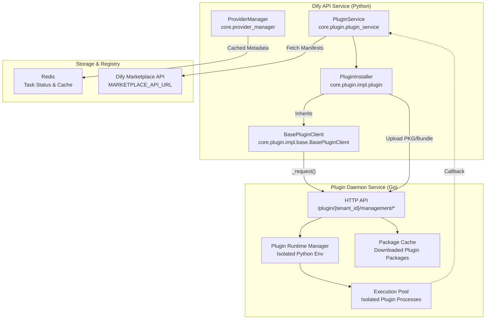
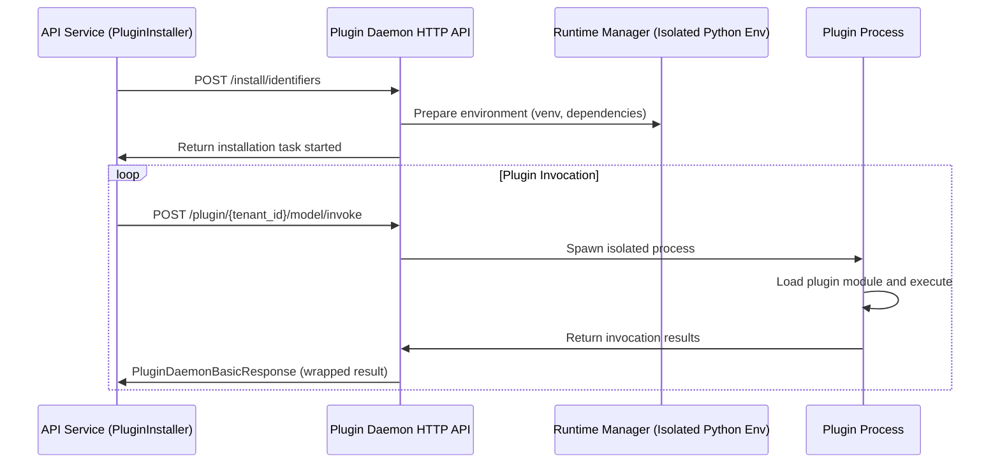
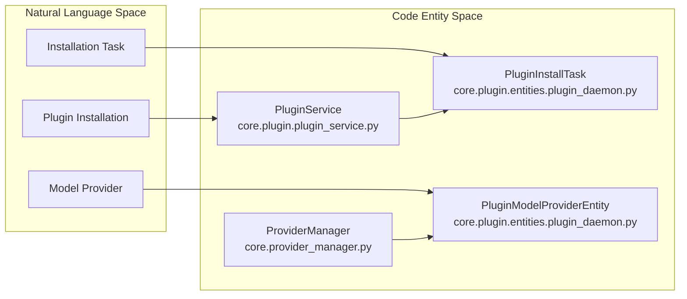
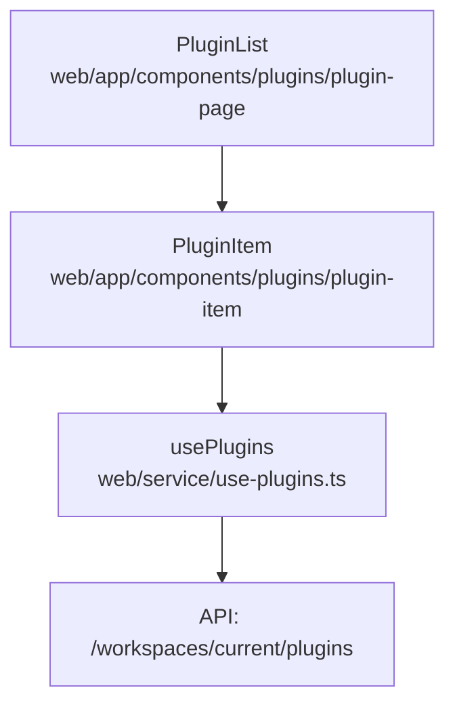

<!-- source: DeepWiki mcp.deepwiki.com · repo langgenius/dify · page 7.4 Plugin Daemon and Execution Environment · fetched 2026-10-26 -->

# Plugin Daemon and Execution Environment

<details>
<summary>Relevant source files</summary>

The following files were used as context for generating this wiki page:

- [api/configs/extra/__init__.py](api/configs/extra/__init__.py)
- [api/configs/extra/logstore_config.py](api/configs/extra/logstore_config.py)
- [api/controllers/inner_api/plugin/wraps.py](api/controllers/inner_api/plugin/wraps.py)
- [api/controllers/inner_api/wraps.py](api/controllers/inner_api/wraps.py)
- [api/core/plugin/endpoint/exc.py](api/core/plugin/endpoint/exc.py)
- [api/core/plugin/impl/base.py](api/core/plugin/impl/base.py)
- [api/core/plugin/impl/endpoint.py](api/core/plugin/impl/endpoint.py)
- [api/core/plugin/impl/exc.py](api/core/plugin/impl/exc.py)
- [api/core/plugin/impl/model.py](api/core/plugin/impl/model.py)
- [api/core/plugin/impl/model_runtime.py](api/core/plugin/impl/model_runtime.py)
- [api/core/plugin/plugin_service.py](api/core/plugin/plugin_service.py)
- [api/core/rag/extractor/firecrawl/firecrawl_app.py](api/core/rag/extractor/firecrawl/firecrawl_app.py)
- [api/core/rag/extractor/watercrawl/client.py](api/core/rag/extractor/watercrawl/client.py)
- [api/core/rag/extractor/watercrawl/exceptions.py](api/core/rag/extractor/watercrawl/exceptions.py)
- [api/core/rag/retrieval/output_parser/structured_chat.py](api/core/rag/retrieval/output_parser/structured_chat.py)
- [api/core/workflow/node_factory.py](api/core/workflow/node_factory.py)
- [api/core/workflow/node_runtime.py](api/core/workflow/node_runtime.py)
- [api/libs/oauth.py](api/libs/oauth.py)
- [api/repositories/saved_message_repository.py](api/repositories/saved_message_repository.py)
- [api/services/data_source/auth/firecrawl/firecrawl.py](api/services/data_source/auth/firecrawl/firecrawl.py)
- [api/services/data_source/auth/watercrawl/watercrawl.py](api/services/data_source/auth/watercrawl/watercrawl.py)
- [api/services/human_input_delivery_test_service.py](api/services/human_input_delivery_test_service.py)
- [api/services/plugin/dependencies_analysis.py](api/services/plugin/dependencies_analysis.py)
- [api/services/plugin/plugin_migration.py](api/services/plugin/plugin_migration.py)
- [api/services/rag_pipeline/rag_pipeline_transform_service.py](api/services/rag_pipeline/rag_pipeline_transform_service.py)
- [api/services/saved_message_service.py](api/services/saved_message_service.py)
- [api/tests/test_containers_integration_tests/services/auth/__init__.py](api/tests/test_containers_integration_tests/services/auth/__init__.py)
- [api/tests/test_containers_integration_tests/services/auth/test_auth_integration.py](api/tests/test_containers_integration_tests/services/auth/test_auth_integration.py)
- [api/tests/unit_tests/configs/test_logstore_config.py](api/tests/unit_tests/configs/test_logstore_config.py)
- [api/tests/unit_tests/controllers/inner_api/plugin/test_plugin_wraps.py](api/tests/unit_tests/controllers/inner_api/plugin/test_plugin_wraps.py)
- [api/tests/unit_tests/controllers/inner_api/test_auth_wraps.py](api/tests/unit_tests/controllers/inner_api/test_auth_wraps.py)
- [api/tests/unit_tests/controllers/service_api/conftest.py](api/tests/unit_tests/controllers/service_api/conftest.py)
- [api/tests/unit_tests/controllers/service_api/test_conftest.py](api/tests/unit_tests/controllers/service_api/test_conftest.py)
- [api/tests/unit_tests/controllers/service_api/test_trace_session_id_parsing.py](api/tests/unit_tests/controllers/service_api/test_trace_session_id_parsing.py)
- [api/tests/unit_tests/controllers/service_api/test_wraps.py](api/tests/unit_tests/controllers/service_api/test_wraps.py)
- [api/tests/unit_tests/controllers/web/test_message_endpoints.py](api/tests/unit_tests/controllers/web/test_message_endpoints.py)
- [api/tests/unit_tests/controllers/web/test_message_list.py](api/tests/unit_tests/controllers/web/test_message_list.py)
- [api/tests/unit_tests/controllers/web/test_saved_message.py](api/tests/unit_tests/controllers/web/test_saved_message.py)
- [api/tests/unit_tests/controllers/web/test_workflow.py](api/tests/unit_tests/controllers/web/test_workflow.py)
- [api/tests/unit_tests/core/plugin/impl/test_base_client_impl.py](api/tests/unit_tests/core/plugin/impl/test_base_client_impl.py)
- [api/tests/unit_tests/core/plugin/impl/test_endpoint_client_impl.py](api/tests/unit_tests/core/plugin/impl/test_endpoint_client_impl.py)
- [api/tests/unit_tests/core/plugin/test_endpoint_client.py](api/tests/unit_tests/core/plugin/test_endpoint_client.py)
- [api/tests/unit_tests/core/plugin/test_model_runtime_adapter.py](api/tests/unit_tests/core/plugin/test_model_runtime_adapter.py)
- [api/tests/unit_tests/core/plugin/test_plugin_runtime.py](api/tests/unit_tests/core/plugin/test_plugin_runtime.py)
- [api/tests/unit_tests/core/rag/extractor/firecrawl/test_firecrawl.py](api/tests/unit_tests/core/rag/extractor/firecrawl/test_firecrawl.py)
- [api/tests/unit_tests/core/rag/extractor/test_crawler_ssrf.py](api/tests/unit_tests/core/rag/extractor/test_crawler_ssrf.py)
- [api/tests/unit_tests/core/rag/extractor/watercrawl/test_watercrawl.py](api/tests/unit_tests/core/rag/extractor/watercrawl/test_watercrawl.py)
- [api/tests/unit_tests/core/workflow/nodes/tool/test_tool_node_runtime.py](api/tests/unit_tests/core/workflow/nodes/tool/test_tool_node_runtime.py)
- [api/tests/unit_tests/core/workflow/test_node_factory.py](api/tests/unit_tests/core/workflow/test_node_factory.py)
- [api/tests/unit_tests/core/workflow/test_node_runtime.py](api/tests/unit_tests/core/workflow/test_node_runtime.py)
- [api/tests/unit_tests/extensions/logstore/repositories/test_logstore_workflow_execution_repository.py](api/tests/unit_tests/extensions/logstore/repositories/test_logstore_workflow_execution_repository.py)
- [api/tests/unit_tests/libs/test_external_api.py](api/tests/unit_tests/libs/test_external_api.py)
- [api/tests/unit_tests/libs/test_oauth_base.py](api/tests/unit_tests/libs/test_oauth_base.py)
- [api/tests/unit_tests/libs/test_oauth_clients.py](api/tests/unit_tests/libs/test_oauth_clients.py)
- [api/tests/unit_tests/services/auth/test_firecrawl_auth.py](api/tests/unit_tests/services/auth/test_firecrawl_auth.py)
- [api/tests/unit_tests/services/auth/test_jina_auth.py](api/tests/unit_tests/services/auth/test_jina_auth.py)
- [api/tests/unit_tests/services/auth/test_watercrawl_auth.py](api/tests/unit_tests/services/auth/test_watercrawl_auth.py)
- [api/tests/unit_tests/services/plugin/__init__.py](api/tests/unit_tests/services/plugin/__init__.py)
- [api/tests/unit_tests/services/plugin/conftest.py](api/tests/unit_tests/services/plugin/conftest.py)
- [api/tests/unit_tests/services/plugin/test_dependencies_analysis.py](api/tests/unit_tests/services/plugin/test_dependencies_analysis.py)
- [api/tests/unit_tests/services/plugin/test_endpoint_service.py](api/tests/unit_tests/services/plugin/test_endpoint_service.py)
- [api/tests/unit_tests/services/plugin/test_oauth_service.py](api/tests/unit_tests/services/plugin/test_oauth_service.py)
- [api/tests/unit_tests/services/plugin/test_plugin_migration.py](api/tests/unit_tests/services/plugin/test_plugin_migration.py)
- [api/tests/unit_tests/services/plugin/test_plugin_service.py](api/tests/unit_tests/services/plugin/test_plugin_service.py)
- [api/tests/unit_tests/services/plugin/test_plugin_service_installation.py](api/tests/unit_tests/services/plugin/test_plugin_service_installation.py)
- [api/tests/unit_tests/services/rag_pipeline/test_rag_pipeline_transform_service.py](api/tests/unit_tests/services/rag_pipeline/test_rag_pipeline_transform_service.py)
- [api/tests/unit_tests/services/test_human_input_delivery_test_service.py](api/tests/unit_tests/services/test_human_input_delivery_test_service.py)
- [web/app/components/plugins/plugin-detail-panel/__tests__/endpoint-list.spec.tsx](web/app/components/plugins/plugin-detail-panel/__tests__/endpoint-list.spec.tsx)

</details>


This page describes the plugin daemon service and execution environment that enables secure, isolated execution of third-party plugins in Dify. For detailed information about specific plugin types (tools, model providers), see [Tool Provider Types and Architecture](7.1). For built-in tools that do not require the plugin daemon, refer to [Built-in and API Tool Integration](7.2).

---

## Purpose and Scope

The Plugin Daemon serves as an independent service responsible for managing the lifecycle and execution of third-party plugins in Dify. It primarily provides:

- **Security Isolation**: Plugins are executed in separated processes and isolated environments to maintain platform security.
- **Resource Management**: Enforces CPU, memory, disk size, and execution time limits per plugin.
- **Plugin Package Management**: Handles installation, caching, upload, and versioning of plugin packages.
- **Marketplace Integration**: Supports discovery, download, and installation of plugins from the Dify Marketplace.
- **Multi-language Support**: Currently handles Python runtime environments for plugins, with sandbox constraints.

---

## System Architecture

The plugin daemon operates as an autonomous service communicating over HTTP with the main Dify API backend. It manages plugin execution environments, package storage, and plugin lifecycle actions.

### Component Diagram



**Notes**: 
- The `PluginService` in the API orchestrates plugin metadata and installation workflows.
- The `PluginInstaller` implements communication via the `BasePluginClient` to the daemon HTTP API.
- `ProviderManager` integrates with `PluginService` to discover and cache plugin-provided model providers.
- Redis caches task status and plugin metadata for efficiency, including compressed zstd payloads for large metadata sets.

**Sources**: `[api/core/plugin/plugin_service.py:91-115]()`, `[api/core/plugin/plugin_service.py:102-109]()`, `[api/core/provider_manager.py:79-85]()`

---

## Execution Environment

Plugin runtime environments are isolated Python environments managed by the plugin daemon. Each plugin declares required resources and permissions via `PluginResourceRequirements`.

### Plugin Resource Requirements

Plugins specify attributes including:

| Resource Attribute               | Description                                | Default / Constraints        |
|---------------------------------|--------------------------------------------|------------------------------|
| `memory_size_mb`                | Memory limit in MB for plugin runtime     | Optional integer             |
| `max_execution_time_seconds`    | Max execution time per invocation          | Optional integer             |
| `permission.tool.enabled`       | Whether tool access is allowed              | Default `False`              |
| `permission.model.enabled`      | Whether model invocation is allowed         | Default `False`              |
| `permission.node.enabled`       | Node execution permission                    | Default `False`              |
| `permission.endpoint.enabled`   | If plugin can host HTTP endpoints           | Default `False`              |
| `permission.storage.size`       | Storage quota in bytes for plugin           | Default 1,048,576 (1MB)      |

These permissions enforce fine-grained control over plugin capabilities and help maintain security isolation.

**Sources**: `[api/core/plugin/entities/plugin.py:25-60]()`

### Execution Flow

The typical lifecycle and execution flow for plugin installation and invocation is as follows:



- On installation, the plugin daemon prepares isolated Python virtual environments per plugin where dependencies are preinstalled.
- Plugin model invocation requests are forwarded via the daemon HTTP API.
- The daemon spawns plugin processes isolated from each other and the host, executes the plugin code, and returns results wrapped in standard response entities.

**Sources**: `[api/core/plugin/impl/plugin.py:100-140]()`, `[api/core/plugin/entities/plugin_daemon.py:23-30]()`

---

## Plugin Installation and Lifecycle

### Plugin Installation Sources

Plugins can be installed from multiple sources, defined by `PluginInstallationSource` enum:

- **marketplace**: Official Dify marketplace plugins.
- **github**: Directly from GitHub repositories.
- **package**: Local `.dify` package uploads.
- **remote**: Plugin debugging or remote source for development.

**Sources**: `[api/core/plugin/entities/plugin.py:17-28]()`, `[web/app/components/plugins/types.ts:17-22]()`

### Plugin Model Provider Discovery and Caching

- Installed plugins that provide model providers are reflected as `PluginModelProviderEntity` instances.
- Plugin model provider metadata is cached tenant-scoped in Redis using keys like `plugin_model_providers:tenant_id:{tenant_id}`.
- Metadata payloads exceeding 64KB are compressed with `zstandard` to optimize storage and network transfer.
- A Redis-based distributed lock key (`plugin_model_providers_refresh_lock`) serializes concurrent cache refresh operations within the tenant.

**Sources**: `[api/core/plugin/plugin_service.py:102-110]()`, `[api/core/plugin/plugin_service.py:128-130]()`, `[api/core/provider_manager.py:79-85]()`

---

## Data Models and Entities

### Plugin Manifest (`manifest.json`)

Plugins are described by `PluginDeclaration` entities that map to the `manifest.json` on their package root. Key aspects include:

| Field                     | Description                                                           |
|---------------------------|-----------------------------------------------------------------------|
| `name`                    | Internal plugin name (1-128 chars, lowercase letters, digits, -, _)   |
| `category`                | Plugin category enum (`tool`, `model`, `extension`, `agent`, etc.)   |
| `resource`                | `PluginResourceRequirements` including memory, permissions, limits   |
| `verified`                | Boolean signifying if plugin is verified by LangGenius               |
| `endpoint`                | Configuration for plugins acting as HTTP endpoint hosts               |

**Sources**: `[api/core/plugin/entities/plugin.py:38-60]()`, `[web/app/components/plugins/types.ts:68-90]()`

### Bridging Natural Language Concepts to Core Code Entities



- The **PluginService** manages installation lifecycles and caches.
- **PluginInstallTask** tracks asynchronous install progress and status.
- **PluginModelProviderEntity** encapsulates plugin model provider metadata.
- **ProviderManager** manages tenant-wide provider metadata, including plugin providers.

**Sources**: `[api/core/plugin/plugin_service.py:91-115]()`, `[api/core/plugin/entities/plugin_daemon.py:182-187]()`, `[api/core/provider_manager.py:106-126]()`

---

## Marketplace and UI Integration

Frontend interaction with plugins is handled through React hooks such as `usePlugins`, along with API endpoints under `/workspaces/current/plugins`.

### Key Frontend Entities

- **PluginCategoryEnum**: Categorizes plugins into types like `tool`, `model`, `extension`, etc.
- **PluginDetail**: The comprehensive data structure representing detailed plugin metadata used in UI.
- **PluginTask**: Represents plugin installation tasks used for displaying progress bars and statuses.



**Sources**: `[web/app/components/plugins/types.ts:8-15]()`, `[web/app/components/plugins/types.ts:205-225]()`, `[web/service/use-plugins.ts:60-62]()`

---

## Security and Isolation

- The plugin daemon enforces isolated execution, running each plugin in a distinct Python virtual environment and process.
- Plugin permissions for tools, models, runtime node execution, endpoint hosting, and storage size quotas are strictly enforced.
- Credentials such as API keys are encrypted and masked in all plugin configuration and API interfaces using `encrypter.obfuscated_token`.
- Load balancing and credential scoping prevent cross-tenant or cross-plugin data leakage.

**Sources**: `[api/core/entities/provider_configuration.py:180-205]()`, `[api/services/model_load_balancing_service.py:138-154]()`

---

## Plugin Migration

The `PluginMigration` service handles the migration of existing models and tools to the new plugin mechanism. This involves extracting installed plugin IDs for each tenant and recording them.

The `extract_plugins` method iterates through tenants, identifies installed plugins, and writes this information to a file. This process is parallelized using a `ThreadPoolExecutor` to handle multiple tenants concurrently.

```python
# api/services/plugin/plugin_migration.py
class PluginMigration:
    @classmethod
    def extract_plugins(cls, filepath: str, workers: int):
        """
        Migrate plugin.
        """
        # ... (initialization and setup) ...

        def process_tenant(flask_app: Flask, tenant_id: str):
            with flask_app.app_context():
                # ... (plugin extraction logic) ...
                plugins = cls.extract_installed_plugin_ids(tenant_id)
                # ... (write to file with lock) ...

        # ... (batch processing and thread pool submission) ...
```

**Sources**: `[api/services/plugin/plugin_migration.py:58-107]()`

---

## Summary of Key Classes and Functions

| Class / Function             | Location | Role                                                                                       |
|-----------------------------|----------|--------------------------------------------------------------------------------------------|
| `PluginService`             | `api/core/plugin/plugin_service.py` | Orchestrates plugin lifecycle, caching, and daemon communication.                         |
| `ProviderManager`           | `api/core/provider_manager.py`        | Manages model provider configurations, including those contributed by plugins.           |
| `PluginInstallTask`         | `api/core/plugin/entities/plugin_daemon.py` | Represents asynchronous plugin installation task status and metadata.                    |
| `BasePluginClient`          | `api/core/plugin/impl/base.py`        | Low-level HTTP client communicating with the Go plugin daemon.                           |
| `PluginMigration`           | `api/services/plugin/plugin_migration.py` | Handles migration of existing models/tools to the new plugin mechanism.                  |
| `usePlugins`                | `web/service/use-plugins.ts`           | React hook managing plugin state and operations in the frontend UI.                      |

**Sources**: `[api/core/plugin/plugin_service.py:91]()`, `[api/core/provider_manager.py:106]()`, `[api/core/plugin/entities/plugin_daemon.py:182]()`, `[api/services/plugin/plugin_migration.py:58]()`, `[web/service/use-plugins.ts:40]()`

---

This detailed overview covers the plugin daemon service architecture, execution environment, lifecycle management, security considerations, and marketplace & UI integration. Engineers can trace key data flows and code entities for extending, debugging, or integrating third-party plugins within Dify.

---

