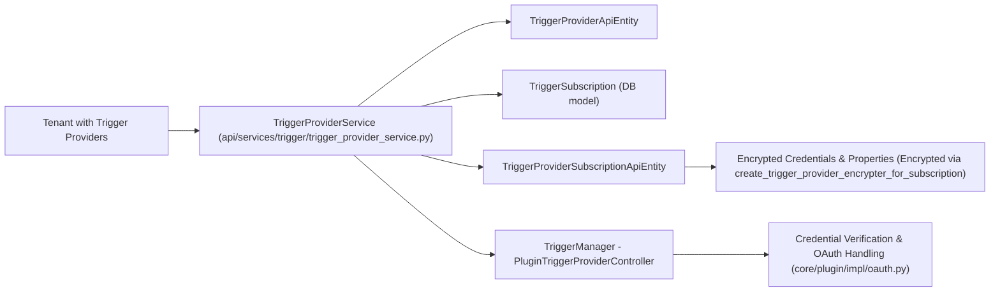
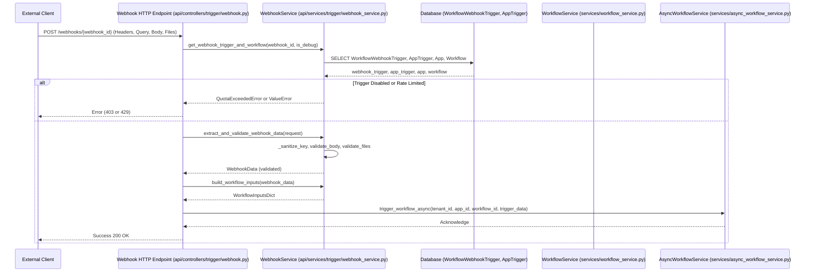

<!-- source: DeepWiki mcp.deepwiki.com · repo langgenius/dify · page 7.5 Trigger Providers, Subscriptions and Webhooks · fetched 2026-10-26 -->

# Trigger Providers, Subscriptions and Webhooks

Relevant source files

The following files were used as context for generating this wiki page:

- [api/controllers/console/app/workflow_trigger.py](api/controllers/console/app/workflow_trigger.py)
- [api/controllers/console/auth/data_source_oauth.py](api/controllers/console/auth/data_source_oauth.py)
- [api/controllers/console/datasets/hit_testing.py](api/controllers/console/datasets/hit_testing.py)
- [api/controllers/console/extension.py](api/controllers/console/extension.py)
- [api/controllers/console/workspace/trigger_providers.py](api/controllers/console/workspace/trigger_providers.py)
- [api/controllers/service_api/app/conversation.py](api/controllers/service_api/app/conversation.py)
- [api/controllers/trigger/webhook.py](api/controllers/trigger/webhook.py)
- [api/core/app/app_config/workflow_ui_based_app/variables/manager.py](api/core/app/app_config/workflow_ui_based_app/variables/manager.py)
- [api/providers/trace/trace-tencent/tests/unit_tests/tencent_trace/test_client.py](api/providers/trace/trace-tencent/tests/unit_tests/tencent_trace/test_client.py)
- [api/repositories/api_based_extension_repository.py](api/repositories/api_based_extension_repository.py)
- [api/services/api_based_extension_adapters.py](api/services/api_based_extension_adapters.py)
- [api/services/api_based_extension_application_service.py](api/services/api_based_extension_application_service.py)
- [api/services/conversation_service.py](api/services/conversation_service.py)
- [api/services/legacy_model_type_migration.py](api/services/legacy_model_type_migration.py)
- [api/services/trigger/webhook_service.py](api/services/trigger/webhook_service.py)
- [api/services/workflow_draft_variable_service.py](api/services/workflow_draft_variable_service.py)
- [api/tasks/trigger_processing_tasks.py](api/tasks/trigger_processing_tasks.py)
- [api/tasks/workflow_schedule_tasks.py](api/tasks/workflow_schedule_tasks.py)
- [api/tests/test_containers_integration_tests/controllers/console/app/test_app_apis.py](api/tests/test_containers_integration_tests/controllers/console/app/test_app_apis.py)
- [api/tests/test_containers_integration_tests/controllers/console/test_api_based_extension.py](api/tests/test_containers_integration_tests/controllers/console/test_api_based_extension.py)
- [api/tests/test_containers_integration_tests/services/test_conversation_service.py](api/tests/test_containers_integration_tests/services/test_conversation_service.py)
- [api/tests/test_containers_integration_tests/services/test_conversation_service_variables.py](api/tests/test_containers_integration_tests/services/test_conversation_service_variables.py)
- [api/tests/test_containers_integration_tests/services/test_metadata_partial_update.py](api/tests/test_containers_integration_tests/services/test_metadata_partial_update.py)
- [api/tests/test_containers_integration_tests/services/test_metadata_service.py](api/tests/test_containers_integration_tests/services/test_metadata_service.py)
- [api/tests/test_containers_integration_tests/services/test_webhook_service.py](api/tests/test_containers_integration_tests/services/test_webhook_service.py)
- [api/tests/test_containers_integration_tests/services/test_webhook_service_relationships.py](api/tests/test_containers_integration_tests/services/test_webhook_service_relationships.py)
- [api/tests/unit_tests/controllers/console/app/test_annotation_security.py](api/tests/unit_tests/controllers/console/app/test_annotation_security.py)
- [api/tests/unit_tests/controllers/console/app/test_workflow_trigger_api.py](api/tests/unit_tests/controllers/console/app/test_workflow_trigger_api.py)
- [api/tests/unit_tests/controllers/console/test_extension.py](api/tests/unit_tests/controllers/console/test_extension.py)
- [api/tests/unit_tests/controllers/trigger/test_webhook.py](api/tests/unit_tests/controllers/trigger/test_webhook.py)
- [api/tests/unit_tests/core/app/app_config/common/test_parameters_mapping.py](api/tests/unit_tests/core/app/app_config/common/test_parameters_mapping.py)
- [api/tests/unit_tests/core/app/app_config/workflow_ui_based_app/test_workflow_ui_based_app_manager.py](api/tests/unit_tests/core/app/app_config/workflow_ui_based_app/test_workflow_ui_based_app_manager.py)
- [api/tests/unit_tests/core/tools/utils/test_tool_engine_serialization.py](api/tests/unit_tests/core/tools/utils/test_tool_engine_serialization.py)
- [api/tests/unit_tests/core/trigger/__init__.py](api/tests/unit_tests/core/trigger/__init__.py)
- [api/tests/unit_tests/core/trigger/debug/__init__.py](api/tests/unit_tests/core/trigger/debug/__init__.py)
- [api/tests/unit_tests/core/trigger/debug/test_debug_event_bus.py](api/tests/unit_tests/core/trigger/debug/test_debug_event_bus.py)
- [api/tests/unit_tests/core/trigger/debug/test_debug_event_selectors.py](api/tests/unit_tests/core/trigger/debug/test_debug_event_selectors.py)
- [api/tests/unit_tests/core/trigger/test_provider.py](api/tests/unit_tests/core/trigger/test_provider.py)
- [api/tests/unit_tests/core/trigger/utils/__init__.py](api/tests/unit_tests/core/trigger/utils/__init__.py)
- [api/tests/unit_tests/core/trigger/utils/test_utils_encryption.py](api/tests/unit_tests/core/trigger/utils/test_utils_encryption.py)
- [api/tests/unit_tests/core/trigger/utils/test_utils_endpoint.py](api/tests/unit_tests/core/trigger/utils/test_utils_endpoint.py)
- [api/tests/unit_tests/core/trigger/utils/test_utils_locks.py](api/tests/unit_tests/core/trigger/utils/test_utils_locks.py)
- [api/tests/unit_tests/extensions/otel/decorators/test_base.py](api/tests/unit_tests/extensions/otel/decorators/test_base.py)
- [api/tests/unit_tests/extensions/otel/decorators/test_handler.py](api/tests/unit_tests/extensions/otel/decorators/test_handler.py)
- [api/tests/unit_tests/services/test_app_model_config_service.py](api/tests/unit_tests/services/test_app_model_config_service.py)
- [api/tests/unit_tests/services/test_archive_workflow_run_logs.py](api/tests/unit_tests/services/test_archive_workflow_run_logs.py)
- [api/tests/unit_tests/services/test_code_based_extension_service.py](api/tests/unit_tests/services/test_code_based_extension_service.py)
- [api/tests/unit_tests/services/test_conversation_service.py](api/tests/unit_tests/services/test_conversation_service.py)
- [api/tests/unit_tests/services/test_dataset_service_lock_not_owned.py](api/tests/unit_tests/services/test_dataset_service_lock_not_owned.py)
- [api/tests/unit_tests/services/test_document_indexing_task_proxy.py](api/tests/unit_tests/services/test_document_indexing_task_proxy.py)
- [api/tests/unit_tests/services/test_duplicate_document_indexing_task_proxy.py](api/tests/unit_tests/services/test_duplicate_document_indexing_task_proxy.py)
- [api/tests/unit_tests/services/test_feature_service_human_input_email_delivery.py](api/tests/unit_tests/services/test_feature_service_human_input_email_delivery.py)
- [api/tests/unit_tests/services/test_feature_service_vector_space.py](api/tests/unit_tests/services/test_feature_service_vector_space.py)
- [api/tests/unit_tests/services/test_metadata_bug_complete.py](api/tests/unit_tests/services/test_metadata_bug_complete.py)
- [api/tests/unit_tests/services/test_metadata_nullable_bug.py](api/tests/unit_tests/services/test_metadata_nullable_bug.py)
- [api/tests/unit_tests/services/test_model_load_balancing_service.py](api/tests/unit_tests/services/test_model_load_balancing_service.py)
- [api/tests/unit_tests/services/test_model_provider_service_sanitization.py](api/tests/unit_tests/services/test_model_provider_service_sanitization.py)
- [api/tests/unit_tests/services/test_webhook_service.py](api/tests/unit_tests/services/test_webhook_service.py)
- [api/tests/unit_tests/services/test_webhook_service_additional.py](api/tests/unit_tests/services/test_webhook_service_additional.py)
- [api/tests/unit_tests/services/workflow/test_draft_var_loader_simple.py](api/tests/unit_tests/services/workflow/test_draft_var_loader_simple.py)
- [api/tests/unit_tests/services/workflow/test_workflow_draft_variable_service.py](api/tests/unit_tests/services/workflow/test_workflow_draft_variable_service.py)
- [api/tests/unit_tests/tasks/test_trigger_processing_tasks.py](api/tests/unit_tests/tasks/test_trigger_processing_tasks.py)

This page details the implementation and design of trigger providers, their subscriptions, OAuth credential handling, webhook endpoints, scheduled triggers, and workflow trigger logs in Dify. It focuses on the backend services `TriggerProviderService` and `TriggerSubscriptionBuilderService`, how OAuth credentials are managed, the webhook request processing flow within workflows, and logging related to triggers.

---

## Overview and Purpose

In Dify, triggers serve to invoke workflows or actions based on external or internal events. Trigger **providers** represent integrations or plugins that can define trigger types (e.g., webhook triggers, API-based triggers). Each tenant can configure **subscriptions** to these trigger providers, supplying parameters and credentials needed for activation.

**Webhooks** form a primary trigger mechanism, exposing endpoints that external services can call to activate Dify workflows. The system manages OAuth credentials for trigger providers, supports scheduled triggers, and keeps logs of trigger handling for debugging and auditing.

Sources:
- `api/services/trigger/webhook_service.py:1-1016`()

---

## Components and Data Flow

The trigger subsystem connects multiple components:

- **Trigger Providers**: Represent external or plugin-defined trigger types.
- **Trigger Subscriptions**: Tenant-specific bindings to a trigger provider with credentials and configuration.
- **OAuth Credentials**: Managed via services and encrypted storage to authenticate external integrations.
- **Webhook Endpoints**: HTTP endpoints validating, extracting, and converting webhook calls into workflow trigger events.
- **Scheduled Triggers**: Trigger executions driven by periodic schedules managed by background tasks.
- **Trigger Logs**: Records of trigger invocation attempts for observability and troubleshooting.

These components interact through dedicated services (`TriggerProviderService`, `TriggerSubscriptionBuilderService`, `WebhookService`), database models, and Celery workers for asynchronous background processing.

Sources:
- `api/services/trigger/webhook_service.py:1-1016`()
- `api/controllers/console/workspace/trigger_providers.py:1-860`()

---

## TriggerProviderService: Managing Providers and Subscriptions

Implemented in `api/services/trigger/trigger_provider_service.py`, the `TriggerProviderService` class encapsulates core logic around trigger providers and subscriptions.

### Key Responsibilities

- **List and retrieve trigger providers** available in a tenant's context.
- **List all subscriptions** filtered by visibility and user permissions.
- **Add or update subscriptions** with encrypted credentials and properties.
- **Manage OAuth clients and credential verification**.
- **Delete trigger provider subscriptions** safely including cache invalidation.
- **Get subscription details for triggering workflows**, resolving the linked workflow node/task.

### Important Methods

- `get_trigger_provider(tenant_id, provider)`:
  Returns a trigger provider's API entity representation for a given tenant and provider identifier. [api/controllers/console/workspace/trigger_providers.py:186-188]()

- `list_trigger_provider_subscriptions(tenant_id, provider_id, user)`:
  Returns all trigger subscriptions for a tenant and provider, consistent with user visibility permissions. Credentials and properties are decrypted but masked for safe display.

- `add_trigger_subscription(...)`:
  Adds a new subscription or updates existing ones with parameters, properties, credentials, and expiration metadata. Encryption is applied to sensitive data fields before storage.

- `get_credentials_for_subscription(subscription_id)`:
  Decrypts credentials for a given subscription to be used by trigger execution components.

- `delete_trigger_subscription(subscription_id)`:
  Removes a subscription and clears any related cache entries used for quick access or validation.

### OAuth Handling

- Methods for managing OAuth system tenant or client credentials are provided, enabling providers to register and configure OAuth clients through Dify securely.
- OAuth token verification and refresh flows are supported, with encryption of sensitive tokens.
- The `TriggerOAuthClientPayload` [api/controllers/console/workspace/trigger_providers.py:77-80]() and `TriggerOAuthClientResponse` [api/controllers/console/workspace/trigger_providers.py:108-116]() models are used for API interactions related to OAuth client configuration.

### Provider Controller Abstraction

- The service interacts with trigger **provider controllers** (`PluginTriggerProviderController`) through `TriggerManager`, following a modular plugin architecture. This abstraction helps integrate trigger-specific logic without coupling to concrete providers.

Sources:
- `api/controllers/console/workspace/trigger_providers.py:1-860`()

---

## TriggerSubscriptionBuilderService: Fluent Builder for Subscriptions

The `TriggerSubscriptionBuilderService` complements the `TriggerProviderService` by helping build or update trigger subscription configurations incrementally. It handles:

- Creating draft subscription configurations.
- Applying partial updates, including credentials and parameters.
- Verifying credentials for correctness via provider validation hooks.
- Persisting the subscription configuration atomically.

This service is commonly driven by frontend workflows where users iteratively configure a trigger subscription before activation.

Sources:
- `api/controllers/console/workspace/trigger_providers.py:47`()

---

## OAuth Credential Handling

OAuth credential management is tightly integrated with trigger providers that require OAuth-based authentication.

- OAuth client creation and updates happen through dedicated API controllers driven by `OAuthHandler` [api/controllers/console/workspace/trigger_providers.py:29]() and `OAuthProxyService` [api/controllers/console/workspace/trigger_providers.py:44]() layers.
- Credentials are encrypted/decrypted transparently using provider-specific encrypters created in utility functions like `create_trigger_provider_encrypter_for_subscription`.
- The system exposes authorization URLs and redirect handling to complete OAuth authorization flows.
- Credential status (configured, system-configured, custom-enabled flags) is tracked and returned for UI rendering.
- The `TriggerOAuthAuthorizeResponse` [api/controllers/console/workspace/trigger_providers.py:102-106]() and `TriggerOAuthClientResponse` [api/controllers/console/workspace/trigger_providers.py:108-116]() models define the structure for OAuth-related API responses.

Sources:
- `api/controllers/console/workspace/trigger_providers.py:1-860`()

---

## WebhookService: Webhook Endpoint Processing and Validation

Implemented in `api/services/trigger/webhook_service.py`, the `WebhookService` class manages incoming webhook calls that serve as triggers for workflows.

### Main Responsibilities

- **Lookup webhook trigger and associated workflow** by webhook ID. [api/services/trigger/webhook_service.py:97-180]()
- Confirm trigger validity, including quota checks and enabled status. [api/services/trigger/webhook_service.py:153-161]()
- **Extract and validate inbound webhook HTTP request data**:
  - HTTP method, headers (normalized)
  - Query parameters (normalized)
  - Request body (JSON or form data)
  - File attachments
- Apply strict size limits and validation logic to protect from abuse. [api/services/trigger/webhook_service.py:14]()
- Convert raw request data into webhook trigger inputs compatible with workflow execution. [api/services/trigger/webhook_service.py:66-71]()
- Dispatch workflow run requests asynchronously for the webhook event. [api/services/trigger/webhook_service.py:37]()

### Workflow Resolution and Permissions

- Workflow resolution differs based on whether it's a debug/draft workflow or published. [api/services/trigger/webhook_service.py:124-175]()
- Triggers are checked against `AppTrigger` entities for activation and rate limits. [api/services/trigger/webhook_service.py:137-161]()
- Workflows are retrieved via `WorkflowService` for running the workflow. [api/services/trigger/webhook_service.py:174]()

### Data Sanitization and Conversion Utilities

- Keys such as headers and query params are normalized by replacing hyphens (`-`) with underscores (`_`) using `_sanitize_key`. [api/services/trigger/webhook_service.py:90-94]()
- Request payloads undergo validation (e.g., JSON parsing with fallback to form data).
- Large file uploads are rejected early with `RequestEntityTooLarge`. [api/services/trigger/webhook_service.py:14]()

Sources:
- `api/services/trigger/webhook_service.py:1-1016`()
- `api/tests/unit_tests/services/test_webhook_service.py:1-966`()
- `api/controllers/trigger/webhook.py`()

---

## Scheduled Triggers and Background Task Processing

The infrastructure uses Celery workers for asynchronous background processing:

- Scheduled triggers are managed in periodic schedules defined in Celery Beat configuration. (See `api/extensions/ext_celery.py`)
- The `tasks.trigger_processing_tasks` module handles queue-based execution of workflows triggered by providers. [api/tasks/trigger_processing_tasks.py]()
- Workflow trigger logs and event snapshots assist in monitoring and debugging.

Sources:
- `api/tasks/trigger_processing_tasks.py`()
- `api/tests/unit_tests/tasks/test_trigger_processing_tasks.py`()

---

## Workflow Trigger Logs and Event Snapshots

Trigger execution events generate logs that are stored and can be queried. These include:

- Incoming webhook call metadata (headers, payload, user info).
- Execution status: success, failures, rate-limiting.
- Authorization and quota enforcement records.

These logs are critical for audit trails and for troubleshooting issues with triggers or workflows. The `TriggerSubscriptionBuilderLogsResponse` [api/controllers/console/workspace/trigger_providers.py:98-99]() model is used to represent trigger logs in API responses.

Sources:
- `api/controllers/console/workspace/trigger_providers.py:98-99`()
- `core/trigger/entities/entities.py`()

---

## Diagrams

### 1. Natural Language to Code Entity Mapping: Trigger Providers and Subscriptions

### Description

- The `TriggerProviderService` manages providers and their subscriptions mapped to internal API entities.
- Subscriptions include encrypted credentials and properties.
- Credential verification and OAuth handling are managed via plugin controllers.
- The `TriggerManager` acts as the abstraction for provider-specific logic.

Sources:
- `api/controllers/console/workspace/trigger_providers.py:171`()
- `api/controllers/console/workspace/trigger_providers.py:191`()
- `api/controllers/console/workspace/trigger_providers.py:29`()
- `api/controllers/console/workspace/trigger_providers.py:36`()

---

### 2. Webhook Request to Workflow Trigger Execution Flow

### Description

- The `WebhookAPI` endpoint receives the request and delegates to `WebhookService`.
- `WebhookService` validates the incoming webhook request, looks up the related trigger and workflow, enforcing enablement and quota.
- It extracts all HTTP data and converts it to trigger inputs.
- The workflow is run asynchronously through `AsyncWorkflowService`.

Sources:
- `api/controllers/trigger/webhook.py:1-100`()
- `api/services/trigger/webhook_service.py:97-180`()
- `api/services/trigger/webhook_service.py:182-300`()
- `api/services/trigger/webhook_service.py:66-71`()
- `api/services/async_workflow_service.py:1-100`()

---

## Summary Table of Relevant Classes and Files

| Class / Service                 | Location                                 | Responsibility                                             |
| :------------------------------ | :--------------------------------------- | :--------------------------------------------------------- |
| `TriggerProviderService`        | `api/services/trigger/trigger_provider_service.py` | Managing trigger providers, subscriptions, and credentials. |
| `TriggerSubscriptionBuilderService` | `api/services/trigger/trigger_subscription_builder_service.py` | Fluent trigger subscription builder and update logic.      |
| `WebhookService`                | `api/services/trigger/webhook_service.py` | Webhook endpoint logic, validation, workflow trigger calls. |
| `OAuthHandler`                  | `core/plugin/impl/oauth.py`              | OAuth flows and token management for trigger providers.    |
| `TriggerManager`                | `core/trigger/trigger_manager.py`        | Plugin trigger controller registry and dispatch.           |
| Celery (Background Tasks)       | `api/extensions/ext_celery.py`, `api/tasks/trigger_processing_tasks.py` | Scheduled triggers and asynchronous workflow triggering.   |
| `WebhookTriggerApi`             | `api/controllers/console/app/workflow_trigger.py` | Console API for managing webhook triggers.                 |
| `AppTriggersApi`                | `api/controllers/console/app/workflow_trigger.py` | Console API for listing and managing app triggers.         |

Sources:
- `api/services/trigger/webhook_service.py:1-1016`()
- `api/controllers/console/workspace/trigger_providers.py:1-860`()
- `api/controllers/console/app/workflow_trigger.py:93-125`()
- `api/controllers/console/app/workflow_trigger.py:128-164`()

---

## Additional Notes

- Credentials and sensitive trigger subscription properties are encrypted using a custom encrypter linked to provider and tenant context ensuring data security.
- The system supports OAuth authorization URL generation, client configuration, and token refreshing for OAuth-enabled trigger providers.
- Webhook triggers are carefully validated for size and type to prevent misuse or DoS.
- Truncation of workflow input variables is handled elsewhere to ensure payloads meet system size limits.
- The API controllers (`api/controllers/console/workspace/trigger_providers.py`) consume these services to expose REST endpoints for trigger configuration and management.

Sources:
- `api/controllers/console/workspace/trigger_providers.py:1-860`()

---

This page captures the core backend architecture and flow for trigger providers, subscriptions, OAuth credentials, webhook processing, and workflow trigger logging in Dify.

---

