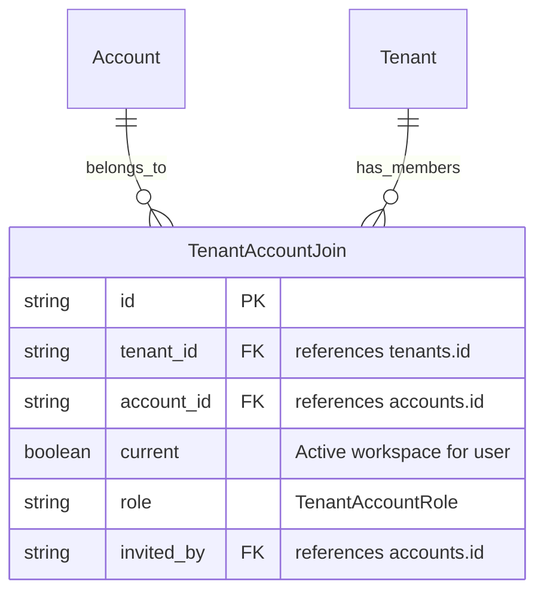
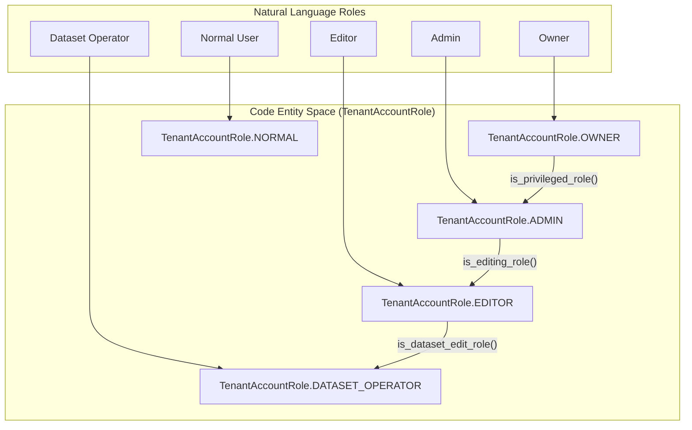
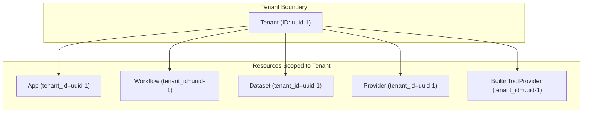
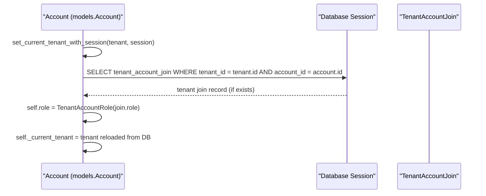
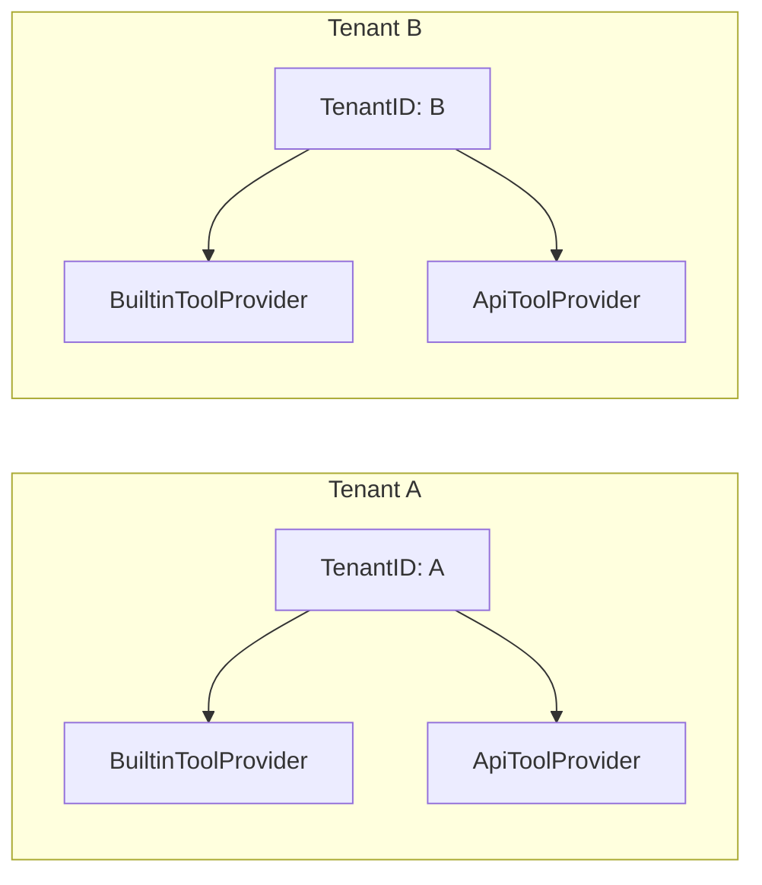

<!-- source: DeepWiki mcp.deepwiki.com · repo langgenius/dify · page 8.1 Tenant Model and Resource Isolation · fetched 2026-10-26 -->

# Tenant Model and Resource Isolation

Relevant source files

The following files were used as context for generating this wiki page:

- [api/controllers/console/app/model_config_payload.py](api/controllers/console/app/model_config_payload.py)
- [api/models/account.py](api/models/account.py)
- [api/models/api_based_extension.py](api/models/api_based_extension.py)
- [api/models/dataset.py](api/models/dataset.py)
- [api/models/model.py](api/models/model.py)
- [api/models/provider.py](api/models/provider.py)
- [api/models/source.py](api/models/source.py)
- [api/models/task.py](api/models/task.py)
- [api/models/tools.py](api/models/tools.py)
- [api/models/trigger.py](api/models/trigger.py)
- [api/models/web.py](api/models/web.py)
- [api/models/workflow.py](api/models/workflow.py)
- [api/repositories/recommended_app_catalog_repository.py](api/repositories/recommended_app_catalog_repository.py)
- [api/tests/test_containers_integration_tests/models/test_conversation_status_count.py](api/tests/test_containers_integration_tests/models/test_conversation_status_count.py)
- [api/tests/test_containers_integration_tests/models/test_dataset_models.py](api/tests/test_containers_integration_tests/models/test_dataset_models.py)
- [api/tests/test_containers_integration_tests/repositories/test_recommended_app_catalog_repository.py](api/tests/test_containers_integration_tests/repositories/test_recommended_app_catalog_repository.py)
- [api/tests/unit_tests/controllers/console/app/test_model_config_api.py](api/tests/unit_tests/controllers/console/app/test_model_config_api.py)
- [api/tests/unit_tests/models/test_app_models.py](api/tests/unit_tests/models/test_app_models.py)
- [api/tests/unit_tests/models/test_dataset_models.py](api/tests/unit_tests/models/test_dataset_models.py)
- [api/tests/unit_tests/repositories/test_recommended_app_catalog_repository.py](api/tests/unit_tests/repositories/test_recommended_app_catalog_repository.py)
- [packages/contracts/app-model-config.test.ts](packages/contracts/app-model-config.test.ts)

## Purpose and Scope

This document details Dify's multi-tenancy architecture centered on the `Tenant` model as the core isolation boundary. It explains how tenants define workspaces, govern membership via the `TenantAccountJoin` join model, organize workspace resources, and enforce data isolation by tenant. The page elaborates on tenant scoped resource models, role-based permissions, and context management patterns to ensure strict resource partitioning and security.

Authentication methods, role-based access control, and workspace member management are covered separately under [8.2](), [8.3](), and [8.4]() respectively.

---

## Core Tenant Entity

### Tenant Model

The `Tenant` model represents a workspace and forms the fundamental isolation unit in Dify. Each tenant is uniquely identified by a UUID and privately segments resources such as apps, workflows, datasets, and tools.

| Column | Type | Description |
|---|---|---|
| `id` | StringUUID | Workspace identifier, UUID v4 primary key |
| `name` | String(255) | Human-readable workspace name |
| `encrypt_public_key` | LongText | Public encryption key for tenant-specific use |
| `plan` | String(255) | Subscription plan (e.g., basic, pro, team) |
| `status` | String(255) | Workspace status (e.g., normal, archived) |
| `custom_config` | LongText | JSON blob for workspace custom configurations |
| `created_at` | DateTime | Timestamp of creation |
| `updated_at` | DateTime | Timestamp of last update |

This model is implemented as `Tenant` in `api/models/account.py`. The `id` field uses a UUID string type (`StringUUID`) and many other models link resources via `tenant_id`. This strict linkage ensures data and operational separation between workspaces.

Sources: [api/models/account.py:175-181]()

---

## Tenant-Account Relationship

### Many-to-Many Association through `TenantAccountJoin`

Users represented by `Account` entities may belong to multiple tenants (workspaces). The association is managed by the `TenantAccountJoin` table that includes role and active status flags.

### `TenantAccountJoin` Table Schema

| Column | Type | Constraints | Description |
|---|---|---|---|
| `id` | StringUUID | Primary Key | Unique identifier |
| `tenant_id` | StringUUID | Foreign key, Indexed | Links to a tenant |
| `account_id` | StringUUID | Foreign key, Indexed | Links to a user account |
| `current` | Boolean | Default `False` | Marks this tenant as user's current workspace |
| `role` | String(16) | Enum, Default `'normal'` | User role within this tenant |
| `invited_by` | StringUUID | Nullable, Foreign key | Account ID who invited this member |

This join table drives tenancy membership and role assignment.

Sources: [api/models/account.py:279-302]()

---

### Role System and Privilege Levels

The `TenantAccountRole` enum defines possible member roles within a tenant, with associated permission semantics:

- `OWNER`: Full control, workspace admin and owner.
- `ADMIN`: Admin privileges but distinct from owner.
- `EDITOR`: Can edit workspace resources.
- `NORMAL`: Standard user.
- `DATASET_OPERATOR`: Dataset-specific limited editor role.

The model provides utility methods to perform privilege checks:

- `is_privileged_role()`: True for OWNER or ADMIN roles.
- `is_editing_role()`: For roles allowed to edit resources.
- `is_dataset_edit_role()`: Dataset editing roles including DATASET_OPERATOR.

These methods ensure role-based access control enforcement at a workspace granularity.

Sources: [api/models/account.py:115-163](), [enums/account.py:1-10]()

---

## Resource Scoping Pattern

### Universal tenant_id Isolation

All major application resources are tied explicitly to a `tenant_id` attribute, which acts as a data partition key isolating workspace data.

This pattern is pervasive, ensuring strict resource ownership and preventing cross-tenant visibility or modification.

Sources:
- `App` model: [api/models/model.py:309]()
- `Workflow` model: [api/models/workflow.py:217]()
- `Dataset` model: [api/models/dataset.py:163]()
- `Provider` model: [api/models/provider.py:55]()
- `BuiltinToolProvider` model: [api/models/tools.py:95]()

### Tenant-Scoped Resource Models Summary

| Resource Type | Code Model Entity | tenant_id Field Location | Index/Constraints Highlights |
|---|---|---|---|
| Applications | `App` | [api/models/model.py:309]() | `app_tenant_idx` on `tenant_id` |
| Workflows | `Workflow` | [api/models/workflow.py:217]() | `workflow_tenant_idx` on `tenant_id` |
| Knowledge Bases | `Dataset` | [api/models/dataset.py:163]() | `dataset_tenant_idx` on `tenant_id` |
| LLM Providers | `Provider` | [api/models/provider.py:55]() | `provider_tenant_id_provider_idx` on `tenant_id`, `provider_name` |
| Built-in Tools | `BuiltinToolProvider` | [api/models/tools.py:95]() | `unique_builtin_tool_provider` on `tenant_id`, `provider`, `name` |
| API Tools | `ApiToolProvider` | [api/models/tools.py:158]() | `unique_api_tool_provider` on `name`, `tenant_id` |
| Data Source OAuth Bindings | `DataSourceOauthBinding` | [api/models/source.py:25]() | `source_binding_tenant_id_idx` on `tenant_id` |
| Data Source API Key Auth Bindings | `DataSourceApiKeyAuthBinding` | [api/models/source.py:64]() | `data_source_api_key_auth_binding_tenant_id_idx` on `tenant_id` |
| Trigger Subscriptions | `TriggerSubscription` | [api/models/trigger.py:88]() | `idx_trigger_providers_tenant_provider` on `tenant_id`, `provider_id` |

Sources:
[api/models/model.py:309](), [api/models/workflow.py:217](), [api/models/dataset.py:163](), [api/models/provider.py:55](), [api/models/tools.py:95,158](), [api/models/source.py:25,64](), [api/models/trigger.py:88]()

---

## Tenant Context Management

### Account Tenant Association and Context Resolution

During request processing, an `Account` instance maintains the active tenant context using the `current_tenant` and `role` properties. When setting `current_tenant`, the system reloads the tenant membership state and role of the user by querying `TenantAccountJoin`.

This guarantees that an `Account` always knows which tenant workspace it belongs to currently, and what permissions it has there. It also prevents detached instance errors by reloading the tenant object with `expire_on_commit=False`.

Sources: [api/models/account.py:74-86](), [api/models/account.py:93-104]()

### Tenant Resolver for Apps and Workflows

Helper functions consistently resolve a tenant ID from an app or workflow ID, enforcing tenant-aware resource access:

- For `App`: `_resolve_app_tenant_id(app_id: str, session: Session) -> str` to get owning tenant [api/models/model.py:73-77]()
- For `Workflow`: `_resolve_workflow_app_tenant_id(app_id: str) -> str` utilises session to locate tenant of workflow app [api/models/workflow.py:91-97]()

These resolvers are critical for safely filtering and validating requests concerning tenant-owned resources.

Sources: [api/models/model.py:73-77](), [api/models/workflow.py:91-97]()

---

## Tool and Provider Isolation

### Tool Provider Partitioning by Tenant

Both built-in and API tool providers are scoped to tenants, storing credentials and config isolated from other tenants.

The tables:

- `tool_oauth_tenant_clients` hold tenant-specific OAuth client parameters [api/models/tools.py:50-67]()
- `tool_builtin_providers` maintain built-in tools per tenant [api/models/tools.py:73-126]()

This separation ensures that credentials, tools, and configurations do not leak between tenants.

Sources: [api/models/tools.py:50-67](), [api/models/tools.py:73-126]()

### LLM Provider Models Tenant Segregation

LLM service providers and models are partitioned by tenant:

- `Provider` model: Tenant-scoped API/LLM service accounts and keys [api/models/provider.py:34-69]()
- `ProviderModel`: Defines a model available for a tenant's provider [api/models/provider.py:118-146]()
- `TenantDefaultModel`: Tenant's default preferred model per type [api/models/provider.py:167-183]()

All tables enforce uniqueness and indexes with tenant scope to ensure distinct configuration per workspace.

Sources: [api/models/provider.py:34-69](), [api/models/provider.py:118-146](), [api/models/provider.py:167-183]()

---

## Security and Data Integrity

### Composite Unique Constraints by Tenant

Enforcing uniqueness across tenant and other identifying columns prevents resource name collisions and unauthorized cross-tenant conflicts.

| Table | Constraint Name | Enforced Columns | Purpose |
|---|---|---|---|
| `providers` | `unique_provider_name_type_quota` | `(tenant_id, provider_name, provider_type, quota_type)` | Unique LLM provider config per tenant |
| `tool_builtin_providers` | `unique_builtin_tool_provider` | `(tenant_id, provider, name)` | Unique built-in tool provider per tenant |
| `tool_api_providers` | `unique_api_tool_provider` | `(name, tenant_id)` | Unique API tool per tenant |
| `provider_models` | `unique_provider_model_name` | `(tenant_id, provider_name, model_name, model_type)` | Unique models scoped by tenant |
| `tenant_default_models` | `unique_tenant_default_model_type` | `(tenant_id, model_type)` | Single default model type per tenant |
| `trigger_subscriptions` | `unique_trigger_provider` | `(tenant_id, provider_id, name)` | Unique trigger subscription per tenant |

Sources:
[api/models/provider.py:43-45](), [api/models/tools.py:82](), [api/models/tools.py:135-137](), [api/models/provider.py:127-129](), [api/models/provider.py:172](), [api/models/trigger.py:81]()

### Indexing Strategy for Efficiency

Indexes on tenant_id fields optimize queries and enforce efficient data partitioning:

- Dataset table index on `tenant_id`: `dataset_tenant_idx` [api/models/dataset.py:170]()
- Workflow table composite index on `(tenant_id, app_id, version)`: `workflow_version_idx` [api/models/workflow.py:213]()
- Provider table index on `(tenant_id, provider_name)` [api/models/provider.py:42]()
- Data Source OAuth Binding table index on `tenant_id`: `source_binding_tenant_id_idx` [api/models/source.py:18]()
- Data Source API Key Auth Binding table index on `tenant_id`: `data_source_api_key_auth_binding_tenant_id_idx` [api/models/source.py:57]()
- Trigger Subscription table index on `(tenant_id, provider_id)`: `idx_trigger_providers_tenant_provider` [api/models/trigger.py:76]()

These indexes support tenancy-scoped CRUD and filtering operations at scale.

Sources: [api/models/dataset.py:170](), [api/models/workflow.py:213](), [api/models/provider.py:42](), [api/models/source.py:18,57](), [api/models/trigger.py:76]()

---

# Summary

Dify implements multi-tenancy through a strict tenant-centered data model where every isolatable resource references a unique `tenant_id`. The `Tenant` model defines workspaces and boundaries, and user memberships with roles are managed via `TenantAccountJoin`. This join associates users to tenants with assigned privilege levels defined in `TenantAccountRole`.

All key domain entities such as apps, workflows, datasets, and providers are scoped and indexed by tenant, guaranteeing secure data partitioning. The `Account` model dynamically tracks active tenant context per request by loading membership and role for authorization enforcement.

Tool providers and LLM-related models also obey tenant scoping for credential and resource isolation. Composite unique constraints and tenant-aware indexing across tables prevent unauthorized cross-tenant access or naming conflicts.

This architectural pattern enables secure, flexible, and scalable multi-tenancy within the Dify platform.

Sources:
- [api/models/account.py:74-86,93-104,115-163,175-181,279-302]()
- [api/models/model.py:73-77,309]()
- [api/models/workflow.py:91-97,213,217]()
- [api/models/dataset.py:163,170]()
- [api/models/provider.py:34-69,42-45,118-146,127-129,167-183,172]()
- [api/models/tools.py:50-67,73-126,82,95,135-137,158]()
- [api/models/source.py:18,25,57,64]()
- [api/models/trigger.py:76,81,88]()
- [enums/account.py:1-10]()

---

