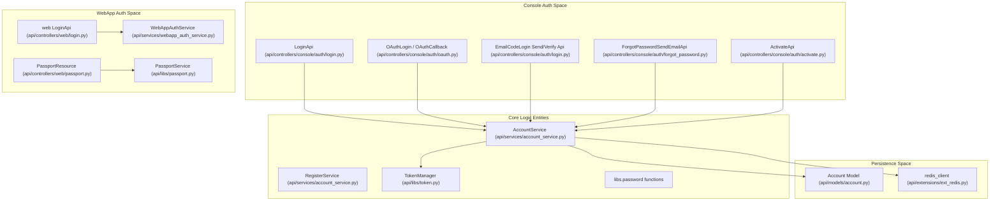
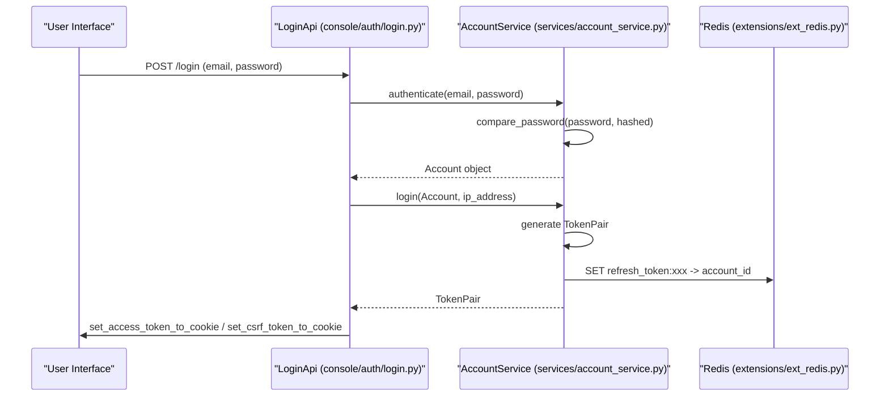
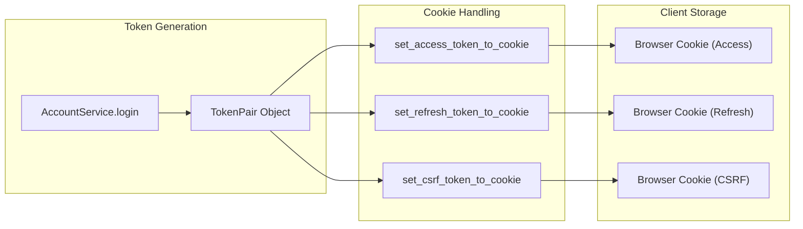
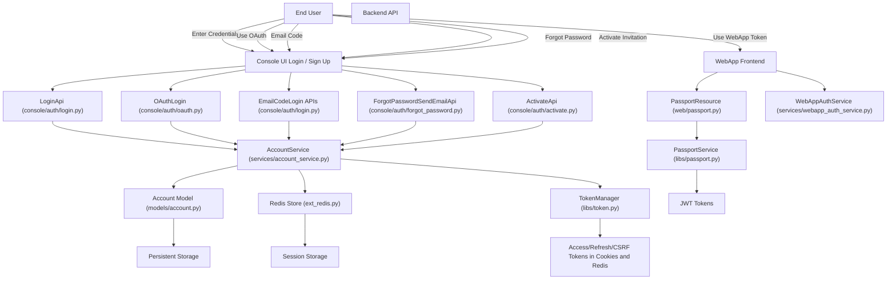

<!-- source: DeepWiki mcp.deepwiki.com · repo langgenius/dify · page 8.2 Authentication Methods and Flows · fetched 2026-10-26 -->

# Authentication Methods and Flows

Relevant source files

The following files were used as context for generating this wiki page:

- [.coveragerc](.coveragerc)
- [api/controllers/console/auth/activate.py](api/controllers/console/auth/activate.py)
- [api/controllers/console/auth/email_register.py](api/controllers/console/auth/email_register.py)
- [api/controllers/console/auth/error.py](api/controllers/console/auth/error.py)
- [api/controllers/console/auth/forgot_password.py](api/controllers/console/auth/forgot_password.py)
- [api/controllers/console/auth/login.py](api/controllers/console/auth/login.py)
- [api/controllers/console/auth/oauth.py](api/controllers/console/auth/oauth.py)
- [api/controllers/files/upload_file_delivery.py](api/controllers/files/upload_file_delivery.py)
- [api/controllers/web/__init__.py](api/controllers/web/__init__.py)
- [api/controllers/web/forgot_password.py](api/controllers/web/forgot_password.py)
- [api/controllers/web/login.py](api/controllers/web/login.py)
- [api/controllers/web/passport.py](api/controllers/web/passport.py)
- [api/extensions/ext_blueprints.py](api/extensions/ext_blueprints.py)
- [api/extensions/ext_login.py](api/extensions/ext_login.py)
- [api/libs/external_api.py](api/libs/external_api.py)
- [api/libs/token.py](api/libs/token.py)
- [api/services/entities/auth_entities.py](api/services/entities/auth_entities.py)
- [api/services/upload_file_delivery_service.py](api/services/upload_file_delivery_service.py)
- [api/services/webapp_auth_service.py](api/services/webapp_auth_service.py)
- [api/tests/integration_tests/conftest.py](api/tests/integration_tests/conftest.py)
- [api/tests/unit_tests/controllers/console/auth/test_account_activation.py](api/tests/unit_tests/controllers/console/auth/test_account_activation.py)
- [api/tests/unit_tests/controllers/console/auth/test_email_register.py](api/tests/unit_tests/controllers/console/auth/test_email_register.py)
- [api/tests/unit_tests/controllers/console/auth/test_forgot_password.py](api/tests/unit_tests/controllers/console/auth/test_forgot_password.py)
- [api/tests/unit_tests/controllers/console/auth/test_login_logout.py](api/tests/unit_tests/controllers/console/auth/test_login_logout.py)
- [api/tests/unit_tests/controllers/console/auth/test_oauth.py](api/tests/unit_tests/controllers/console/auth/test_oauth.py)
- [api/tests/unit_tests/controllers/files/test_upload_file_delivery.py](api/tests/unit_tests/controllers/files/test_upload_file_delivery.py)
- [api/tests/unit_tests/controllers/web/conftest.py](api/tests/unit_tests/controllers/web/conftest.py)
- [api/tests/unit_tests/controllers/web/test_completion.py](api/tests/unit_tests/controllers/web/test_completion.py)
- [api/tests/unit_tests/controllers/web/test_web_forgot_password.py](api/tests/unit_tests/controllers/web/test_web_forgot_password.py)
- [api/tests/unit_tests/controllers/web/test_web_login.py](api/tests/unit_tests/controllers/web/test_web_login.py)
- [api/tests/unit_tests/controllers/web/test_web_passport.py](api/tests/unit_tests/controllers/web/test_web_passport.py)
- [api/tests/unit_tests/extensions/test_ext_login.py](api/tests/unit_tests/extensions/test_ext_login.py)
- [api/tests/unit_tests/libs/test_token.py](api/tests/unit_tests/libs/test_token.py)
- [packages/contracts/generated/api/console/refresh-token/types.gen.ts](packages/contracts/generated/api/console/refresh-token/types.gen.ts)
- [packages/contracts/generated/api/console/refresh-token/zod.gen.ts](packages/contracts/generated/api/console/refresh-token/zod.gen.ts)
- [web/app/(shareLayout)/webapp-reset-password/check-code/page.tsx](web/app/(shareLayout)/webapp-reset-password/check-code/page.tsx)
- [web/app/(shareLayout)/webapp-reset-password/page.tsx](web/app/(shareLayout)/webapp-reset-password/page.tsx)
- [web/app/(shareLayout)/webapp-reset-password/set-password/page.tsx](web/app/(shareLayout)/webapp-reset-password/set-password/page.tsx)
- [web/app/(shareLayout)/webapp-signin/check-code/page.tsx](web/app/(shareLayout)/webapp-signin/check-code/page.tsx)
- [web/app/(shareLayout)/webapp-signin/components/__tests__/mail-and-code-auth.spec.tsx](web/app/(shareLayout)/webapp-signin/components/__tests__/mail-and-code-auth.spec.tsx)
- [web/app/(shareLayout)/webapp-signin/components/external-member-sso-auth.tsx](web/app/(shareLayout)/webapp-signin/components/external-member-sso-auth.tsx)
- [web/app/(shareLayout)/webapp-signin/components/mail-and-code-auth.tsx](web/app/(shareLayout)/webapp-signin/components/mail-and-code-auth.tsx)
- [web/app/(shareLayout)/webapp-signin/components/mail-and-password-auth.tsx](web/app/(shareLayout)/webapp-signin/components/mail-and-password-auth.tsx)
- [web/app/(shareLayout)/webapp-signin/components/sso-auth.tsx](web/app/(shareLayout)/webapp-signin/components/sso-auth.tsx)
- [web/app/(shareLayout)/webapp-signin/page.tsx](web/app/(shareLayout)/webapp-signin/page.tsx)
- [web/app/auth/refresh/__tests__/route.spec.ts](web/app/auth/refresh/__tests__/route.spec.ts)
- [web/app/auth/refresh/route.ts](web/app/auth/refresh/route.ts)
- [web/app/forgot-password/ChangePasswordForm.spec.tsx](web/app/forgot-password/ChangePasswordForm.spec.tsx)
- [web/app/forgot-password/ChangePasswordForm.tsx](web/app/forgot-password/ChangePasswordForm.tsx)
- [web/app/forgot-password/ForgotPasswordForm.spec.tsx](web/app/forgot-password/ForgotPasswordForm.spec.tsx)
- [web/app/forgot-password/ForgotPasswordForm.tsx](web/app/forgot-password/ForgotPasswordForm.tsx)
- [web/app/install/installForm.spec.tsx](web/app/install/installForm.spec.tsx)
- [web/app/install/installForm.tsx](web/app/install/installForm.tsx)
- [web/app/reset-password/check-code/page.tsx](web/app/reset-password/check-code/page.tsx)
- [web/app/reset-password/page.tsx](web/app/reset-password/page.tsx)
- [web/app/reset-password/set-password/__tests__/page.spec.tsx](web/app/reset-password/set-password/__tests__/page.spec.tsx)
- [web/app/reset-password/set-password/page.tsx](web/app/reset-password/set-password/page.tsx)
- [web/app/signin/__tests__/normal-form.spec.tsx](web/app/signin/__tests__/normal-form.spec.tsx)
- [web/app/signin/__tests__/one-more-step.spec.tsx](web/app/signin/__tests__/one-more-step.spec.tsx)
- [web/app/signin/check-code/__tests__/page.spec.tsx](web/app/signin/check-code/__tests__/page.spec.tsx)
- [web/app/signin/check-code/page.tsx](web/app/signin/check-code/page.tsx)
- [web/app/signin/components/mail-and-code-auth.tsx](web/app/signin/components/mail-and-code-auth.tsx)
- [web/app/signin/components/mail-and-password-auth.tsx](web/app/signin/components/mail-and-password-auth.tsx)
- [web/app/signin/invite-settings/__tests__/page.spec.tsx](web/app/signin/invite-settings/__tests__/page.spec.tsx)
- [web/app/signin/invite-settings/page.tsx](web/app/signin/invite-settings/page.tsx)
- [web/app/signin/normal-form.tsx](web/app/signin/normal-form.tsx)
- [web/app/signin/one-more-step.tsx](web/app/signin/one-more-step.tsx)
- [web/app/signup/check-code/page.tsx](web/app/signup/check-code/page.tsx)
- [web/app/signup/components/input-mail.spec.tsx](web/app/signup/components/input-mail.spec.tsx)
- [web/app/signup/components/input-mail.tsx](web/app/signup/components/input-mail.tsx)
- [web/app/signup/page.tsx](web/app/signup/page.tsx)
- [web/app/signup/set-password/__tests__/page.spec.tsx](web/app/signup/set-password/__tests__/page.spec.tsx)
- [web/app/signup/set-password/page.tsx](web/app/signup/set-password/page.tsx)
- [web/service/share.ts](web/service/share.ts)
- [web/service/use-common.ts](web/service/use-common.ts)

## Purpose and Scope

This page documents the authentication approaches employed in Dify, including email/password login, OAuth with GitHub and Google, passwordless email code login, and token management for session security. It covers backend implementations, data flow for each method, key classes and functions, and token lifecycle management (access, refresh, and CSRF tokens). The focus includes security measures like rate limiting and cryptographic validation employed across authentication flows.

---

## Authentication Architecture Overview

Dify's authentication system encompasses multiple entry points and layers adapted for various client types (Console UI, WebApp, API). Central logic is implemented primarily in `AccountService` and coordinated through controller endpoints and utility classes.

### Authentication Systems and Code Entity Mapping

**Sources:** [api/services/account_service.py:143-165](), [api/controllers/console/auth/login.py:108-118](), [api/controllers/console/auth/oauth.py:145-174](), [api/controllers/web/passport.py:41-56](), [api/libs/passport.py:19-21](), [api/controllers/console/auth/activate.py:77-99]()

---

## Console Authentication Flows

### Email and Password Authentication

The primary method for user authentication is via email and password.

#### Implementation Details

- The core logic resides in `AccountService.authenticate`, which retrieves the account by normalized email and uses the password utilities to verify the hashed password and salt [api/services/account_service.py:167-183]().
- Password hashing and verification use PBKDF2-HMAC-SHA256 with per-user salt, handled in `libs.password` functions [api/libs/password.py:26]().
- Upon successful authentication, `AccountService.login` generates a `TokenPair` containing access, refresh, and CSRF tokens and persists refresh tokens in Redis using specific prefixes `REFRESH_TOKEN_PREFIX`, `ACCOUNT_REFRESH_TOKEN_PREFIX` [api/services/account_service.py:130-141]().
- Rate limiting controls login attempts and reset password requests using `RateLimiter` instances to defend against brute-force attacks [api/services/account_service.py:149-165]().
- The login REST endpoint is provided by `LoginApi` in `api/controllers/console/auth/login.py`, which handles model validation, password decryption, error mapping, and token cookie setting [api/controllers/console/auth/login.py:120-153]().

#### Email/Password Login Sequence Diagram

**Sources:** [api/services/account_service.py:130-141](), [api/controllers/console/auth/login.py:120-153](), [api/libs/password.py:26]()

---

### OAuth Authentication (GitHub/Google)

OAuth 2.0 enables login using external identity providers.

#### Implementation Details

- The `OAuthLogin` resource initiates OAuth authorization by creating a provider-specific authorization request with optional invitation tokens, timezone, language, and redirect URL parameters. It obtains an authorization URL from `AccountService.oauth.start_authorization` and redirects the user [api/controllers/console/auth/oauth.py:144-168]().
- The `OAuthCallback` resource receives the provider's authorization code and state, then invokes `AccountService.oauth.complete_authorization` to exchange the code for user info.
- The service uses `RegisterService.get_or_create_account_by_oauth` to manage account linkage or creation.
- On success, the server issues session tokens and redirects the client with cookies set for access, refresh, and CSRF tokens [api/controllers/console/auth/oauth.py:170-217]().
- The OAuth flow handles corner cases like invitation tokens, account bans, and seat limits with detailed error mappings.
  
**Sources:** [api/controllers/console/auth/oauth.py:144-217](), [api/services/account_service.py:153-180](), [api/libs/oauth.py:18-40]()

---

### Email Code Login (Passwordless Login)

Dify supports passwordless login via email one-time codes.

#### Implementation Details

- `EmailCodeLoginSendEmailApi` accepts an email address and optional Cloudflare Turnstile token to send a 6-digit verification code, invoking a background mail task [api/controllers/console/auth/login.py:180-193]().
- The verifying API `EmailCodeLoginApi` accepts the email, code, a token UUID, and optional language/timezone. It verifies code correctness and creates user sessions similarly to password logins [api/controllers/console/auth/login.py:190-203]().
- Tokens and codes are managed securely using `TokenManager` to ensure code/token pairs and prevent reuse or replay attacks.
- Supports rate limiting on sending and verifying codes to limit abuse.
  
**Sources:** [api/controllers/console/auth/login.py:190-203](), [api/services/account_service.py:151-160](), [api/tasks/mail_email_code_login.py:46]()

---

### Forgot Password Flow

Users who forget passwords can reset via code verification and new password submission.

#### Implementation Details

- `ForgotPasswordSendEmailApi` handles email submission for reset requests, calling `AccountService.forgot_password.send_code` with rate limiting enforced [api/controllers/console/auth/forgot_password.py:54-81]().
- `ForgotPasswordCheckApi` verifies the reset code and issues a new token to allow password reset [api/controllers/console/auth/forgot_password.py:82-118]().
- `ForgotPasswordResetApi` verifies the token and resets the password by hashing the new password [api/controllers/console/auth/forgot_password.py:119-148]().
- The flow includes careful error handling and rate limiting to protect the reset mechanism.
  
**Sources:** [api/controllers/console/auth/forgot_password.py:54-148](), [api/services/account_service.py:90-98](), [api/libs/password.py:20-26]()

---

## Token Management and Security

### Tokens Managed

| Token Type    | Purpose                          | Storage                 | Source |
|---------------|---------------------------------|-------------------------|--------|
| Access Token  | Authenticate API requests        | HTTP-only cookie        | [api/libs/token.py:53-53]() |
| Refresh Token | Renew Access Token               | Cookie + Redis          | [api/services/account_service.py:136-138]() |
| CSRF Token    | Prevent CSRF attacks             | Cookie                  | [api/libs/token.py:54-54]() |

### Session and Token Flow Diagram

**Sources:** [api/services/account_service.py:130-141](), [api/libs/token.py:48-56](), [api/controllers/console/auth/login.py:179-182]()

---

## WebApp and API Authentication

### WebApp Passport Flow

Web applications use a "Passport" mechanism designed for end-user authentication via application-issued tokens:

- `PassportResource` handles token issuance and verification for WebApps [api/controllers/web/passport.py:41-56]().
- `PassportService.issue` generates JWT tokens containing `app_id`, `app_code`, and `end_user_id`. This supports authentication for internal and external web apps, with different `WebAppAuthType` enum values: `PUBLIC`, `EXTERNAL`, and `INTERNAL` [api/services/webapp_auth_service.py:20-32]().
- Enterprise mode users can exchange token types and access management APIs for web app integration [api/controllers/web/passport.py:72]().
- The Passport tokens integrate with session and cookie management for seamless auth state.

**Sources:** [api/controllers/web/passport.py:41-72](), [api/services/webapp_auth_service.py:10-32](), [api/libs/passport.py:19-21]()

---

### Enterprise Integration

Dify Enterprise Edition supplements auth flows with workspace membership logic and identity forwarding:

- The helper `_try_join_enterprise_default_workspace(account_id)` tries joining new accounts into the default enterprise workspace, triggered after account creation/login [api/services/account_service.py:130-139]().
- Enterprise SSO flows use `issue_mcp_token` and related mechanisms to securely propagate identity tokens for remote tool invocation and session sharing.
- RBACService integration resolves roles for tenants and accounts enhancing authorization after authentication [api/services/account_service.py:170-190]().

**Sources:** [api/services/account_service.py:120-140](), [api/services/enterprise/enterprise_service.py:90-160]()

---

## Account Lifecycle and Security

### Rate Limiting and Abuse Protection

To maintain security and prevent abuse:

- `AccountService` defines several `RateLimiter` instances, e.g. for reset password emails, change email operations, owner transfer actions [api/services/account_service.py:150-165]().
- Integrated rate limits enforce maximum allowed attempts within specified time windows, stored in Redis.
- IP-based email sending limits detect abusive sources to prevent spam [api/controllers/console/auth/forgot_password.py:76-78]().

### Account Initialization

Post-login, users are required to complete profile initialization:

- `AccountInitPayload` requires setting `interface_language`, `timezone`, and optionally an invitation code [api/controllers/console/workspace/account.py:60-70]().
- The initialization endpoint validates language and timezone, ensuring consistent locale settings.
- Invitation codes tie users to specific tenants/workspaces enabling access control [api/controllers/console/workspace/account.py:70-90]().
  
**Sources:** [api/controllers/console/auth/activate.py:27-48](), [api/controllers/console/auth/activate.py:102-140]()

---

### Summary Diagram: Natural Language to Code Entity Mapping for Authentication

---

**Sources:** Multiple from above: [api/services/account_service.py](), [api/controllers/console/auth/login.py](), [api/controllers/console/auth/oauth.py](), [api/controllers/console/auth/forgot_password.py](), [api/controllers/console/auth/activate.py](), [api/controllers/web/passport.py](), [api/services/webapp_auth_service.py](), [api/libs/passport.py]()

---

# Summary

This page detailed the multi-modal and secure authentication methods used by Dify: email/password login with salted hashing, OAuth via GitHub and Google, passwordless email code login, and WebApp-specific Passport-based login. It described how the backend coordinates these flows, manages cryptographically sound tokens (access, refresh, CSRF), enforces rate limits, and maintains session state with Redis and HTTP-only cookies. The architecture bridges frontend UI, API, and persistent storage layers, providing security and extensibility for multi-tenant workspace environments.

---

