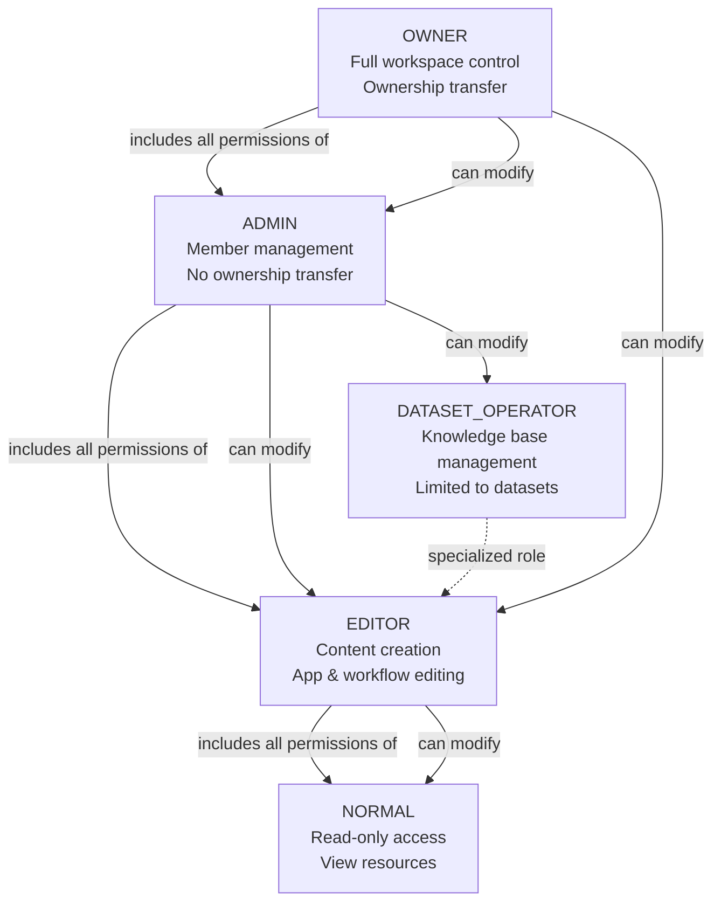
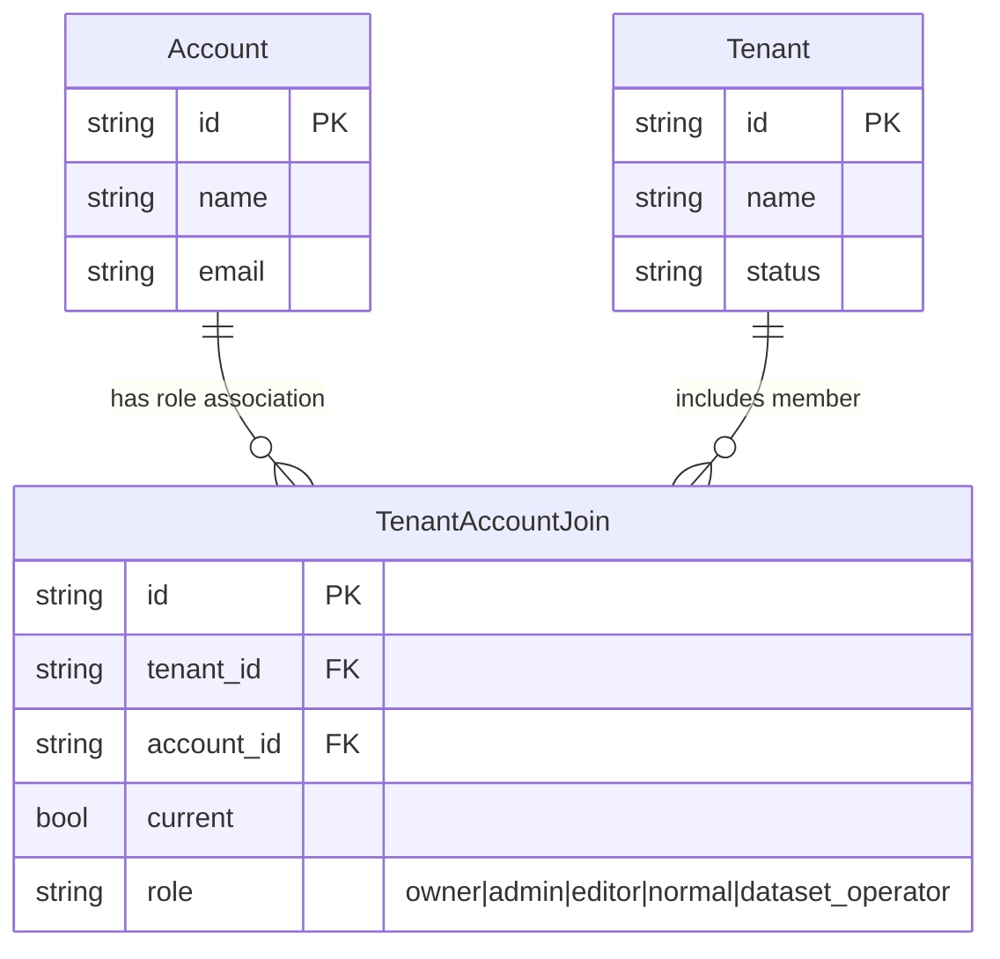
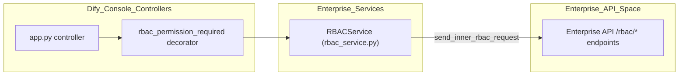
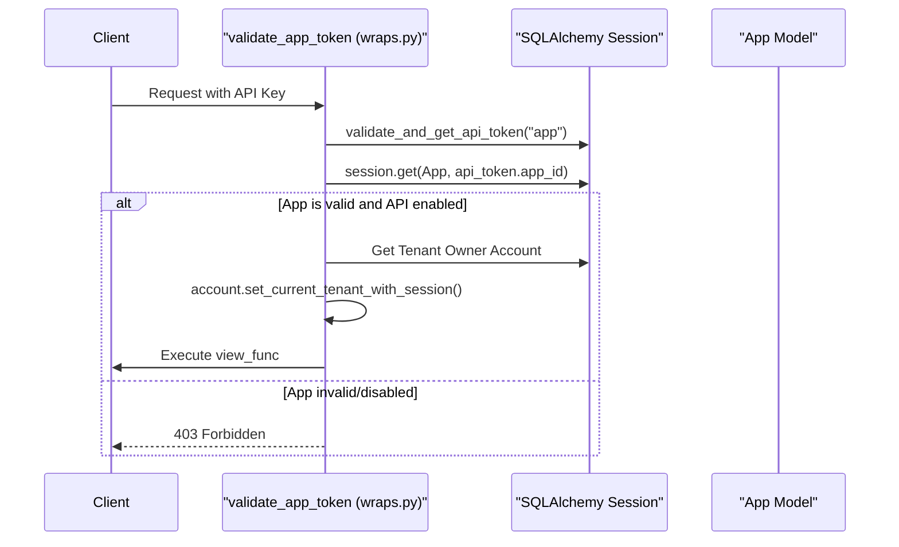
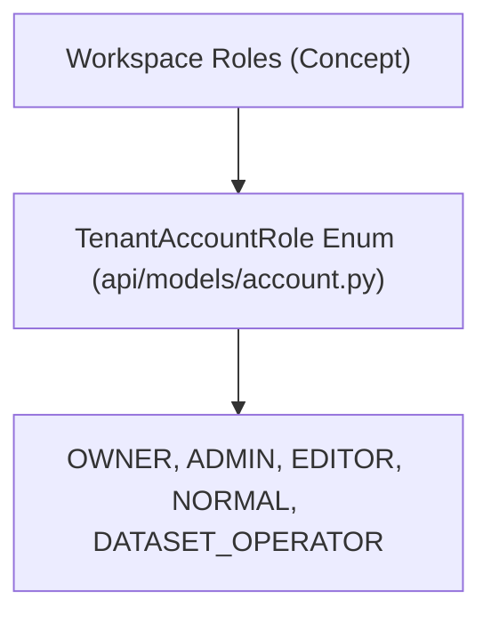
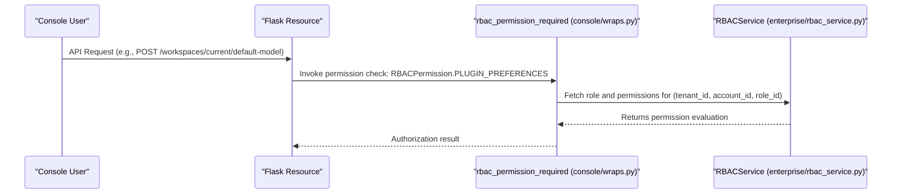

<!-- source: DeepWiki mcp.deepwiki.com · repo langgenius/dify · page 8.3 Role-Based Access Control · fetched 2026-10-26 -->

# Role-Based Access Control

Relevant source files

The following files were used as context for generating this wiki page:

- [api/.importlinter](api/.importlinter)
- [api/controllers/console/app/app_import.py](api/controllers/console/app/app_import.py)
- [api/controllers/console/app/wraps.py](api/controllers/console/app/wraps.py)
- [api/controllers/console/datasets/rag_pipeline/rag_pipeline_datasets.py](api/controllers/console/datasets/rag_pipeline/rag_pipeline_datasets.py)
- [api/controllers/console/datasets/rag_pipeline/rag_pipeline_import.py](api/controllers/console/datasets/rag_pipeline/rag_pipeline_import.py)
- [api/controllers/console/flask_admission.py](api/controllers/console/flask_admission.py)
- [api/controllers/console/wraps.py](api/controllers/console/wraps.py)
- [api/controllers/service_api/wraps.py](api/controllers/service_api/wraps.py)
- [api/core/helper/creators.py](api/core/helper/creators.py)
- [api/extensions/ext_application_services.py](api/extensions/ext_application_services.py)
- [api/libs/login.py](api/libs/login.py)
- [api/machinery/__init__.py](api/machinery/__init__.py)
- [api/machinery/context.py](api/machinery/context.py)
- [api/machinery/errors.py](api/machinery/errors.py)
- [api/services/account_errors.py](api/services/account_errors.py)
- [api/services/account_ports.py](api/services/account_ports.py)
- [api/services/app/console_gateway.py](api/services/app/console_gateway.py)
- [api/services/app/console_service.py](api/services/app/console_service.py)
- [api/services/app/creators_platform_gateway.py](api/services/app/creators_platform_gateway.py)
- [api/services/app_dsl_service.py](api/services/app_dsl_service.py)
- [api/services/enterprise/rbac_service.py](api/services/enterprise/rbac_service.py)
- [api/services/entities/account_entities.py](api/services/entities/account_entities.py)
- [api/services/entities/dsl_entities.py](api/services/entities/dsl_entities.py)
- [api/services/knowledge/dataset_service.py](api/services/knowledge/dataset_service.py)
- [api/services/rag_pipeline/rag_pipeline_dsl_service.py](api/services/rag_pipeline/rag_pipeline_dsl_service.py)
- [api/services/snippet_dsl_service.py](api/services/snippet_dsl_service.py)
- [api/tests/test_containers_integration_tests/services/test_app_dsl_service.py](api/tests/test_containers_integration_tests/services/test_app_dsl_service.py)
- [api/tests/unit_tests/.ruff.toml](api/tests/unit_tests/.ruff.toml)
- [api/tests/unit_tests/controllers/console/app/test_app_apis.py](api/tests/unit_tests/controllers/console/app/test_app_apis.py)
- [api/tests/unit_tests/controllers/console/app/test_app_import_api.py](api/tests/unit_tests/controllers/console/app/test_app_import_api.py)
- [api/tests/unit_tests/controllers/console/app/test_conversation_api.py](api/tests/unit_tests/controllers/console/app/test_conversation_api.py)
- [api/tests/unit_tests/controllers/console/app/test_wraps.py](api/tests/unit_tests/controllers/console/app/test_wraps.py)
- [api/tests/unit_tests/controllers/console/test_wraps.py](api/tests/unit_tests/controllers/console/test_wraps.py)
- [api/tests/unit_tests/controllers/console/workspace/test_rbac.py](api/tests/unit_tests/controllers/console/workspace/test_rbac.py)
- [api/tests/unit_tests/core/helper/test_creators.py](api/tests/unit_tests/core/helper/test_creators.py)
- [api/tests/unit_tests/core/prompt/test_agent_history_prompt_transform.py](api/tests/unit_tests/core/prompt/test_agent_history_prompt_transform.py)
- [api/tests/unit_tests/core/prompt/test_prompt_message.py](api/tests/unit_tests/core/prompt/test_prompt_message.py)
- [api/tests/unit_tests/core/prompt/test_prompt_transform.py](api/tests/unit_tests/core/prompt/test_prompt_transform.py)
- [api/tests/unit_tests/core/prompt/test_simple_prompt_transform.py](api/tests/unit_tests/core/prompt/test_simple_prompt_transform.py)
- [api/tests/unit_tests/extensions/test_ext_application_services.py](api/tests/unit_tests/extensions/test_ext_application_services.py)
- [api/tests/unit_tests/libs/test_login.py](api/tests/unit_tests/libs/test_login.py)
- [api/tests/unit_tests/pyrefly.toml](api/tests/unit_tests/pyrefly.toml)
- [api/tests/unit_tests/services/app/test_console_gateway.py](api/tests/unit_tests/services/app/test_console_gateway.py)
- [api/tests/unit_tests/services/app/test_console_service.py](api/tests/unit_tests/services/app/test_console_service.py)
- [api/tests/unit_tests/services/app/test_creators_platform_gateway.py](api/tests/unit_tests/services/app/test_creators_platform_gateway.py)
- [api/tests/unit_tests/services/enterprise/test_rbac_service.py](api/tests/unit_tests/services/enterprise/test_rbac_service.py)
- [api/tests/unit_tests/services/rag_pipeline/test_rag_pipeline_dsl_service.py](api/tests/unit_tests/services/rag_pipeline/test_rag_pipeline_dsl_service.py)
- [api/tests/unit_tests/services/test_app_dsl_service.py](api/tests/unit_tests/services/test_app_dsl_service.py)
- [api/tests/unit_tests/services/test_snippet_dsl_service.py](api/tests/unit_tests/services/test_snippet_dsl_service.py)

## Purpose and Scope

This document provides a detailed technical overview of Dify's Role-Based Access Control (RBAC) system, crucial for managing user permissions and resource access within multi-tenant workspace environments. It focuses on defining role hierarchy through the `TenantAccountRole` enum, integration with the enterprise RBAC service for granular permission management on resources, and describes the route-level permission enforcement strategy.

Key topics include the core roles and their capabilities, the model linking tenants and user accounts with roles, the architecture and usage of the enterprise RBAC service, permission catalog and scenes, and security validation decorators applied at the API layer.

Related topics can be found in these pages:
- [8.1 Tenant Model and Resource Isolation](8.1)
- [8.2 Authentication Methods and Flows](8.2)
- [8.4 Workspace and Member Management](8.4)

---

## Role Hierarchy

Dify represents workspace roles in the `TenantAccountRole` enum, defined in `api/models/account.py`. This enum outlines five distinct roles with differing scopes and privileges:

- **OWNER**: Highest privilege, full control over workspace, including ownership transfers, billing, and all administrative functions.
- **ADMIN**: Can manage workspace members and roles except ownership transfer; inherits editor capabilities.
- **EDITOR**: Can create and edit apps, workflows, datasets; can run/publish workflows.
- **NORMAL**: Read-only access to workspace resources.
- **DATASET_OPERATOR**: Special role limited to managing datasets (knowledge bases), without access to app/workflow management.

The roles form a hierarchical permission model where OWNER includes all ADMIN permissions, ADMIN includes EDITOR permissions, etc. The `DATASET_OPERATOR` role acts as a separate branch focused solely on dataset capabilities.

### Diagram: Dify Role Hierarchy and Permission Inclusion

### Role Validation Utilities

The `TenantAccountRole` class provides utility methods for role validation that simplify permission checks:

- `is_valid_role(role: str) -> bool` — Validate a string is a recognized role.
- `is_privileged_role(role: Optional[TenantAccountRole]) -> bool` — Check if role is OWNER or ADMIN.
- `is_admin_role(role: Optional[TenantAccountRole]) -> bool` — Check if role is ADMIN or OWNER.
- `is_editing_role(role: Optional[TenantAccountRole]) -> bool` — Check if role includes EDITOR or above roles.
- `is_dataset_edit_role(role: Optional[TenantAccountRole]) -> bool` — Check if role allows dataset editing (EDITOR or DATASET_OPERATOR).

These are used extensively across the platform to gate features and API access based on role.

**Sources:** [api/models/account.py:27-60](), [api/controllers/service_api/wraps.py:153-172]()

---

## Tenant-Account Role Association

### TenantAccountJoin Model

The relation between users (`Account`) and tenants (`Tenant`) is represented by `TenantAccountJoin`. This link table records the user's role within each tenant workspace and whether the association is current.

Diagram: Tenant-Account Relationship Mapping

### Account Role Management

The `Account` model caches the current tenant and role for use during API request processing. The method `Account.set_current_tenant_with_session` is called upon authentication or API token validation to bind the user to a tenant with the appropriate role context, thereby optimizing permission checks downstream.

**Sources:** [api/models/account.py:27-60](), [api/controllers/service_api/wraps.py:150-172]()

---

## Enterprise RBAC Integration

Dify supports an enterprise-grade RBAC system for fine-grained access control on resources beyond workspace-wide roles, enabling resource-level permission policies.

### RBAC Service Architecture

The `RBACService` class, implemented in `api/services/enterprise/rbac_service.py`, serves as the facade for RBAC operations. It handles retrieving permission catalogs, roles, bindings, and validating access against enterprise backends through `EnterpriseRequest` HTTP calls.

Key resource types include:
- `RBACResourceType.APP`
- `RBACResourceType.DATASET`
- `RBACResourceType.AGENT`

These resources correspond to application, dataset, and agent entities in Dify.

Diagram: Enterprise RBAC Request Flow

The `try_sync_creator_access_policy_member_bindings` function [api/services/enterprise/rbac_service.py:90-154]() is a best-effort mechanism to synchronize creator access policies, particularly for `APP` and `DATASET` resources. This ensures that when a resource is created, the creator automatically gets appropriate access policy bindings and is added to the resource's whitelist, if applicable. This function is called by `AppDslService` when importing an app [api/services/app_dsl_service.py:113-115]().

**Sources:** [api/services/enterprise/rbac_service.py:60-80](), [api/services/enterprise/rbac_service.py:140-220](), [api/controllers/console/wraps.py:25-35](), [api/services/enterprise/rbac_service.py:90-154](), [api/services/app_dsl_service.py:113-115]()

### Permission Catalog and Scenes

Permissions are grouped by scopes (workspace, app, dataset) and defined with keys. The `RBACRole` and `AccessPolicy` models describe roles and policies, including permission keys they permit.

Permission scopes map to resource scopes for precise access control:

| Scope       | Code Entity                 | Description                             |
|-------------|-----------------------------|---------------------------------------|
| WORKSPACE   | `RBACResourceScope.WORKSPACE` | Workspace-wide administrative access. |
| APP         | `RBACResourceType.APP`       | App lifecycle and resource control.   |
| DATASET     | `RBACResourceType.DATASET`   | Dataset/document access control.      |

Controllers use these permission keys to enforce authorization using decorators.

**Sources:** [api/services/enterprise/rbac_service.py:60-80](), [api/services/enterprise/rbac_service.py:140-220](), [api/controllers/console/wraps.py:25-35]()

---

## Validation Wrappers and Security

### Service API Token Validation

In `api/controllers/service_api/wraps.py`, the `validate_app_token` decorator validates that requests possess a valid API token. It does:

- Verify token and associated app exists, is "normal" status, and API enabled.
- Fetch tenant and verify tenant status.
- If user context (`end_user`) is required, fetch or create the end user associated with the app.
- If no end-user context, default the current user to the workspace owner account.

This layers authentication and authorization for service-facing APIs.

Diagram: Service API Token Validation Sequence

**Sources:** [api/controllers/service_api/wraps.py:110-173]()

### Console API RBAC Permission Check

The `rbac_permission_required` decorator [api/controllers/console/wraps.py:14]() is used in console controllers to enforce RBAC permissions. It takes an `RBACPermission` and an `RBACResourceScope` (or a specific resource instance like `PlainApp()` or `Workspace()`) to determine if the current user has the necessary privileges.

For example, the `AppImportConfirmApi` [api/controllers/console/app/app_import.py:114-122]() uses this decorator to ensure that only users with `EDITOR` or higher roles and the `APP_IMPORT_EXPORT_DSL` permission for the `Workspace` can confirm an app import.

**Sources:** [api/controllers/console/wraps.py:14](), [api/controllers/console/app/app_import.py:114-122]()

### Cloud Edition Billing Resource Check

In `api/controllers/console/wraps.py`, decorators verify user subscription constraints before permitting access to resource-heavy features, e.g. ensuring the workspace's vector space size is within plan limits.

If limits are exceeded, a 403 HTTP error is returned, preventing further action.

Example check includes vector space capacity or workspace members count compared against billing-provided limits.

**Sources:** [api/controllers/console/wraps.py:175-191](), [api/controllers/console/workspace/members.py:170-196]()

---

## Summary of Permission Matrix

| Operation             | OWNER | ADMIN | EDITOR | NORMAL | DATASET_OPERATOR |
|-----------------------|-------|-------|--------|--------|------------------|
| **App Management**    | ✅    | ✅    | ✅     | ❌     | ❌               |
| **Dataset Management**| ✅    | ✅    | ✅     | ❌     | ✅               |
| **Member Management** | ✅    | ✅    | ❌     | ❌     | ❌               |
| **Ownership Transfer**| ✅    | ❌    | ❌     | ❌     | ❌               |
| **Plugin Config**     | ✅    | ✅    | ❌     | ❌     | ❌               |

This matrix summarizes how each role’s privileges apply to core workspace features and resources in Dify.

**Sources:** [api/models/account.py:27-60](), [api/controllers/console/workspace/members.py:140-155](), [api/controllers/console/workspace/plugin.py:26-27]()

---

## Code Entity Mapping

### Mapping Workspace Roles to Enum

Title: Mapping Conceptual Roles to Code Entities

### Console API RBAC Permission Check Flow

Title: Console RBAC Validation Logic in Controllers

This shows how permission checks in console API endpoints delegate evaluation to the enterprise RBAC service.

**Sources:** [api/controllers/console/workspace/models.py:230-230](), [api/services/enterprise/rbac_service.py:120-140](), [api/controllers/console/wraps.py:126-140]()

---

# References

- `TenantAccountRole` enum in `api/models/account.py`
- RBAC service in `api/services/enterprise/rbac_service.py`
- Decorators in `api/controllers/console/wraps.py` and `api/controllers/service_api/wraps.py`
- Tenant and Account associations in `api/models/account.py`
- Enterprise RBAC protocol models in `api/services/enterprise/rbac_service.py`
- Permission constants in `api/controllers/console/wraps.py`

---

**Sources:**
[api/models/account.py:20-60](),
[api/controllers/service_api/wraps.py:105-173](),
[api/services/enterprise/rbac_service.py:10-80](),
[api/services/enterprise/rbac_service.py:90-154](),
[api/services/enterprise/rbac_service.py:140-220](),
[api/controllers/console/wraps.py:14](),
[api/controllers/console/wraps.py:20-35](),
[api/controllers/console/wraps.py:126-140](),
[api/controllers/console/wraps.py:175-191](),
[api/controllers/console/app/app_import.py:114-122](),
[api/controllers/console/workspace/members.py:140-155](),
[api/controllers/console/workspace/members.py:170-196](),
[api/controllers/console/workspace/plugin.py:26-27](),
[api/controllers/service_api/wraps.py:150-172](),
[api/controllers/console/workspace/models.py:230-230](),
[api/services/app_dsl_service.py:113-115]()

---

