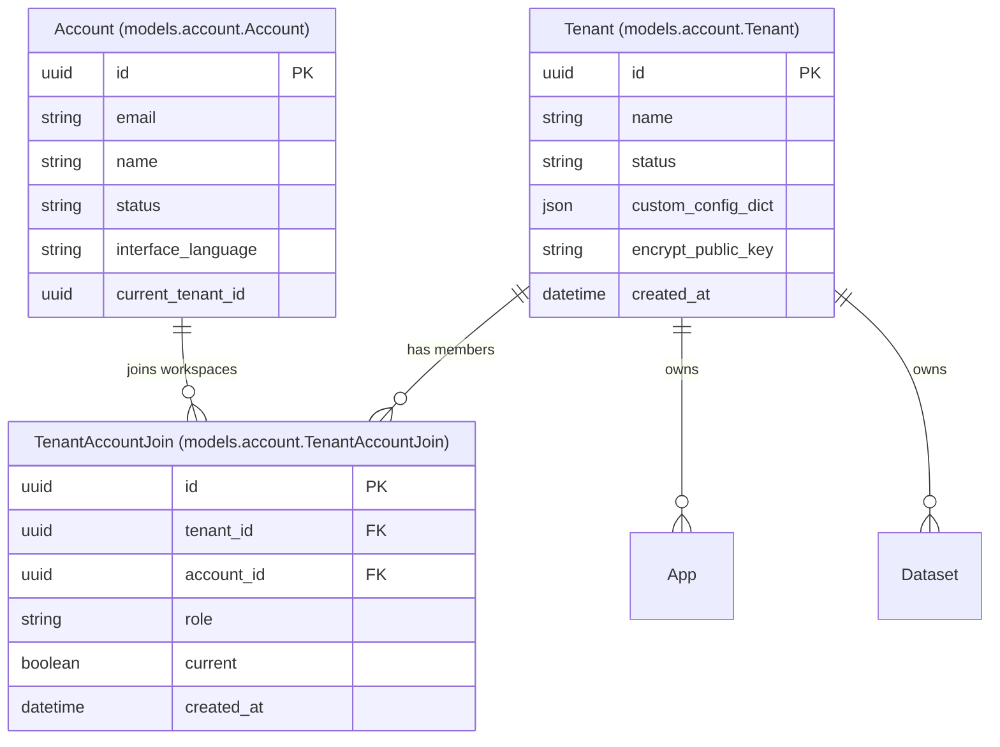
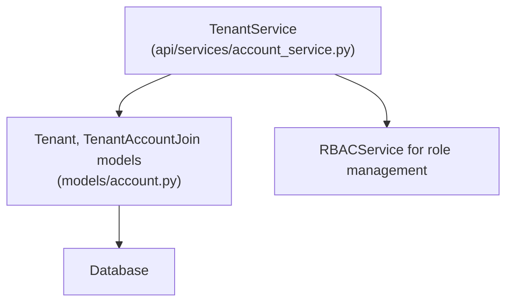
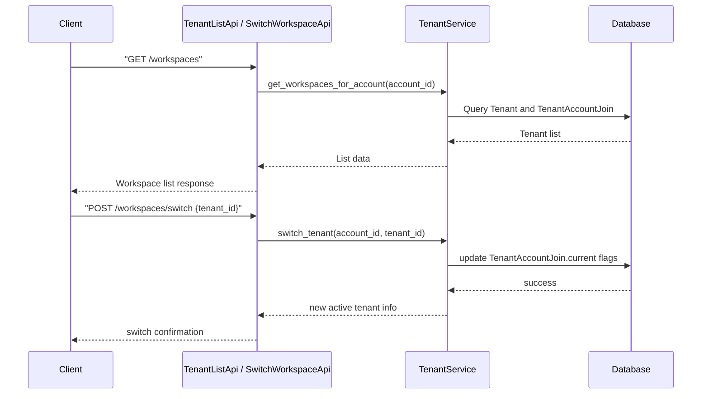
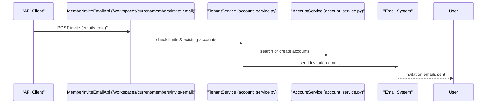
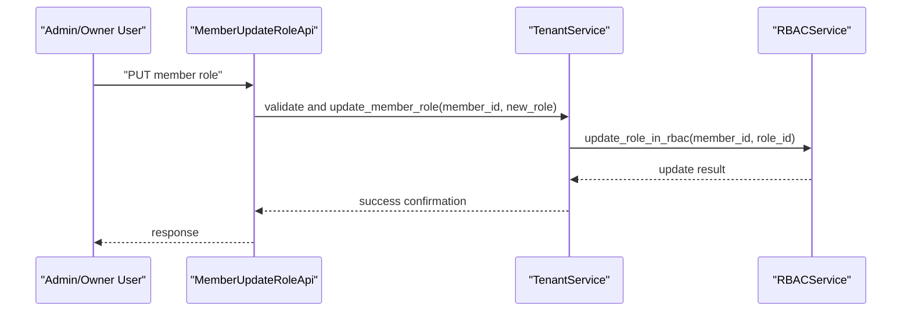
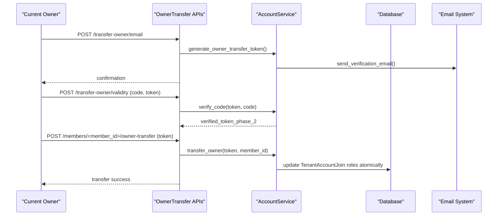
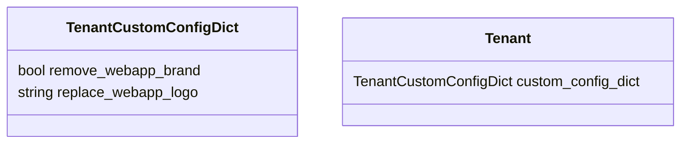
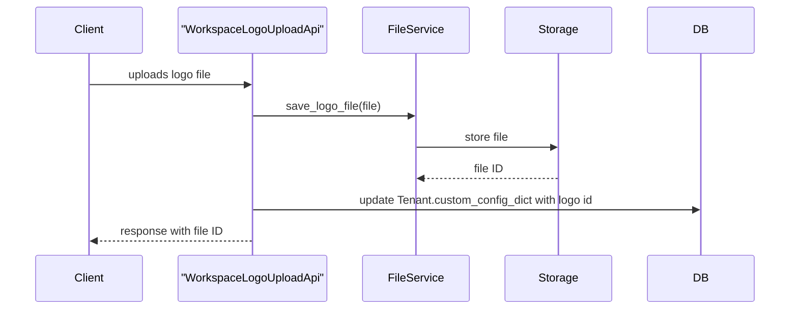
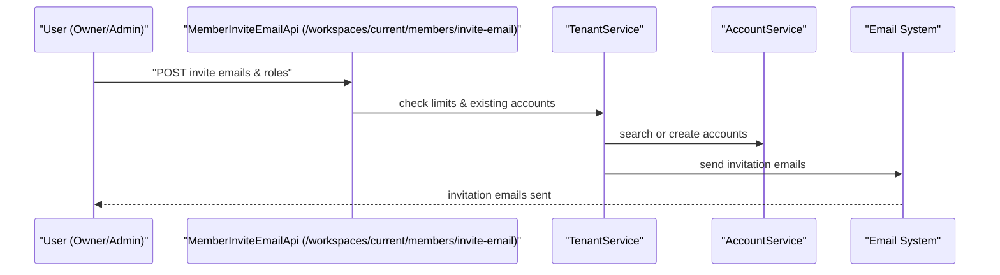

<!-- source: DeepWiki mcp.deepwiki.com · repo langgenius/dify · page 8.4 Workspace and Member Management · fetched 2026-10-26 -->

# Workspace and Member Management

<details>
<summary>Relevant source files</summary>

The following files were used as context for generating this wiki page:

- [api/controllers/console/workspace/__init__.py](api/controllers/console/workspace/__init__.py)
- [api/controllers/console/workspace/account.py](api/controllers/console/workspace/account.py)
- [api/controllers/console/workspace/agent_providers.py](api/controllers/console/workspace/agent_providers.py)
- [api/controllers/console/workspace/endpoint.py](api/controllers/console/workspace/endpoint.py)
- [api/controllers/console/workspace/members.py](api/controllers/console/workspace/members.py)
- [api/controllers/console/workspace/model_providers.py](api/controllers/console/workspace/model_providers.py)
- [api/controllers/console/workspace/models.py](api/controllers/console/workspace/models.py)
- [api/controllers/console/workspace/plugin.py](api/controllers/console/workspace/plugin.py)
- [api/controllers/console/workspace/workspace.py](api/controllers/console/workspace/workspace.py)
- [api/libs/password.py](api/libs/password.py)
- [api/tests/test_containers_integration_tests/controllers/console/workspace/test_members.py](api/tests/test_containers_integration_tests/controllers/console/workspace/test_members.py)
- [api/tests/test_containers_integration_tests/controllers/console/workspace/test_workspace_wraps.py](api/tests/test_containers_integration_tests/controllers/console/workspace/test_workspace_wraps.py)
- [api/tests/unit_tests/controllers/console/test_workspace_account.py](api/tests/unit_tests/controllers/console/test_workspace_account.py)
- [api/tests/unit_tests/controllers/console/test_workspace_credential_mutation_permissions.py](api/tests/unit_tests/controllers/console/test_workspace_credential_mutation_permissions.py)
- [api/tests/unit_tests/controllers/console/workspace/test_accounts.py](api/tests/unit_tests/controllers/console/workspace/test_accounts.py)
- [api/tests/unit_tests/controllers/console/workspace/test_agent_providers.py](api/tests/unit_tests/controllers/console/workspace/test_agent_providers.py)
- [api/tests/unit_tests/controllers/console/workspace/test_endpoint.py](api/tests/unit_tests/controllers/console/workspace/test_endpoint.py)
- [api/tests/unit_tests/controllers/console/workspace/test_members.py](api/tests/unit_tests/controllers/console/workspace/test_members.py)
- [api/tests/unit_tests/controllers/console/workspace/test_model_providers.py](api/tests/unit_tests/controllers/console/workspace/test_model_providers.py)
- [api/tests/unit_tests/controllers/console/workspace/test_models.py](api/tests/unit_tests/controllers/console/workspace/test_models.py)
- [api/tests/unit_tests/controllers/console/workspace/test_plugin.py](api/tests/unit_tests/controllers/console/workspace/test_plugin.py)
- [api/tests/unit_tests/controllers/console/workspace/test_workspace.py](api/tests/unit_tests/controllers/console/workspace/test_workspace.py)
- [api/tests/unit_tests/libs/test_password.py](api/tests/unit_tests/libs/test_password.py)
- [docker/envs/core-services/api.env.example](docker/envs/core-services/api.env.example)
- [packages/contracts/generated/api/console/account/types.gen.ts](packages/contracts/generated/api/console/account/types.gen.ts)
- [packages/contracts/generated/api/console/account/zod.gen.ts](packages/contracts/generated/api/console/account/zod.gen.ts)
- [web/app/account/(commonLayout)/avatar.tsx](web/app/account/(commonLayout)/avatar.tsx)
- [web/app/components/base/file-uploader/file-uploader-in-chat-input/index.tsx](web/app/components/base/file-uploader/file-uploader-in-chat-input/index.tsx)
- [web/app/components/base/premium-badge/index.css](web/app/components/base/premium-badge/index.css)
- [web/app/components/base/premium-badge/index.tsx](web/app/components/base/premium-badge/index.tsx)
- [web/app/components/header/account-dropdown/__tests__/index.spec.tsx](web/app/components/header/account-dropdown/__tests__/index.spec.tsx)
- [web/app/components/header/account-dropdown/index.tsx](web/app/components/header/account-dropdown/index.tsx)
- [web/app/components/header/account-dropdown/workplace-selector/index.tsx](web/app/components/header/account-dropdown/workplace-selector/index.tsx)
- [web/app/components/header/account-setting/members-page/member-details-modal/__tests__/index.spec.tsx](web/app/components/header/account-setting/members-page/member-details-modal/__tests__/index.spec.tsx)
- [web/app/components/header/account-setting/members-page/member-details-modal/permission-role-chip.tsx](web/app/components/header/account-setting/members-page/member-details-modal/permission-role-chip.tsx)
- [web/app/components/header/account-setting/members-page/member-row.tsx](web/app/components/header/account-setting/members-page/member-row.tsx)
- [web/app/components/header/account-setting/members-page/role-badges.tsx](web/app/components/header/account-setting/members-page/role-badges.tsx)
- [web/app/components/header/plan-badge/index.tsx](web/app/components/header/plan-badge/index.tsx)
- [web/app/components/main-nav/components/account-section.tsx](web/app/components/main-nav/components/account-section.tsx)
- [web/app/components/main-nav/components/help-menu/account-about-dialog.tsx](web/app/components/main-nav/components/help-menu/account-about-dialog.tsx)
- [web/service/common.ts](web/service/common.ts)
- [web/themes/manual-dark.css](web/themes/manual-dark.css)
- [web/themes/manual-light.css](web/themes/manual-light.css)

</details>


This page documents workspace (tenant) management operations, member lifecycle management, and role-based access control in Dify. It covers workspace CRUD operations, member invitation workflows, role updates, owner transfer, and workspace-level permissions including custom configurations.

For information about the underlying tenant and account data models, see page 8.1. For authentication mechanisms, see page 8.2. For detailed RBAC policies and role checks, see page 8.3.

---

## Workspace Data Model

### Core Entities and Relationships

The workspace system is primarily implemented through the `Tenant` entity representing a workspace, and its many-to-many relationship with user accounts via `TenantAccountJoin`. A `Tenant` owns resources like apps and datasets, and members are linked through the join table specifying roles and membership status.



The classes `Tenant`, `Account`, and `TenantAccountJoin` are defined in `models/account.py`. The join entity `TenantAccountJoin` encodes membership role, invitation info, and whether the workspace is the current active one for the user.

Sources: [api/models/account.py:36-48](), [api/models/account.py:330-365]()

---

### Tenant Status and Member Roles

Workspaces use the enum `TenantStatus` to reflect their operational state, typically `NORMAL` for active workspaces.

Member roles within a workspace are enumerated by `TenantAccountRole`, defining permission levels:

| Role                  | Description                                  | Source                      |
|-----------------------|----------------------------------------------|-----------------------------|
| `OWNER`               | Full control, including billing and owner transfer rights | `models.account.TenantAccountRole` |
| `ADMIN`               | Manage users and workspace resources          | `models.account.TenantAccountRole` |
| `EDITOR`              | Create and edit workspace content              | `models.account.TenantAccountRole` |
| `NORMAL`              | Standard member/user                           | `models.account.TenantAccountRole` |
| `DATASET_OPERATOR`    | Limited to knowledge base operations           | `models.account.TenantAccountRole` |

Role entries in `TenantAccountJoin` define a member's current role and are used extensively for access control checks, integrated with RBAC services if enabled.

Sources: [api/models/account.py:42-48]()

---

## Workspace Operations

### TenantService Overview

Workspace logic is handled mainly by the `TenantService` class implemented in `api/services/account_service.py`. This service manages:

- Tenant lifecycle (create, update, delete)
- Membership operations (add members, remove members)
- Role management and owner transfer
- Integration with RBAC for enterprise permissions

Key methods include:

- `create_tenant()`: Creates new workspace records.
- `get_workspaces_for_account()`: Lists all workspaces an account belongs to.
- `switch_tenant()`: Sets the current active workspace for the account.
- `invite_member()`: Sends invitations or adds members to a tenant.
- `remove_member()`: Removes members from the workspace.
- `update_member_role()`: Changes roles of workspace members.
- `transfer_owner()`: Transfers ownership of a workspace safely.



The service methods are explicit about sql session usage for transactional integrity.

Sources: [api/services/account_service.py:153-540](), [api/services/account_service.py:801-1100]()

---

### Workspace Listing and Switching

The REST API `TenantListApi` in `api/controllers/console/workspace/workspace.py` implements workspace listing:

- `GET /workspaces`: Returns detailed workspace list including plan, role, status, creation date, and credits.
- The response marshals tenant entities plus subscription and trial info.
- Uses `TenantService.get_workspaces_for_account` together with billing and plan gateway services.

Switching active workspace is done via:

- `POST /workspaces/switch` handled by `SwitchWorkspaceApi`: accepts `tenant_id` and makes this tenant the current active one.
- Updates `TenantAccountJoin.current` flags and account current tenant accordingly.



Sources: [api/controllers/console/workspace/workspace.py:50-150](), [api/controllers/console/workspace/workspace.py:339]()

---

## Member Management and Invitation

### Member Invitation Workflow

Members are invited through `POST /workspaces/current/members/invite-email` via `MemberInviteEmailApi` in `api/controllers/console/workspace/members.py` that accepts a `MemberInvitePayload` containing emails and roles.

Workflow steps:

1. Emails normalization and deduplication.
2. Existing accounts lookup by email, and detection if already workspace members.
3. Calls `TenantService.invite_member` for each new member or account.
4. Validation of invite limits to prevent exceeding seat/workspace member quotas.
5. Sends invitation emails asynchronously.



The system enforces limits based on deployment edition (Enterprise, Cloud) using features and license seats.

Sources: [api/controllers/console/workspace/members.py:140-200](), [api/controllers/console/workspace/members.py:230-280](), [api/services/account_service.py:153-540]()

---

### Member Role Updates and RBAC

Role updates are supported via the endpoint `PUT /workspaces/current/members/<member_id>/role` (e.g. `MemberUpdateRoleApi`).

- Roles can be legacy single enums or RBAC role IDs.
- Uses RBACService to update member roles atomically.
- Validates role permissions and allowed values.
- Denies unsupported roles or roles disabled by configuration (e.g., `DATASET_OPERATOR` may be optionally enabled).

The API supports role validation methods internally and enforces non-conflicting role states.



Sources: [api/controllers/console/workspace/members.py:340-370](), [api/services/account_service.py:153-540]()

---

## Owner Transfer System

The owner transfer process involves secure multi-step verification to prevent unauthorized transfers.

### Transfer Flow:

1. **Send Transfer Email**  
   API: `POST /workspaces/current/members/transfer-owner/email`  
   Generates and emails a time-limited verification token and code. This is handled by `SendOwnerTransferEmailApi`.

2. **Verify Transfer Code**  
   API: `POST /workspaces/current/members/transfer-owner/validity`  
   Validates the verification code sent to the current owner’s email. This is handled by `OwnerTransferCheckApi`.

3. **Complete Transfer**  
   API: `POST /workspaces/current/members/{member_id}/owner-transfer`  
   Uses the verified token to atomically swap roles, transferring ownership. This is handled by `OwnerTransfer`.



Key security guards:

- The decorator `is_admin_or_owner_required` ensures only owners can initiate transfer. [api/controllers/console/workspace/members.py:375]()
- Prevents transferring ownership to self with `CannotTransferOwnerToSelfError`. [api/controllers/console/auth/error.py:18]()
- Rate limits enforced via `owner_transfer_rate_limiter`. [api/controllers/console/auth/error.py:25]()

Sources: [api/controllers/console/workspace/members.py:390](), [api/services/account_service.py:153-540](), [api/controllers/console/workspace/members.py:375](), [api/controllers/console/auth/error.py:18](), [api/controllers/console/auth/error.py:25]()

---

## Workspace Customization and Permissions

### Workspace-Level Permissions

Permissions specific to workspace administrative actions like member invitations and owner transfer are exposed via APIs like:

- `GET /workspaces/current/permission` that returns flags such as `allow_member_invite` and `allow_owner_transfer`.
- Controlled by licensing and feature gates to respect plan limits.

Sources: [api/controllers/console/workspace/workspace.py:171-174]()

### Custom Configuration (Branding)

Workspace owners can customize UI branding:

- Boolean flag `remove_webapp_brand` to hide default branding.
- `replace_webapp_logo` storing a file ID referencing a custom logo.

These are configured through `PATCH /workspaces/current/custom-config` handled in `CustomConfigWorkspaceApi`.



This config is persisted in the tenant JSON column `custom_config_dict` in `Tenant`.

Sources: [api/controllers/console/workspace/workspace.py:67-85](), [api/models/account.py:327-330]()

---

### Workspace Logo Upload

Workspace logos can be uploaded through:

- Endpoint `POST /workspaces/current/webapp-logo` accepting a single file in SVG or PNG format.
- The file is processed by `FileService` and stored via the configured storage backend.
- The returned file ID is used to update workspace branding config.



Sources: [api/controllers/console/workspace/workspace.py:195-202](), [api/controllers/console/workspace/workspace.py:334-339]()

---

# Appendices

## Mapping Natural Language Concepts to Code Entities

### Workspace Management Mapping

```mermaid
graph LR
    "Workspace (Tenant)" --> TenantService["TenantService\n(api/services/account_service.py)"]
    "Workspace API" --> TenantListApi["TenantListApi\n(api/controllers/console/workspace/workspace.py)"]
    "Switch Workspace" --> SwitchWorkspaceApi["SwitchWorkspaceApi\n(api/controllers/console/workspace/workspace.py)"]
    TenantService --> TenantModel["Tenant, TenantAccountJoin\n(models/account.py)"]
    TenantListApi --> TenantService
    SwitchWorkspaceApi --> TenantService
```
Sources: [api/services/account_service.py](), [api/controllers/console/workspace/workspace.py](), [api/models/account.py]()

### Member Management and Invitation Mapping

```mermaid
graph LR
    "Member Invitation API" --> MemberInviteEmailApi["MemberInviteEmailApi\n(api/controllers/console/workspace/members.py)"]
    "Member Role Update API" --> MemberUpdateRoleApi["MemberUpdateRoleApi\n(api/controllers/console/workspace/members.py)"]
    "Owner Transfer API" --> OwnerTransferAPIs["SendOwnerTransferEmailApi, OwnerTransferCheckApi, OwnerTransfer\n(api/controllers/console/workspace/members.py)"]
    MemberInviteEmailApi --> TenantService["TenantService\n(api/services/account_service.py)"]
    MemberUpdateRoleApi --> TenantService
    OwnerTransferAPIs --> AccountService["AccountService\n(api/services/account_service.py)"]
```
Sources: [api/controllers/console/workspace/members.py](), [api/services/account_service.py]()

---

# Summary Table of Key Classes and Functions

| Feature                  | Key Code Entities                      | Location                              |
|--------------------------|--------------------------------------|-------------------------------------|
| Workspace data models    | `Tenant`, `TenantAccountJoin`, `Account` | `models/account.py`                  |
| Workspace service logic  | `TenantService`                      | `api/services/account_service.py`   |
| Workspace list API       | `TenantListApi`                     | `api/controllers/console/workspace/workspace.py` |
| Switch workspace API     | `SwitchWorkspaceApi`                | `api/controllers/console/workspace/workspace.py` |
| Member invitation API    | `MemberInviteEmailApi`              | `api/controllers/console/workspace/members.py`   |
| Role update API          | `MemberUpdateRoleApi`              | `api/controllers/console/workspace/members.py`   |
| Owner transfer APIs      | `SendOwnerTransferEmailApi`, `OwnerTransferCheckApi`, `OwnerTransfer` | `api/controllers/console/workspace/members.py`   |
| Workspace branding config| `CustomConfigWorkspaceApi`         | `api/controllers/console/workspace/workspace.py` |
| Workspace logo upload API| `WorkspaceLogoUploadApi`           | `api/controllers/console/workspace/workspace.py` |

---

# Detailed Data Flow for Member Invitation & Owner Transfer


Sources: [api/controllers/console/workspace/members.py:174-200](), [api/services/account_service.py]()

---

# References

- Workspace and member management APIs: [api/controllers/console/workspace/workspace.py](), [api/controllers/console/workspace/members.py]()
- Tenant and account models: [api/models/account.py]()
- Business logic: [api/services/account_service.py]()
- Frontend member UI: [web/app/components/header/account-setting/members-page/index.tsx]()

# End of Page 8.4

---

**Sources summary**:  
- `api/services/account_service.py` [153-540](), [801-1100]()  
- `api/controllers/console/workspace/workspace.py` [50-150](), [392-415](), [67-85](), [171-174](), [195-202](), [334-360]()  
- `api/controllers/console/workspace/members.py` [140-200](), [230-280](), [340-370](), [375](), [420-545]()  
- `api/models/account.py` [36-48](), [42-48](), [327-330](), [330-365]()  
- `api/controllers/console/auth/error.py` [18](), [25]()

---

