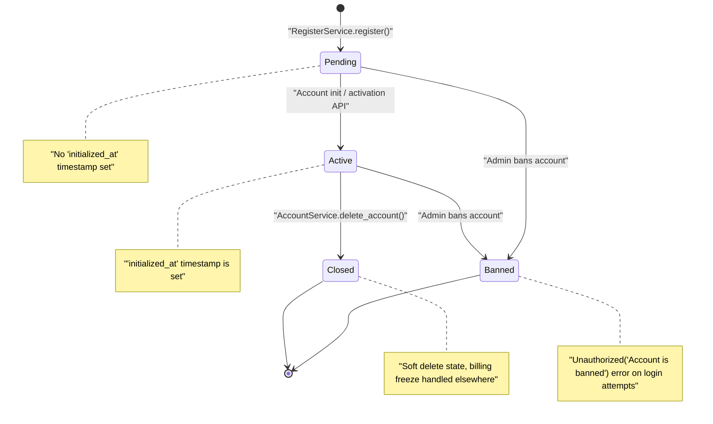
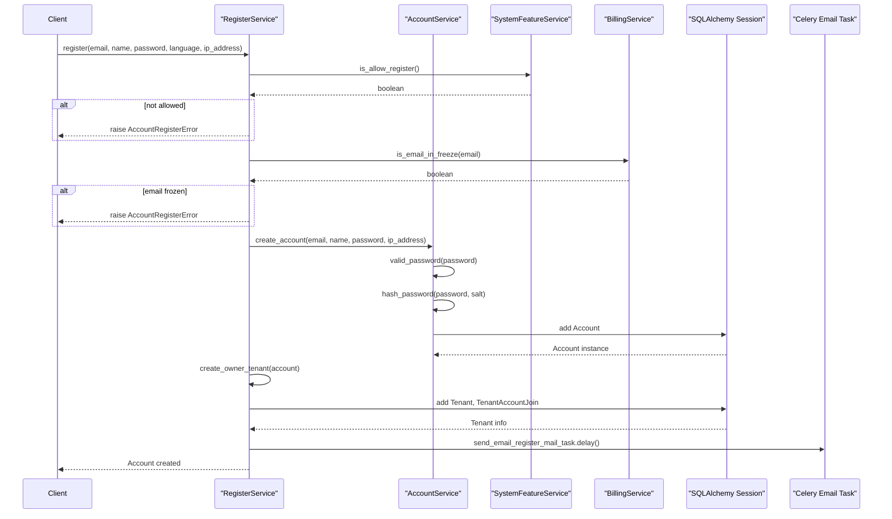
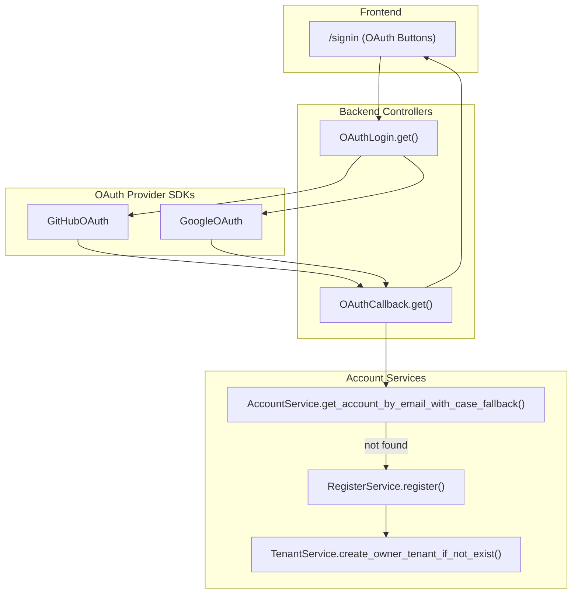
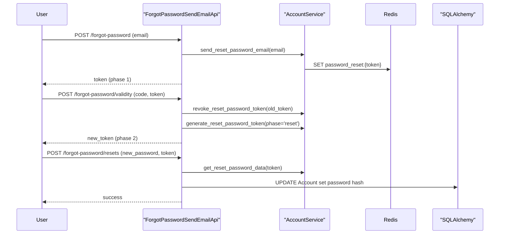
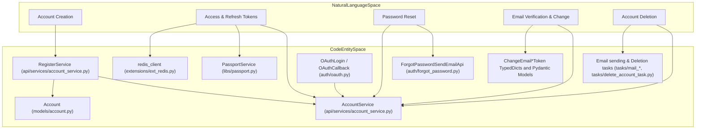
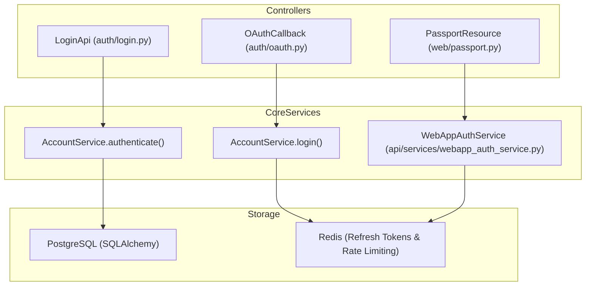

<!-- source: DeepWiki mcp.deepwiki.com · repo langgenius/dify · page 8.5 Account Lifecycle Management · fetched 2026-10-26 -->

# Account Lifecycle Management

Relevant source files

The following files were used as context for generating this wiki page:

- [api/.importlinter](api/.importlinter)
- [api/controllers/console/app/wraps.py](api/controllers/console/app/wraps.py)
- [api/controllers/console/auth/activate.py](api/controllers/console/auth/activate.py)
- [api/controllers/console/auth/email_register.py](api/controllers/console/auth/email_register.py)
- [api/controllers/console/auth/error.py](api/controllers/console/auth/error.py)
- [api/controllers/console/auth/forgot_password.py](api/controllers/console/auth/forgot_password.py)
- [api/controllers/console/auth/login.py](api/controllers/console/auth/login.py)
- [api/controllers/console/auth/oauth.py](api/controllers/console/auth/oauth.py)
- [api/controllers/console/flask_admission.py](api/controllers/console/flask_admission.py)
- [api/controllers/console/wraps.py](api/controllers/console/wraps.py)
- [api/controllers/files/upload_file_delivery.py](api/controllers/files/upload_file_delivery.py)
- [api/controllers/service_api/wraps.py](api/controllers/service_api/wraps.py)
- [api/controllers/web/__init__.py](api/controllers/web/__init__.py)
- [api/controllers/web/forgot_password.py](api/controllers/web/forgot_password.py)
- [api/controllers/web/login.py](api/controllers/web/login.py)
- [api/controllers/web/passport.py](api/controllers/web/passport.py)
- [api/extensions/ext_application_services.py](api/extensions/ext_application_services.py)
- [api/libs/login.py](api/libs/login.py)
- [api/machinery/__init__.py](api/machinery/__init__.py)
- [api/machinery/context.py](api/machinery/context.py)
- [api/machinery/errors.py](api/machinery/errors.py)
- [api/services/account_errors.py](api/services/account_errors.py)
- [api/services/account_ports.py](api/services/account_ports.py)
- [api/services/entities/account_entities.py](api/services/entities/account_entities.py)
- [api/services/entities/auth_entities.py](api/services/entities/auth_entities.py)
- [api/services/upload_file_delivery_service.py](api/services/upload_file_delivery_service.py)
- [api/services/webapp_auth_service.py](api/services/webapp_auth_service.py)
- [api/tests/unit_tests/.ruff.toml](api/tests/unit_tests/.ruff.toml)
- [api/tests/unit_tests/controllers/console/app/test_app_apis.py](api/tests/unit_tests/controllers/console/app/test_app_apis.py)
- [api/tests/unit_tests/controllers/console/app/test_conversation_api.py](api/tests/unit_tests/controllers/console/app/test_conversation_api.py)
- [api/tests/unit_tests/controllers/console/app/test_wraps.py](api/tests/unit_tests/controllers/console/app/test_wraps.py)
- [api/tests/unit_tests/controllers/console/auth/test_account_activation.py](api/tests/unit_tests/controllers/console/auth/test_account_activation.py)
- [api/tests/unit_tests/controllers/console/auth/test_email_register.py](api/tests/unit_tests/controllers/console/auth/test_email_register.py)
- [api/tests/unit_tests/controllers/console/auth/test_forgot_password.py](api/tests/unit_tests/controllers/console/auth/test_forgot_password.py)
- [api/tests/unit_tests/controllers/console/auth/test_login_logout.py](api/tests/unit_tests/controllers/console/auth/test_login_logout.py)
- [api/tests/unit_tests/controllers/console/auth/test_oauth.py](api/tests/unit_tests/controllers/console/auth/test_oauth.py)
- [api/tests/unit_tests/controllers/console/test_wraps.py](api/tests/unit_tests/controllers/console/test_wraps.py)
- [api/tests/unit_tests/controllers/files/test_upload_file_delivery.py](api/tests/unit_tests/controllers/files/test_upload_file_delivery.py)
- [api/tests/unit_tests/controllers/web/conftest.py](api/tests/unit_tests/controllers/web/conftest.py)
- [api/tests/unit_tests/controllers/web/test_completion.py](api/tests/unit_tests/controllers/web/test_completion.py)
- [api/tests/unit_tests/controllers/web/test_web_forgot_password.py](api/tests/unit_tests/controllers/web/test_web_forgot_password.py)
- [api/tests/unit_tests/controllers/web/test_web_login.py](api/tests/unit_tests/controllers/web/test_web_login.py)
- [api/tests/unit_tests/controllers/web/test_web_passport.py](api/tests/unit_tests/controllers/web/test_web_passport.py)
- [api/tests/unit_tests/core/prompt/test_agent_history_prompt_transform.py](api/tests/unit_tests/core/prompt/test_agent_history_prompt_transform.py)
- [api/tests/unit_tests/core/prompt/test_prompt_message.py](api/tests/unit_tests/core/prompt/test_prompt_message.py)
- [api/tests/unit_tests/core/prompt/test_prompt_transform.py](api/tests/unit_tests/core/prompt/test_prompt_transform.py)
- [api/tests/unit_tests/core/prompt/test_simple_prompt_transform.py](api/tests/unit_tests/core/prompt/test_simple_prompt_transform.py)
- [api/tests/unit_tests/extensions/test_ext_application_services.py](api/tests/unit_tests/extensions/test_ext_application_services.py)
- [api/tests/unit_tests/libs/test_login.py](api/tests/unit_tests/libs/test_login.py)
- [api/tests/unit_tests/pyrefly.toml](api/tests/unit_tests/pyrefly.toml)
- [packages/contracts/generated/api/console/refresh-token/types.gen.ts](packages/contracts/generated/api/console/refresh-token/types.gen.ts)
- [packages/contracts/generated/api/console/refresh-token/zod.gen.ts](packages/contracts/generated/api/console/refresh-token/zod.gen.ts)
- [web/service/share.ts](web/service/share.ts)

This document describes the complete lifecycle of user accounts in Dify, covering:

- Account creation (email/password registration, OAuth and invitation-based)
- Account activation and initialization
- Password reset via secure two-phase flows
- Email verification including change email two-phase validation tokens
- Access and refresh token management
- Rate limiting and security protections to prevent abuse
- Account deletion and post-deletion cleanup

This is a core security and identity management subsystem implemented primarily in the `AccountService` and `RegisterService` classes.

For related topics on workspace membership, authentication methods, and tenant isolation, see pages 8.4, 8.2, and 8.1 respectively.

---

## Overview

Account lifecycle management is found largely in the `api/services/account_service.py` file, specifically implemented by:

- `AccountService` class which encapsulates most account operations: creation, password management, email verification, token handling, and deletion.
- `RegisterService` which specializes in user registration flows including creating initial tenants and linking accounts.
  
Support for OAuth is implemented in API controllers under `api/controllers/console/auth/oauth.py`, which delegates to these services. Invitation workflows integrate into these services as well.

Abuse prevention is implemented via `RateLimiter` instances inside `AccountService`. Tokens are managed with Redis, and emails dispatched asynchronously via Celery tasks.

The system supports flexible account creation:

- Email/password
- OAuth providers (e.g., GitHub, Google)
- Invitation-based (email invite with optional auto-join to workspace)

Security-related states, token revocation, and asynchronous deletion tasks are integral to stable lifecycle policies.

---

## Account States and Transitions

The lifecycle states are managed by the `AccountStatus` enum used by the `Account` model.

| Status   | Description                                         |
| -------- | ------------------------------------------------- |
| PENDING  | Account created but not yet activated `(initialized_at == None)` |
| ACTIVE   | Fully activated and initialized                   |
| BANNED   | Blocked account, prevented from logging in        |
| CLOSED   | Soft-deleted, under billing freeze or cleanup     |

State transitions and triggers:

This strict state model governs all lifecycle operations ensuring consistency and security.

---

## Account Creation Flows

### Email/Password Registration

User self-registration is handled by the `RegisterService.register()` method which:

- Checks system feature flag `is_allow_register` to allow or deny registration [api/services/account_service.py:1075-1082]().
- Normalizes and validates emails, checking for email freeze via billing service [api/services/account_service.py:1050-1070]().
- Validates password strength and hashes the password with a salt using `hash_password()` [api/services/account_service.py:1090-1100]().
- Creates the `Account` record with an initial status (commonly ACTIVE).
- Creates an owner tenant/workspace and links the account in tenant membership [api/services/account_service.py:1100-1120]().
- Sends registration confirmation emails asynchronously via Celery tasks.
- Triggers telemetry events, billing checks, and auto-joins enterprise default workspace where applicable.

Sequence diagram for email registration:

---

### OAuth Registration and Login

OAuth login API is implemented via `OAuthLogin` and `OAuthCallback` controllers in the `api/controllers/console/auth/oauth.py` file.

Process:

- User initiates OAuth login on frontend.
- Backend redirects the user to the OAuth provider's authorization URL.
- Upon callback, the provider returns an authorization code.
- Backend exchanges the code for user info and attempts to find an account by email with case fallback through `AccountService`.
- If no account is found, `RegisterService.register()` creates a new user account.
- In Enterprise editions, system attempts auto-join to default workspace.
- Issue tokens and redirect user back to frontend with session cookies.

Flow diagram linking natural language steps to code entities:

---

## Password Management

### Password Reset Flow

Dify's password reset is a two-phase secure flow using tokens and verification codes sent by email, stored in Redis.

Endpoints in `api/controllers/console/auth/forgot_password.py` implement these steps:

1. **Send reset email:** POST `/forgot-password` — User requests password reset by email; system sends a reset code and issues a reset token [lines 55-85]().

2. **Verify code:** POST `/forgot-password/validity` — User submits email, code and token; system verifies and returns a new reset-phase token [lines 87-121]().

3. **Reset password:** POST `/forgot-password/resets` — User submits new password and reset-phase token; system updates password hash in DB [lines 123-153]().

Sequence diagram:

---

## Token Management

### Access and Refresh Tokens

Dify issues `Access Tokens` and `Refresh Tokens` for session management:

- `Access Tokens` are short-lived JWTs signed and issued by the `PassportService` (in `libs/passport.py`).
- `Refresh Tokens` are stored in Redis with prefixes such as `refresh_token:` and `account_refresh_token:` and expire according to configuration [api/services/account_service.py:140-160]().

Tokens are managed consistently across web and API clients with refresh logic and revocation, enabling strong session control and logout operations.

### WebApp Passport Token

The WebApp passport system provides tokens at the `EndUser` level, supporting:

- Token generation based on app and user info.
- Session exchange flows for enterprise users.
- CSRF token issuance for browser security.

This is handled in `api/controllers/web/passport.py`.

---

## Rate Limiting and Security

`AccountService` implements multiple rate limiters using the `RateLimiter` helper to prevent abuse and brute force attacks:

| Limiter                          | Max Attempts | Time Window    | Purpose                              |
|---------------------------------|--------------|----------------|------------------------------------|
| `reset_password_rate_limiter`   | 1            | 60 seconds     | Throttle password reset email sends|
| `email_code_login_rate_limiter` | 3            | 5 minutes      | Throttle email code login attempts |
| `change_email_rate_limiter`     | 1            | 1 minute       | Limit email change requests         |
| `owner_transfer_rate_limiter`   | 1            | 1 minute       | Limit workspace owner transfer      |

These limiters protect heavy user-sensitive operations and are checked at service layer during account interactions.

---

## Two-Phase Email Verification and Change Email Flow

To securely handle email verification and email address changes, Dify uses two-phase token flows that encode phase and email info in token payloads.

Tokens are TypedDicts such as:

- `ChangeEmailOldEmailToken` capturing account ID, old email, and verification code for phase 1.
- `ChangeEmailNewEmailToken` for phase 2, including account ID, new email, and verification code.

The `AccountService` manages these token encodings and decoding, enforcing phase advancement only after successful verification of the old email. Codes are sent via email, stored temporarily for verification and revocation.

This approach ensures strict validation and mitigates risks associated with email change hijacking.

---

## Account Deletion

Account deletion is performed softly by marking the account as `CLOSED` and freezing billing within `AccountService.delete_account()`.

The deletion workflow schedules asynchronous background tasks using Celery to:

- Perform data cleanup.
- Remove related user resources.
- Handle event consistency without blocking request-response latency.

This staged approach ensures a robust and responsive user deletion lifecycle.

---

## Code Entity Bridge Diagrams

### Account Registration and Token Flow

This diagram bridges the natural language account lifecycle concepts to their main code entities involved in creation, tokens, password reset, email verification, and deletion.

---

### Authentication and Session Management

This diagram associates the main controllers with core service components and storage layers used in authentication and session handling.

---

# Summary

Dify’s account lifecycle management implements robust flows for user onboarding, session and token management, as well as secure handling of email verification and password reset. It enforces rate limits and two-phase token schemes to mitigate abuse, and integrates tightly to tenant and workspace models.

The design uses a combination of database persistence, Redis-backed ephemeral tokens, and background email/task queues to ensure responsive and secure account handoff flows.

---

**Sources:**  
- `api/services/account_service.py` [1000-1150](), [1250-1350]()  
- `api/services/account_service.py` [900-1100]()  
- `api/controllers/console/auth/oauth.py` [1-170]()  
- `api/controllers/console/auth/forgot_password.py` [50-150]()  
- `api/controllers/console/auth/login.py` [100-170]()  
- `api/libs/passport.py` [19-40]()  
- `api/models/account.py` [30-50]()  
- `api/tasks/delete_account_task.py` [10-40]()

---

