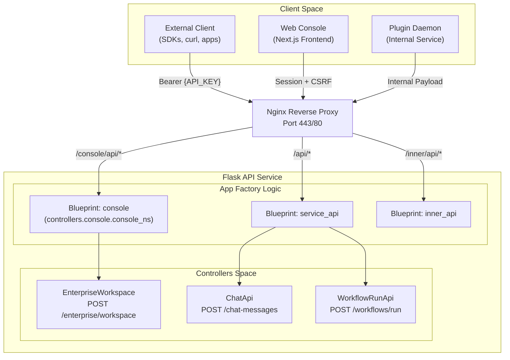
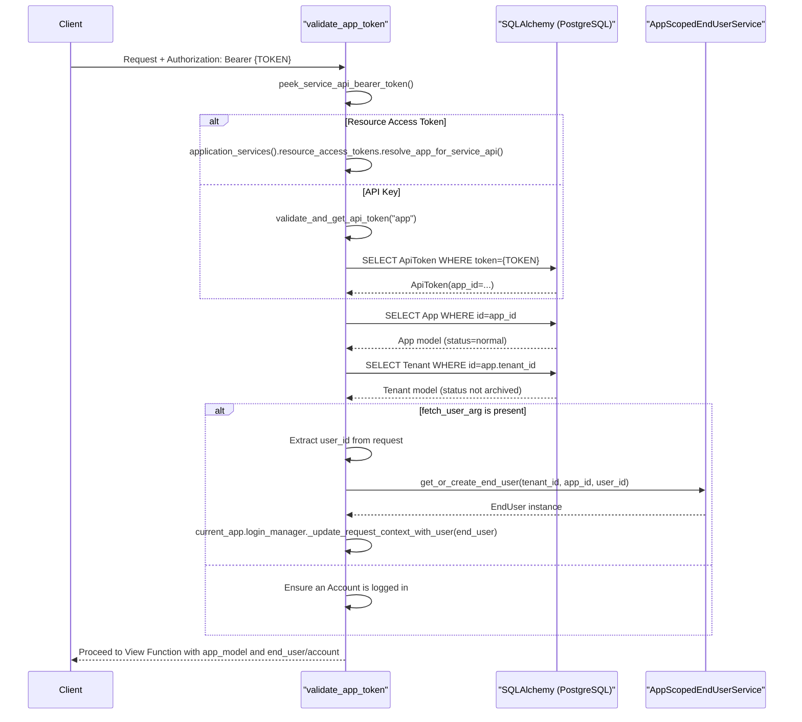
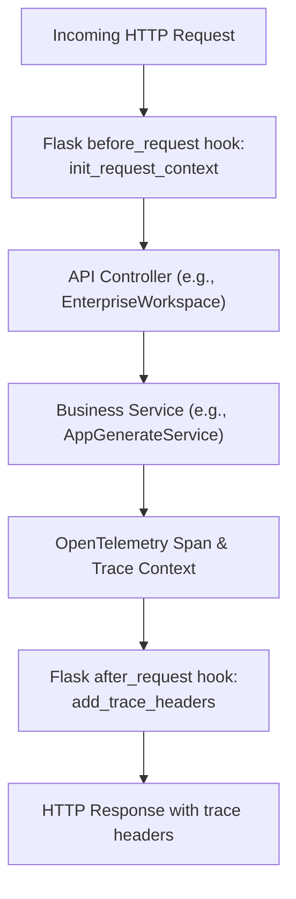
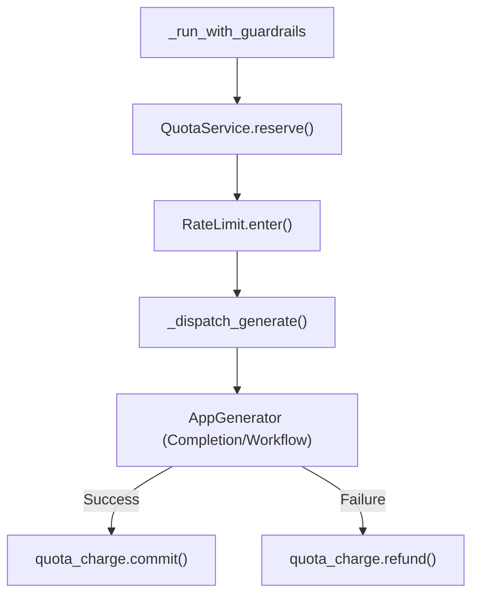

<!-- source: DeepWiki mcp.deepwiki.com · repo langgenius/dify · page 9.1 API Architecture and Request Flow · fetched 2026-10-26 -->

# API Architecture and Request Flow

Relevant source files

The following files were used as context for generating this wiki page:

- [.coveragerc](.coveragerc)
- [api/.importlinter](api/.importlinter)
- [api/controllers/console/app/wraps.py](api/controllers/console/app/wraps.py)
- [api/controllers/console/flask_admission.py](api/controllers/console/flask_admission.py)
- [api/controllers/console/wraps.py](api/controllers/console/wraps.py)
- [api/controllers/inner_api/__init__.py](api/controllers/inner_api/__init__.py)
- [api/controllers/inner_api/app/dsl.py](api/controllers/inner_api/app/dsl.py)
- [api/controllers/inner_api/app/file_grants.py](api/controllers/inner_api/app/file_grants.py)
- [api/controllers/inner_api/mail.py](api/controllers/inner_api/mail.py)
- [api/controllers/inner_api/runtime_credentials.py](api/controllers/inner_api/runtime_credentials.py)
- [api/controllers/inner_api/workspace/workspace.py](api/controllers/inner_api/workspace/workspace.py)
- [api/controllers/service_api/wraps.py](api/controllers/service_api/wraps.py)
- [api/dev/generate_swagger_markdown_docs.py](api/dev/generate_swagger_markdown_docs.py)
- [api/dev/generate_swagger_specs.py](api/dev/generate_swagger_specs.py)
- [api/extensions/ext_application_services.py](api/extensions/ext_application_services.py)
- [api/extensions/ext_blueprints.py](api/extensions/ext_blueprints.py)
- [api/extensions/ext_login.py](api/extensions/ext_login.py)
- [api/libs/external_api.py](api/libs/external_api.py)
- [api/libs/login.py](api/libs/login.py)
- [api/libs/token.py](api/libs/token.py)
- [api/machinery/__init__.py](api/machinery/__init__.py)
- [api/machinery/context.py](api/machinery/context.py)
- [api/machinery/errors.py](api/machinery/errors.py)
- [api/services/account_errors.py](api/services/account_errors.py)
- [api/services/account_ports.py](api/services/account_ports.py)
- [api/services/entities/account_entities.py](api/services/entities/account_entities.py)
- [api/tests/integration_tests/conftest.py](api/tests/integration_tests/conftest.py)
- [api/tests/unit_tests/.ruff.toml](api/tests/unit_tests/.ruff.toml)
- [api/tests/unit_tests/commands/test_generate_swagger_specs.py](api/tests/unit_tests/commands/test_generate_swagger_specs.py)
- [api/tests/unit_tests/controllers/console/app/test_app_apis.py](api/tests/unit_tests/controllers/console/app/test_app_apis.py)
- [api/tests/unit_tests/controllers/console/app/test_conversation_api.py](api/tests/unit_tests/controllers/console/app/test_conversation_api.py)
- [api/tests/unit_tests/controllers/console/app/test_wraps.py](api/tests/unit_tests/controllers/console/app/test_wraps.py)
- [api/tests/unit_tests/controllers/console/test_wraps.py](api/tests/unit_tests/controllers/console/test_wraps.py)
- [api/tests/unit_tests/controllers/inner_api/app/test_dsl.py](api/tests/unit_tests/controllers/inner_api/app/test_dsl.py)
- [api/tests/unit_tests/controllers/inner_api/test_schema.py](api/tests/unit_tests/controllers/inner_api/test_schema.py)
- [api/tests/unit_tests/controllers/inner_api/workspace/test_workspace.py](api/tests/unit_tests/controllers/inner_api/workspace/test_workspace.py)
- [api/tests/unit_tests/core/prompt/test_agent_history_prompt_transform.py](api/tests/unit_tests/core/prompt/test_agent_history_prompt_transform.py)
- [api/tests/unit_tests/core/prompt/test_prompt_message.py](api/tests/unit_tests/core/prompt/test_prompt_message.py)
- [api/tests/unit_tests/core/prompt/test_prompt_transform.py](api/tests/unit_tests/core/prompt/test_prompt_transform.py)
- [api/tests/unit_tests/core/prompt/test_simple_prompt_transform.py](api/tests/unit_tests/core/prompt/test_simple_prompt_transform.py)
- [api/tests/unit_tests/extensions/test_ext_application_services.py](api/tests/unit_tests/extensions/test_ext_application_services.py)
- [api/tests/unit_tests/extensions/test_ext_login.py](api/tests/unit_tests/extensions/test_ext_login.py)
- [api/tests/unit_tests/libs/test_login.py](api/tests/unit_tests/libs/test_login.py)
- [api/tests/unit_tests/libs/test_token.py](api/tests/unit_tests/libs/test_token.py)
- [api/tests/unit_tests/pyrefly.toml](api/tests/unit_tests/pyrefly.toml)

## Purpose and Scope

This document details the architecture and flow of API requests within the Dify platform. It covers key aspects such as API authentication mechanisms, user and tenant context tracking, response modes (streaming vs blocking), enforcement of billing and feature quotas, and trace ID propagation for observability.

This leaf page complements other API-specific documentation:
- Chat and Completion APIs: [9.2]()
- Workflow Execution API: [9.3]()
- File and Feedback APIs: [9.4](), [9.5]()

Background on tenancy, authentication, and roles is described in [8.2]() and [8.3](). For overall system topology see [2.1]().

---

## Dual API Architecture: Console API vs Service API

### Overview

Dify exposes three primary API surfaces serving different purposes and employing distinct authentication methods:

| API Type | Base Path | Purpose | Authentication | Typical Clients |
|---|---|---|---|---|
| **Console API** | `/console/api` | Internal management (apps, datasets, monitoring) | Session-based login (Passport) + CSRF | Web console UI |
| **Service API** | `/api` or `/v1` | External application access (chat messages, completions, workflows) | API Key (Bearer Token) | External clients, SDKs, integrations |
| **Inner API** | `/inner/api` | Internal communication among Dify components | Shared secrets / payload validation | Plugin daemon, internal workers |

### Internal Flask Blueprint Structure

- The Flask app factory (`create_flask_app_with_configs` in `api/app_factory.py`) registers separate Blueprints for these APIs:
  - `console` blueprint serves the Console API [api/controllers/console/__init__.py:8-15]()
  - `service_api` blueprint serves the Service API with bearer token authentication
  - `inner_api` blueprint serves internal APIs for enterprise workflows and controls

- Each Blueprint organizes related Flask-RestX namespaces and routes. For example, the Console API handles Tenant and Workspace management via `TenantListApi` [api/controllers/console/workspace/workspace.py:97-124]().

- The `inner_api` blueprint is specifically designed for internal Dify components and uses `inner_api_only` decorator for authentication [api/controllers/inner_api/workspace/workspace.py:100]().

The full app setup with these blueprints and extensions is orchestrated in `api/app_factory.py` [api/app_factory.py:100-159]().

### Diagram: Natural Language to Code Entities — API Routing

**Sources:**
- [api/controllers/console/__init__.py:8-15]()
- [api/controllers/inner_api/workspace/workspace.py:97-124]()
- [api/controllers/inner_api/workspace/workspace.py:100]()
- [api/app_factory.py:100-159]()

---

## Service API Authentication and User Context Injection

### API Key Authentication with `validate_app_token`

Service API endpoints require authentication with an API key presented as a Bearer token in the `Authorization` header. This is enforced by the `validate_app_token` decorator defined in `api/controllers/service_api/wraps.py` [api/controllers/service_api/wraps.py:99-111]() and its decorated function [api/controllers/service_api/wraps.py:112-173]().

#### Validation Flow:

1.  **Token Lookup**: The decorator invokes `peek_service_api_bearer_token()` to extract the token and then checks if it's a resource access token. If not, it calls `validate_and_get_api_token("app")` which validates and fetches an `ApiToken` model from the DB based on the token [api/controllers/service_api/wraps.py:115-128]().
2.  **App Validation**: Queries the `App` model using the token's `app_id`. The app must exist, have `status == "normal"`, and have `enable_api` enabled [api/controllers/service_api/wraps.py:129-137]().
3.  **Tenant Check**: The associated `Tenant` is retrieved and must not be `ARCHIVE` [api/controllers/service_api/wraps.py:139-143]().
4.  **End-User Context** (optional): If the decorated view requests an end-user context (`fetch_user_arg`), it extracts the `user_id` from the Query parameters / JSON body / Form data depending on configuration. It then creates or retrieves this end-user via `application_services().app_scoped_end_users.commands.get_or_create_end_user` and injects it into the Flask `current_user` context using Flask-Login [api/controllers/service_api/wraps.py:148-173]().
5.  **Fallback User**: If no end-user context is requested, for service APIs without end-user context, an `Account` is logged in [api/controllers/service_api/wraps.py:174-175]().

This decorator thus provides both authentication and injected context objects (`app_model` and optionally `end_user`) into the view.

### Diagram: Authentication and User Context Propagation Flow

**Sources:**
- [api/controllers/service_api/wraps.py:99-111]()
- [api/controllers/service_api/wraps.py:112-173]()
- [api/extensions/ext_application_services.py:114-115]() (AppScopedEndUserService definition)

---

## API Response Modes: Streaming vs Blocking

Dify APIs support different response modes, allowing clients to choose between blocking (full response) or streaming (incremental) responses.

### Blocking Mode

- API waits until processing (e.g., LLM completion, workflow execution) finishes and returns the full JSON payload.
- Typically used for standard REST API calls without streaming.

### Streaming Mode (Server-Sent Events)

- API endpoints (notably chat and workflow run) can use streaming to provide real-time incremental updates.
- Streaming is implemented using Server-Sent Events (SSE), enabling clients to receive partial responses (e.g., token-by-token LLM generations).
- The streaming flow involves dispatching background tasks and streaming from a Redis pub/sub channel or Redis streams if `PUBSUB_REDIS_CHANNEL_TYPE` is set to `"streams"` for durability and replay.

### Backend Streaming Implementation Highlights

- `AppGenerateService.generate` routes requests to appropriate `AppGenerator` subclasses (e.g., `CompletionAppGenerator`, `WorkflowAppGenerator`) for execution [api/services/app_generate_service.py:163-225]().

- For streaming, `AppGenerateService` uses `_build_streaming_task_on_subscribe` to set up background workers initiating generation tasks and producing events on pub/sub channels [api/services/app_generate_service.py:43-88]().

- Redis streams are optionally used to enable event persistence and replay support for late subscribers [api/services/app_generate_service.py:69-77]().

**Sources:**
- [api/services/app_generate_service.py:42-126]()
- [api/services/app_generate_service.py:161-225]()

---

## Trace ID Propagation and Observability

Dify maintains and propagates trace IDs to improve observability and correlation between logs and traces.

### Trace Header Injection

- The Flask app factory (`create_flask_app_with_configs` in `api/app_factory.py`) installs an `after_request` hook that injects OpenTelemetry trace/span IDs into HTTP response headers (`X-Trace-Id` and `X-Span-Id`) upon request completion [api/app_factory.py:132-152]().

- This enables external clients or logging infrastructure to correlate requests with distributed traces.

### Request Context with Trace

- The Console API injects a `RequestContext` containing `request_id` and `trace_id` into controller resource methods, for example in tenant workspace APIs [api/controllers/console/workspace/workspace.py:232-233]().

- Core services use decorators like `@trace_span` (e.g., in `AppGenerateService`) to associate business logic with distributed tracing spans [api/services/app_generate_service.py:91-102]().

**Sources:**
- [api/app_factory.py:132-152]()
- [api/controllers/inner_api/workspace/workspace.py:97-124]() (Example of controller using `setup_required` which implies context)
- [api/services/app_generate_service.py:91-102]()

---

## Billing and Quota Enforcement

Dify enforces tenant-level billing plans and quotas to manage resource consumption.

### Billing API Integration

- `BillingService` wraps HTTP calls to an external billing API for quota and subscription info [api/services/billing_service.py:220-270]().

- `FeatureService` queries billing to expose plan features, including upload limits and vector space quotas [api/services/feature_service.py:10-90]().

### Resource Quota Checks in Decorators

- Decorators like `cloud_edition_billing_resource_check` check resources such as members, apps, or vector space usage before allowing further operations [api/controllers/console/wraps.py:176-215]().

- Vector space quota checks directly compare current usage against limits to prevent overuse [api/controllers/console/wraps.py:184-191]().

### Guardrails During API Request Execution

- `AppGenerateService._run_with_guardrails` coordinates:

  1.  **Quota Reservation**: Calls `QuotaService.reserve` to reserve quota units for the request [api/services/app_generate_service.py:129-139]().

  2.  **Rate Limiting**: Uses the `RateLimit` class to track concurrent requests per app for rate control [api/core/app/features/rate_limiting/rate_limit.py:1-20]().

  3.  **Quota Commit or Refund**: Upon successful request start, quota is committed; if errors occur before streaming starts, quota is refunded to avoid penalizing failed attempts [api/services/app_generate_service.py:140-152]().

**Sources:**
- [api/controllers/console/wraps.py:176-215]()
- [api/services/app_generate_service.py:125-160]()
- [api/core/app/features/rate_limiting/rate_limit.py:1-20]()
- [api/services/billing_service.py:218-270]()
- [api/services/feature_service.py:1-90]()

---

## Role-Based Access Control (RBAC) in APIs

The Console API uses RBAC permission decorators to enforce permissions consistently at the API layer.

- Permissions and scopes are part of `RBACPermission` and `RBACResourceScope` enums [api/controllers/console/wraps.py:20-40]().

- Decorators such as `rbac_permission_required` ensure the current user has the required permissions for workspace/application resources.

- Some endpoints require the user to be an admin or owner, enforced by `is_admin_or_owner_required` [api/controllers/console/wraps.py:31]().

- Plugin-related APIs use `plugin_permission_required` decorator for installation and debugging permissions [api/controllers/console/workspace/plugin.py:20-40]().

This layered access control complements API authentication, tying user identity to their roles and entitlements.

**Sources:**
- [api/controllers/console/wraps.py:20-40]()
- [api/controllers/console/wraps.py:31]()
- [api/controllers/console/workspace/plugin.py:20-40]()

---

# Summary Table

| Feature | Code Entities / Files | Description |
|---|---|---|
| Flask Blueprints & Routing | `api/app_factory.py`, `controllers.console.__init__.py` | Separate blueprints organize Console, Service, Inner APIs |
| Service API Token Auth | `validate_app_token` decorator in `service_api/wraps.py` | Validates API key tokens, injects app and user/end-user context |
| End-User Context Injection | `AppScopedEndUserService` + Flask-Login context update | Supports identifying end users in API calls |
| Response Modes | `AppGenerateService` in `app_generate_service.py` | Supports streaming (SSE) and blocking modes with background task |
| Trace Propagation | OpenTelemetry in `app_factory.py` after_request hook | Injects trace and span IDs into HTTP response headers |
| Billing and Quota Enforcement | `BillingService`, `FeatureService`, decorators in `console/wraps.py` | Enforces tenant resource limits and plan checks |
| API Access Control (RBAC) | `rbac_permission_required`, `is_admin_or_owner_required` decorators | Ensures role-based permission enforcement for Console API |

---

This completes the technical overview of Dify’s API architecture and request processing flow, explaining authentication wrappers, user tracking, streaming vs blocking responses, trace ID propagation, and billing/quota conventions.

**All code described can be further explored in the linked source files for implementation details.**

---

