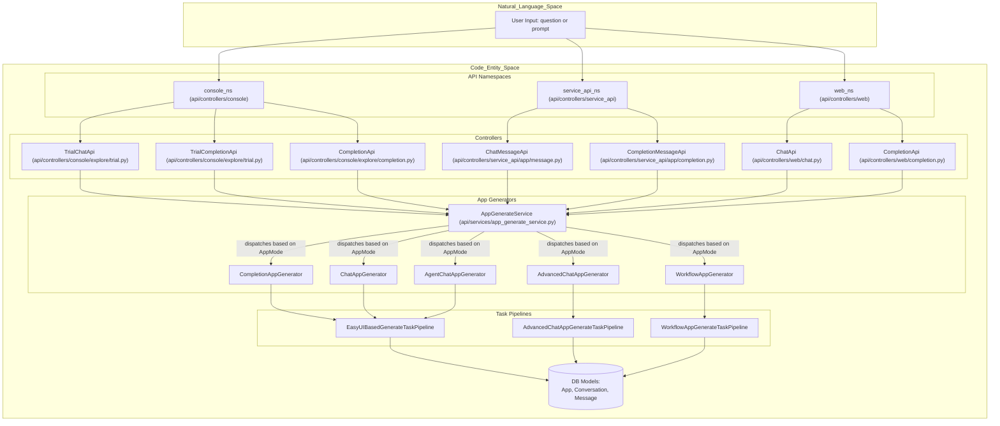
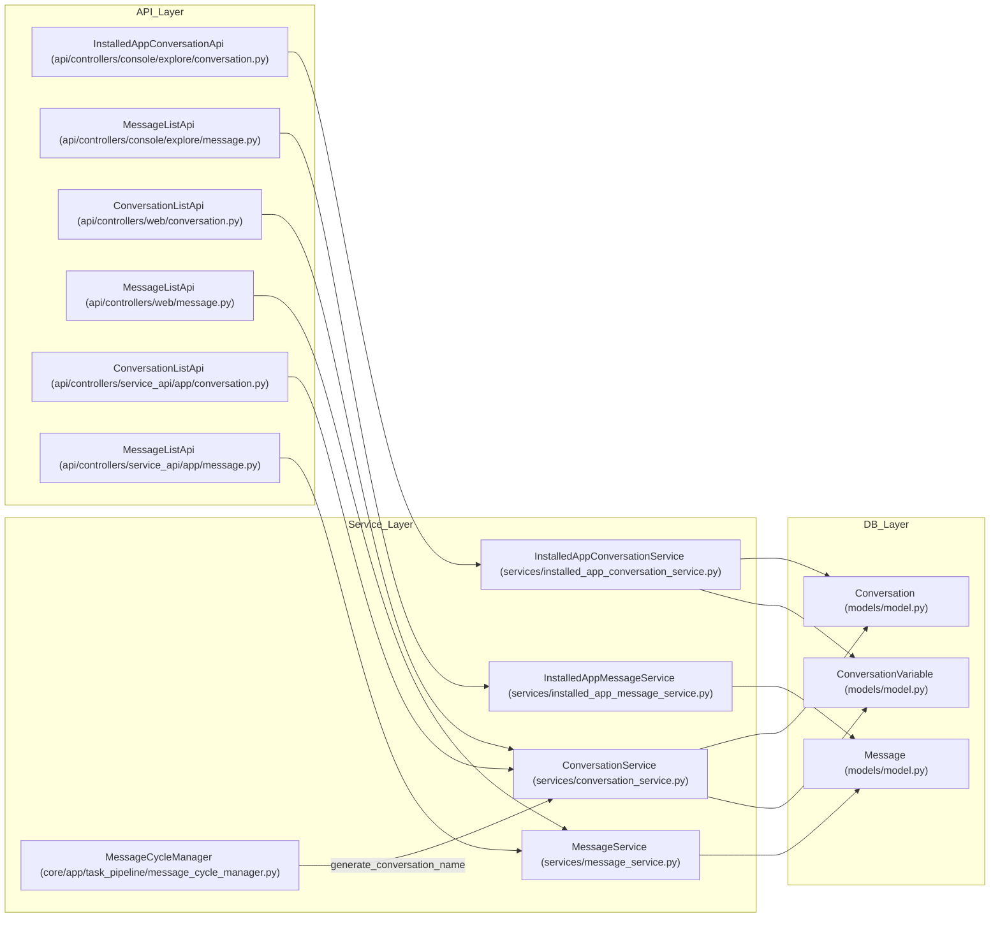

<!-- source: DeepWiki mcp.deepwiki.com · repo langgenius/dify · page 9.2 Chat and Completion APIs · fetched 2026-10-26 -->

# Chat and Completion APIs

Relevant source files

The following files were used as context for generating this wiki page:

- [api/controllers/console/explore/audio.py](api/controllers/console/explore/audio.py)
- [api/controllers/console/explore/completion.py](api/controllers/console/explore/completion.py)
- [api/controllers/console/explore/conversation.py](api/controllers/console/explore/conversation.py)
- [api/controllers/console/explore/error.py](api/controllers/console/explore/error.py)
- [api/controllers/console/explore/installed_app.py](api/controllers/console/explore/installed_app.py)
- [api/controllers/console/explore/message.py](api/controllers/console/explore/message.py)
- [api/controllers/console/explore/saved_message.py](api/controllers/console/explore/saved_message.py)
- [api/controllers/console/explore/trial.py](api/controllers/console/explore/trial.py)
- [api/controllers/console/explore/workflow.py](api/controllers/console/explore/workflow.py)
- [api/controllers/service_api/app/error.py](api/controllers/service_api/app/error.py)
- [api/controllers/service_api/app/message.py](api/controllers/service_api/app/message.py)
- [api/controllers/web/completion.py](api/controllers/web/completion.py)
- [api/controllers/web/conversation.py](api/controllers/web/conversation.py)
- [api/controllers/web/error.py](api/controllers/web/error.py)
- [api/controllers/web/message.py](api/controllers/web/message.py)
- [api/controllers/web/saved_message.py](api/controllers/web/saved_message.py)
- [api/core/app/apps/message_generator.py](api/core/app/apps/message_generator.py)
- [api/core/app/apps/streaming_utils.py](api/core/app/apps/streaming_utils.py)
- [api/core/app/features/rate_limiting/rate_limit.py](api/core/app/features/rate_limiting/rate_limit.py)
- [api/repositories/installed_app_message_repository.py](api/repositories/installed_app_message_repository.py)
- [api/repositories/installed_app_repository.py](api/repositories/installed_app_repository.py)
- [api/services/app_generate_service.py](api/services/app_generate_service.py)
- [api/services/async_workflow_service.py](api/services/async_workflow_service.py)
- [api/services/errors/app.py](api/services/errors/app.py)
- [api/services/installed_app_access_service.py](api/services/installed_app_access_service.py)
- [api/services/installed_app_generation_adapters.py](api/services/installed_app_generation_adapters.py)
- [api/services/installed_app_generation_service.py](api/services/installed_app_generation_service.py)
- [api/tests/unit_tests/controllers/console/explore/test_audio.py](api/tests/unit_tests/controllers/console/explore/test_audio.py)
- [api/tests/unit_tests/controllers/console/explore/test_completion.py](api/tests/unit_tests/controllers/console/explore/test_completion.py)
- [api/tests/unit_tests/controllers/console/explore/test_installed_app.py](api/tests/unit_tests/controllers/console/explore/test_installed_app.py)
- [api/tests/unit_tests/controllers/console/explore/test_installed_app_admission.py](api/tests/unit_tests/controllers/console/explore/test_installed_app_admission.py)
- [api/tests/unit_tests/controllers/console/explore/test_installed_app_completion.py](api/tests/unit_tests/controllers/console/explore/test_installed_app_completion.py)
- [api/tests/unit_tests/controllers/console/explore/test_message.py](api/tests/unit_tests/controllers/console/explore/test_message.py)
- [api/tests/unit_tests/controllers/console/explore/test_parameter.py](api/tests/unit_tests/controllers/console/explore/test_parameter.py)
- [api/tests/unit_tests/controllers/console/explore/test_saved_message.py](api/tests/unit_tests/controllers/console/explore/test_saved_message.py)
- [api/tests/unit_tests/controllers/console/explore/test_trial.py](api/tests/unit_tests/controllers/console/explore/test_trial.py)
- [api/tests/unit_tests/controllers/console/explore/test_workflow.py](api/tests/unit_tests/controllers/console/explore/test_workflow.py)
- [api/tests/unit_tests/controllers/web/test_error.py](api/tests/unit_tests/controllers/web/test_error.py)
- [api/tests/unit_tests/core/app/apps/test_message_generator.py](api/tests/unit_tests/core/app/apps/test_message_generator.py)
- [api/tests/unit_tests/core/app/apps/test_streaming_utils.py](api/tests/unit_tests/core/app/apps/test_streaming_utils.py)
- [api/tests/unit_tests/core/app/features/rate_limiting/conftest.py](api/tests/unit_tests/core/app/features/rate_limiting/conftest.py)
- [api/tests/unit_tests/core/app/features/rate_limiting/test_rate_limit.py](api/tests/unit_tests/core/app/features/rate_limiting/test_rate_limit.py)
- [api/tests/unit_tests/repositories/test_installed_app_conversation_repository.py](api/tests/unit_tests/repositories/test_installed_app_conversation_repository.py)
- [api/tests/unit_tests/repositories/test_installed_app_repository.py](api/tests/unit_tests/repositories/test_installed_app_repository.py)
- [api/tests/unit_tests/services/test_app_generate_service.py](api/tests/unit_tests/services/test_app_generate_service.py)
- [api/tests/unit_tests/services/test_async_workflow_service.py](api/tests/unit_tests/services/test_async_workflow_service.py)
- [api/tests/unit_tests/services/test_installed_app_access_service.py](api/tests/unit_tests/services/test_installed_app_access_service.py)
- [api/tests/unit_tests/services/test_installed_app_conversation_service.py](api/tests/unit_tests/services/test_installed_app_conversation_service.py)
- [api/tests/unit_tests/services/test_installed_app_generation_adapters.py](api/tests/unit_tests/services/test_installed_app_generation_adapters.py)

This document provides a comprehensive technical overview of the Chat and Completion APIs within the Dify platform. These APIs represent the primary endpoints for clients to send user messages and receive AI-generated responses, covering session management, request processing, and response structures. The document explains implementation details, data flow, key classes/functions, and system components related to the `POST /chat-messages` and `POST /completion-messages` endpoints.

---

## Overview

The Chat and Completion APIs serve two distinct usage patterns:

- **Chat API (`POST /chat-messages`)**  
  Designed for conversation-driven applications requiring session persistence tied to a conversation entity. It supports various chat app modes including simple chat, advanced chat, and agent chat, managing conversation state, message history, and multi-turn dialog.

- **Completion API (`POST /completion-messages`)**  
  Designed for stateless text generation tasks such as content completion, translation, or summarization that do not require session context or conversation history.

Both APIs enforce authentication and multi-tenant role-based access control (RBAC). They support synchronous (blocking) or asynchronous (streaming) response modes, with agent apps restricted to streaming only.

| Feature                     | Chat API                            | Completion API           |
|-----------------------------|-----------------------------------|-------------------------|
| Endpoint                    | `/chat-messages`                   | `/completion-messages`   |
| Session Persistence         | Yes (`conversation_id` required)   | No                      |
| Supported App Modes         | `CHAT`, `AGENT_CHAT`, `ADVANCED_CHAT`, `AGENT` | `COMPLETION`            |
| Response Modes Supported    | Blocking, Streaming (agent streaming only) | Blocking, Streaming      |
| Auto Conversation Naming    | Supported                         | N/A                     |

Sources:  
[api/controllers/service_api/app/message.py:70-115](),  
[api/controllers/console/explore/completion.py:49-54](),  
[api/controllers/console/explore/trial.py:152-160](),  
[api/controllers/console/explore/trial.py:168-174]()

---

## API Request Flow

Messages from clients proceed through layered namespaces and controllers before invoking the app generation service pipeline and finally producing responses and saving data.

### Message Processing Flow Diagram

This flow highlights how user requests reach various API namespaces (`console_ns`, `service_api_ns`, `web_ns`), routing onto Chat or Completion controllers. The controllers defer work to `AppGenerateService`, which dispatches to specific app generator objects (`CompletionAppGenerator`, `ChatAppGenerator`, etc.) based on the `AppMode`. These generators then orchestrate task pipelines responsible for model interactions and database updates.

Sources:  
[api/controllers/console/explore/trial.py:22-30](),  
[api/controllers/console/explore/completion.py:86-114](),  
[api/controllers/service_api/app/message.py:70-115](),  
[api/controllers/service_api/app/completion.py:84-114](),  
[api/services/app_generate_service.py:183-196]()

---

## Authentication and Permissions

Both APIs require token-based authentication:

- App-level API tokens authenticate the app requesting generation.
- End-user or console user context may also be passed to support personalized access and conversation ownership.
  
Permission enforcement uses decorators like `@rbac_permission_required`, ensuring that only authorized users can access or perform certain operations on an app, conversation, or message resource.

Sources:  
[api/controllers/service_api/wraps.py:10-30](),  
[api/controllers/service_api/app/message.py:105-107](),
[api/controllers/console/explore/completion.py:100]()

---

## Chat API Implementation

### Endpoint and Controller

The Chat API is implemented at `POST /chat-messages` by `TrialChatApi` for trial apps [api/controllers/console/explore/trial.py:22-26]() and `ChatApi` for web apps [api/controllers/web/chat.py:65-90](). The `service_api` also has a `ChatMessageApi` [api/controllers/service_api/app/message.py:73-74](). It supports modes `CHAT`, `AGENT_CHAT`, `ADVANCED_CHAT`, and `AGENT`.

### Payload Validation

The request body schema is validated by the Pydantic model `ChatRequest` [api/controllers/console/explore/trial.py:152-160]() or `ChatMessagePayload` [api/controllers/console/explore/completion.py:57-64]() which requires:

- `query` (string): User message input
- `inputs` (dict): Optional map of input variables
- `conversation_id` (UUID string | optional): Chat session identifier to preserve context
- `parent_message_id` (UUID string | optional): Supports threaded messages
- `response_mode` (enum: streaming/blocking): Determines response style
- `files` (list | optional): For attachments or multimodal inputs

UUID fields are normalized and validated by `field_validator` [api/controllers/console/explore/completion.py:65-77](). The API refuses blocking mode for Agent apps which only support streaming responses.

### Request Processing

Upon valid input, the controller invokes `AppGenerateService.generate` [api/services/app_generate_service.py:101-111]() with the app, user, and payload. This service:

- Resolves the app mode and dispatches generation strategy accordingly [api/services/app_generate_service.py:183-187]().
- Manages prompts and context (for chat apps).
- Handles LLM provider invocation with retries and error handling.
- Streams data if streaming mode is requested.

### Error Handling

Errors like invalid app mode, quota exhaustion, or provider unavailability translate to specific HTTP error codes and JSON error responses. For example, `NotChatAppError` is raised if the app mode is not chat-compatible [api/controllers/service_api/app/message.py:113-114]().

Sources:  
[api/controllers/console/explore/trial.py:152-160](),  
[api/controllers/console/explore/completion.py:57-77](),  
[api/controllers/service_api/app/message.py:73-74](),  
[api/controllers/service_api/app/message.py:113-114](),  
[api/services/app_generate_service.py:101-111](),  
[api/services/app_generate_service.py:183-187]()

---

## Completion API Implementation

### Endpoint and Controller

The Completion API is implemented at `POST /completion-messages` by `TrialCompletionApi` for trial apps [api/controllers/console/explore/trial.py:34-36](), `CompletionApi` for installed apps [api/controllers/console/explore/completion.py:86-89](), and `CompletionApi` for web apps [api/controllers/web/completion.py:65-68](). The `service_api` also has a `CompletionMessageApi` [api/controllers/service_api/app/completion.py:84-85](). It is specialized for stateless text generation tasks and supports only the `COMPLETION` app mode.

### Payload Validation

Uses the Pydantic `CompletionRequest` [api/controllers/console/explore/trial.py:168-174]() or `CompletionMessageExplorePayload` [api/controllers/console/explore/completion.py:49-54]() which requires:

- `query` (string): The completion prompt text
- `inputs` (dict): Optional inputs to the prompt
- `response_mode` (enum, default blocking): blocking or streaming
- `files` (list | optional): For attachments or multimodal inputs

Unlike the Chat API, no session or conversation ID is expected or supported.

### Request Processing

Invokes the same `AppGenerateService.generate` pipeline [api/services/app_generate_service.py:101-111]() with parameters adjusted for stateless completion. The pipeline then calls the configured LLM provider accordingly [api/services/app_generate_service.py:190-196]().

Sources:  
[api/controllers/console/explore/trial.py:168-174](),  
[api/controllers/console/explore/completion.py:49-54](),  
[api/controllers/console/explore/completion.py:86-89](),  
[api/services/app_generate_service.py:101-111](),  
[api/services/app_generate_service.py:190-196]()

---

## Session and Conversation Management

### Conversation Entity

Chat session persistence is managed via the `Conversation` model:

- Contains conversation metadata including app_id, user owner, timestamps.
- Messages belong to conversations.
- Supports filtering, paging, and soft deletion.

### Conversation Service

`ConversationService` provides:

- Pagination by last conversation ID for infinite scroll UIs.
- Filtering by keyword, date range, and annotation status.
- Auto-generation and updating of conversation names based on initial user queries.

### Conversation API Endpoints

- `GET /installed-apps/{installed_app_id}/conversations` [api/controllers/console/explore/conversation.py:86-87](): List conversations with pagination
- `POST /installed-apps/{installed_app_id}/conversations/{c_id}/name` [api/controllers/console/explore/conversation.py:124-127](): Rename conversation

Sources:  
[api/controllers/console/explore/conversation.py:86-87](),  
[api/controllers/console/explore/conversation.py:124-127]()

---

## Conversation and Message API Components Diagram

This diagram illustrates how API controllers from different namespaces (`console`, `web`, `service_api`) use their respective services (`InstalledAppConversationService`, `ConversationService`, `InstalledAppMessageService`, `MessageService`), which operate on DB models. The message cycle manager integrates with conversation service for naming.

Sources:  
[api/controllers/console/explore/conversation.py:98-104](),  
[api/controllers/console/explore/message.py:138-144](),  
[api/controllers/web/conversation.py:88-94](),  
[api/controllers/web/message.py:88-94](),  
[api/controllers/service_api/app/conversation.py:119-125](),  
[api/controllers/service_api/app/message.py:120-126]()

---

## Task Pipelines and Response Modes

### Task Pipelines

Dify abstracts generation execution into specialized task pipeline classes, each suited for certain app modes.

- **EasyUIBasedGenerateTaskPipeline**  
  Handles general chat, completion, and agent-chat modes with user-facing UI. Supports blocking and streaming modes and manages the message lifecycle.  
  [api/core/app/task_pipeline/easy_ui_based_generate_task_pipeline.py:70-130]()

- **AdvancedChatAppGenerateTaskPipeline**  
  Designed for advanced chat applications which might include workflow-backed state or interaction complexity. Uses SSE for streaming responses.  
  [api/core/app/apps/advanced_chat/app_generator.py:70-90]()

- **WorkflowAppGenerateTaskPipeline**  
  Integrates workflow run events into a streaming response pipeline for workflow-type apps.  
  [api/core/app/apps/workflow/app_generator.py:75-140]()

These pipelines output either fully materialized results (blocking) or generator streams (streaming).

### Response Modes

- `blocking` mode returns the complete response at once after generation concludes.
- `streaming` mode returns partial results as they arrive; supported on chat, agent-chat, advanced-chat, and completion modes.  
- Agent apps exclusively support streaming response mode.

Sources:  
[api/core/app/apps/advanced_chat/app_generator.py:70-90](),  
[api/core/app/apps/workflow/app_generator.py:75-140]()

---

## Annotation and Feedback Features

User feedback on messages enables rating and commenting via:

- `POST /installed-apps/{installed_app_id}/messages/{message_id}/feedbacks` endpoint [api/controllers/console/explore/message.py:148-151]() allows users to submit “like” or “dislike” ratings and optional comments.
- `POST /messages/{message_id}/feedbacks` endpoint for web apps [api/controllers/web/message.py:108-111]() and service API [api/controllers/service_api/app/message.py:138-140]().
- Feedback payload validated by `MessageFeedbackPayload` [api/controllers/common/controller_schemas.py:9-10]().
- Feedback is persisted via `MessageService.create_feedback` [api/controllers/web/message.py:141-146]().
- Supports filtering and export of feedback data.

Message history retrieval supports infinite scroll pagination, configured with `first_id` and `limit` parameters.

Sources:  
[api/controllers/console/explore/message.py:148-151](),  
[api/controllers/web/message.py:108-111](),  
[api/controllers/service_api/app/message.py:138-140](),  
[api/controllers/common/controller_schemas.py:9-10](),  
[api/controllers/web/message.py:141-146]()

---

## Error Handling and Response Structures

The APIs use standard HTTP codes and JSON error messages mapped from custom exceptions:

| HTTP Status | Condition                         | Exception Class / Location                   |
|-------------|---------------------------------|---------------------------------------------|
| 400         | Bad request / mode mismatch     | `NotChatAppError` ([api/controllers/console/explore/error.py:67-68])          |
| 401         | Unauthorized                   | `validate_app_token` decorator ([api/controllers/service_api/wraps.py:15-40])                |
| 404         | Resource not found             | `ConversationNotExistsError` ([api/services/errors/conversation.py:15-21]) |
| 429         | Rate limit exceeded            | `InvokeRateLimitError` ([api/services/errors/llm.py:5-15])    |

Response schemas use Pydantic models registered with Flask-RestX namespaces to document API contracts.

Sources:  
[api/controllers/console/explore/error.py:67-68](),  
[api/controllers/service_api/wraps.py:15-40](),  
[api/services/errors/conversation.py:15-21](),  
[api/services/errors/llm.py:5-15]()

---

# Summary

The Chat and Completion APIs provide flexible and secure endpoints to interact with Dify applications:

- The Chat API manages conversational sessions with persistent conversation entities and supports rich chat modes such as those with agents and advanced workflows.
- The Completion API supports quick, stateless text generation tasks without conversational context.
- Both APIs rely on rigorous authentication, RBAC, and feature robust error handling.
- The app generator and task pipeline design decouples API exposure from execution logic, enabling modularity and scalability.
- Session management ensures continuity in multi-turn interactions and facilitates conversation naming and retrieval.
- User-enabled feedback and message pagination enhance user experience and monitoring.

This architecture supports Dify’s goals to provide adaptable AI app endpoints capable of complex chat, workflow, and generation tasks.

---

# Appendix: Key Files and Classes

| Component                            | File                                       | Description                                |
|------------------------------------|--------------------------------------------|--------------------------------------------|
| `TrialChatApi`                     | `api/controllers/console/explore/trial.py` | Chat API controller for trial apps         |
| `TrialCompletionApi`               | `api/controllers/console/explore/trial.py` | Completion API controller for trial apps   |
| `CompletionApi`                    | `api/controllers/console/explore/completion.py` | Completion API controller for installed apps |
| `ChatMessagePayload`               | `api/controllers/console/explore/completion.py` | Pydantic schema for chat message requests |
| `CompletionMessageExplorePayload`  | `api/controllers/console/explore/completion.py` | Pydantic schema for completion message requests |
| `ConversationService`              | `api/services/conversation_service.py`    | Business logic for conversation management |
| `MessageService`                   | `api/services/message_service.py`          | Message CRUD and pagination                 |
| `AppGenerateService`               | `api/services/app_generate_service.py`     | Core generation orchestration                |
| `EasyUIBasedGenerateTaskPipeline`  | `api/core/app/task_pipeline/easy_ui_based_generate_task_pipeline.py` | General chat/completion pipeline            |
| `AdvancedChatAppGenerateTaskPipeline` | `api/core/app/apps/advanced_chat/app_generator.py` | Advanced chat pipeline                       |
| `MessageFeedbackPayload`           | `api/controllers/common/controller_schemas.py` | Feedback payload schema                      |

Sources compiled from previously cited files.

---

This completes the detailed technical documentation for Dify’s Chat and Completion APIs.

---

