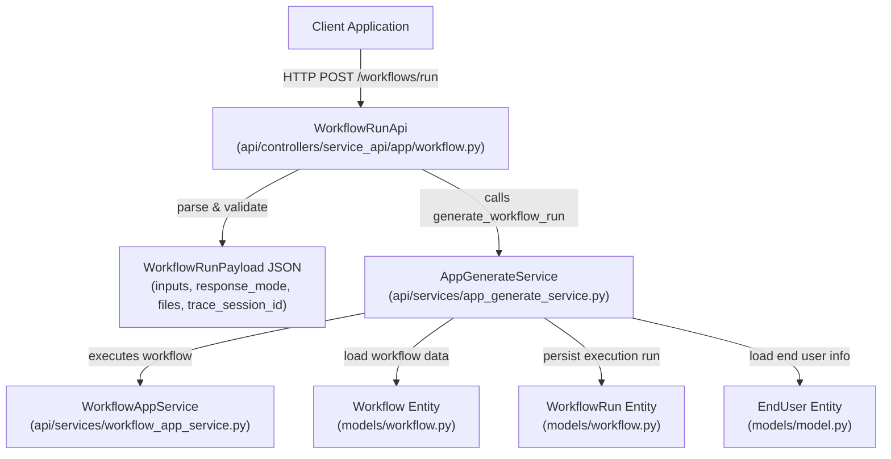
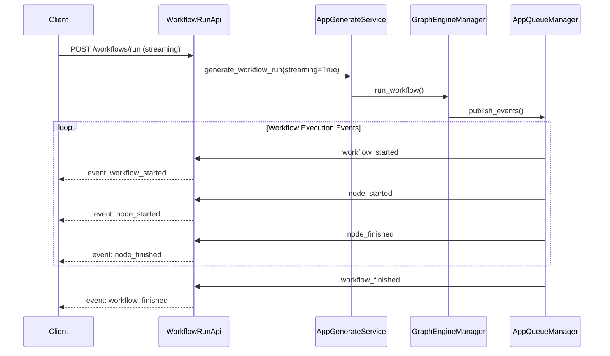
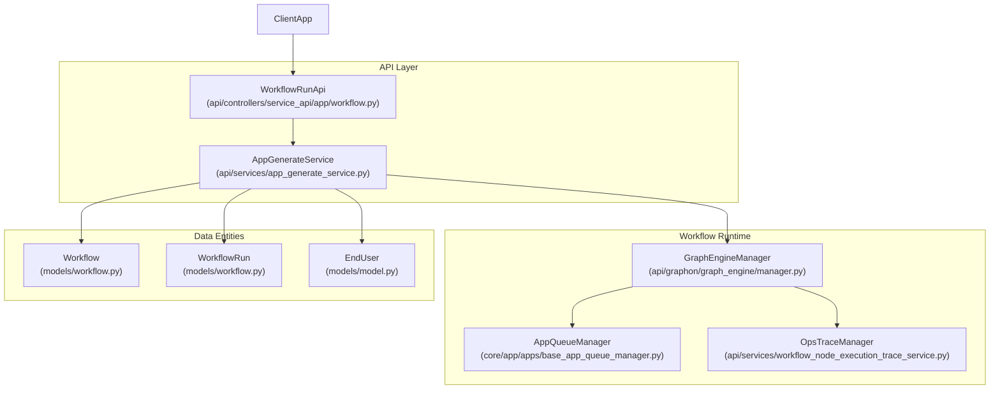

<!-- source: DeepWiki mcp.deepwiki.com · repo langgenius/dify · page 9.3 Workflow Execution API · fetched 2026-10-26 -->

# Workflow Execution API

<details>
<summary>Relevant source files</summary>

The following files were used as context for generating this wiki page:

- [api/controllers/console/app/workflow.py](api/controllers/console/app/workflow.py)
- [api/controllers/console/app/workflow_app_log.py](api/controllers/console/app/workflow_app_log.py)
- [api/controllers/console/app/workflow_draft_variable.py](api/controllers/console/app/workflow_draft_variable.py)
- [api/controllers/console/app/workflow_run.py](api/controllers/console/app/workflow_run.py)
- [api/controllers/console/datasets/rag_pipeline/datasource_auth.py](api/controllers/console/datasets/rag_pipeline/datasource_auth.py)
- [api/controllers/console/datasets/rag_pipeline/datasource_content_preview.py](api/controllers/console/datasets/rag_pipeline/datasource_content_preview.py)
- [api/controllers/console/datasets/rag_pipeline/rag_pipeline.py](api/controllers/console/datasets/rag_pipeline/rag_pipeline.py)
- [api/controllers/console/datasets/rag_pipeline/rag_pipeline_draft_variable.py](api/controllers/console/datasets/rag_pipeline/rag_pipeline_draft_variable.py)
- [api/controllers/console/datasets/rag_pipeline/rag_pipeline_workflow.py](api/controllers/console/datasets/rag_pipeline/rag_pipeline_workflow.py)
- [api/controllers/service_api/app/completion.py](api/controllers/service_api/app/completion.py)
- [api/controllers/service_api/app/workflow.py](api/controllers/service_api/app/workflow.py)
- [api/controllers/web/workflow.py](api/controllers/web/workflow.py)
- [api/fields/dataset_fields.py](api/fields/dataset_fields.py)
- [api/fields/workflow_run_fields.py](api/fields/workflow_run_fields.py)
- [api/openapi/markdown/service-openapi.md](api/openapi/markdown/service-openapi.md)
- [api/services/app_task_service.py](api/services/app_task_service.py)
- [api/tests/test_containers_integration_tests/controllers/console/datasets/rag_pipeline/test_rag_pipeline.py](api/tests/test_containers_integration_tests/controllers/console/datasets/rag_pipeline/test_rag_pipeline.py)
- [api/tests/test_containers_integration_tests/controllers/console/datasets/rag_pipeline/test_rag_pipeline_datasets.py](api/tests/test_containers_integration_tests/controllers/console/datasets/rag_pipeline/test_rag_pipeline_datasets.py)
- [api/tests/test_containers_integration_tests/controllers/console/datasets/test_data_source.py](api/tests/test_containers_integration_tests/controllers/console/datasets/test_data_source.py)
- [api/tests/test_containers_integration_tests/controllers/console/workspace/test_tool_provider.py](api/tests/test_containers_integration_tests/controllers/console/workspace/test_tool_provider.py)
- [api/tests/unit_tests/controllers/console/app/test_workflow.py](api/tests/unit_tests/controllers/console/app/test_workflow.py)
- [api/tests/unit_tests/controllers/console/app/test_workflow_app_log_api.py](api/tests/unit_tests/controllers/console/app/test_workflow_app_log_api.py)
- [api/tests/unit_tests/controllers/console/app/test_workflow_convert_api.py](api/tests/unit_tests/controllers/console/app/test_workflow_convert_api.py)
- [api/tests/unit_tests/controllers/console/app/test_workflow_human_input_debug_api.py](api/tests/unit_tests/controllers/console/app/test_workflow_human_input_debug_api.py)
- [api/tests/unit_tests/controllers/console/app/test_workflow_node_output_inspector.py](api/tests/unit_tests/controllers/console/app/test_workflow_node_output_inspector.py)
- [api/tests/unit_tests/controllers/console/app/test_workflow_pause_details_api.py](api/tests/unit_tests/controllers/console/app/test_workflow_pause_details_api.py)
- [api/tests/unit_tests/controllers/console/app/test_workflow_run_api.py](api/tests/unit_tests/controllers/console/app/test_workflow_run_api.py)
- [api/tests/unit_tests/controllers/console/datasets/rag_pipeline/test_datasource_auth.py](api/tests/unit_tests/controllers/console/datasets/rag_pipeline/test_datasource_auth.py)
- [api/tests/unit_tests/controllers/console/datasets/rag_pipeline/test_datasource_content_preview.py](api/tests/unit_tests/controllers/console/datasets/rag_pipeline/test_datasource_content_preview.py)
- [api/tests/unit_tests/controllers/console/datasets/rag_pipeline/test_rag_pipeline.py](api/tests/unit_tests/controllers/console/datasets/rag_pipeline/test_rag_pipeline.py)
- [api/tests/unit_tests/controllers/console/datasets/rag_pipeline/test_rag_pipeline_datasets.py](api/tests/unit_tests/controllers/console/datasets/rag_pipeline/test_rag_pipeline_datasets.py)
- [api/tests/unit_tests/controllers/console/datasets/rag_pipeline/test_rag_pipeline_draft_variable.py](api/tests/unit_tests/controllers/console/datasets/rag_pipeline/test_rag_pipeline_draft_variable.py)
- [api/tests/unit_tests/controllers/console/datasets/rag_pipeline/test_rag_pipeline_workflow.py](api/tests/unit_tests/controllers/console/datasets/rag_pipeline/test_rag_pipeline_workflow.py)
- [api/tests/unit_tests/controllers/console/datasets/rag_pipeline/test_rag_pipeline_workflow_apis.py](api/tests/unit_tests/controllers/console/datasets/rag_pipeline/test_rag_pipeline_workflow_apis.py)
- [api/tests/unit_tests/controllers/console/datasets/test_data_source.py](api/tests/unit_tests/controllers/console/datasets/test_data_source.py)
- [api/tests/unit_tests/controllers/console/test_oauth_custom_client_permissions.py](api/tests/unit_tests/controllers/console/test_oauth_custom_client_permissions.py)
- [api/tests/unit_tests/controllers/console/workspace/test_tool_provider_apis.py](api/tests/unit_tests/controllers/console/workspace/test_tool_provider_apis.py)
- [api/tests/unit_tests/controllers/console/workspace/test_tool_providers.py](api/tests/unit_tests/controllers/console/workspace/test_tool_providers.py)
- [api/tests/unit_tests/controllers/service_api/app/test_completion.py](api/tests/unit_tests/controllers/service_api/app/test_completion.py)
- [api/tests/unit_tests/controllers/service_api/app/test_workflow.py](api/tests/unit_tests/controllers/service_api/app/test_workflow.py)
- [api/tests/unit_tests/controllers/test_swagger.py](api/tests/unit_tests/controllers/test_swagger.py)
- [api/tests/unit_tests/core/datasource/test_notion_provider.py](api/tests/unit_tests/core/datasource/test_notion_provider.py)
- [api/tests/unit_tests/services/controller_api.py](api/tests/unit_tests/services/controller_api.py)
- [api/tests/unit_tests/services/knowledge/test_indexing_source_adapters.py](api/tests/unit_tests/services/knowledge/test_indexing_source_adapters.py)
- [api/tests/unit_tests/services/test_app_task_service.py](api/tests/unit_tests/services/test_app_task_service.py)
- [packages/contracts/generated/api/console/datasets/orpc.gen.ts](packages/contracts/generated/api/console/datasets/orpc.gen.ts)
- [packages/contracts/generated/api/console/datasets/types.gen.ts](packages/contracts/generated/api/console/datasets/types.gen.ts)
- [packages/contracts/generated/api/console/datasets/zod.gen.ts](packages/contracts/generated/api/console/datasets/zod.gen.ts)
- [packages/contracts/generated/api/service/orpc.gen.ts](packages/contracts/generated/api/service/orpc.gen.ts)
- [packages/contracts/generated/api/service/types.gen.ts](packages/contracts/generated/api/service/types.gen.ts)
- [packages/contracts/generated/api/service/zod.gen.ts](packages/contracts/generated/api/service/zod.gen.ts)

</details>


## Purpose and Scope

This page documents the Workflow Execution API exposed via the `POST /workflows/run` endpoint under the service API namespace. This API enables invocation of Workflow applications in Dify, primarily stateless, single-run directed graphs used for content generation, data processing, or transformation tasks.

We describe request payloads, input validation, multi-modal file inputs, response modes including streaming events, execution event logging, and observability instrumentation via distributed tracing.

---

## Workflow Execution Endpoint

### Endpoint Overview

- **HTTP Method:** `POST`
- **Route:** `/workflows/run`
- **Implementation:** `WorkflowRunApi` class in `api/controllers/service_api/app/workflow.py` ([api/controllers/service_api/app/workflow.py:300-328]()).

### Key Traits

- Supports transient runs without conversation IDs.
- Accepts inputs conforming to the workflow DSL-defined variable schema.
- Supports two response modes: `blocking` for synchronous completion and `streaming` for SSE event streaming.
- Supports multi-modal file inputs via an optional `files` parameter.
- Tracing instrumentation via `trace_session_id` for distributed tracing ([api/controllers/service_api/app/workflow.py:92-95]()).

Sources:
[api/controllers/service_api/app/workflow.py:300-328]()

---

## Request Structure

### Input Parameters

The request JSON body conforms to the `WorkflowRunPayload` Pydantic model (`api/controllers/service_api/app/workflow.py` lines 83-95). The main fields are:

| Parameter          | Type           | Description                                               |
|--------------------|----------------|-----------------------------------------------------------|
| `inputs`           | dict           | Key-value mapping of input variable values for the workflow |
| `response_mode`    | string (enum)  | `"blocking"` or `"streaming"`. Controls synchronous or SSE response mode |
| `files`            | list of file dicts (optional) | Multi-modal input files (images, audio, documents) |
| `trace_session_id` | string (optional) | External trace session ID for observability grouping |

The `files` structure allows detailed control over file transfer methods and types, consistent with `InputFileList` used across other APIs ([api/controllers/service_api/app/completion.py:80-87]()).

### Payload Validation and Processing

- The API verifies inputs against the workflow's declared input variable types.
- Initializes the workflow engine variable pool accordingly.
- Multi-file support via the `files` parameter passes through to the workflow runtime.
- The `response_mode` selects between blocking JSON output or server-sent event streaming.

Sources:
[api/controllers/service_api/app/workflow.py:83-95](),
[api/controllers/service_api/app/completion.py:80-87]()

---

## Workflow Execution Request Flow



Sources:
[api/controllers/service_api/app/workflow.py:83-95](),
[api/controllers/service_api/app/workflow.py:300-328]()

---

## Response Modes

### Blocking Mode

- The request waits until the full workflow run completes.
- Returns a JSON response modelled by `WorkflowRunResponse` ([api/controllers/service_api/app/workflow.py:129-169]()).
- Response fields include final execution outputs, workflow run status, error details if any, and timing metrics.
- If the workflow pauses (e.g., waiting for human input), outputs are cleared before return for security ([api/controllers/service_api/app/workflow.py:165-168]()).

### Streaming Mode (Server-Sent Events)

- Returns an SSE stream with continuous event messages detailing workflow execution progress.
- Uses the helper function `json_or_event_stream_response` ([api/controllers/service_api/app/workflow.py:328]()) for SSE emission.
- Execution events are sent via an `AppQueueManager` event queue.
- Enables clients to observe nodes starting, finishing, and workflow-level state changes live.

Sources:
[api/controllers/service_api/app/workflow.py:129-169](),
[api/controllers/service_api/app/workflow.py:328]()

---

### Workflow Streaming Sequence Diagram



Sources:
[api/controllers/service_api/app/workflow.py:300-328](),
[api/controllers/service_api/app/workflow.py:39](),
[api/controllers/service_api/app/workflow.py:58]()

---

## Execution Events and Tracing

### Common Workflow Execution Events

| Event                 | Description                                         | Data Included                                     | Relevant Classes/Entities                  |
|-----------------------|-----------------------------------------------------|-------------------------------------------------|-------------------------------------------|
| `workflow_started`     | Workflow run has started                             | IDs, inputs, timestamps                          | `WorkflowRun` ([models/workflow.py]()) |
| `node_started`         | A node within workflow execution started            | Node ID, node type, inputs                        | `GraphNodeEventBase` ([graphon/graph_events.py]()) |
| `node_finished`        | Node completed execution successfully                | Outputs, timings, status                          | `NodeRunSucceededEvent` ([graphon/graph_events.py]()) |
| `workflow_paused`      | Workflow execution paused (e.g., for human input)   | Paused node details, cleared outputs             | `WorkflowExecutionStatus.PAUSED` ([api/controllers/service_api/app/workflow.py:166]()) |
| `workflow_finished`    | Workflow run completed (successful or failed)       | Status, final outputs, total tokens, elapsed time| `WorkflowRunResponse` ([api/controllers/service_api/app/workflow.py:129]()) |

### Execution Log Queries

- Workflow execution results and logs are recorded as `WorkflowRun` objects in the database ([models/workflow.py]()).
- Logs can be queried with filters via `WorkflowLogQuery` ([api/controllers/service_api/app/workflow.py:97-120]()).
- Filters include keyword search, status filtering (`succeeded`, `failed`, `stopped`), and creation time bounds.
- The querying API supports pagination and filtering by creator or end user session.

Sources:
[api/controllers/service_api/app/workflow.py:97-120](),
[api/controllers/service_api/app/workflow.py:57-86]()

---

## Distributed Tracing and Observability

### Trace Propagation Mechanism

Dify supports distributed tracing via correlating spans with external trace session IDs:

- The `trace_session_id` can be included in workflow run requests ([api/controllers/service_api/app/workflow.py:92-95]()).
- The API extracts and forwards trace IDs using helper functions `get_external_trace_id` and `get_trace_session_id` ([api/controllers/service_api/app/workflow.py:49]()).
- `AppGenerateService` and subsequent workflow execution layers use these IDs for correlation.
- This enables observability systems to reconstruct end-to-end traces including API, workflow execution, and node-level spans.

---

### Trace Propagation Diagram

```mermaid
graph TD
    ClientApp["Client Application (calls /workflows/run)"]
    WorkflowRunApi["WorkflowRunApi<br>(api/controllers/service_api/app/workflow.py)"]
    TraceHelper["trace_id_helper<br>(core/helper/trace_id_helper.py)"]
    AppGenerateService["AppGenerateService<br>(api/services/app_generate_service.py)"]
    GraphEngineManager["GraphEngineManager<br>(api/graphon/graph_engine/manager.py)"]
    OpsTraceManager["OpsTraceManager<br>(api/services/workflow_node_execution_trace_service.py)"]

    ClientApp -->|POST Request (with trace_session_id)| WorkflowRunApi
    WorkflowRunApi -->|extract trace id| TraceHelper
    WorkflowRunApi -->|pass trace ids| AppGenerateService
    AppGenerateService -->|executes workflow| GraphEngineManager
    GraphEngineManager -->|emits trace spans| OpsTraceManager
```

Sources:
[api/controllers/service_api/app/workflow.py:49](),
[api/controllers/service_api/app/workflow.py:92-95]()

---

## Error Handling

The Workflow Execution API translates internal exceptions to appropriate HTTP error status codes and messages:

| Exception                                  | HTTP Status Code | Description                                 | Source                          |
|--------------------------------------------|-----------------|---------------------------------------------|----------------------------------|
| `WorkflowNotFoundError`                     | 404             | The workflow ID does not exist               | [api/services/errors/app.py:63]() |
| `IsDraftWorkflowError`                      | 400             | Attempted executing an unpublished draft    | [api/services/errors/app.py:63]() |
| `InvokeRateLimitError`                      | 429             | Rate limit exceeded for LLM invocation      | [api/services/errors/llm.py:20]() |
| `ProviderQuotaExceededError`                | 400             | Model provider quota exceeded                | [api/controllers/service_api/app/error.py:30]() |
| `NotWorkflowAppError`                       | 400             | App is not configured as workflow mode      | [api/controllers/service_api/app/error.py:27]() |

These error mappings are handled transparently by controller exception handlers with translation to JSON error responses.

Sources:
[api/controllers/service_api/app/workflow.py:25-33](),
[api/controllers/service_api/app/error.py:18-32]()

---

# Summary

The Workflow Execution API provides a unified HTTP interface for invoking workflows in Dify with structured inputs and flexible response modes (blocking or streaming events). It enables fine-grained observability via distributed tracing propagation and records detailed execution logs. This enables developers to integrate and automate workflow-driven applications effectively, with built-in support for asynchronous streaming and robust error handling.

---

# Appendix: Key Code Entities and Their Mapping



Sources:
[api/controllers/service_api/app/workflow.py:83-95](),
[api/controllers/service_api/app/workflow.py:58](),
[core/app/apps/base_app_queue_manager.py]()

---

# References

- `api/controllers/service_api/app/workflow.py`
- `api/controllers/service_api/app/completion.py`
- `api/services/app_generate_service.py`
- `api/graphon/graph_engine/manager.py`
- `models/workflow.py`
- `core/app/apps/base_app_queue_manager.py`
- `api/services/workflow_node_execution_trace_service.py`
- `api/controllers/service_api/app/error.py`

---

