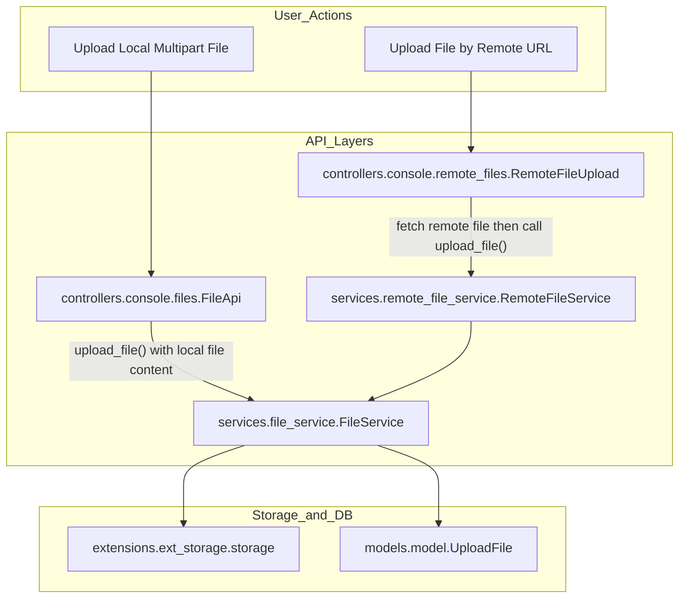
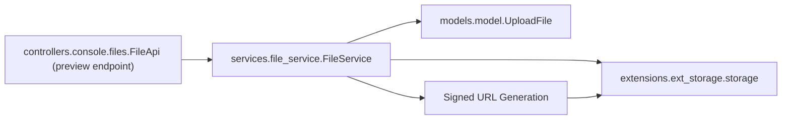
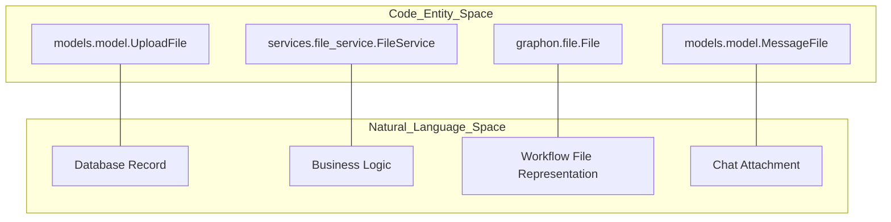

<!-- source: DeepWiki mcp.deepwiki.com · repo langgenius/dify · page 9.4 File Upload and Management APIs · fetched 2026-10-26 -->

# File Upload and Management APIs

<details>
<summary>Relevant source files</summary>

The following files were used as context for generating this wiki page:

- [api/configs/secret_key.py](api/configs/secret_key.py)
- [api/controllers/common/helpers.py](api/controllers/common/helpers.py)
- [api/controllers/trigger/trigger.py](api/controllers/trigger/trigger.py)
- [api/controllers/web/human_input_form.py](api/controllers/web/human_input_form.py)
- [api/controllers/web/site.py](api/controllers/web/site.py)
- [api/core/app/file_access/__init__.py](api/core/app/file_access/__init__.py)
- [api/core/app/file_access/controller.py](api/core/app/file_access/controller.py)
- [api/core/app/file_access/scope.py](api/core/app/file_access/scope.py)
- [api/core/app/workflow/file_runtime.py](api/core/app/workflow/file_runtime.py)
- [api/core/datasource/datasource_file_manager.py](api/core/datasource/datasource_file_manager.py)
- [api/core/datasource/utils/message_transformer.py](api/core/datasource/utils/message_transformer.py)
- [api/core/tools/utils/message_transformer.py](api/core/tools/utils/message_transformer.py)
- [api/extensions/ext_set_secretkey.py](api/extensions/ext_set_secretkey.py)
- [api/factories/file_factory/builders.py](api/factories/file_factory/builders.py)
- [api/factories/file_factory/remote.py](api/factories/file_factory/remote.py)
- [api/libs/exception.py](api/libs/exception.py)
- [api/libs/flask_utils.py](api/libs/flask_utils.py)
- [api/libs/smtp.py](api/libs/smtp.py)
- [api/providers/vdb/vdb-analyticdb/src/dify_vdb_analyticdb/analyticdb_vector_sql.py](api/providers/vdb/vdb-analyticdb/src/dify_vdb_analyticdb/analyticdb_vector_sql.py)
- [api/services/file_service.py](api/services/file_service.py)
- [api/services/icon_configuration.py](api/services/icon_configuration.py)
- [api/services/web_app_runtime_query_service.py](api/services/web_app_runtime_query_service.py)
- [api/tests/test_containers_integration_tests/controllers/web/test_human_input_form.py](api/tests/test_containers_integration_tests/controllers/web/test_human_input_form.py)
- [api/tests/test_containers_integration_tests/controllers/web/test_site.py](api/tests/test_containers_integration_tests/controllers/web/test_site.py)
- [api/tests/test_containers_integration_tests/services/test_file_service.py](api/tests/test_containers_integration_tests/services/test_file_service.py)
- [api/tests/unit_tests/controllers/openapi/test_app_describe_builder.py](api/tests/unit_tests/controllers/openapi/test_app_describe_builder.py)
- [api/tests/unit_tests/controllers/trigger/test_trigger.py](api/tests/unit_tests/controllers/trigger/test_trigger.py)
- [api/tests/unit_tests/controllers/web/test_human_input_form.py](api/tests/unit_tests/controllers/web/test_human_input_form.py)
- [api/tests/unit_tests/controllers/web/test_site.py](api/tests/unit_tests/controllers/web/test_site.py)
- [api/tests/unit_tests/core/datasource/test_datasource_file_manager.py](api/tests/unit_tests/core/datasource/test_datasource_file_manager.py)
- [api/tests/unit_tests/core/datasource/test_datasource_manager.py](api/tests/unit_tests/core/datasource/test_datasource_manager.py)
- [api/tests/unit_tests/core/datasource/test_file_upload.py](api/tests/unit_tests/core/datasource/test_file_upload.py)
- [api/tests/unit_tests/core/rag/datasource/test_retrieval_attachment_access.py](api/tests/unit_tests/core/rag/datasource/test_retrieval_attachment_access.py)
- [api/tests/unit_tests/core/tools/utils/test_message_transformer.py](api/tests/unit_tests/core/tools/utils/test_message_transformer.py)
- [api/tests/unit_tests/factories/test_build_from_mapping.py](api/tests/unit_tests/factories/test_build_from_mapping.py)
- [api/tests/unit_tests/factories/test_file_factory.py](api/tests/unit_tests/factories/test_file_factory.py)
- [api/tests/unit_tests/libs/test_flask_utils.py](api/tests/unit_tests/libs/test_flask_utils.py)
- [api/tests/unit_tests/libs/test_sendgrid_client.py](api/tests/unit_tests/libs/test_sendgrid_client.py)
- [api/tests/unit_tests/libs/test_smtp_client.py](api/tests/unit_tests/libs/test_smtp_client.py)
- [api/tests/unit_tests/models/test_app_session_accessors.py](api/tests/unit_tests/models/test_app_session_accessors.py)
- [api/tests/unit_tests/services/test_file_service.py](api/tests/unit_tests/services/test_file_service.py)
- [api/tests/unit_tests/services/test_icon_configuration.py](api/tests/unit_tests/services/test_icon_configuration.py)
- [api/tests/unit_tests/services/test_remote_file_service.py](api/tests/unit_tests/services/test_remote_file_service.py)
- [api/tests/unit_tests/services/test_web_app_runtime_query_service.py](api/tests/unit_tests/services/test_web_app_runtime_query_service.py)

</details>


This document details the file upload and management APIs within Dify. It covers the mechanisms for uploading files (both local multipart uploads and remote URL fetching), file preview and retrieval, storage abstraction, file type handling, and the lifecycle management of files generated by tools and workflows.

---

## File Upload API Architecture

The file upload system allows both end users and accounts to submit files to the platform, which can then be referenced in chat and completion requests, utilized in multimodal AI, feed into tool inputs, or be indexed for knowledge base (RAG) purposes.

### Core Implementation: `FileService`

The `FileService` class located in `api/services/file_service.py` is the primary service responsible for:

- Validating file extensions against a blacklist and allowed types, especially when used in specific contexts like datasets.
- Checking file size limits, which vary by file category (image, video, audio, or other documents).
- Storing files through the configured storage backend (OpenDAL abstraction).
- Creating and persisting associated `UploadFile` database records, linking files to tenant IDs and creator information.
- Offering utility methods for file preview extraction and base64 encoding of file content for in-app retrieval.
- Generating signed URLs for controlled file access and download.

Key methods include:

| Method | Purpose | Location |
| --- | --- | --- |
| `upload_file(...)` | Validates and saves an uploaded file to storage and DB | [api/services/file_service.py:74-168]() |
| `is_file_size_within_limit(...)` | Static method to enforce size limits per file type | [api/services/file_service.py:300-325]() |
| `get_file_base64(...)` | Returns base64 encoded string of file content | [api/services/file_service.py:202-217]() |
| `upload_text(...)` | Creates a `.txt` file from raw text content | [api/services/file_service.py:219-237]() |
| `get_file_presigned_url(...)` | Generates a secure, temporary URL for file access | [api/services/file_service.py:180-194]() |

#### Data Flow and Process

- Uploads come from users of types `Account`, `EndUser`, or the internal `FileUploadActor`.
- The upload process validates filename, extension (blacklist check), and size.
- Tenant isolation is enforced by namespace prefixes in the storage key:  
  `upload_files/{tenant_id}/{uuid}.{extension}`.
- After saving file content to storage, an `UploadFile` DB record is created with metadata and file hash.
- If no explicit source URL is given, a signed URL is generated for access.

### File Upload Request Flow



Sources: [api/services/file_service.py:74-168](), [api/tests/unit_tests/services/test_file_service.py:91-124](), [api/tests/test_containers_integration_tests/services/test_file_service.py:162-192]()

---

## File Transfer Methods: Remote vs. Local Upload

Dify supports two primary paradigms for ingesting files:

### Local File Upload

Users send files via standard `multipart/form-data` HTTP POST to `/files/upload`. Key points:

- Only one file per request is allowed. Multiple files result in a `TooManyFilesError`.
- Filenames are sanitized to forbid path separators [api/services/file_service.py:103-105]().
- Extensions are checked against a blacklist from configuration [api/services/file_service.py:111-113]().
- The optional `source` parameter can be `"datasets"` to restrict uploads to document types only, helping enforce dataset ingestion policies [api/services/file_service.py:115-117]().
- File size limits depend on file type (image, audio, video have dedicated size limits) or use a default configured limit [api/services/file_service.py:122-127]().
- Files are saved to storage keys formed as:  
  `upload_files/{tenant_id}/{uuid}.{extension}` [api/services/file_service.py:139-140]().

### Remote File Upload (`remote_url`)

Users can specify a remote URL which the system fetches and uploads internally. The steps:

- The service first retrieves remote file metadata through HTTP `HEAD` or fallback `GET` request using `get_remote_file_info` [api/factories/file_factory/remote.py:31-101]().
- Content length and content type are checked for size and allowed types constraints [api/factories/file_factory/remote.py:101]().
- The full content is downloaded and then passed to the same `FileService.upload_file()` method.
- The original URL is saved in `UploadFile.source_url` for source traceability [api/services/file_service.py:158]().

The remote upload API abstracts the complexity of remote fetching, error handling, and validation, raising appropriate HTTP errors for invalid or inaccessible URLs.

Sources: [api/services/file_service.py:74-168](), [api/factories/file_factory/remote.py:31-101](), [api/tests/unit_tests/factories/test_file_factory.py:33-127]()

---

## File Preview and Retrieval

Dify provides APIs for previewing and retrieving uploaded files, with access controls and efficient data representation.

### File Preview Text Snippet

- For document-type files, preview snippets (first certain number of words) are extracted asynchronously via the `ExtractProcessor` [api/services/file_service.py:330-331]().
- `/files/<uuid:file_id>/preview` endpoint returns a text snippet response.
- Access control checks verify the file belongs to the tenant context of the requesting user or service [api/services/file_service.py:333-335]().
- Preview text is limited to a specified word count (`PREVIEW_WORDS_LIMIT = 3000`) [api/services/file_service.py:38]().

### Signed URLs for File Access

- Signed URLs provide time-limited, secure HTTP access to stored files.
- These URLs are generated in `FileService.get_file_presigned_url()` using the storage backend's signing functionality [api/services/file_service.py:180-194]().
- The expiration timeout is controlled by `FILES_ACCESS_TIMEOUT` environment setting.
- Signed URLs are commonly used for downloads and embedding in responses.

### Human Input Form Uploads

- For Human-In-The-Loop form uploads, dedicated services issue short lived upload tokens scoped per tenant and end user [api/controllers/web/human_input_form.py:141]().
- Uploaded files in this mode are managed with additional access control and token verification layers.



Sources: [api/services/file_service.py:180-194](), [api/services/file_service.py:330-335](), [api/controllers/web/human_input_form.py:111-150]()

---

## Storage Backend and File Type Handling

### File Extension Categories and Limits

Based on sets imported from `constants.py`:

| Category | Extensions (examples)                           | Size limit env config key                      |
|----------|------------------------------------------------|-----------------------------------------------|
| Images   | `.jpg`, `.png`, `.gif`, etc                     | `UPLOAD_IMAGE_FILE_SIZE_LIMIT`                 |
| Audio    | `.mp3`, `.wav`, `.aac`                          | `UPLOAD_AUDIO_FILE_SIZE_LIMIT`                 |
| Video    | `.mp4`, `.avi`, `.mov`                          | `UPLOAD_VIDEO_FILE_SIZE_LIMIT`                 |
| Documents| `.pdf`, `.docx`, `.txt`, plus dataset documents| Default `UPLOAD_FILE_SIZE_LIMIT` or dataset-specific limits |

The `FileService.is_file_size_within_limit()` static method determines the applicable size limit per file extension category [api/services/file_service.py:300-325]().

### Storage Key Namespaces

- Files uploaded by users are stored with keys under the `upload_files` prefix [api/services/file_service.py:139]().
- Tenant ID is embedded in the path for multi-tenancy isolation:
  
  ```
  upload_files/{tenant_id}/{uuid4}.{extension}
  ```
- Text uploads use `.txt` extension and similar naming convention [api/services/file_service.py:219-237]().

### Data Models and API Response Schemas

- **`UploadFile`** (from `models.model`) represents persistent records for uploaded files, including metadata like tenant, creator, size, mime type, and hash [api/services/file_service.py:145-159]().
- **`File`** (from `graphon.file`) is a dataclass representing a file with its `transfer_method`, `type`, `reference`, and `storage_key` [api/factories/file_factory/builders.py:24-29]().
- **`MessageFile`** (in `models.model`) models file attachments in chat messages, supporting multiple transfer methods: `local_file`, `remote_url`, `tool_file`.



Sources: [api/services/file_service.py:37-115](), [api/factories/file_factory/builders.py:24-29](), [api/tests/unit_tests/factories/test_build_from_mapping.py:35-40]()

---

## File Access Control and Tool Integration

- Files have associated tenant ownership enforced on all access paths.
- Special handling exists for files uploaded and managed by tools (tool files).
- The `ToolFileMessageTransformer` class in `core.tools.utils.message_transformer` processes tool invocation messages containing files and converts them to URLs accessible with proper authorization [api/core/tools/utils/message_transformer.py:65-73]().
- Tool files use distinct transfer methods with references that include IDs and key paths [api/core/tools/utils/message_transformer.py:161-162]().
- When transforming tool messages, the system may download images, save blobs as tool files, and produce accessible URLs with metadata [api/core/tools/utils/message_transformer.py:83-156]().
- The `DatabaseFileAccessController` is used to manage file access permissions, ensuring that only authorized users or services can access specific files [api/core/app/file_access/controller.py:15-20](). This controller is bound to the current request context using `bind_file_access_scope` [api/core/app/file_access/scope.py:15-20]().

Sources: [api/core/tools/utils/message_transformer.py:65-165](), [api/core/app/file_access/controller.py:15-20](), [api/core/app/file_access/scope.py:15-20](), [api/tests/unit_tests/factories/test_build_from_mapping.py:14-18]()

---

# Summary

Dify implements a robust, secure, multi-tenant aware file upload and management system.

- The **`FileService`** backend service validates, persists, and retrieves files, enforcing file extension blacklists and size limits.
- Both multipart local uploads and remote file URL ingestion are supported, with consistent handling moving content into internal storage.
- Files are stored in tenant-isolated namespaces with associated database metadata managed by `UploadFile`.
- Secure, expiring signed URLs allow safe download and embedding of files.
- Preview endpoints provide textual snippets for document files.
- Tool file messages are integrated such that files handled by tools have proper references, access control, and URL transformation for UI consumption.

**Sources:**  
- [api/services/file_service.py:18-194]()  
- [api/factories/file_factory/remote.py:31-101]()  
- [api/core/tools/utils/message_transformer.py:65-165]()  
- [api/controllers/web/human_input_form.py:111-150]()  
- [api/core/app/file_access/controller.py:15-20]()  
- [api/core/app/file_access/scope.py:15-20]()  
- [api/tests/unit_tests/factories/test_build_from_mapping.py:14-18]()

---

