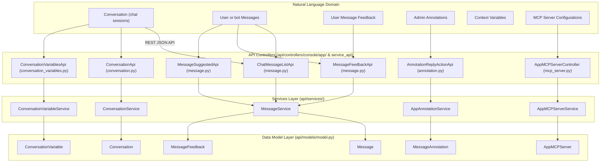
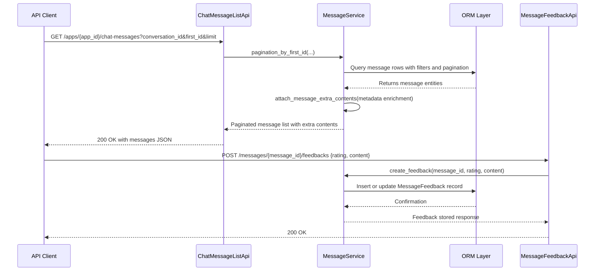

<!-- source: DeepWiki mcp.deepwiki.com · repo langgenius/dify · page 9.5 Conversation, Annotation and Feedback APIs · fetched 2026-10-26 -->

# Conversation, Annotation and Feedback APIs

<details>
<summary>Relevant source files</summary>

The following files were used as context for generating this wiki page:

- [api/controllers/console/app/advanced_prompt_template.py](api/controllers/console/app/advanced_prompt_template.py)
- [api/controllers/console/app/agent.py](api/controllers/console/app/agent.py)
- [api/controllers/console/app/annotation.py](api/controllers/console/app/annotation.py)
- [api/controllers/console/app/audio.py](api/controllers/console/app/audio.py)
- [api/controllers/console/app/completion.py](api/controllers/console/app/completion.py)
- [api/controllers/console/app/conversation.py](api/controllers/console/app/conversation.py)
- [api/controllers/console/app/conversation_variables.py](api/controllers/console/app/conversation_variables.py)
- [api/controllers/console/app/error.py](api/controllers/console/app/error.py)
- [api/controllers/console/app/mcp_server.py](api/controllers/console/app/mcp_server.py)
- [api/controllers/console/app/message.py](api/controllers/console/app/message.py)
- [api/controllers/console/app/model_config.py](api/controllers/console/app/model_config.py)
- [api/controllers/console/app/ops_trace.py](api/controllers/console/app/ops_trace.py)
- [api/controllers/console/app/site.py](api/controllers/console/app/site.py)
- [api/controllers/console/app/statistic.py](api/controllers/console/app/statistic.py)
- [api/controllers/console/app/workflow_statistic.py](api/controllers/console/app/workflow_statistic.py)
- [api/controllers/service_api/app/annotation.py](api/controllers/service_api/app/annotation.py)
- [api/controllers/service_api/app/conversation.py](api/controllers/service_api/app/conversation.py)
- [api/controllers/trigger/webhook.py](api/controllers/trigger/webhook.py)
- [api/core/ops/exceptions.py](api/core/ops/exceptions.py)
- [api/providers/trace/trace-tencent/tests/unit_tests/tencent_trace/test_client.py](api/providers/trace/trace-tencent/tests/unit_tests/tencent_trace/test_client.py)
- [api/repositories/conversation_variable_query_repository.py](api/repositories/conversation_variable_query_repository.py)
- [api/services/annotation_service.py](api/services/annotation_service.py)
- [api/services/app_audio_service.py](api/services/app_audio_service.py)
- [api/services/app_tracing_config_gateway.py](api/services/app_tracing_config_gateway.py)
- [api/services/app_tracing_config_service.py](api/services/app_tracing_config_service.py)
- [api/services/conversation_service.py](api/services/conversation_service.py)
- [api/services/conversation_variable_query.py](api/services/conversation_variable_query.py)
- [api/services/legacy_model_type_migration.py](api/services/legacy_model_type_migration.py)
- [api/services/trigger/webhook_service.py](api/services/trigger/webhook_service.py)
- [api/services/workflow_draft_variable_service.py](api/services/workflow_draft_variable_service.py)
- [api/tasks/trigger_processing_tasks.py](api/tasks/trigger_processing_tasks.py)
- [api/tasks/workflow_schedule_tasks.py](api/tasks/workflow_schedule_tasks.py)
- [api/tests/integration_tests/controllers/console/app/test_feedback_api_basic.py](api/tests/integration_tests/controllers/console/app/test_feedback_api_basic.py)
- [api/tests/test_containers_integration_tests/controllers/console/app/test_message.py](api/tests/test_containers_integration_tests/controllers/console/app/test_message.py)
- [api/tests/test_containers_integration_tests/services/test_conversation_service.py](api/tests/test_containers_integration_tests/services/test_conversation_service.py)
- [api/tests/test_containers_integration_tests/services/test_conversation_service_variables.py](api/tests/test_containers_integration_tests/services/test_conversation_service_variables.py)
- [api/tests/test_containers_integration_tests/services/test_webhook_service.py](api/tests/test_containers_integration_tests/services/test_webhook_service.py)
- [api/tests/test_containers_integration_tests/services/test_webhook_service_relationships.py](api/tests/test_containers_integration_tests/services/test_webhook_service_relationships.py)
- [api/tests/unit_tests/controllers/console/app/test_annotation_security.py](api/tests/unit_tests/controllers/console/app/test_annotation_security.py)
- [api/tests/unit_tests/controllers/console/app/test_audio.py](api/tests/unit_tests/controllers/console/app/test_audio.py)
- [api/tests/unit_tests/controllers/console/app/test_conversation_variables_api.py](api/tests/unit_tests/controllers/console/app/test_conversation_variables_api.py)
- [api/tests/unit_tests/controllers/console/app/test_mcp_server_response.py](api/tests/unit_tests/controllers/console/app/test_mcp_server_response.py)
- [api/tests/unit_tests/controllers/console/app/test_message_api.py](api/tests/unit_tests/controllers/console/app/test_message_api.py)
- [api/tests/unit_tests/controllers/console/app/test_ops_trace_api.py](api/tests/unit_tests/controllers/console/app/test_ops_trace_api.py)
- [api/tests/unit_tests/controllers/trigger/test_webhook.py](api/tests/unit_tests/controllers/trigger/test_webhook.py)
- [api/tests/unit_tests/core/tools/utils/test_tool_engine_serialization.py](api/tests/unit_tests/core/tools/utils/test_tool_engine_serialization.py)
- [api/tests/unit_tests/models/test_app_mcp_server_session_accessors.py](api/tests/unit_tests/models/test_app_mcp_server_session_accessors.py)
- [api/tests/unit_tests/repositories/test_conversation_variable_query_repository.py](api/tests/unit_tests/repositories/test_conversation_variable_query_repository.py)
- [api/tests/unit_tests/services/test_app_tracing_config_gateway.py](api/tests/unit_tests/services/test_app_tracing_config_gateway.py)
- [api/tests/unit_tests/services/test_conversation_service.py](api/tests/unit_tests/services/test_conversation_service.py)
- [api/tests/unit_tests/services/test_webhook_service.py](api/tests/unit_tests/services/test_webhook_service.py)
- [api/tests/unit_tests/services/test_webhook_service_additional.py](api/tests/unit_tests/services/test_webhook_service_additional.py)
- [api/tests/unit_tests/services/workflow/test_draft_var_loader_simple.py](api/tests/unit_tests/services/workflow/test_draft_var_loader_simple.py)
- [api/tests/unit_tests/services/workflow/test_workflow_draft_variable_service.py](api/tests/unit_tests/services/workflow/test_workflow_draft_variable_service.py)
- [api/tests/unit_tests/tasks/test_trigger_processing_tasks.py](api/tests/unit_tests/tasks/test_trigger_processing_tasks.py)

</details>


This page details the comprehensive implementation of the Conversation management, Message history retrieval, Annotation system, Feedback submission, and Conversation Variable handling APIs in Dify. These API endpoints and internal services enable rich conversational state management with pagination, annotation curation, user feedback mechanisms, and related conversation variable interactions.

---

## Purpose and Scope

This LEAF page covers message and conversation history APIs, feedback and suggested questions on messages, annotation management APIs, and conversation variable access and mutation. It includes an in-depth technical explanation of how the API controllers delegate to service layers, key domain entities involved, and describes the associated data flow. Relevant code classes, functions, models, and validation are discussed with mermaid diagrams linking natural language concepts to concrete code artifacts.

---

## Conversation Management APIs

### Persistent Conversation Listing and Pagination

Conversation retrieval supports infinite scroll pagination based on the last conversation ID with sorting and filtering capabilities.

- Endpoint example: `GET /conversations`
- Implemented by `ConversationApi` controller ([api/controllers/service_api/app/conversation.py:160-179]())
- Service interaction via `ConversationService.pagination_by_last_id()` ([api/services/conversation_service.py:34-102]())

**Key Logic:**

- Query filters conversations by app, user context (end user vs. console user), deletion status, and invocation source.
- Supports inclusion or exclusion lists of conversation IDs.
- Supports sorting by creation or update timestamp ascending or descending.
- Pagination uses the last conversation ID as cursor, constructing corresponding comparison filter conditions depending on sort order.
- Returns result encapsulated in `InfiniteScrollPagination`.

```python
stmt = select(Conversation).where(
    Conversation.is_deleted == False,
    Conversation.app_id == app_model.id,
    Conversation.from_source == ("api" if isinstance(user, EndUser) else "console"),
    Conversation.from_end_user_id == (user.id if isinstance(user, EndUser) else None),
    Conversation.from_account_id == (user.id if isinstance(user, Account) else None),
    or_(Conversation.invoke_from.is_(None), Conversation.invoke_from == invoke_from.value),
)
```
Sources:
- [api/services/conversation_service.py:50-57]()

### Conversation Rename: Manual and Auto Generation

- Endpoint: `POST /conversations/<uuid:conversation_id>/name`
- Service: `ConversationService.rename()` ([api/services/conversation_service.py:118-167]())

**Behavior:**

- If `auto_generate` flag is true, a name is generated using the first message's query text in the conversation with a call to an LLM generator: `LLMGenerator.generate_conversation_name()` ([api/services/conversation_service.py:168-171]()).
- Otherwise, the conversation name is updated directly with the provided string.
- Commits the name change with `updated_at` timestamp update.
- Raises appropriate errors if conversation or first message not found.

Sources:
- [api/services/conversation_service.py:118-167]()

---

## Message History and Feedback APIs

### Message History Retrieval

- Endpoint: `GET /apps/<uuid:app_id>/chat-messages`
- Controller: `ChatMessageListApi` ([api/controllers/console/app/message.py:132-154]())
- Pagination uses a `first_id` cursor to fetch older messages before that ID.
- Returns a paginated list enriched with extra execution contents (`ExecutionExtraContentDomainModel`).

Sources:
- [api/controllers/console/app/message.py:132-154]()

### Message Feedback Submission

- `POST /messages/<uuid:message_id>/feedbacks` endpoint accepts user feedback with a rating (`like`/`dislike`) and optional comments.
- Data model: `MessageFeedbackPayload` validates and normalizes message IDs ([api/controllers/console/app/message.py:90-97]()).
- Service layer `MessageService.create_feedback()` persists feedback entries or updates existing ones.
- Allows revoking feedback by setting rating to `None`.

Sources:
- [api/controllers/console/app/message.py:90-97]()

---

## Suggested Questions on Messages

- Endpoint: `GET /messages/<uuid:message_id>/suggested`
- Purpose: Provide AI-generated suggested follow-up questions for a given message.
- Enforced RBAC and app mode checks ensure only appropriate apps support this feature.
- Returned data model encapsulates a list of suggested questions.
- Controller and service collaborate for retrieval.

Sources:
- [api/controllers/console/app/message.py:103-105]()

---

## Annotation API and Management

Annotations allow admins to define question-answer pairs linked to messages for authoritative corrections and curated knowledge bases.

### Annotation Control API

- Endpoint examples include `POST /apps/<uuid:app_id>/annotation-reply/<string:action>`
- Supported actions: `enable` or `disable` annotation reply for an app.
- Controller: `AnnotationReplyActionApi` ([api/controllers/console/app/annotation.py:173-191](), [api/controllers/service_api/app/annotation.py:79-123]())
- Payload includes annotation reply config: score threshold and embedding model provider/name.
- Enabling triggers asynchronous background jobs to build or refresh the annotation index.
- Disabling stops annotation reply responses for the app.

Sources:
- [api/controllers/console/app/annotation.py:173-191]()
- [api/controllers/service_api/app/annotation.py:79-123]()

### Annotation Data Models

- `Annotation`, `AnnotationList`, `AnnotationExportList`, and annotation job status models are pydantic responses.

Sources:
- [api/fields/annotation_fields.py]() (not provided in full, but implied by usage in controllers)
- [api/controllers/console/app/annotation.py:28-36]()

### Annotation Service

- `AppAnnotationService` manages insertion, update, enable/disable, and indexing of annotations.
- Annotations are stored as `MessageAnnotation` ORM entities.
- Features upsert from existing messages or standalone creation.

Sources:
- [api/services/annotation_service.py:94-177]()

---

## Conversation Variables APIs

- Allow clients to query conversation-scoped variables supporting the persistent conversational state and contextual memory.
- Pagination and filtering by variable name are supported.
- Validation prevents unsafe variable names.
- Variables responses provide metadata including creation and update timestamps.

Sources:
- [api/controllers/service_api/app/conversation.py:49-85]()
- [api/controllers/service_api/app/conversation.py:138-142]()

---

## MCP Server APIs

Dify supports MCP (Model Context Protocol) servers allowing apps to expose themselves with remote procedure capabilities.

- Endpoint: `GET/POST/PUT /apps/<uuid:app_id>/server`
- Controller: `AppMCPServerController` ([api/controllers/console/app/mcp_server.py:79-167]())
- Manages MCP server records with JSON-encoded parameters and status fields.
- Supports creating and updating MCP server configurations, with consistent typing and validation.
- Response model deserializes JSON strings into native structures automatically.

Sources:
- [api/controllers/console/app/mcp_server.py:79-167]()

---

## Data Flow and Interactions

### Diagram: Natural Language Concepts to Code Entities



### Sequence Diagram: Message History and Feedback Handling



---

## Key Classes and Functions

| Class / Function                 | Role / Description                                                                                   | Location (file : lines)                   |
|---------------------------------|----------------------------------------------------------------------------------------------------|-----------------------------------------|
| `ConversationService.pagination_by_last_id` | Provides cursor-based pagination of conversations filtered by app and user context.                | [api/services/conversation_service.py:34-102]() |
| `ConversationService.rename`     | Renames or auto-generates conversation names using first message context and LLM.                    | [api/services/conversation_service.py:118-167]() |
| `ChatMessageListApi`             | Controller endpoint for paginated retrieval of chat messages by conversation.                        | [api/controllers/console/app/message.py:132-154]() |
| `MessageFeedbackPayload`         | Pydantic schema validating message feedback submission payload.                                     | [api/controllers/console/app/message.py:90-97]() |
| `MessageService.create_feedback` | Service method to save or update feedback associated with messages.                                  | Referenced through `message.py` controller |
| `AppAnnotationService`           | Manages CRUD and asynchronous indexing of annotations linked to an app for annotation reply feature.| [api/services/annotation_service.py:94-177]() |
| `AnnotationReplyActionApi`       | Enables/disables annotation reply feature for apps asynchronously, triggers background indexing.    | [api/controllers/console/app/annotation.py:173-191]() |
| `AppMCPServerController`         | CRUD API controller for MCP server configurations per app.                                          | [api/controllers/console/app/mcp_server.py:79-167]() |
| `ChatMessagesQuery`              | Pydantic model for querying chat messages, including conversation ID, first ID, and limit.         | [api/controllers/console/app/message.py:70-86]() |
| `SuggestedQuestionsResponse`     | Pydantic model for suggested questions response, containing a list of strings.                     | [api/controllers/console/app/message.py:103-105]() |
| `ChatConversationQuery`          | Pydantic model for querying chat conversations, including keyword, date range, annotation status, and sorting. | [api/controllers/console/app/conversation.py:76-80]() |
| `ConversationVariablesQuery`     | Pydantic model for querying conversation variables, including last ID, limit, and variable name.   | [api/controllers/service_api/app/conversation.py:49-85]() |
| `ConversationVariableUpdatePayload` | Pydantic model for updating a conversation variable's value.                                       | [api/controllers/service_api/app/conversation.py:87-89]() |
| `DraftVarLoader`                 | Implements `VariableLoader` for loading workflow draft variables, handling offloaded variables.    | [api/services/workflow_draft_variable_service.py:80-176]() |

---

## Data Model Overview

- `Conversation`: Represents a chat session belonging to an app.
- `Message`: Individual messages linked to conversations.
- `MessageFeedback`: User ratings or comments related to a message.
- `MessageAnnotation`: Admin-curated question-answer annotations tied to a message.
- `ConversationVariable`: Stores persistent state variables scoped to a conversation.
- `AppMCPServer`: Configuration records for MCP servers exposing apps as services.

These are SQLAlchemy ORM models defined in `models.model` and connected relationally (one-to-many from App to Conversation to Message).

---

# Summary

The Conversation, Annotation, and Feedback APIs in Dify build a foundation for managing user conversations, keeping message history, enabling user feedback, and supporting administrative annotation for improved AI interactions.

- **ConversationService** provides paginated access and manipulation of conversations.
- **MessageService** handles message retrieval and user feedback operations.
- **AppAnnotationService** implements annotation data management with asynchronous vector index refresh.
- **Annotation APIs** allow enabling/disabling annotation reply features through controlled background jobs.
- **MCP Server API** exposes app server configurations for external protocol access.
- **Controllers** enforce robust RBAC, validation, and pagination patterns across these APIs.

Comprehensive API coverage and data model integration allow Dify to provide persistent, annotated, and feedback-rich conversational experiences safely and efficiently.

---

Sources:
- [api/controllers/console/app/message.py:60-167]()
- [api/controllers/service_api/app/conversation.py:90-254]()
- [api/services/conversation_service.py:34-172]()
- [api/controllers/console/app/annotation.py:60-191]()
- [api/controllers/service_api/app/annotation.py:1-174]()
- [api/controllers/console/app/mcp_server.py:30-167]()
- [api/services/annotation_service.py:94-177]()
- [api/controllers/console/app/message.py:70-86]()
- [api/controllers/console/app/message.py:103-105]()
- [api/controllers/console/app/conversation.py:76-80]()
- [api/controllers/service_api/app/conversation.py:49-85]()
- [api/controllers/service_api/app/conversation.py:87-89]()
- [api/services/workflow_draft_variable_service.py:80-176]()

---

