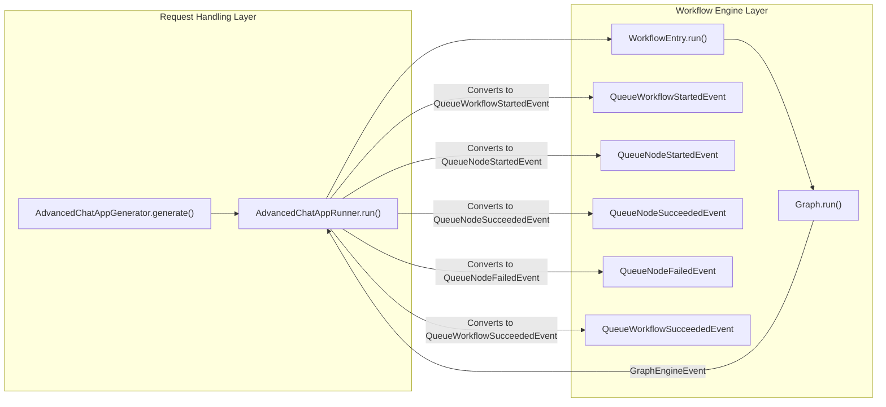
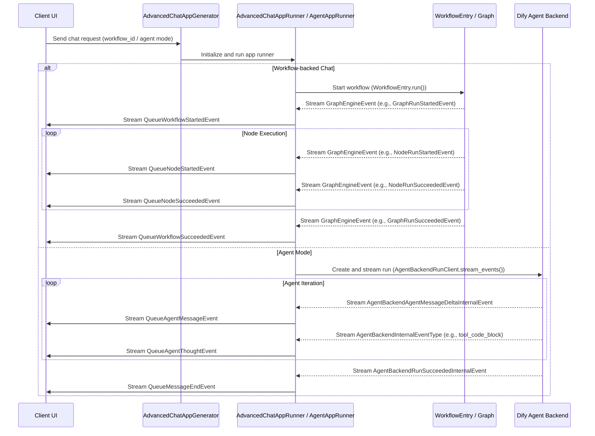

<!-- source: DeepWiki mcp.deepwiki.com · repo langgenius/dify · page 9.6 Advanced Chat and Agent APIs · fetched 2026-10-26 -->

# Advanced Chat and Agent APIs

<details>
<summary>Relevant source files</summary>

The following files were used as context for generating this wiki page:

- [api/core/app/app_config/easy_ui_based_app/dataset/manager.py](api/core/app/app_config/easy_ui_based_app/dataset/manager.py)
- [api/core/app/apps/advanced_chat/app_runner.py](api/core/app/apps/advanced_chat/app_runner.py)
- [api/core/app/apps/agent_app/app_config_manager.py](api/core/app/apps/agent_app/app_config_manager.py)
- [api/core/app/apps/agent_app/app_generator.py](api/core/app/apps/agent_app/app_generator.py)
- [api/core/app/apps/agent_app/app_runner.py](api/core/app/apps/agent_app/app_runner.py)
- [api/core/app/apps/agent_app/app_variable_projection.py](api/core/app/apps/agent_app/app_variable_projection.py)
- [api/core/app/apps/agent_app/runtime_request_builder.py](api/core/app/apps/agent_app/runtime_request_builder.py)
- [api/core/app/apps/execution_coordinator.py](api/core/app/apps/execution_coordinator.py)
- [api/core/app/apps/pipeline/pipeline_runner.py](api/core/app/apps/pipeline/pipeline_runner.py)
- [api/core/app/apps/workflow/app_runner.py](api/core/app/apps/workflow/app_runner.py)
- [api/core/app/apps/workflow/command_channels.py](api/core/app/apps/workflow/command_channels.py)
- [api/core/app/apps/workflow/stop_aware_ready_queue.py](api/core/app/apps/workflow/stop_aware_ready_queue.py)
- [api/core/app/apps/workflow_app_runner.py](api/core/app/apps/workflow_app_runner.py)
- [api/core/app/entities/app_invoke_entities.py](api/core/app/entities/app_invoke_entities.py)
- [api/core/app/features/annotation_reply/annotation_reply.py](api/core/app/features/annotation_reply/annotation_reply.py)
- [api/tests/unit_tests/core/app/app_config/easy_ui_based_app/test_dataset_manager.py](api/tests/unit_tests/core/app/app_config/easy_ui_based_app/test_dataset_manager.py)
- [api/tests/unit_tests/core/app/app_config/easy_ui_based_app/test_prompt_template_manager.py](api/tests/unit_tests/core/app/app_config/easy_ui_based_app/test_prompt_template_manager.py)
- [api/tests/unit_tests/core/app/apps/advanced_chat/test_app_config_manager.py](api/tests/unit_tests/core/app/apps/advanced_chat/test_app_config_manager.py)
- [api/tests/unit_tests/core/app/apps/advanced_chat/test_app_runner_conversation_variables.py](api/tests/unit_tests/core/app/apps/advanced_chat/test_app_runner_conversation_variables.py)
- [api/tests/unit_tests/core/app/apps/advanced_chat/test_app_runner_input_moderation.py](api/tests/unit_tests/core/app/apps/advanced_chat/test_app_runner_input_moderation.py)
- [api/tests/unit_tests/core/app/apps/agent_app/test_app_config_manager.py](api/tests/unit_tests/core/app/apps/agent_app/test_app_config_manager.py)
- [api/tests/unit_tests/core/app/apps/agent_app/test_app_generator.py](api/tests/unit_tests/core/app/apps/agent_app/test_app_generator.py)
- [api/tests/unit_tests/core/app/apps/agent_app/test_app_runner.py](api/tests/unit_tests/core/app/apps/agent_app/test_app_runner.py)
- [api/tests/unit_tests/core/app/apps/agent_app/test_input_guards.py](api/tests/unit_tests/core/app/apps/agent_app/test_input_guards.py)
- [api/tests/unit_tests/core/app/apps/agent_app/test_resolve_agent.py](api/tests/unit_tests/core/app/apps/agent_app/test_resolve_agent.py)
- [api/tests/unit_tests/core/app/apps/agent_app/test_runtime_request_builder.py](api/tests/unit_tests/core/app/apps/agent_app/test_runtime_request_builder.py)
- [api/tests/unit_tests/core/app/apps/chat/test_app_config_manager.py](api/tests/unit_tests/core/app/apps/chat/test_app_config_manager.py)
- [api/tests/unit_tests/core/app/apps/common/test_workflow_response_converter_human_input.py](api/tests/unit_tests/core/app/apps/common/test_workflow_response_converter_human_input.py)
- [api/tests/unit_tests/core/app/apps/common/test_workflow_response_converter_resumption.py](api/tests/unit_tests/core/app/apps/common/test_workflow_response_converter_resumption.py)
- [api/tests/unit_tests/core/app/apps/common/test_workflow_response_converter_truncation.py](api/tests/unit_tests/core/app/apps/common/test_workflow_response_converter_truncation.py)
- [api/tests/unit_tests/core/app/apps/test_execution_coordinator.py](api/tests/unit_tests/core/app/apps/test_execution_coordinator.py)
- [api/tests/unit_tests/core/app/apps/test_message_based_app_generator.py](api/tests/unit_tests/core/app/apps/test_message_based_app_generator.py)
- [api/tests/unit_tests/core/app/apps/test_workflow_app_runner_core.py](api/tests/unit_tests/core/app/apps/test_workflow_app_runner_core.py)
- [api/tests/unit_tests/core/app/apps/test_workflow_app_runner_single_node.py](api/tests/unit_tests/core/app/apps/test_workflow_app_runner_single_node.py)
- [api/tests/unit_tests/core/app/apps/test_workflow_pause_events.py](api/tests/unit_tests/core/app/apps/test_workflow_pause_events.py)
- [api/tests/unit_tests/core/app/apps/workflow/test_app_config_manager.py](api/tests/unit_tests/core/app/apps/workflow/test_app_config_manager.py)
- [api/tests/unit_tests/core/app/apps/workflow/test_command_channels.py](api/tests/unit_tests/core/app/apps/workflow/test_command_channels.py)
- [api/tests/unit_tests/core/app/apps/workflow/test_generate_task_pipeline_core.py](api/tests/unit_tests/core/app/apps/workflow/test_generate_task_pipeline_core.py)
- [api/tests/unit_tests/core/app/apps/workflow/test_stop_aware_ready_queue.py](api/tests/unit_tests/core/app/apps/workflow/test_stop_aware_ready_queue.py)
- [api/tests/unit_tests/core/app/features/test_annotation_reply.py](api/tests/unit_tests/core/app/features/test_annotation_reply.py)
- [api/tests/unit_tests/core/app/workflow/test_observability_layer_extra.py](api/tests/unit_tests/core/app/workflow/test_observability_layer_extra.py)
- [api/tests/unit_tests/core/workflow/nodes/agent/test_agent_entities.py](api/tests/unit_tests/core/workflow/nodes/agent/test_agent_entities.py)
- [dify-agent/src/dify_agent/protocol/schemas.py](dify-agent/src/dify_agent/protocol/schemas.py)
- [dify-agent/src/dify_agent/runtime/event_sink.py](dify-agent/src/dify_agent/runtime/event_sink.py)
- [dify-agent/src/dify_agent/runtime/run_scheduler.py](dify-agent/src/dify_agent/runtime/run_scheduler.py)
- [dify-agent/src/dify_agent/runtime/runner.py](dify-agent/src/dify_agent/runtime/runner.py)
- [dify-agent/src/dify_agent/storage/redis_run_store.py](dify-agent/src/dify_agent/storage/redis_run_store.py)
- [dify-agent/tests/integration/dify_agent/storage/test_terminal_finalization.py](dify-agent/tests/integration/dify_agent/storage/test_terminal_finalization.py)
- [dify-agent/tests/local/dify_agent/protocol/test_protocol_schemas.py](dify-agent/tests/local/dify_agent/protocol/test_protocol_schemas.py)
- [dify-agent/tests/local/dify_agent/runtime/test_run_scheduler.py](dify-agent/tests/local/dify_agent/runtime/test_run_scheduler.py)
- [dify-agent/tests/local/dify_agent/runtime/test_runner.py](dify-agent/tests/local/dify_agent/runtime/test_runner.py)
- [dify-agent/tests/local/dify_agent/storage/test_redis_run_store.py](dify-agent/tests/local/dify_agent/storage/test_redis_run_store.py)

</details>


This page documents the advanced features of the Chat API, specifically **Agent mode** with `agent_thought` events, **workflow-backed chat applications** with detailed node execution events, and extensive execution tracing and event streaming.

These advanced capabilities extend the basic Chat API by providing granular observability into the AI's reasoning, detailed workflows in chat applications, and fine-grained sequence of execution events. This allows developers to build rich user experiences that reveal the steps the AI takes, showcase tool usage, and follow node-level execution in workflows driving chat.

For standard chat usage including message handling and basic conversation APIs, see [Chat and Completion APIs](). For standalone workflow execution without chat sessions, see [Workflow Execution API]().

---

## Purpose and Scope

The Advanced Chat API enhances the basic chat experience principally with two critical features:

- **Agent Mode with agent_thought events**:  
  Provides visibility into the agent's internal reasoning process including tool selections, inputs, outputs (observations), and intermediate thought steps. This is managed by agent runners such as `CotAgentRunner` and `FunctionCallAgentRunner` which produce detailed thought event streams.

- **Workflow-Backed Chat Applications**:  
  Enables chat apps that rely on workflows to orchestrate multi-step reasoning. It streams comprehensive workflow execution events such as `workflow_started`, `node_started`, `node_finished`, and `workflow_finished` via the `AdvancedChatAppGenerateTaskPipeline`. This allows precise tracking of each node's execution within a chat session context.

Both modes are delivered through **Server-Sent Events (SSE)** streaming, enabling clients to receive real-time events describing the AI system's internal state and decision-making steps.

Sources:  
[api/core/app/entities/queue_entities.py:15-54](),  
[api/core/app/apps/advanced_chat/app_runner.py:10-17](),  
[api/core/app/apps/agent_app/app_runner.py:45-50]()

---

## Agent Mode Architecture

### Agent Thought Event Streaming

Agent mode extends the chat message model to surface detailed internal agent reasoning, exposing tool calls and their inputs/outputs. This is managed by the agent runner loop that performs iterations of:

- **Thought**: Internal reasoning step.  
- **Action**: Tool call selection.  
- **Observation**: Tool execution result.

These iteration steps are emitted as `agent_thought` events with metadata such as `agent_thought_id`, position, thought text, tool inputs, and observations. Several fields like `tool_labels` and `message_files` augment these events with structured information for UI consumption.

**Natural Language to Code Entity Space Mapping (Agent Execution Pipeline)**

```mermaid
graph TB
    subgraph "Natural Language Space"
        UserQuery["\"Search for Dify documentation\" (User Query)"]
    end

    subgraph "Code Entity Space"
        AgentAppGenerator["AgentAppGenerator.generate()"]
        AgentAppRunner["AgentAppRunner.run()"]
        AgentBackendRunClient["AgentBackendRunClient.stream_events()"]
        QueueAgentThoughtEvent["QueueAgentThoughtEvent"]
        QueueAgentMessageEvent["QueueAgentMessageEvent"]
        AgentBackendRunSucceededInternalEvent["AgentBackendRunSucceededInternalEvent"]
    end

    UserQuery --> AgentAppGenerator
    AgentAppGenerator --> AgentAppRunner
    AgentAppRunner --> AgentBackendRunClient
    AgentBackendRunClient -- "Streams AgentBackendInternalEventType" --> AgentAppRunner
    AgentAppRunner -- "Converts to QueueAgentThoughtEvent" --> QueueAgentThoughtEvent
    AgentAppRunner -- "Converts to QueueAgentMessageEvent" --> QueueAgentMessageEvent
    AgentBackendRunClient -- "Terminal event" --> AgentBackendRunSucceededInternalEvent
    AgentAppRunner -- "Final answer" --> AgentAppGenerator
```

**Explanation:**  
- The user query triggers the `AgentAppGenerator.generate()` method which sets up the chat session and forwards to an agent runner [api/core/app/apps/agent_app/app_generator.py:77-86]().  
- The `AgentAppRunner` delegates execution to the `dify-agent` backend via `AgentBackendRunClient.stream_events()` [api/core/app/apps/agent_app/app_runner.py:30-31, 250-251]().  
- The `dify-agent` backend streams `AgentBackendInternalEventType` events, which the `AgentAppRunner` converts into `QueueAgentThoughtEvent` for intermediate reasoning and `QueueAgentMessageEvent` for agent output [api/core/app/apps/agent_app/app_runner.py:250-300]().  
- The `AgentBackendRunSucceededInternalEvent` signals the completion of the agent run [api/core/app/apps/agent_app/app_runner.py:29-30]().

Sources:  
[api/core/app/apps/agent_app/app_generator.py:77-86](),  
[api/core/app/apps/agent_app/app_runner.py:250-300](),  
[api/core/app/apps/agent_app/app_runner.py:29-31](),  
[api/core/app/entities/queue_entities.py:60-61]()

---

### Agent Message Events: Specialized Event Types

Agent mode distinguishes different event types to separately convey normal LLM text output and internal agent states:

| Event Name      | Queue Event Class           | Description                              |
|-----------------|-----------------------------|------------------------------------------|
| `message`       | `QueueTextChunkEvent`       | Regular chat LLM text chunks             |
| `agent_message` | `QueueAgentMessageEvent`    | Final answer text after agent iterations |
| `agent_thought` | `QueueAgentThoughtEvent`    | Agent internal reasoning & tool calls    |

In agent mode, textual outputs stream as `agent_message` events via `AgentMessageStreamResponse`, and intermediate reasoning is surfaced via `agent_thought` events [api/core/app/entities/queue_entities.py:60-61]().

Sources:  
[api/core/app/entities/queue_entities.py:28-29, 60-61]()

---

## Workflow-Backed Chat Applications

### Overview of Workflow Execution Events

Workflow-backed chat apps orchestrate multi-step reasoning through workflow graphs. The `AdvancedChatAppRunner` manages the execution and streams detailed workflow events to clients, facilitating rich observability and control.

Key workflow-related stream events include:

- `workflow_started`, `workflow_paused`, `workflow_failed`, `workflow_succeeded`  
- `node_started`, `node_succeeded`, `node_failed`, `node_retry`, `node_exception`  
- `iteration_started`, `iteration_next`, `iteration_completed`  
- `loop_started`, `loop_next`, `loop_completed`

**Natural Language to Code Entity Space Mapping (Workflow Execution Event Propagation)**



**Explanation:**  
- The `AdvancedChatAppGenerator` initiates the chat generation, which delegates to `AdvancedChatAppRunner.run()` [api/core/app/apps/advanced_chat/app_runner.py:105]().  
- The `AdvancedChatAppRunner` initializes a `WorkflowEntry` and its `Graph` [api/core/app/apps/advanced_chat/app_runner.py:145-147]().  
- The `Graph` execution emits `GraphEngineEvent`s, which the `AdvancedChatAppRunner` converts into various `Queue` events (e.g., `QueueWorkflowStartedEvent`, `QueueNodeStartedEvent`, `QueueNodeSucceededEvent`, `QueueNodeFailedEvent`) and publishes them via the `AppQueueManager` [api/core/app/apps/workflow_app_runner.py:66-91, 600-700]().  
- These workflow execution events are pushed as SSE to the client for real-time progress updates, revealing step-by-step execution inside the chat experience.  

Sources:  
[api/core/app/apps/advanced_chat/app_runner.py:105, 145-147](),  
[api/core/app/apps/workflow_app_runner.py:66-91, 600-700](),  
[api/core/app/entities/queue_entities.py:31-35](),  
[api/core/app/entities/queue_entities.py:18-26]()

---

### Pause and Resume Mechanism (Human-In-The-Loop, HITL)

Advanced Chat APIs support Human-In-The-Loop interactions through a pause-resume mechanism for workflows. When a node requires human input (reason `HumanInputRequired`), the workflow pauses execution:

- **State Persistence:** Managed by `WorkflowPersistenceLayer`, persisting pause context and data [api/core/app/apps/advanced_chat/app_runner.py:32]().  
- **Pause Events:** `QueueWorkflowPausedEvent` signals workflow pause, converting to `WorkflowPauseStreamResponse` for clients [api/core/app/entities/queue_entities.py:33]().  
- **Resumption:** Clients send inputs that trigger `QueueHumanInputFormFilledEvent` resuming workflow execution smoothly [api/core/app/entities/queue_entities.py:20]().

This mechanism allows workflows to integrate human decision points seamlessly within automated tasks, with full event-driven orchestration.

Sources:  
[api/core/app/apps/advanced_chat/app_runner.py:32](),  
[api/core/app/entities/queue_entities.py:20, 33]()

---

## Event Stream Sequencing Example

The following sequence diagram illustrates the flow of events in an advanced chat request using workflow-backed chat or agent mode:



In this example:  
- The client sends a chat request specifying workflow and/or agent mode.  
- The API calls the appropriate runner (`AdvancedChatAppRunner` for workflow-backed chat or `AgentAppRunner` for agent mode) [api/core/app/apps/advanced_chat/app_runner.py:105](), [api/core/app/apps/agent_app/app_runner.py:250-251]().  
- For workflow-backed chat, the `AdvancedChatAppRunner` interacts with the `WorkflowEntry` and `Graph` to execute the workflow, converting `GraphEngineEvent`s into `Queue` events for the client [api/core/app/apps/workflow_app_runner.py:600-700]().  
- For agent mode, the `AgentAppRunner` communicates with the `dify-agent` backend, converting `AgentBackendInternalEventType` events into `QueueAgentMessageEvent` and `QueueAgentThoughtEvent` for the client [api/core/app/apps/agent_app/app_runner.py:250-300]().  
- The runner streams all gathered events back to the client via SSE for interactive UI updates.

Sources:  
[api/core/app/apps/advanced_chat/app_runner.py:105](),  
[api/core/app/apps/agent_app/app_runner.py:250-300](),  
[api/core/app/apps/workflow_app_runner.py:600-700](),  
[api/core/app/entities/queue_entities.py:18-35, 60-61]()

---

## Performance and Cost Tracking

### Granular Metrics Collection

The advanced chat and agent APIs provide detailed usage metrics at several granularity levels:

- **Node-Level Metrics:** Each workflow node execution records statistics such as token usage, elapsed time, and costs. These are included in `QueueNodeSucceededEvent` metadata for downstream analysis [api/core/app/entities/queue_entities.py:26]().  
- **Workflow-Level Metrics:** Final workflow responses aggregate total tokens and execution steps used, available in `QueueWorkflowSucceededEvent` [api/core/app/entities/queue_entities.py:35]().  
- **Agent-Level Metrics:** Agent runs report usage in `AgentRunUsage` within `RunSucceededEventData` and `RunFailedEventData` from the `dify-agent` backend, which are then converted to `LLMUsage` and included in `QueueMessageEndEvent` [dify-agent/src/dify_agent/protocol/schemas.py:23-32](), [api/core/app/apps/agent_app/app_runner.py:118-125, 290-291]().

This comprehensive tracking supports detailed cost analysis and performance monitoring integrated directly into event streams.

Sources:  
[api/core/app/entities/queue_entities.py:26, 35](),  
[dify-agent/src/dify_agent/protocol/schemas.py:23-32](),  
[api/core/app/apps/agent_app/app_runner.py:118-125, 290-291]()

---

# Summary

This page detailed Dify's advanced chat and agent APIs, covering:

- **Agent Mode** with detailed `agent_thought` intermediate reasoning event streaming, powered by the `dify-agent` backend.  
- **Workflow-backed Chat Applications** that stream rich workflow node events for fine-grained insight.  
- **Pause/Resume Human-In-The-Loop (HITL)** functionality with persisted state and explicit pause events.  
- **Detailed Performance and Cost Metrics** surfaced throughout the streaming pipeline.

Together, these components provide a powerful platform foundation for building transparent, interactive, and observable AI chat applications in Dify.

Sources:  
[api/core/app/apps/advanced_chat/app_runner.py:10-17](),  
[api/core/app/apps/agent_app/app_runner.py:250-300](),  
[api/core/app/apps/workflow_app_runner.py:600-700](),  
[api/core/app/entities/queue_entities.py:18-35, 60-61]()

---

