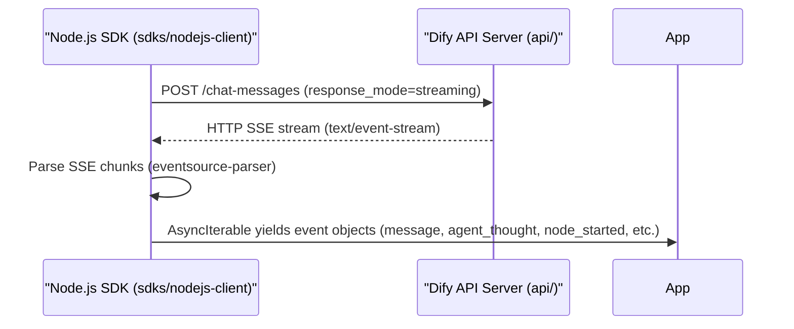
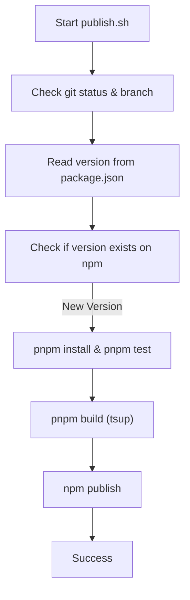
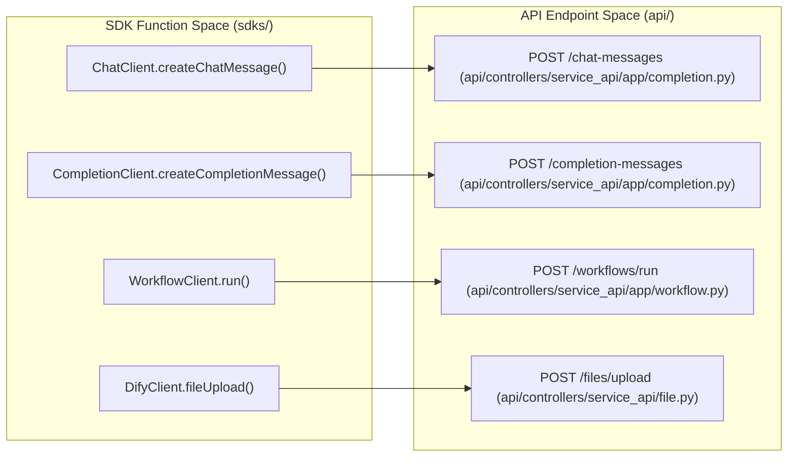
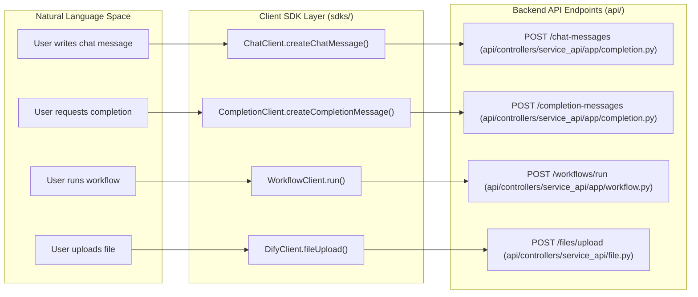
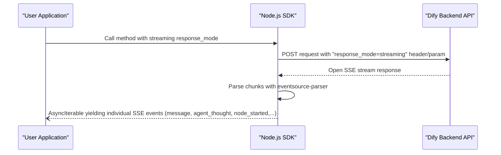

<!-- source: DeepWiki mcp.deepwiki.com · repo langgenius/dify · page 9.7 Client SDKs · fetched 2026-10-26 -->

# Client SDKs

<details>
<summary>Relevant source files</summary>

The following files were used as context for generating this wiki page:

- [.github/workflows/api-tests.yml](.github/workflows/api-tests.yml)
- [.github/workflows/autofix.yml](.github/workflows/autofix.yml)
- [.github/workflows/db-migration-test.yml](.github/workflows/db-migration-test.yml)
- [.github/workflows/main-ci.yml](.github/workflows/main-ci.yml)
- [.github/workflows/pyrefly-diff-comment.yml](.github/workflows/pyrefly-diff-comment.yml)
- [.github/workflows/pyrefly-diff.yml](.github/workflows/pyrefly-diff.yml)
- [.github/workflows/pyrefly-type-coverage-comment.yml](.github/workflows/pyrefly-type-coverage-comment.yml)
- [.github/workflows/pyrefly-type-coverage.yml](.github/workflows/pyrefly-type-coverage.yml)
- [.github/workflows/style.yml](.github/workflows/style.yml)
- [.github/workflows/tool-test-sdks.yaml](.github/workflows/tool-test-sdks.yaml)
- [.github/workflows/translate-i18n-claude.yml](.github/workflows/translate-i18n-claude.yml)
- [.github/workflows/trigger-i18n-sync.yml](.github/workflows/trigger-i18n-sync.yml)
- [.github/workflows/vdb-tests-full.yml](.github/workflows/vdb-tests-full.yml)
- [.github/workflows/vdb-tests.yml](.github/workflows/vdb-tests.yml)
- [.github/workflows/web-e2e.yml](.github/workflows/web-e2e.yml)
- [.github/workflows/web-tests.yml](.github/workflows/web-tests.yml)
- [api/controllers/console/app/workflow_app_log.py](api/controllers/console/app/workflow_app_log.py)
- [api/controllers/service_api/app/completion.py](api/controllers/service_api/app/completion.py)
- [api/controllers/service_api/app/workflow.py](api/controllers/service_api/app/workflow.py)
- [api/controllers/web/workflow.py](api/controllers/web/workflow.py)
- [api/fields/dataset_fields.py](api/fields/dataset_fields.py)
- [api/openapi/markdown/service-openapi.md](api/openapi/markdown/service-openapi.md)
- [api/services/app_task_service.py](api/services/app_task_service.py)
- [api/tests/unit_tests/controllers/console/app/test_workflow_app_log_api.py](api/tests/unit_tests/controllers/console/app/test_workflow_app_log_api.py)
- [api/tests/unit_tests/controllers/service_api/app/test_completion.py](api/tests/unit_tests/controllers/service_api/app/test_completion.py)
- [api/tests/unit_tests/controllers/service_api/app/test_workflow.py](api/tests/unit_tests/controllers/service_api/app/test_workflow.py)
- [api/tests/unit_tests/controllers/test_swagger.py](api/tests/unit_tests/controllers/test_swagger.py)
- [api/tests/unit_tests/services/test_app_task_service.py](api/tests/unit_tests/services/test_app_task_service.py)
- [packages/contracts/generated/api/console/datasets/orpc.gen.ts](packages/contracts/generated/api/console/datasets/orpc.gen.ts)
- [packages/contracts/generated/api/console/datasets/types.gen.ts](packages/contracts/generated/api/console/datasets/types.gen.ts)
- [packages/contracts/generated/api/console/datasets/zod.gen.ts](packages/contracts/generated/api/console/datasets/zod.gen.ts)
- [packages/contracts/generated/api/service/orpc.gen.ts](packages/contracts/generated/api/service/orpc.gen.ts)
- [packages/contracts/generated/api/service/types.gen.ts](packages/contracts/generated/api/service/types.gen.ts)
- [packages/contracts/generated/api/service/zod.gen.ts](packages/contracts/generated/api/service/zod.gen.ts)

</details>


This page details the official client SDKs provided by Dify for integrating with its APIs. It covers the Node.js SDK, the community-contributed PHP client, their API coverage, and provides usage examples for common Dify functionalities. These SDKs simplify interaction with Dify's chat, completion, workflow, and knowledge base APIs, abstracting away direct HTTP requests and handling authentication.

---

## Node.js Client SDK

The Dify Node.js SDK, named `dify-client`, provides a convenient way to interact with the Dify API from Node.js applications. The project is managed using `pnpm` and is located in the `sdks/nodejs-client` directory [pnpm-workspace.yaml:180-180](). It is published as an independent npm package installable via common package managers.

### Installation

Install via npm or pnpm as:

```bash
pnpm add dify-client
```

### Architecture and Key Components

The Node.js SDK organizes API access into modular client classes, each scoped to a domain of functionality:

- **`DifyClient`**: General app-level interactions such as fetching app params, file upload, feedback, and audio/text conversions.
- **`ChatClient`**: Chat service interaction, including sending chat messages (both blocking and streaming), stopping messages, querying suggested questions, managing conversations and annotations.
- **`CompletionClient`**: Handles text completion requests, providing blocking and streaming create methods as well as cancellation.
- **`WorkflowClient`**: Manages workflow execution requests and streaming events.
- **`KnowledgeBaseClient`**: Exposes dataset CRUD, document and segment management, child chunk handling, metadata tagging, and running RAG pipelines.
- **`WorkspaceClient`**: Provides workspace-level model fetching and basic metadata operations.

These clients share a common HTTP transport internally and provide typed methods to interact with backend routes.

### Streaming Response and Event Parsing

The SDK supports both blocking (standard REST) and streaming (Server-Sent Events, SSE) response modes. For streaming, it uses an event-source parser that incrementally parses SSE streams, yielding asynchronous events back to the application.

This pattern enables real-time feedback loops for chat, completion, and workflows, delivering partial results as they become available.



Sources:
- [sdks/nodejs-client/package.json:1-10]()
- [pnpm-workspace.yaml:180-180]()
- [packages/contracts/generated/api/service/zod.gen.ts:239-240]()
- [packages/contracts/generated/api/service/types.gen.ts:197-198]()

### Usage Examples

Example usage of the Node.js SDK for chat and workflow operations:

```javascript
import {
  ChatClient,
  WorkflowClient
} from 'dify-client'

const API_KEY = 'your-app-api-key'
const user = 'random-user-id'

const chatClient = new ChatClient(API_KEY)
const workflowClient = new WorkflowClient(API_KEY)

// Chat interaction with streaming response
const stream = await chatClient.createChatMessage({
  inputs: {},
  query: 'Hello!',
  user,
  response_mode: 'streaming'
})

for await (const event of stream) {
  console.log(event.event, event.answer)
}

// Run a workflow call in blocking mode
await workflowClient.run({
  inputs: { query: 'Summarize this text' },
  user,
  response_mode: 'blocking'
})
```

Sources:
- [api/controllers/service_api/app/workflow.py:84-94]()
- [api/controllers/service_api/app/completion.py:100-110]()
- [packages/contracts/generated/api/service/zod.gen.ts:239-240]()
- [packages/contracts/generated/api/service/types.gen.ts:197-198]()

### Node.js SDK Publishing Workflow

The SDK is published using a shell script `publish.sh` inside the `sdks/nodejs-client/scripts/` directory. The publishing procedure involves:

- Verifying the git status and current branch
- Reading the current version from `package.json`
- Checking if the version already exists on the npm registry to avoid duplication
- Installing dependencies and running tests
- Building the package using `tsup`
- Publishing the package via `npm publish`



Sources: [sdks/nodejs-client/scripts/publish.sh:1-20]()

---

## PHP Client

The Dify PHP SDK is a community-supported client enabling PHP applications to interact with Dify APIs. It serves as a lightweight wrapper around HTTP API calls using Guzzle.

### Architecture and Key Components

The PHP client follows a simple inheritance-based design:

- **`DifyClient`**: Base client class configuring the API base URL and authentication header using the Bearer token scheme. It manages HTTP request sending to the API.
- **`CompletionClient`**: Extends `DifyClient` for completion-specific endpoints to create completion messages.
- **`ChatClient`**: Extends `DifyClient` to interact with chat message creation, retrieve suggested questions, and perform conversation management.
- **`WorkflowClient`**: Extends `DifyClient` to support running workflows and stopping workflow runs.

This client does not currently implement streaming support.

Sources:
- [sdks/php-client/dify-client.php:5-150]()

---

## SDK to Service API Mapping

The following diagram bridges the conceptual client SDK functions with the backend API endpoints they invoke. It helps developers correlate SDK method calls to actual HTTP routes implemented in the backend.



Sources:
- [api/controllers/service_api/app/completion.py:113-113]()
- [api/controllers/service_api/app/workflow.py:200-200]()
- [api/controllers/service_api/app/completion.py:113-113]()
- [api/controllers/service_api/app/workflow.py:200-200]()
- [api/openapi/markdown/service-openapi.md:100-100]()
- [api/openapi/markdown/service-openapi.md:100-100]()

---

## Streaming Response Event Types

Dify uses Server-Sent Events (SSE) to communicate streamed results from the backend. The SDK parses these events and yields them to the client app. Key events include:

| Event Type          | Description                        | Reference                                       |
| ------------------- | -------------------------------- | ----------------------------------------------- |
| `message`           | LLM returns a text chunk          | [packages/contracts/generated/api/service/zod.gen.ts:189-190]() |
| `agent_thought`     | Agent internal thinking or tool use | [packages/contracts/generated/api/service/zod.gen.ts:300-301]() |
| `workflow_started`  | Workflow run started               | [packages/contracts/generated/api/service/zod.gen.ts:4490-4491]() |
| `node_started`      | Specific workflow node started    | [packages/contracts/generated/api/service/zod.gen.ts:4490-4491]() |
| `text_chunk`        | Text output chunk from node       | [packages/contracts/generated/api/service/zod.gen.ts:4490-4491]() |
| `message_end`       | End of the streaming message      | [packages/contracts/generated/api/service/zod.gen.ts:4490-4491]() |
| `human_input_required` | Workflow paused for human input  | [packages/contracts/generated/api/service/zod.gen.ts:4490-4491]() |

This event typing enables client applications to respond appropriately to advanced chat, agent, and workflow streaming semantics.

Sources:
- [packages/contracts/generated/api/service/zod.gen.ts:189-190]()
- [packages/contracts/generated/api/service/zod.gen.ts:300-301]()
- [packages/contracts/generated/api/service/zod.gen.ts:4490-4491]()
- [packages/contracts/generated/api/service/types.gen.ts:159-160]()
- [packages/contracts/generated/api/service/types.gen.ts:268-269]()
- [packages/contracts/generated/api/service/types.gen.ts:4000-4001]()

---

## Summary

Dify provides official client SDKs primarily for Node.js, covering comprehensive API functionalities including chat, completion, workflows, and knowledge base management. A community-supported PHP client is available for PHP developers. These SDKs abstract the raw HTTP API, handle authentication, streaming protocols, and provide idiomatic usage patterns to ease integration.

| SDK             | Supported Language | Coverage                                  | Key Features                        |
|-----------------|--------------------|-------------------------------------------|-----------------------------------|
| `dify-client`   | Node.js            | Chat, Completion, Workflow, KnowledgeBase, File Uploads | SSE streaming handling, typed client interfaces |
| PHP Client      | PHP                | Chat, Completion, Workflow                  | Guzzle-based HTTP client, simple request wrappers |

Sources:
- [sdks/nodejs-client/package.json]()
- [sdks/php-client/dify-client.php]()

---

# Additional Diagram: Natural Language to Code Entity Space (Client SDKs)



Sources:
- [api/controllers/service_api/app/completion.py:113-113]()
- [api/controllers/service_api/app/workflow.py:200-200]()
- [api/openapi/markdown/service-openapi.md:100-100]()

---

# Additional Diagram: Streaming Response Event Data Flow in Node.js SDK



Explanation: This diagram shows how the SDK translates a streaming API call from user code, interacts with the backend SSE endpoint, parses the stream internally, and yields parsed events to the user asynchronously.

Sources:
- [sdks/nodejs-client/package.json:1-10]()
- [packages/contracts/generated/api/service/zod.gen.ts:239-240]()
- [packages/contracts/generated/api/service/types.gen.ts:197-198]()

---

This concludes the detailed technical documentation for the Dify official client SDKs.

---

