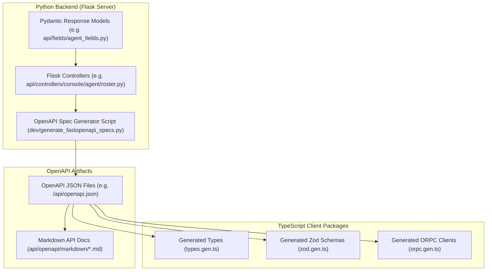
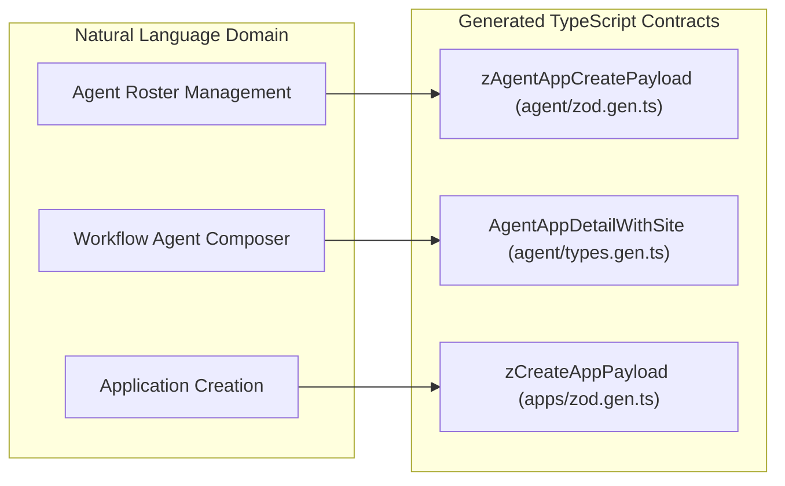

<!-- source: DeepWiki mcp.deepwiki.com · repo langgenius/dify · page 9.8 OpenAPI Contracts and Generated API Clients · fetched 2026-10-26 -->

# OpenAPI Contracts and Generated API Clients

<details>
<summary>Relevant source files</summary>

The following files were used as context for generating this wiki page:

- [Makefile](Makefile)
- [api/AGENTS.md](api/AGENTS.md)
- [api/controllers/API_SCHEMA_GUIDE.md](api/controllers/API_SCHEMA_GUIDE.md)
- [api/controllers/console/agent/composer.py](api/controllers/console/agent/composer.py)
- [api/controllers/console/agent/roster.py](api/controllers/console/agent/roster.py)
- [api/controllers/console/snippets/payloads.py](api/controllers/console/snippets/payloads.py)
- [api/controllers/console/snippets/snippet_workflow.py](api/controllers/console/snippets/snippet_workflow.py)
- [api/controllers/console/snippets/snippet_workflow_draft_variable.py](api/controllers/console/snippets/snippet_workflow_draft_variable.py)
- [api/controllers/console/workspace/snippets.py](api/controllers/console/workspace/snippets.py)
- [api/dev/lint_response_contracts.py](api/dev/lint_response_contracts.py)
- [api/fields/agent_fields.py](api/fields/agent_fields.py)
- [api/models/agent.py](api/models/agent.py)
- [api/openapi/markdown/console-openapi.md](api/openapi/markdown/console-openapi.md)
- [api/services/agent/composer_service.py](api/services/agent/composer_service.py)
- [api/services/agent/composer_validator.py](api/services/agent/composer_validator.py)
- [api/services/agent/roster_service.py](api/services/agent/roster_service.py)
- [api/services/agent/workflow_publish_service.py](api/services/agent/workflow_publish_service.py)
- [api/services/snippet_service.py](api/services/snippet_service.py)
- [api/services/workflow_service.py](api/services/workflow_service.py)
- [api/tests/unit_tests/commands/test_check_no_new_base_model.py](api/tests/unit_tests/commands/test_check_no_new_base_model.py)
- [api/tests/unit_tests/commands/test_lint_response_contracts.py](api/tests/unit_tests/commands/test_lint_response_contracts.py)
- [api/tests/unit_tests/controllers/console/agent/test_agent_controllers.py](api/tests/unit_tests/controllers/console/agent/test_agent_controllers.py)
- [api/tests/unit_tests/controllers/console/snippets/test_snippet_workflow.py](api/tests/unit_tests/controllers/console/snippets/test_snippet_workflow.py)
- [api/tests/unit_tests/controllers/console/snippets/test_snippet_workflow_draft_variable.py](api/tests/unit_tests/controllers/console/snippets/test_snippet_workflow_draft_variable.py)
- [api/tests/unit_tests/controllers/console/workspace/test_snippets.py](api/tests/unit_tests/controllers/console/workspace/test_snippets.py)
- [api/tests/unit_tests/services/agent/test_agent_composer_entities.py](api/tests/unit_tests/services/agent/test_agent_composer_entities.py)
- [api/tests/unit_tests/services/agent/test_agent_services.py](api/tests/unit_tests/services/agent/test_agent_services.py)
- [api/tests/unit_tests/services/agent/test_workflow_publish_service.py](api/tests/unit_tests/services/agent/test_workflow_publish_service.py)
- [api/tests/unit_tests/services/test_snippet_generate_service.py](api/tests/unit_tests/services/test_snippet_generate_service.py)
- [api/tests/unit_tests/services/test_snippet_service.py](api/tests/unit_tests/services/test_snippet_service.py)
- [api/tests/unit_tests/services/test_workflow_service.py](api/tests/unit_tests/services/test_workflow_service.py)
- [packages/contracts/generated/api/console/agent/orpc.gen.ts](packages/contracts/generated/api/console/agent/orpc.gen.ts)
- [packages/contracts/generated/api/console/agent/types.gen.ts](packages/contracts/generated/api/console/agent/types.gen.ts)
- [packages/contracts/generated/api/console/agent/zod.gen.ts](packages/contracts/generated/api/console/agent/zod.gen.ts)
- [packages/contracts/generated/api/console/apps/orpc.gen.ts](packages/contracts/generated/api/console/apps/orpc.gen.ts)
- [packages/contracts/generated/api/console/apps/types.gen.ts](packages/contracts/generated/api/console/apps/types.gen.ts)
- [packages/contracts/generated/api/console/apps/zod.gen.ts](packages/contracts/generated/api/console/apps/zod.gen.ts)
- [packages/contracts/generated/api/console/snippets/types.gen.ts](packages/contracts/generated/api/console/snippets/types.gen.ts)
- [packages/contracts/generated/api/console/snippets/zod.gen.ts](packages/contracts/generated/api/console/snippets/zod.gen.ts)
- [packages/contracts/generated/api/console/workspaces/orpc.gen.ts](packages/contracts/generated/api/console/workspaces/orpc.gen.ts)
- [packages/contracts/generated/api/console/workspaces/types.gen.ts](packages/contracts/generated/api/console/workspaces/types.gen.ts)
- [packages/contracts/generated/api/console/workspaces/zod.gen.ts](packages/contracts/generated/api/console/workspaces/zod.gen.ts)
- [packages/contracts/openapi-ts.api.config.ts](packages/contracts/openapi-ts.api.config.ts)
- [packages/contracts/package.json](packages/contracts/package.json)
- [packages/jotai-tanstack-form/package.json](packages/jotai-tanstack-form/package.json)
- [scripts/ast_grep_rules/no_new_base_model.yml](scripts/ast_grep_rules/no_new_base_model.yml)
- [scripts/check_no_new_base_model.py](scripts/check_no_new_base_model.py)
- [web/app/components/snippets/components/hooks/__tests__/use-snippet-dsl.spec.ts](web/app/components/snippets/components/hooks/__tests__/use-snippet-dsl.spec.ts)
- [web/app/components/snippets/components/hooks/use-snippet-dsl.ts](web/app/components/snippets/components/hooks/use-snippet-dsl.ts)

</details>


This page details how Dify maintains consistency between its backend API specifications and the frontend/SDK client code. It covers the generation of TypeScript contracts (Zod schemas, types, and ORPC clients) from OpenAPI specifications and the automated processes that keep these contracts synchronized across the API and Web components.

## Overview of Contract Generation

Dify's API is specified using OpenAPI (version 3.1.0) specifications served as the single source of truth for endpoints, request/response schemas, and data models. This ensures clients, including web frontends and SDKs, have strongly typed API contracts that reflect backend realities.

The contract generation pipeline involves:

1.  **OpenAPI Specification Generation:** The Python backend servers expose JSON OpenAPI specs at routes such as `/api/openapi.json`. These specs are generated via scripts like `dev/generate_fastopenapi_specs.py` which introspect Flask controllers, Pydantic models, and database entities to produce consistent API definitions [Makefile:95-95]().

2.  **Markdown API Documentation:** The OpenAPI JSON specs are parsed to generate human-readable Markdown API docs, e.g., `console-openapi.md`, `web-openapi.md` and `service-openapi.md`. These markdown files provide descriptive, navigable API reference documentation for developers [api/openapi/markdown/console-openapi.md:1-169]().

3.  **TypeScript Client Contract Generation:** Using the OpenAPI JSON specs, the `@hey-api/openapi-ts` tool generates TypeScript code that includes:
    *   **Types** (`types.gen.ts`): Strongly typed TypeScript types representing request and response shapes [packages/contracts/generated/api/console/apps/types.gen.ts:1-281]().
    *   **Zod Schemas** (`zod.gen.ts`): Runtime validation schemas with Zod for stricter runtime guards [packages/contracts/generated/api/console/apps/zod.gen.ts:1-273]() and [packages/contracts/generated/api/console/agent/zod.gen.ts:1-287]().
    *   **ORPC Clients** (`orpc.gen.ts`): Type-safe RPC-like client clients for API calls [packages/contracts/generated/api/console/apps/orpc.gen.ts]() (not detailed here).

This process enables type-safe API consumption on the client side, ensuring any server changes will surface errors during contract generation or type checking.

---

## Detailed Implementation and Data Flow

The following diagram captures the main flow from backend domain code through OpenAPI to generated TS client contracts.

### Contract Generation Pipeline Data Flow



-   Python backend Pydantic models and controller schemas define the API domain models.
-   A generation script uses these to emit OpenAPI JSON specs reflecting accurate endpoints and schemas.
-   Markdown docs for API reference are generated from these specs for documentation.
-   The TypeScript contracts (types + Zod validation schemas + ORPC clients) are generated from OpenAPI JSON specs.
-   This chain ensures the client projects remain in sync with backend API changes.

**Sources:**
- [api/fields/agent_fields.py:61-73]()
- [api/controllers/console/agent/roster.py:1-181]()
- [api/openapi/markdown/console-openapi.md:1-169]()
- [packages/contracts/generated/api/console/agent/types.gen.ts:1-271]()
- [packages/contracts/generated/api/console/agent/zod.gen.ts:1-287]()
- [Makefile:95-95]()

---

## Backend Contract Validation

To avoid desynchronization between backend implementations and declared contracts, Dify runs a response contract linting step as part of its validation process in CI and local dev environments.

The `Makefile` defines an `api-contract-lint` target executed by `make lint` [Makefile:78-90]() which runs the Python linting script `api/dev/lint_response_contracts.py`. This script checks that all Flask endpoints conform to their declared response schemas, validating Pydantic models and OpenAPI compatibility.

```makefile
api-contract-lint:
	@echo "🔎 Linting Flask response contracts..."
	@uv run --project api --dev python api/dev/lint_response_contracts.py
	@echo "✅ Response contract lint complete"
```

This automated validation prevents silent breaks or contract drift during backend code changes.

**Sources:**
- [Makefile:78-90]()
- [api/dev/lint_response_contracts.py:1-40]()

---

## TypeScript Contracts: Zod Schemas and Types

The generated TypeScript contracts come in multiple forms:

-   **Zod Schemas:** Used for runtime validation of JSON payloads. For example, the `zAgentAppCreatePayload` schema in `packages/contracts/generated/api/console/agent/zod.gen.ts` defines expected keys, types, and optional fields:

```ts
export const zAgentAppCreatePayload = z.object({
  description: z.string().nullish(),
  icon: z.string().nullish(),
  icon_background: z.string().nullish(),
  icon_type: zIconType.nullish(),
  name: z.string(),
  role: z.string().nullish(),
})
```
[packages/contracts/generated/api/console/agent/zod.gen.ts:300-308]()

-   **TypeScript Types:** Represent the static typing version of the payloads and responses. For example, `AgentAppCreatePayload` in `packages/contracts/generated/api/console/agent/types.gen.ts` mirrors the schema with optional properties and strong typings:

```ts
export type AgentAppCreatePayload = {
  description?: string | null
  icon?: string | null
  icon_background?: string | null
  icon_type?: IconType | null
  name: string
  role?: string | null
}
```
[packages/contracts/generated/api/console/agent/types.gen.ts:31-38]()

This dual representation enables both static type safety at compile time and robust runtime validation.

---

## Natural Language to Code Entity Association Diagrams

### 1. Domain Concepts to Generated Contract Entities

This diagram shows how abstract system concepts map to specific generated TypeScript contract entities.



**Sources:**
- [packages/contracts/generated/api/console/agent/zod.gen.ts:300-308]()
- [packages/contracts/generated/api/console/agent/types.gen.ts:40-76]()
- [packages/contracts/generated/api/console/apps/zod.gen.ts:21-31]()

---

### 2. Backend Model to TypeScript Client Code Path

Illustrates the explicit flow from backend model definitions to generated TypeScript clients.

```mermaid
graph TD
  BackEndModel["Backend Pydantic Models & Controller Schemas (Python)"]
  |"generate via dev/generate_fastopenapi_specs.py"| OpenApiJson["OpenAPI JSON Spec"]
  |"generate via @hey-api/openapi-ts"| TsTypes["TypeScript Types (types.gen.ts)"]
  TsZod["Zod Schemas (zod.gen.ts)"]
  TsOrpc["ORPC Clients (orpc.gen.ts)"]

  BackEndModel --> OpenApiJson
  OpenApiJson --> TsTypes
  OpenApiJson --> TsZod
  OpenApiJson --> TsOrpc
```

**Sources:**
- [api/dev/generate_fastopenapi_specs.py:1-75]()
- [packages/contracts/generated/api/console/apps/types.gen.ts:1-281]()
- [packages/contracts/generated/api/console/apps/zod.gen.ts:1-273]()
- [Makefile:95-95]()

---

## Synchronization and CI/CD Practices

Dify integrates contract generation and validation into its developer workflows and CI/CD pipelines to ensure no contract drift:

-   The `make lint` target includes running the `api-contract-lint` step, validating backend response contracts [Makefile:78-90]().

-   The `make type-check` runs `pyrefly` over backend code to catch type errors alongside other linters, with exclusions configured for generation scripts to avoid false positives [Makefile:95-95]().

-   Developers are required to maintain contracts as local source of truth: the backend Pydantic models and API docs should be updated whenever the API changes. Contract generation commands must be rerun to update TypeScript artifacts immediately [api/AGENTS.md:1-30]().

-   The contract generation process is repeatable and reproducible through Makefile targets and dev scripts.

---

# Summary

-   Dify uses OpenAPI as the authoritative definition for all its APIs.
-   Python backend Pydantic models and Flask controllers define the source models.
-   An automated script generates OpenAPI JSON specs reflecting the backend APIs.
-   Markdown API documentation is generated from these JSON specs for easy human reference.
-   The OpenAPI JSON specs feed into `@hey-api/openapi-ts` tool to generate three TypeScript contract artifacts: types, Zod schemas, and ORPC clients.
-   Backend contract adherence is validated via a lint step in CI and local dev.
-   This pipeline ensures API clients are type-safe, validated at runtime, and synchronized with server changes.
-   Developers must keep Pydantic models, OpenAPI specs, and generated contracts in sync manually through provided commands.

---

# Appendix: Key Files and Their Roles

| File                                            | Purpose                                                              |
| :---------------------------------------------- | :------------------------------------------------------------------- |
| `api/dev/generate_fastopenapi_specs.py`         | Generates OpenAPI JSON specs from backend code                       |
| `api/openapi/markdown/*.md`                     | Human-readable API reference docs derived from OpenAPI specs         |
| `packages/contracts/generated/api/*/types.gen.ts` | Generated TypeScript static types                                    |
| `packages/contracts/generated/api/*/zod.gen.ts`   | Generated Zod runtime validation schemas                             |
| `packages/contracts/generated/api/*/orpc.gen.ts`  | Generated TypeScript ORPC clients                                    |
| `Makefile`                                      | Orchestrates linting, type-checking, generation commands             |
| `packages/contracts/openapi-ts.api.config.ts`   | Configuration for `@hey-api/openapi-ts` generation tool              |

**Sources:**
- [Makefile:78-96]()
- [api/AGENTS.md:1-30]()
- [packages/contracts/generated/api/console/apps/types.gen.ts:1-281]()
- [packages/contracts/generated/api/console/apps/zod.gen.ts:1-273]()
- [api/openapi/markdown/console-openapi.md:1-169]()
- [packages/contracts/openapi-ts.api.config.ts]()

---

