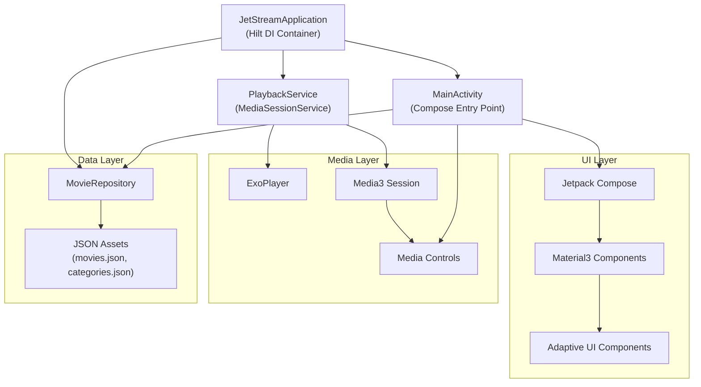

<!-- source: DeepWiki mcp.deepwiki.com · repo android/adaptive-apps-samples · page 1 Overview · fetched 2026-10-23 -->

# Overview

<details>
<summary>Relevant source files</summary>

The following files were used as context for generating this wiki page:

- [AdaptiveJetStream/README.md](AdaptiveJetStream/README.md)
- [AdaptiveJetStream/Screenshots.png](AdaptiveJetStream/Screenshots.png)
- [AdaptiveJetStream/jetstream/src/main/AndroidManifest.xml](AdaptiveJetStream/jetstream/src/main/AndroidManifest.xml)

</details>


## Purpose and Scope

This document provides a high-level overview of the AdaptiveJetStream sample application, which demonstrates cross-platform media streaming with adaptive UI capabilities across multiple Android form factors. This overview covers the application's purpose, key features, architecture, and technology stack.

For detailed information about specific subsystems, see [Architecture](#2) for core components, [User Interface](#3) for adaptive UI implementation, [Performance Optimization](#4) for baseline profiles and benchmarking, and [Build System](#5) for Gradle configuration and dependencies.

## What is AdaptiveJetStream

AdaptiveJetStream is a sample media streaming application designed to demonstrate adaptive user experiences across diverse Android form factors using a single binary. The application showcases how to build modern Android apps that automatically adapt their interface and behavior to different device characteristics while maintaining a cohesive user experience.

The application serves as a practical implementation guide for developers building cross-platform Android applications that need to work seamlessly across mobile devices, tablets, foldables, Chromebooks, Android TV, automotive systems, and XR devices.

**Sources:** [AdaptiveJetStream/README.md:1-15]()

## Key Features and Capabilities

| Feature Category | Capabilities |
|-----------------|-------------|
| **Adaptive UI** | Automatic layout adaptation using Compose Material3 components and window size classes |
| **Media Playback** | Full-featured video streaming using ExoPlayer and Media3 session management |
| **Cross-Platform** | Single binary supporting mobile, tablet, foldable, TV, automotive, and XR form factors |
| **Performance** | Baseline profile optimization for improved startup performance |
| **Modern Architecture** | Jetpack Compose UI with Hilt dependency injection and modern Android patterns |

### Supported Form Factors

AdaptiveJetStream supports the following device categories:

- **Mobile devices** - Phones with touch interfaces
- **Tablets** - Larger touch-enabled devices  
- **Foldable devices** - Devices with flexible or dual screens
- **Chromebooks** - Chrome OS devices with keyboard/mouse input
- **Android TV** - Television devices with D-pad navigation
- **Automotive** - Android Auto and Android Automotive OS
- **XR devices** - Augmented and virtual reality platforms

**Sources:** [AdaptiveJetStream/README.md:5-11](), [AdaptiveJetStream/jetstream/src/main/AndroidManifest.xml:20-42]()

## System Architecture Overview

The following diagram illustrates the high-level system architecture and relationships between major components:

### Core Application Architecture



**Sources:** [AdaptiveJetStream/jetstream/src/main/AndroidManifest.xml:48-96](), [AdaptiveJetStream/README.md:3-4](), [AdaptiveJetStream/README.md:15]()

## Platform Configuration Matrix

The application uses feature declarations and permissions to support different platform capabilities:

| Platform Feature | Required | Purpose |
|------------------|----------|---------|
| `android.software.leanback` | false | Android TV support |
| `android.hardware.touchscreen` | false | Touch input (optional for TV/automotive) |
| `android.hardware.type.automotive` | false | Android Automotive platform |
| `android.hardware.wifi` | false | Network connectivity |
| `android.hardware.screen.portrait` | false | Portrait orientation support |
| `android.hardware.screen.landscape` | false | Landscape orientation support |

### Required Permissions

- `android.permission.INTERNET` - Network access for streaming
- `android.permission.FOREGROUND_SERVICE` - Background media playback
- `android.permission.FOREGROUND_SERVICE_MEDIA_PLAYBACK` - Media-specific foreground service

**Sources:** [AdaptiveJetStream/jetstream/src/main/AndroidManifest.xml:20-46]()

## Core Code Structure

The following diagram maps the application's logical components to specific code entities:

### Code Entity Relationships

```mermaid
graph LR
    subgraph "Application_Layer" ["Application Layer"]
        JetStreamApplication_class["JetStreamApplication<br/>(Application Class)"]
        MainActivity_class["MainActivity<br/>(ComponentActivity)"]
    end
    
    subgraph "Service_Layer" ["Service Layer"] 
        PlaybackService_class["PlaybackService<br/>(MediaSessionService)"]
        MediaSessionService_interface["MediaSessionService<br/>(Interface)"]
        MediaBrowserService_interface["MediaBrowserService<br/>(Interface)"]
    end
    
    subgraph "Intent_Filters" ["Intent System"]
        MAIN_action["android.intent.action.MAIN"]
        LAUNCHER_category["android.intent.category.LAUNCHER"]
        LEANBACK_LAUNCHER_category["android.intent.category.LEANBACK_LAUNCHER"]
        MediaSession_action["androidx.media3.session.MediaSessionService"]
        MediaBrowser_action["android.media.browse.MediaBrowserService"]
    end
    
    subgraph "Resource_System" ["Resource System"]
        app_name["@string/app_name"]
        ic_launcher["@mipmap/ic_launcher"]
        app_banner["@mipmap/app_banner"]
        Theme_App_Starting["@style/Theme.App.Starting"]
    end
    
    JetStreamApplication_class --> MainActivity_class
    JetStreamApplication_class --> PlaybackService_class
    
    MainActivity_class --> MAIN_action
    MainActivity_class --> LAUNCHER_category
    MainActivity_class --> LEANBACK_LAUNCHER_category
    
    PlaybackService_class --> MediaSessionService_interface
    PlaybackService_class --> MediaBrowserService_interface
    PlaybackService_class --> MediaSession_action
    PlaybackService_class --> MediaBrowser_action
    
    MainActivity_class --> Theme_App_Starting
    JetStreamApplication_class --> ic_launcher
    JetStreamApplication_class --> app_banner
    JetStreamApplication_class --> app_name
```

**Sources:** [AdaptiveJetStream/jetstream/src/main/AndroidManifest.xml:49-96]()

## Technology Stack

AdaptiveJetStream leverages modern Android development technologies and libraries:

### Core Technologies

- **UI Framework**: Jetpack Compose with Material3 adaptive components
- **Dependency Injection**: Hilt for dependency management  
- **Media Playback**: Media3 ExoPlayer with session management
- **Performance**: Baseline profiles for optimized app startup
- **Architecture**: Repository pattern with modern Android architecture components

### Development Tools

- **Build System**: Gradle with Kotlin DSL
- **Code Quality**: Spotless formatting with ktlint rules
- **Testing**: Macrobenchmark library for performance testing
- **Profiling**: Baseline profile generation and validation

### Cross-Platform Support

The application demonstrates adaptive design patterns using:
- Window size classes for responsive layouts
- Material3 adaptive navigation components
- Platform-specific optimizations for TV, automotive, and XR

**Sources:** [AdaptiveJetStream/README.md:15](), [AdaptiveJetStream/README.md:23-29](), [AdaptiveJetStream/jetstream/src/main/AndroidManifest.xml:61-64]()

---

