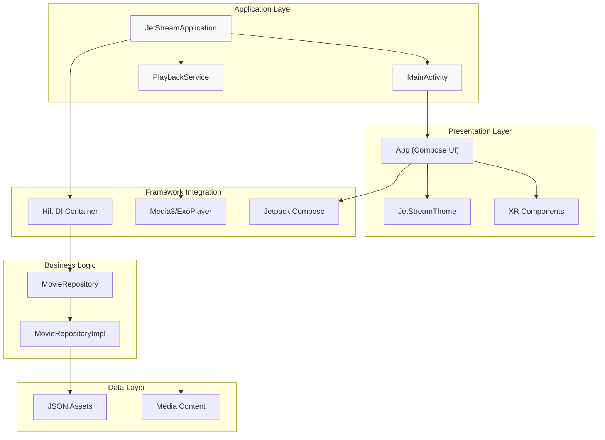
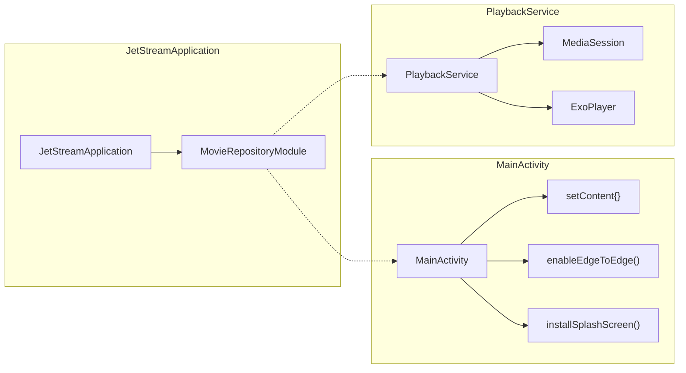
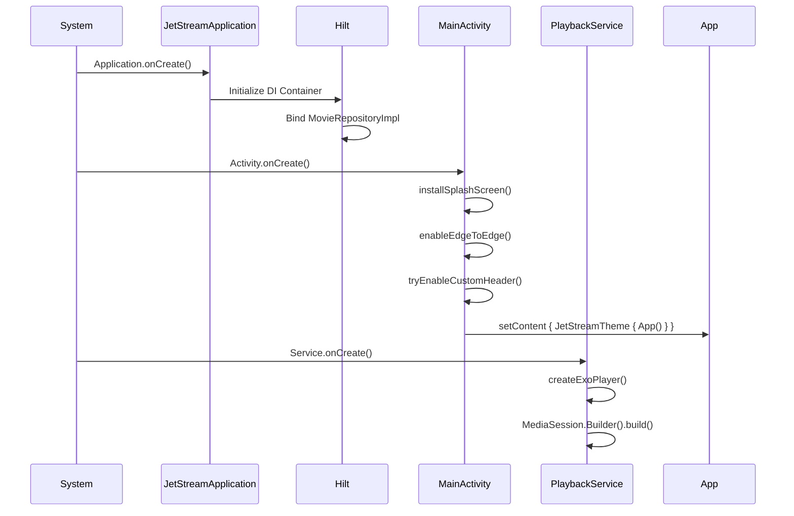
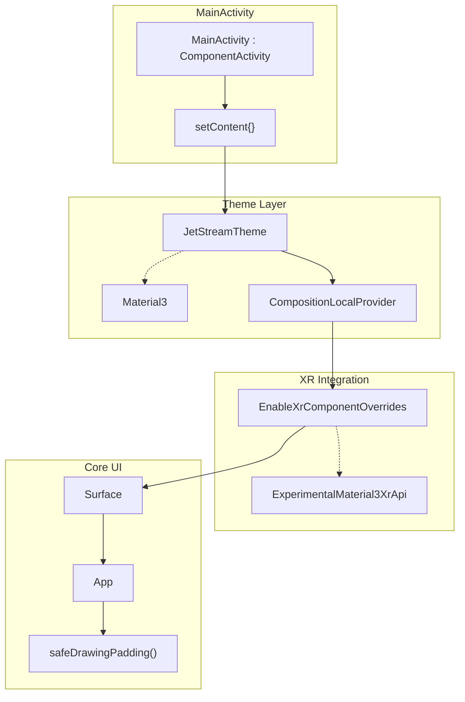
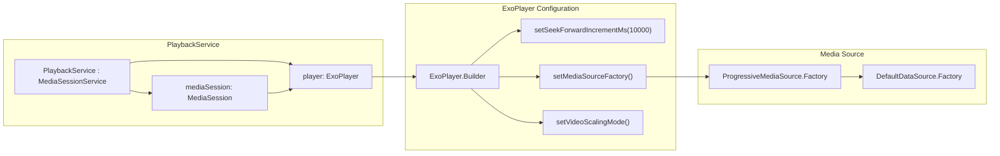

<!-- source: DeepWiki mcp.deepwiki.com · repo android/adaptive-apps-samples · page 2 Architecture · fetched 2026-10-23 -->

# Architecture

Relevant source files

The following files were used as context for generating this wiki page:

- [AdaptiveJetStream/jetstream/src/main/java/com/google/jetstream/JetStreamApplication.kt](AdaptiveJetStream/jetstream/src/main/java/com/google/jetstream/JetStreamApplication.kt)
- [AdaptiveJetStream/jetstream/src/main/java/com/google/jetstream/MainActivity.kt](AdaptiveJetStream/jetstream/src/main/java/com/google/jetstream/MainActivity.kt)
- [AdaptiveJetStream/jetstream/src/main/java/com/google/jetstream/PlaybackService.kt](AdaptiveJetStream/jetstream/src/main/java/com/google/jetstream/PlaybackService.kt)

This document provides an overview of the AdaptiveJetStream application's core architecture, including its primary components, design patterns, and system interactions. It covers the high-level structure and relationships between major subsystems.

For detailed information about specific subsystems, see [Application Structure](#2.1), [Media Playback System](#2.2), and [Data Layer](#2.3). For UI implementation details, see [User Interface](#3). For performance optimization strategies, see [Performance Optimization](#4).

## Architecture Overview

AdaptiveJetStream is built as a modern Android application designed for cross-platform media streaming with adaptive UI capabilities. The architecture follows clean architecture principles with clear separation of concerns across presentation, business logic, and data layers.

**Sources:** [AdaptiveJetStream/jetstream/src/main/java/com/google/jetstream/JetStreamApplication.kt:1-40](), [AdaptiveJetStream/jetstream/src/main/java/com/google/jetstream/MainActivity.kt:1-265](), [AdaptiveJetStream/jetstream/src/main/java/com/google/jetstream/PlaybackService.kt:1-68]()

## Core Components

The application consists of three primary components that form the foundation of the system architecture:

**Sources:** [AdaptiveJetStream/jetstream/src/main/java/com/google/jetstream/JetStreamApplication.kt:28-39](), [AdaptiveJetStream/jetstream/src/main/java/com/google/jetstream/MainActivity.kt:49-82](), [AdaptiveJetStream/jetstream/src/main/java/com/google/jetstream/PlaybackService.kt:29-67]()

## Application Initialization Flow

The application follows a structured initialization sequence that sets up dependency injection, UI theming, and media services:

**Sources:** [AdaptiveJetStream/jetstream/src/main/java/com/google/jetstream/JetStreamApplication.kt:28-29](), [AdaptiveJetStream/jetstream/src/main/java/com/google/jetstream/MainActivity.kt:53-82](), [AdaptiveJetStream/jetstream/src/main/java/com/google/jetstream/PlaybackService.kt:32-37]()

## Dependency Injection Architecture

The application uses Hilt for dependency injection with a clean module structure:

| Component | Responsibility | Scope |
|-----------|---------------|-------|
| `JetStreamApplication` | Application-level DI container | Singleton |
| `MovieRepositoryModule` | Provides repository implementations | Singleton |
| `MovieRepository` | Abstract repository interface | Singleton |
| `MovieRepositoryImpl` | Concrete repository implementation | Singleton |

The dependency graph is established through the `@HiltAndroidApp` annotation on `JetStreamApplication` and the `@Module` annotation on `MovieRepositoryModule`. The module uses `@Binds` to map the concrete `MovieRepositoryImpl` to the abstract `MovieRepository` interface.

**Sources:** [AdaptiveJetStream/jetstream/src/main/java/com/google/jetstream/JetStreamApplication.kt:25-39]()

## UI Framework Integration

The application integrates multiple UI frameworks to support adaptive and cross-platform experiences:

The `MainActivity` sets up the UI framework stack with XR component overrides enabled through the `@OptIn(ExperimentalMaterial3XrApi::class)` annotation. The UI uses edge-to-edge display with safe drawing padding for modern Android design guidelines.

**Sources:** [AdaptiveJetStream/jetstream/src/main/java/com/google/jetstream/MainActivity.kt:42-82]()

## Media Playback Architecture

The media playback system is built around Android's Media3 framework with ExoPlayer:

The `PlaybackService` extends `MediaSessionService` and creates an `ExoPlayer` instance with specific configurations including 10-second seek increments, progressive media source factory, and scale-to-fit-with-cropping video scaling mode. The service manages the lifecycle of both the `MediaSession` and `ExoPlayer` instances.

**Sources:** [AdaptiveJetStream/jetstream/src/main/java/com/google/jetstream/PlaybackService.kt:29-67]()

## Design Patterns

The architecture employs several key design patterns:

- **Dependency Injection**: Hilt provides compile-time dependency resolution
- **Repository Pattern**: `MovieRepository` abstracts data access
- **Service Pattern**: `PlaybackService` handles background media operations
- **Component Architecture**: Compose UI components with clear separation of concerns
- **Builder Pattern**: ExoPlayer configuration through builder pattern

The application supports advanced features including custom window headers for freeform window management, comprehensive keyboard shortcuts for navigation and media control, and XR component integration for extended reality experiences.

**Sources:** [AdaptiveJetStream/jetstream/src/main/java/com/google/jetstream/MainActivity.kt:92-117](), [AdaptiveJetStream/jetstream/src/main/java/com/google/jetstream/MainActivity.kt:119-263]()

---

