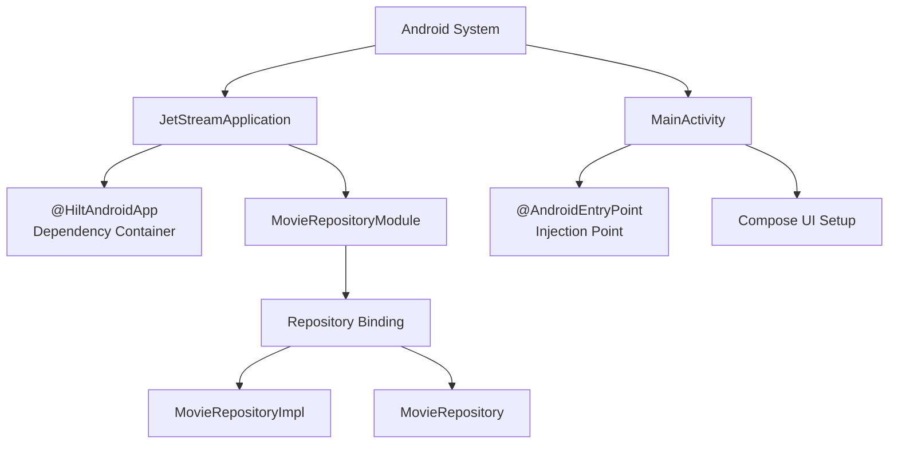
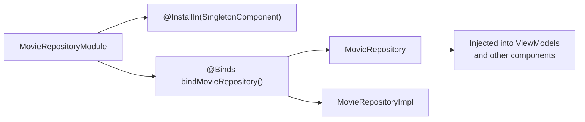
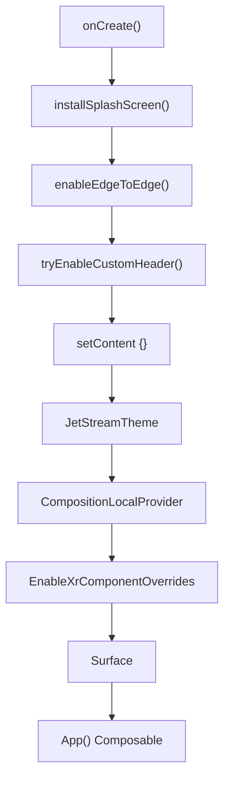
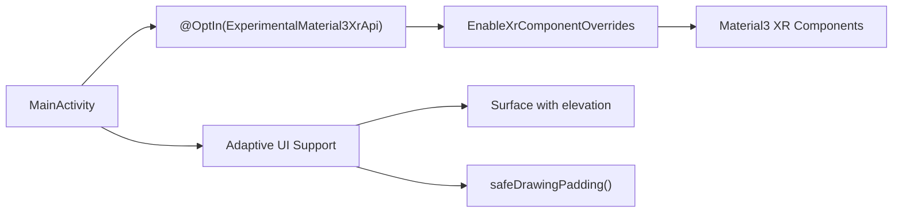
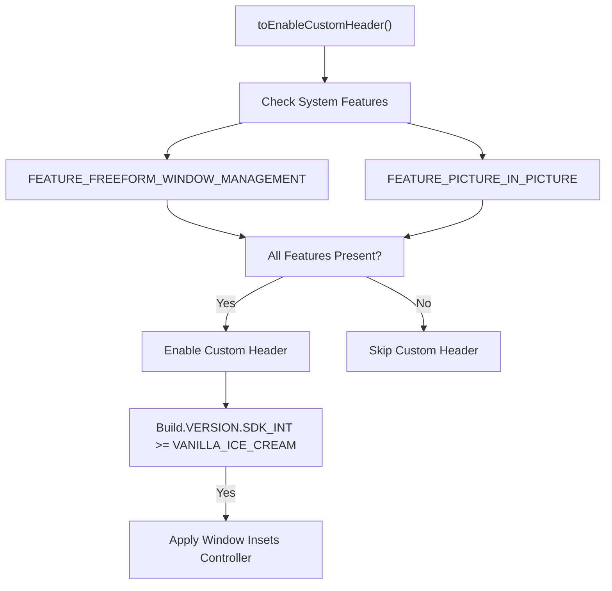

<!-- source: DeepWiki mcp.deepwiki.com · repo android/adaptive-apps-samples · page 2.1 Application Structure · fetched 2026-10-23 -->

# Application Structure

Relevant source files

The following files were used as context for generating this wiki page:

- [AdaptiveJetStream/jetstream/src/main/java/com/google/jetstream/JetStreamApplication.kt](AdaptiveJetStream/jetstream/src/main/java/com/google/jetstream/JetStreamApplication.kt)
- [AdaptiveJetStream/jetstream/src/main/java/com/google/jetstream/MainActivity.kt](AdaptiveJetStream/jetstream/src/main/java/com/google/jetstream/MainActivity.kt)

This document details the core application structure of AdaptiveJetStream, including the main application class, dependency injection configuration, and primary activity setup. It covers the initialization flow, Hilt integration, and Compose UI bootstrap process.

For information about the media playback architecture, see [Media Playback System](#2.2). For details about the data layer and repository pattern, see [Data Layer](#2.3).

## Overview

The AdaptiveJetStream application follows a standard Android architecture with modern frameworks. The application structure consists of three primary components:

- **JetStreamApplication**: The main Application class that initializes dependency injection
- **MainActivity**: The single activity that hosts the entire Compose UI
- **Hilt Module Configuration**: Dependency injection setup for core services

## Application Entry Point

The application initialization begins with the `JetStreamApplication` class, which serves as the Hilt dependency injection container for the entire application.

Sources: [AdaptiveJetStream/jetstream/src/main/java/com/google/jetstream/JetStreamApplication.kt:28-29](), [AdaptiveJetStream/jetstream/src/main/java/com/google/jetstream/MainActivity.kt:49-50]()

### JetStreamApplication Class

The `JetStreamApplication` class is minimal and focused solely on enabling Hilt dependency injection:

| Component | Purpose | Implementation |
|-----------|---------|----------------|
| `@HiltAndroidApp` | Enables Hilt DI | Applied at class level |
| Application inheritance | Android app lifecycle | Extends `Application` |
| Module inclusion | Repository binding | `MovieRepositoryModule` |

The application class registers the `MovieRepositoryModule` which provides the core data access abstraction used throughout the app.

Sources: [AdaptiveJetStream/jetstream/src/main/java/com/google/jetstream/JetStreamApplication.kt:28-29]()

## Dependency Injection Configuration

The Hilt module configuration defines how core dependencies are resolved and injected throughout the application.

Sources: [AdaptiveJetStream/jetstream/src/main/java/com/google/jetstream/JetStreamApplication.kt:31-39]()

### Module Structure

The `MovieRepositoryModule` uses the following Hilt annotations:

- `@InstallIn(SingletonComponent::class)`: Installs the module in the application-wide singleton scope
- `@Binds`: Creates a binding from the implementation to the interface
- Abstract class structure: Allows Hilt to generate the binding code efficiently

This pattern ensures that `MovieRepository` instances are provided as singletons throughout the application lifecycle.

Sources: [AdaptiveJetStream/jetstream/src/main/java/com/google/jetstream/JetStreamApplication.kt:31-39]()

## MainActivity Structure

The `MainActivity` serves as the single entry point for the user interface, hosting the entire Compose-based application.

### Activity Initialization Flow

Sources: [AdaptiveJetStream/jetstream/src/main/java/com/google/jetstream/MainActivity.kt:53-82]()

### UI Framework Configuration

The activity configures multiple UI framework layers:

| Layer | Purpose | Implementation |
|-------|---------|----------------|
| Edge-to-edge | Modern display usage | `enableEdgeToEdge()` |
| Splash screen | App launch experience | `installSplashScreen()` |
| Custom header | Desktop window integration | `tryEnableCustomHeader()` |
| Material Theme | Design system | `JetStreamTheme` |
| XR Support | Extended reality | `EnableXrComponentOverrides` |
| Content color | Theme consistency | `CompositionLocalProvider` |

Sources: [AdaptiveJetStream/jetstream/src/main/java/com/google/jetstream/MainActivity.kt:54-58](), [AdaptiveJetStream/jetstream/src/main/java/com/google/jetstream/MainActivity.kt:60-81]()

## XR and Adaptive UI Integration

The application includes experimental XR support through Material3 XR APIs:

Sources: [AdaptiveJetStream/jetstream/src/main/java/com/google/jetstream/MainActivity.kt:52](), [AdaptiveJetStream/jetstream/src/main/java/com/google/jetstream/MainActivity.kt:64-78]()

## Keyboard Shortcuts System

The activity implements comprehensive keyboard shortcuts for navigation and media playback control.

### Shortcut Categories

| Category | Shortcuts | Key Combinations |
|----------|-----------|------------------|
| General Navigation | Home, Movies, Shows, etc. | `Ctrl+Alt+H`, `Ctrl+Alt+M`, etc. |
| Video Playback | Play/pause, seek, fullscreen | `K`, `J`, `L`, `F` |
| Spatial Video | Pan, zoom controls | `W`, `A`, `S`, `D`, `+`, `-` |
| Dialog Control | Close dialogs, scroll | `Escape`, `Page Up/Down` |

The keyboard shortcuts are defined in the `keyboardShortcuts` lazy property and provided through the `onProvideKeyboardShortcuts()` callback.

Sources: [AdaptiveJetStream/jetstream/src/main/java/com/google/jetstream/MainActivity.kt:84-90](), [AdaptiveJetStream/jetstream/src/main/java/com/google/jetstream/MainActivity.kt:119-263]()

## Platform Feature Detection

The activity includes adaptive behavior based on device capabilities:

Sources: [AdaptiveJetStream/jetstream/src/main/java/com/google/jetstream/MainActivity.kt:92-117]()

This feature detection ensures that desktop-specific UI enhancements like transparent caption bars are only enabled on compatible platforms.

## Application Lifecycle Integration

The application structure integrates with Android's component lifecycle through several mechanisms:

- **Hilt Integration**: Automatic dependency injection tied to component lifecycles
- **Splash Screen**: Managed through the AndroidX SplashScreen API
- **Back Press Handling**: Delegated to the `onBackPressedDispatcher`
- **Configuration Changes**: Handled automatically by Compose and Activity

Sources: [AdaptiveJetStream/jetstream/src/main/java/com/google/jetstream/MainActivity.kt:67](), [AdaptiveJetStream/jetstream/src/main/java/com/google/jetstream/MainActivity.kt:54]()

---

