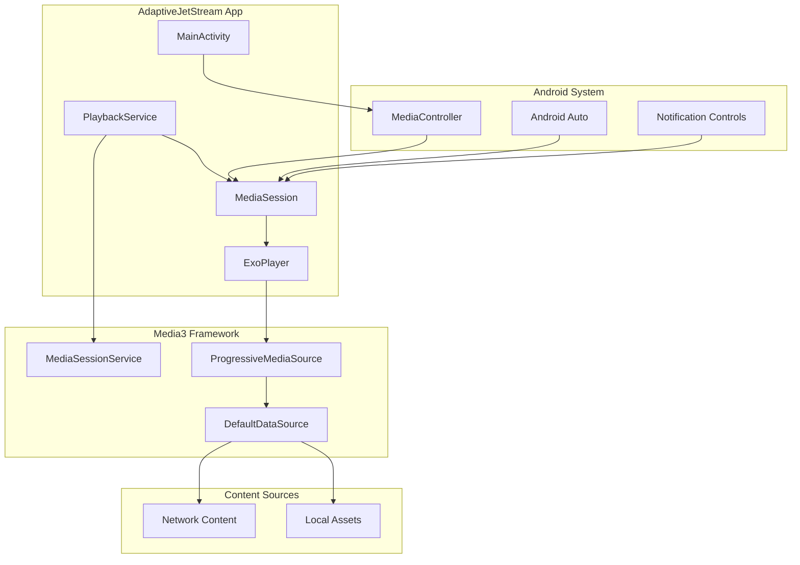
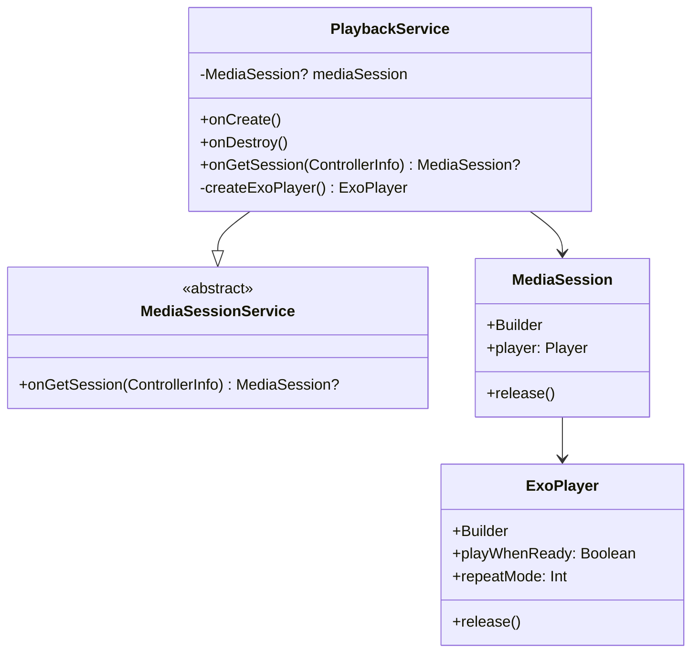
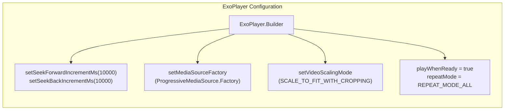
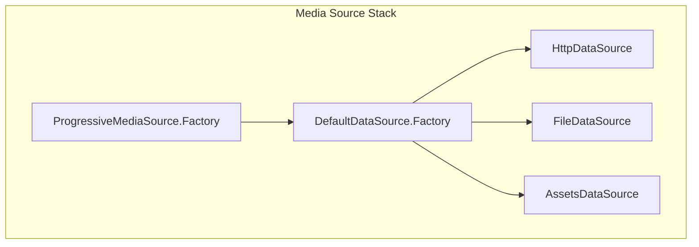
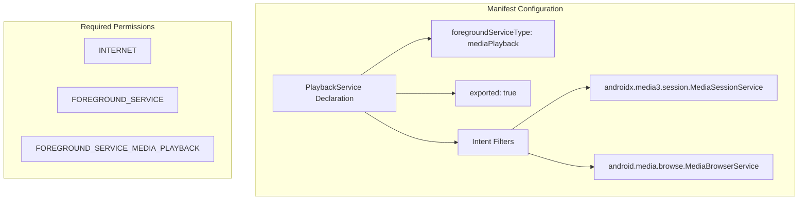

<!-- source: DeepWiki mcp.deepwiki.com · repo android/adaptive-apps-samples · page 2.2 Media Playback System · fetched 2026-10-23 -->

# Media Playback System

Relevant source files

The following files were used as context for generating this wiki page:

- [AdaptiveJetStream/jetstream/src/main/AndroidManifest.xml](AdaptiveJetStream/jetstream/src/main/AndroidManifest.xml)
- [AdaptiveJetStream/jetstream/src/main/java/com/google/jetstream/PlaybackService.kt](AdaptiveJetStream/jetstream/src/main/java/com/google/jetstream/PlaybackService.kt)

## Purpose and Scope

This document covers the media playback architecture of the AdaptiveJetStream application, focusing on the `PlaybackService` implementation and its integration with Android's Media3 framework. The system provides background media playback capabilities with external controller support for Android Auto, TV remotes, and other media control interfaces.

For information about the data structures that feed content to this playback system, see [Data Layer](#2.3). For details about the UI components that interact with media playback, see [User Interface](#3).

## Architecture Overview

The media playback system is built around Android's Media3 framework, specifically using `MediaSessionService` and `ExoPlayer` as core components. The architecture follows the recommended pattern for background media playback on Android.

### Media Playback Service Architecture

**Sources:** [AdaptiveJetStream/jetstream/src/main/java/com/google/jetstream/PlaybackService.kt:29-67](), [AdaptiveJetStream/jetstream/src/main/AndroidManifest.xml:88-96]()

## Service Implementation

### PlaybackService Class Structure

The `PlaybackService` extends `MediaSessionService` and manages the lifecycle of media playback sessions. The service maintains a single `MediaSession` instance that controls an `ExoPlayer`.

**Sources:** [AdaptiveJetStream/jetstream/src/main/java/com/google/jetstream/PlaybackService.kt:29-50]()

### Service Lifecycle Management

The service follows a standard lifecycle pattern:

| Lifecycle Method | Responsibilities |
|------------------|------------------|
| `onCreate()` | Creates `ExoPlayer` instance and wraps it in `MediaSession` |
| `onDestroy()` | Releases player resources and clears session reference |
| `onGetSession()` | Returns the active `MediaSession` to requesting controllers |

**Sources:** [AdaptiveJetStream/jetstream/src/main/java/com/google/jetstream/PlaybackService.kt:32-50]()

## ExoPlayer Configuration

### Player Builder Configuration

The `createExoPlayer()` method configures `ExoPlayer` with specific settings optimized for the streaming media use case:

**Sources:** [AdaptiveJetStream/jetstream/src/main/java/com/google/jetstream/PlaybackService.kt:53-66]()

### Configuration Details

| Configuration | Value | Purpose |
|---------------|-------|---------|
| `setSeekForwardIncrementMs` | 10000 | 10-second forward seek increments |
| `setSeekBackIncrementMs` | 10000 | 10-second backward seek increments |
| `setVideoScalingMode` | `C.VIDEO_SCALING_MODE_SCALE_TO_FIT_WITH_CROPPING` | Optimized video scaling for different screen sizes |
| `playWhenReady` | `true` | Automatic playback when media is loaded |
| `repeatMode` | `Player.REPEAT_MODE_ALL` | Continuous playback loop |

**Sources:** [AdaptiveJetStream/jetstream/src/main/java/com/google/jetstream/PlaybackService.kt:55-65]()

## Media Source Factory Configuration

The player uses a `ProgressiveMediaSource.Factory` with a `DefaultDataSource.Factory` to handle various content sources including network streams and local assets.

**Sources:** [AdaptiveJetStream/jetstream/src/main/java/com/google/jetstream/PlaybackService.kt:57-59]()

## Service Declaration and Permissions

### Manifest Configuration

The service is declared in the Android manifest with specific foreground service type and intent filters:

**Sources:** [AdaptiveJetStream/jetstream/src/main/AndroidManifest.xml:44-46](), [AdaptiveJetStream/jetstream/src/main/AndroidManifest.xml:88-96]()

### Hardware Feature Support

The manifest declares optional support for various hardware features to enable cross-platform compatibility:

| Feature | Required | Purpose |
|---------|----------|---------|
| `android.software.leanback` | false | Android TV support |
| `android.hardware.touchscreen` | false | Non-touch device support |
| `android.hardware.type.automotive` | false | Android Automotive integration |
| `android.hardware.wifi` | false | Network connectivity flexibility |

**Sources:** [AdaptiveJetStream/jetstream/src/main/AndroidManifest.xml:20-43]()

## External Integration Points

The media playback system supports external control through the `MediaSession` interface, enabling integration with:

- **Android Auto**: Automotive dashboard controls
- **Notification Controls**: System notification media controls  
- **TV Remote Controls**: D-pad and media key navigation
- **External Media Controllers**: Third-party apps and accessories

The service's exported nature and standard intent filters allow these external systems to discover and control playback through the Android media framework.

**Sources:** [AdaptiveJetStream/jetstream/src/main/AndroidManifest.xml:88-96](), [AdaptiveJetStream/jetstream/src/main/java/com/google/jetstream/PlaybackService.kt:48-50]()

---

